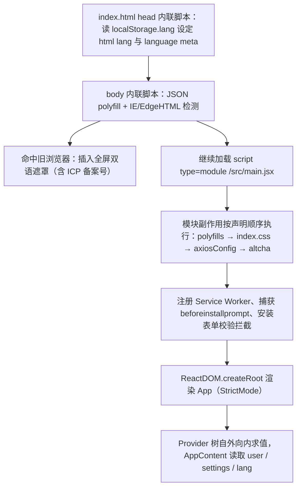
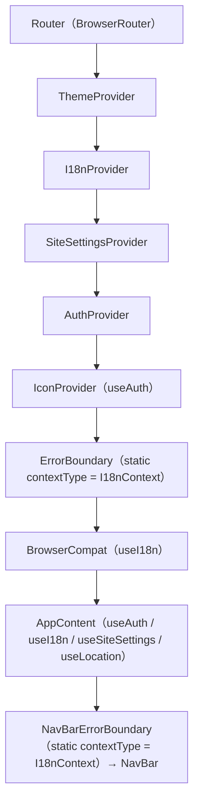
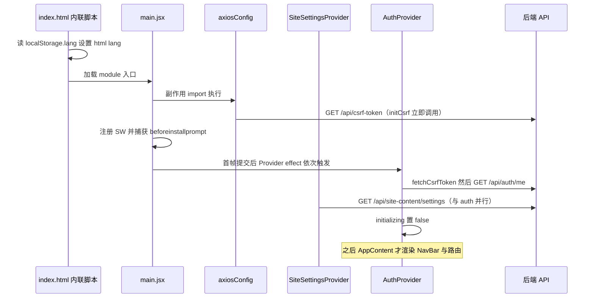

# 启动链与全局 Provider 树

前端没有服务端渲染，也没有路由级数据加载器：一次页面加载的可见行为几乎全部由「三段启动代码」决定——`index.html` 里的两段内联脚本、`src/main.jsx` 的模块级副作用、`src/App.jsx` 的 Provider 嵌套。理解这条链是安全修改任何全局行为（语言、CSRF、主题、错误兜底、PWA）的前提；其余全局状态机制见[架构总览](./overview.md)与[状态与持久化](./state-and-persistence.md)。

## 启动顺序总览



上图是浏览器实际观测到的执行顺序；下面按阶段展开每段的副作用与失败语义。

## 阶段一：index.html 的早期脚本

`index.html` 承担了三件 React 无法承担的事，因为它们必须在任何打包产物下载之前完成。

**早期语言检测。** 文档静态声明为 `lang="zh-CN"`，但 head 里一段同步内联脚本会在解析期读取 `localStorage.lang`（只接受 `zh` / `en`），否则按 `navigator.language` 是否以 `en` 开头决定，回退 `zh`；随后把 `document.documentElement.lang` 与 `meta[http-equiv="content-language"]`、`meta[name="language"]` 统一写成完整 locale（`zh-CN` / `en-US`）。目的是让浏览器翻译、拼写检查、无障碍服务在初始加载时就能正确识别页面语言，而不是等 React 挂载后再改（那时浏览器已做完首次语言判定）。这也是为什么切换语言走的是「写 localStorage 后整页 reload」而不是纯状态更新，详见[国际化与翻译](../systems/i18n-and-translation.md)。脚本整体包在 `try/catch` 里，隐私模式下 localStorage 抛错也不会阻断启动。`<noscript>` 刻意写成中英双语，避免浏览器通过纯中文内容误判语言。

**旧浏览器兜底遮罩。** body 末尾第二段内联脚本刻意只用 ES5：先给缺 `JSON` 的环境补一个 `parse`/`stringify`，再用 UA 判定 `MSIE|Trident`（IE）与 `Edge/\d+` 且非 `Edg/`（EdgeHTML 旧 Edge）；命中就构造一个 `z-index: 2147483647` 的全屏遮罩，内置中英双语字典、语言切换按钮（写回 `localStorage.lang` 并重绘）与浏览器下载入口，并通过 XHR（IE 下回退 `ActiveXObject`）请求 `/api/site-content/about` 取 ICP 备案号，写入 `localStorage._icp` 供后续复用。注意它并不能真正「中止」启动：对 IE 起作用只是因为 IE 不执行 `type="module"`；旧 Edge 可能会照样加载并挂载 React，只是被遮罩盖住。真正的第二道闸门是 React 层里的 `BrowserCompat`。

**CSP。** head 里的 `Content-Security-Policy` meta 是这份前端唯一的运行期安全策略：`script-src 'self' 'unsafe-inline' blob:`（内联早期脚本与 `blob:` 依赖 `'unsafe-inline'` / `blob:`）、`style-src 'self' 'unsafe-inline' fonts.googleapis.com`、`img-src 'self' data: blob:`、`font-src 'self' fonts.gstatic.com`、`connect-src 'self'` 加上三家翻译 API、`frame-src 'self'` 加上 B 站 / YouTube / niconico 播放器、`object-src 'none'`。这意味着新增任何第三方资源都要同步改这条 meta：新的翻译/接口域名要加进 `connect-src`，新的播放器域名要加进 `frame-src`，而外部站点的图片（例如页脚引用 `https://www.beian.gov.cn/img/ghs.png` 的公安备案图标）不在 `img-src` 白名单内，会被直接拦截。

## 阶段二：main.jsx 的模块级副作用

`src/main.jsx` 只做装配，不渲染任何业务逻辑，但它的 import 顺序本身就是语义。

```
React / ReactDOM → App → './utils/polyfills' → './index.css'
                → './utils/axiosConfig' → 'altcha'
```

后面的副作用依次是：

1. **polyfills**：`src/utils/polyfills.js` 只补 ES2019–ES2020 缺口（`Object.fromEntries`、`Promise.allSettled`、`Array.prototype.flat/flatMap`、`String.prototype.matchAll`、`globalThis`）。构建目标是 `es2019`（`vite.config.js`），即语法会被降级、但 API 不会被打补丁，所以缺失的运行时 API 必须手工补齐；它排在 axios 之前执行是必要的，axios 与后续 SDK 都依赖 `Promise`。
2. **axiosConfig 是副作用导入，不可移除**：`import './utils/axiosConfig'` 没有任何具名导入，模块顶层即设置 `axios.defaults.timeout = 15000`、`withCredentials = true`，立刻调用 `initCsrf()` 发起 `GET /api/csrf-token`，并注册请求/响应拦截器：非 GET 请求等待 `csrfReady` 并带 `X-XSRF-TOKEN`、419 与 401 触发双 token 刷新并排队重试、403 + `forceEmailChange` 打标、5xx 派发自定义事件 `api-error`。删掉或挪进懒加载 chunk 会同时失去 CSRF 注入、自动刷新、401 跳登录，以及 `AppContent` 里那条红色错误提示。请求细节见[状态与持久化](./state-and-persistence.md)。
3. **`import 'altcha'` 注册 Web Component**：`altcha` 只在被导入时注册 `<altcha-widget>` 自定义元素，而使用它的表单（`Login`、`Register`、`VerifyEmail`、`FriendLinks`）全部位于懒加载路由里，因此必须在这里提前注册，不能等路由 chunk。
4. **Service Worker 注册**：仅在 `'serviceWorker' in navigator` 时动态 `import('virtual:pwa-register')` 再 `registerSW({ onOfflineReady })`。动态导入把注册逻辑隔离在独立 chunk；`vite.config.js` 用 `registerType: 'autoUpdate'`，因此没有「有新版本，请点击更新」的 UI，新 SW 在下次加载时接管，`onOfflineReady` 只打一条 console 日志；`devOptions.enabled: false` 意味着开发环境根本没有 SW。缓存策略与离线队列见[PWA、离线与兼容性](../systems/pwa-offline-and-compat.md)。
5. **`beforeinstallprompt` 提前捕获**：React 挂载前该事件就可能触发，一旦错过就无法再次唤起安装提示。这里全局 `preventDefault()` 后把事件存到 `window.__pwaDeferredPrompt`，并派发 `pwa-install-available` 自定义事件；`InstallPrompt` 挂载时先读全局变量、再订阅事件，两路兜底，安装成功后会把全局变量清空。
6. **原生表单校验提示拦截**：文档级 `invalid` 监听（capture 阶段）`preventDefault()` 掉浏览器的原生气泡，改从内置的 `VALIDATION_MSG_MAP`（`valueMissing` / `typeMismatch`(email/url/default) / `tooShort` / `patternMismatch`，中英两份）取文案，语言取自 `document.documentElement.lang` 前缀而非 React i18n；随后 `setCustomValidity(msg)` 让元素保持 `:invalid` 样式，并在元素后面插入 `<span class="validation-msg">`（样式见 `index.css` 的 `.validation-msg`）。`input` 监听用 `requestAnimationFrame` 合并高频输入，清 `customValidity` 并移除提示。两个隐含耦合：提示依赖 `nextElementSibling` 的 DOM 结构，且这套文案表是独立于 `src/locales/` 的第二套字典，新增约束类型需要两处同时补。

`main.jsx` 末尾用 `createRoot(...).render(<React.StrictMode><App /></React.StrictMode>)`。StrictMode 会在开发环境双挂载 effect，这也是 `AuthContext` / `IconContext` 普遍使用 `AbortController`、`SiteSettingsContext` 用 ref 守卫重复拉取的原因。

## 阶段三：App.jsx 的 Provider 嵌套



每层的职责边界与顺序约束：

| 层 | 提供什么 | 为什么必须在这个位置 |
| --- | --- | --- |
| `Router` | 路由上下文 | 最外层：`AppContent` 用 `useLocation`，错误兜底里还会渲染 `<Link>` |
| `ThemeProvider` | 主题模式、accent 色、CSS 变量 | 不消费任何其他 context，只读写 `localStorage` 与 `document.documentElement`，可放最外 |
| `I18nProvider` | `lang` / `t` / `switchLang` | 所有文案消费方、两个 class 错误边界的 `contextType`、`BrowserCompat` 都在其内 |
| `SiteSettingsProvider` | 运行时站点配置（localStorage 缓存 30 分钟） | 顶层设置消费方（NavBar、Home、页脚、`AppContent` 的标题/manifest 副作用）需要它 |
| `AuthProvider` | `user` / `initializing` / `login` / `logout` / `updateUser` | `IconProvider` 与 `AppContent` 都用 `useAuth()`；放在 `SiteSettingsProvider` 内侧是既有约定 |
| `IconProvider` | 图标映射 + 主题图标覆盖 | **硬约束**：内部直接调用 `useAuth()`，移到 `AuthProvider` 外面会立刻抛 "useAuth 必须在 AuthProvider 内使用" |
| `ErrorBoundary` | 渲染期错误兜底 | 必须包住所有可能崩溃的 UI，但又必须在 `I18nProvider` 之内才能拿到 `t` |
| `BrowserCompat` | 兼容性闸门 | 用在 `useI18n`；不兼容时直接替换掉子树 |

调整嵌套顺序会直接改变「谁先拿到 `user` / `settings` / `lang`」以及每个 Provider 的重渲染范围：例如把 `SiteSettingsProvider` 挪进 `AuthProvider` 内侧，站点配置的消费方会多受一次 auth 状态变化影响；把 `ErrorBoundary` 提到 `I18nProvider` 之外，兜底页会退化成打印 key（`this.context` 为 `undefined` 时的 fallback `t`）；把 `ThemeProvider` 挪到内层则会让 `IconProvider` 等更早渲染的节点先经历一次无主题变量的提交。**改序前先确认目标 Provider 的 hook 依赖和兜底渲染是否仍被满足。**

另外两个与顺序相关的首帧事实：`AppContent` 在 `initializing` 为真时只渲染 `t('common.loading')` 文案，而 `initializing` 要等 `AuthProvider` 的 `fetchCsrfToken()` + `GET /api/auth/me` 完成后才置假，所以任何页面的第一帧都是这段加载文案，NavBar 与路由内容都在其后。颜色类 CSS token 只由 `ThemeProvider` 的 effect 写入 `document.documentElement`（`index.css` 的 `:root` 只声明间距、圆角、字号、阴影、动效与 z-index），因此首次提交到 effect 执行之间存在一个 没有颜色变量的窗口，组件必须依赖 `var(--token, fallback)` 的回退值。



该时序图刻画首屏网络请求的发生顺序：CSRF 早于 React，站点配置与鉴权并行。

## 两层 ErrorBoundary 的失败表现

两个边界都是 class 组件，`getDerivedStateFromError` 只置 `hasError`，兜底 UI 都在 `render` 里内联写死：

- **`ErrorBoundary`**（包住 `BrowserCompat` 与 `AppContent`）兜底是一块居中文案：标题取 `t('common.pageLoadError')`，正文在生产构建里是同一句通用文案、在开发环境才显示 `error.message`，按钮先 `setState({ hasError: false, error: null })` 再 `window.location.reload()`。它能接住子树在渲染与生命周期里抛出的同步错误；**接不住**事件处理器、Promise 异步失败，也接不住它上层的 `ThemeProvider` / `I18nProvider` / `SiteSettingsProvider` / `AuthProvider` / `IconProvider` 渲染时抛出的错误——那些错误没有边界，表现为白屏。
- **`NavBarErrorBoundary`**（只包 `NavBar`）兜底是一个极简 header：品牌 `<Link to="/">`（文案复用 `admin.brand`）加刷新按钮。它存在的意义是隔离导航栏这块依赖最多的组件（`useAuth` + `useI18n` + `useSiteSettings` + 图标 + 通知 hook），使导航栏崩溃时页面主体、路由与页脚仍可正常渲染与导航。

**遗留模式（勿改）：** 两者都用 `static contextType = I18nContext` 读取翻译，而不是 hooks——这是仓库里唯一保留的 class 组件读取 context 的方式，`AGENTS.md` 也明确要求不要转换成 hooks。相关约束：它们必须留在 `I18nProvider` 内部；`I18nContext` 必须以具名导出形式存在（不提供 default export，以兼容 Fast Refresh）；并且 `I18nContext.jsx` 会通过 `import.meta.hot.data` 在热更新间复用同一个 context 对象，正是为了避免「旧 Provider / 新 Consumer 不匹配导致 `this.context` 为 `undefined`」的崩溃——class 的 `contextType` 在类定义时就绑定了 context 引用，这类崩溃只能靠稳定 context 身份来消除。

`App.jsx` 模块作用域还会注册一个 `unhandledrejection` 监听，仅把原因打进 console；它不改变任何 UI 状态，因此异步失败最终仍由各组件自己的错误提示或 `api-error` 事件呈现。

## 阶段四：BrowserCompat 闸门

`BrowserCompat` 是 React 层的兼容性闸门，与 `index.html` 的原生遮罩构成「双重防线」。它在 effect 中执行 `checkCompatibility()`：

1. UA 判定：IE、EdgeHTML 旧 Edge、Chrome < 60、Firefox < 55、Safari < 12；
2. 特性判定：缺 `Promise`、`fetch`、`IntersectionObserver`、`ResizeObserver`、`Object.assign`、`Array.from`；
3. CSS 变量判定：用元素 `style.setProperty('--test-var', '0')` 读回，刻意不用 `CSS.supports('--a','0')`（Safari 对自定义属性有 bug 会误判）。

判定不兼容且用户未选择「继续访问」时，`BrowserCompat` **不渲染 children**，而是渲染全屏 `IncompatibleOverlay`——此时 `AppContent` 根本没挂载，任何鉴权、站点配置、壁纸请求都不会发出。遮罩里的语言切换走 `switchLang`（写 localStorage 后整页 reload），ICP 备案号同样从 `/api/site-content/about` 拉取并回填 `localStorage._icp`。点「继续访问」后子树正常渲染，60 秒后弹出反馈对话框；选「正常」会把 `browserCompat_bypass_<UA 哈希>` 写成 `ok`，下次启动在检测之前就直接视为兼容。

## 不变量与安全修改清单

1. `main.jsx` 里 `import './utils/axiosConfig'` 是**副作用导入，不可移除、不可下移进懒加载 chunk**；它必须在任何 Provider effect 发请求之前执行。
2. Provider 顺序保持 `Router → Theme → I18n → SiteSettings → Auth → Icon → ErrorBoundary → BrowserCompat → AppContent`。新增 Provider 时按 hook 依赖插入：用 `useAuth()` 的必须在 `AuthProvider` 内，用 `useI18n()` 或 `static contextType = I18nContext` 的必须在 `I18nProvider` 内，不要在 `IconProvider` 之上换掉 `AuthProvider`。
3. `ErrorBoundary` 与 `NavBarErrorBoundary` 保持 class + `static contextType = I18nContext` 的遗留写法，并保留 `I18nContext` 的具名导出与 HMR 身份复用。
4. 早期内联脚本必须维持 ES5 且不新增外链依赖；CSP meta 是白名单，新增第三方脚本、图片、接口或 iframe 域名时同步扩充对应指令。
5. 语言切换维持「写 `localStorage.lang` → 整页 reload」两条路径（`I18nProvider.switchLang` 与 `index.html` 遮罩里的切换按钮），否则早期脚本读不到新值。
6. 新增全局副作用（表单校验文案、PWA 事件、日志）时优先沿用 `main.jsx` 的模块级注册，不要在组件里重复绑定 document/window 监听。

## 验证

仓库没有测试运行器（`package.json` 只有 `dev` / `build` / `lint` / `preview` / `generate-icons`，`AGENTS.md` 亦注明 "No test runner is configured"），启动链的回归靠三件事：`npm run lint`（ESLint 9 flat config，`--max-warnings 0`）、`npm run build` 与 `npm run preview`，以及手工冒烟——硬刷新观察首帧加载文案、隐私窗口确认语言与 CSP 行为、DevTools 断网验证 SW 与离线提示、用伪造 UA 的旧版浏览器配置复核两道兼容闸门。
