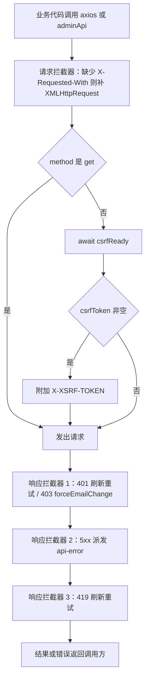
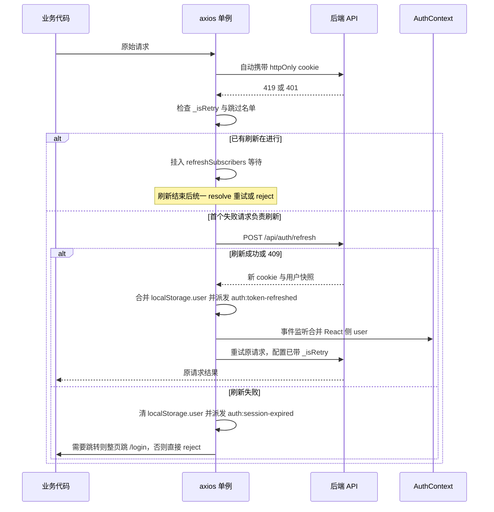
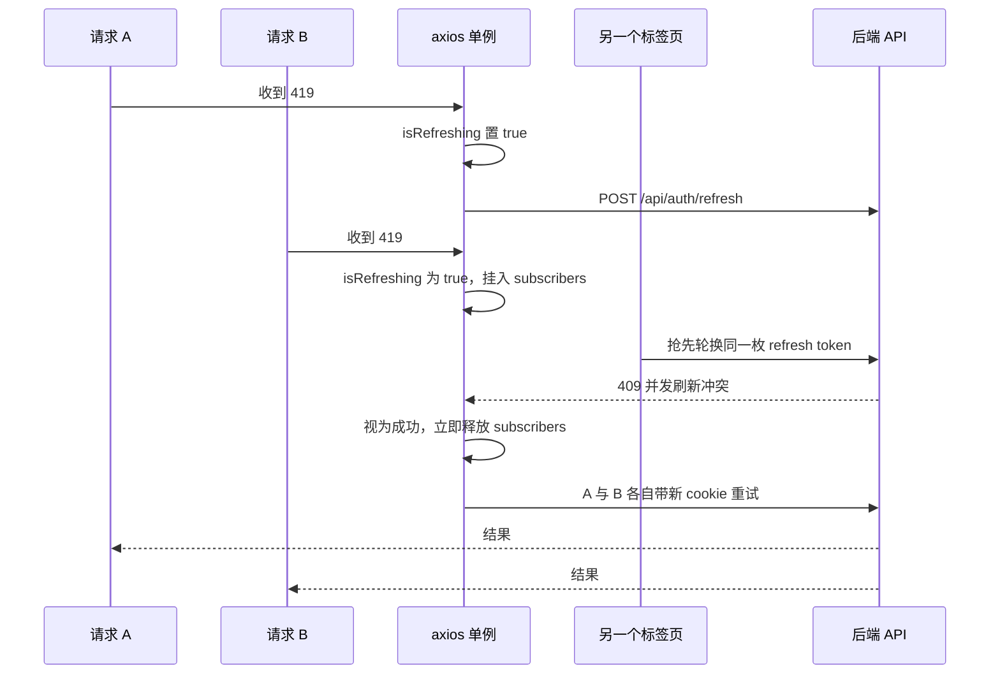

# HTTP 层、CSRF 与双 Token 刷新

前端所有网络行为都收敛在 `src/utils/axiosConfig.js` 这一个模块里：它没有导出「客户端实例」，而是在模块顶层直接改写**全局 axios 默认值**并注册拦截器，然后由 `src/main.jsx` 以 `import './utils/axiosConfig'` 的裸副作用形式加载（详见[启动链与全局 Provider 树](./boot-and-providers.md)）。因此这条拦截器链的作用域是整个应用，包括 `src/utils/adminApi.js` 里那些看似「另一套」的管理端调用。

与之配套的凭据模型是一条硬边界：**认证凭据只存在于 httpOnly cookie，`localStorage` 里只有用户快照（`localStorage.user`），没有任何 token 存储**。浏览器自动携带 cookie，前端拦截器只负责三件事——补 CSRF 头、在会话过期时用 refresh token 把 session 救回来并重试、以及在救不回来时统一登出。

## 全局单例：默认值与「唯一的 axios」

```js
axios.defaults.timeout = 15000;
axios.defaults.withCredentials = true;
```

- `withCredentials` 必须显式为 `true`：axios 默认 `false`，而跨域部署（`VITE_API_BASE_URL`）下不带该标志浏览器不会附带认证 cookie。开发期 `/api` 与 `/uploads` 由 Vite 代理到 `http://localhost:5000`（`vite.config.js`），此时是同源请求。
- 全仓库没有 `axios.create(...)`：所有模块 `import axios from 'axios'` 拿到的都是同一个对象、同一份默认值与同一条拦截器链。这正是 `adminApi` 能「直通」的前提（见[adminApi 为什么直通](#adminapi-为什么直通-axios)）。
- `timeout = 15000` 是全局兜底；批量翻译、上传等长任务在单次调用上显式覆盖（例如 `/api/translate/batch` 用 `timeout: 120000`）。

## 请求拦截器：CSRF 预热、X-Requested-With、withCredentials



该图刻画一个请求的完整往返：一次请求拦截 + 三段响应拦截，顺序即语义。

**CSRF 预热是一次性的、失败即放行。** 模块加载时立刻调用 `initCsrf()`，它用 `csrfReady` 这个 Promise 加 `csrfResolve` 闭包标记「首次取 token 已结束」，然后 `GET /api/csrf-token`。注意 `catch` 里同样调用 `csrfResolve()`——**即使取 token 失败，`csrfReady` 也会 resolve**，后续非 GET 请求不会被永久挂起。代价是：首次失败后写请求会在没有 `X-XSRF-TOKEN` 的情况下发出，只能等后端回 403，或等 `fetchCsrfToken()` 被下一次调用重新填上（`AuthContext` 在启动与标签页 `visibilitychange` 回到前台时都会调它）。

**三件套的具体规则：**

| 规则 | 实现 | 为什么要紧 |
| --- | --- | --- |
| `X-Requested-With: XMLHttpRequest` | 每个请求兜底写入，已存在则不覆盖 | 后端可据此区分 AJAX 与跨站表单提交（表单无法设置自定义头），是 CSRF 的第二道防线；`Profile`、`AdminEpisodes` 里手动重复设置该头属于冗余写法 |
| 非 GET 才 `await csrfReady` | `config.method !== 'get' && config.method !== 'GET'` | GET 不校验 CSRF，等待只会白白拖慢首屏读请求 |
| `X-XSRF-TOKEN` 仅在已有 token 且非 GET 时附加 | `if (csrfToken && config.method !== 'get')` | 不发送空头；axios 已把 `method` 归一化为小写，`'GET'` 分支实际不会命中 |

**token 会被自动续期。** 第一段响应拦截器在**任何**成功响应的 body 里发现 `csrfToken` 就把内存值替换掉，因此凡是会在响应里回传新 token 的端点都无需额外代码；`fetchCsrfToken()`（具名导出）则是显式的主动重取入口，目前只有 `AuthContext` 在启动和 `visibilitychange` 时调用。

## 响应拦截器的三段链与顺序语义

axios 按**注册顺序（FIFO）**串接响应拦截器，所以本文件里的三段注册顺序就是执行顺序，且这个顺序有实际后果：

| 顺序 | 归属状态码 | 做了什么 |
| --- | --- | --- |
| 1 | `401`、`403 + forceEmailChange` | 先用 refresh token 救会话并重试；救不回来则登出（清快照、派发 `auth:session-expired`、必要时整页跳到 `/login`）；`403` 且 body 带 `forceEmailChange` 时只打标不登出 |
| 2 | `>= 500` | 派发自定义事件 `api-error`（含 `status`、`message`、`messageKey: 'common.serverUnavailable'`） |
| 3 | `419` | 执行双 token 刷新、并发合并与重试；刷新失败则自行登出 |

由此产生三条必须知道的推论：

1. **`419` 不会触发 `api-error`**（只有 `>= 500` 才会），所以 token 过期不会给用户弹「服务器不可用」。
2. **`419` 处理器处于链尾，不能指望 `401` 处理器替它收尾。** 原始错误是 `419`，第一段处理器早已跑过并且直接放行；等第三段决定「刷新失败要登出」时，前面的处理器不会再被调用，所以 `419` 分支必须把登出逻辑（清 `localStorage.user`、派发事件、按路径跳转）**原样复制一份**。这就是该文件里两段相似代码的由来，不是可随手合并的重复。
3. **错误类型会被改写或保留，两条路径不对称**：`419` 刷新失败时 `reject(result.error)`，调用方拿到的是**刷新请求的错误**；`401` 刷新失败时继续走同段内的登出逻辑并 `reject(error)`，调用方拿到的仍是**原始 401**。

## 双 Token 刷新：401 与 419 两条触发路径

前端把两种状态码当作同一个问题的两种表现：

- **`419`** = access token 过期（后端约定的过期语义），走双 token 刷新。
- **`401`** = access **cookie 可能已因 `maxAge`（约 15 分钟）被浏览器丢弃**，后端回 `noToken`。代码注释明确写着这是「主因修复」：收到 `401` 也先尝试 refresh 恢复会话，**只有刷新失败才真正登出**。

两条路径共用一个 `isRefreshing` 标志、一个 `refreshSubscribers` 数组和同一个 `refreshAccessToken()`，唯一的差别是触发条件，所以「并发合并」对两种状态码是统一的。刷新端点是 `axiosConfig.js` 里的硬编码字面量 `/api/auth/refresh`，不在 `apiEndpoints.js` 的映射表内；后端各端点与状态码的完整对照见[后端 API 地图](../integrations/backend-api-map.md)。

**一次性标记与跳过名单。** 两条路径都要求 `!originalRequest._isRetry`，命中后立刻把它置 `true` 并挂到 config 上——重试的请求若再次失败，就不会再触发第二次刷新，直接进入登出。`shouldSkipAutoRefresh()` 按 **URL 子串**排除四类请求：`/api/auth/refresh`、`/api/auth/login`、`/api/auth/register`、`/api/csrf-token`。

**跳过名单只跳过刷新，不跳过登出副作用。** 这是最容易误判的一点：`shouldSkipAutoRefresh` 只守住刷新分支，登出分支的闸门是 `skipRedirect` 与当前 `pathname`，因此登录页提交错误口令（`POST /api/auth/login` 返回 401）时不会尝试刷新，但**仍会**清掉 `localStorage.user` 并派发 `auth:session-expired`（只是因为在 `/login` 上而免于跳转）。同理，启动时 `AuthContext` 用 `skipRedirect: true` 请求 `/api/auth/me`，匿名访客收到 401 时不会跳转，但快照会被清空、事件会被派发。

### 刷新时序：419/401 → refresh → 重试 或登出



该图是「刷新成功→重试」「刷新失败→登出」两条终局的分叉，注意 access token 全程由 cookie 携带，重试时不会也不需要手工写 Authorization 头。

### `refreshAccessToken()` 的三种结局

`POST /api/auth/refresh` 的失败并不都意味着会话结束，函数把三类响应分开处理：

| 刷新响应 | 返回值 | 语义 |
| --- | --- | --- |
| 2xx | `{ ok: true, user: res.data }` | 正常轮换，`res.data` 被当作最新用户快照 |
| `409` | `{ ok: true, user: null }` | **并发刷新冲突**：另一个标签页刚轮换了同一枚 refresh token，同浏览器的 cookie 已更新为新值。无需再刷新，按成功处理让调用方带新 cookie 重试 |
| `403` | 先 `GET /api/csrf-token` 覆盖内存 token，再重试 refresh 一次；仍失败则 `{ ok: false }` | CSRF token 过期/丢失导致刷新请求本身被拒 |
| 其他（含 5xx） | `{ ok: false, error }` | 视为会话终结 |

两个值得注意的边界：`403` 补救只重试**一次**；而**任何其它失败（包括后端 5xx）都会被当成会话过期**——刷新端点 500 时用户会被登出并跳到 `/login`，同时因为该 5xx 也经过第二段拦截器，还会额外弹一次「服务器不可用」提示。

### 并发合并：一个屏障 + 一个订阅数组



该图说明同一时刻只发一次刷新请求：`isRefreshing` 是屏障，`refreshSubscribers` 是等待队列，跨标签页的竞争则由 `409` 收敛。

实现细节上的几个不变量：

- 订阅回调签名是 `(newToken, err)`，但**`onTokenRefreshed()` 在两个成功分支里都是无参调用**，`newToken` 始终是 `undefined`——因为 access token 在 httpOnly cookie 里，重试时「直接 `axios(originalRequest)`」即可，头里没有可注入的东西。改代码时不要把 `newAccessToken` 当成有效载荷依赖。
- 挂起者由 `onTokenRefreshed()`（全部 resolve 重试）或 `onRefreshFailed()`（全部以 `new Error('refresh failed')` reject）统一释放，数组随即清空；释放后**不会**有残留订阅。
- 只有「首个失败请求」负责刷新与登出。挂起者只重试或 reject，因此一次刷新失败只会产生一次跳转，不会每个失败请求各跳一次。
- `isRefreshing` 在 `await` 之后、通知订阅者之前就复位为 `false`；紧接着的合并任务是同步的，实践中不会形成第二个刷新窗口，但它是「先打开闸门再干活」的顺序，写扩展代码时不要在这两步之间插入会发请求的 `await`。

## 刷新成功后的快照合并与事件

刷新响应携带的用户信息**不会**整包覆盖前端状态，而是按白名单合并进既有快照（`_id`、`accountId`、`username`、`email`、`isEmailVerified`、`role`、`forceEmailChange`），保留 `avatar` 等旧字段，然后写回 `localStorage.user` 并派发 `auth:token-refreshed`：

```js
const merged = { ...oldUser, _id: ..., accountId: ..., username: ..., email: ..., role: ..., forceEmailChange: !!result.user.forceEmailChange };
localStorage.setItem('user', JSON.stringify(merged));
window.dispatchEvent(new CustomEvent('auth:token-refreshed', { detail: { user: merged } }));
```

`AuthContext` 监听该事件，把 `detail.user` 合并进 React 侧的 `user` 状态（角色、邮箱、`forceEmailChange` 都可能在刷新窗口内变化）。两个边界：

- 合并**只在 `localStorage.user` 已存在时执行**（`if (stored)`）。没有快照（例如刚被登出清空）时即使刷新成功也不写、不派发，`AuthContext` 那边也保持 `user` 为 `null`。
- 这次合并写入的字段集合与 `AuthContext.storeUserToLocalStorage` 的字段集合并不一致（后者写 `_id`/`accountId`/`username`/`isEmailVerified`/`role`/`avatar`，不写 `email`/`forceEmailChange`）。快照字段是「谁最后写谁生效」，读取方不要假设某个字段一定存在。`localStorage` 只是快照，权威会话状态始终在 cookie 与服务端，详见[状态与持久化](./state-and-persistence.md)。

## 登出、软拦截与错误事件

除刷新外，这条链还向 window 派发四类事件，消费方都是 React 层：

| 事件 | 触发条件 | 载荷 | 消费方 |
| --- | --- | --- | --- |
| `auth:session-expired` | 401 且刷新失败/被跳过；或 419 刷新失败 | `detail.type: 'user'`，419 失败时额外带 `reason: 'refresh-failed'` | `AuthContext`（`type === 'user'` 时 `setUser(null)`）、`OfflineIndicator`（destructive 配色的「登录已过期」提示，3 秒后自动消失） |
| `auth:token-refreshed` | 刷新成功且存在用户快照 | `detail.user`（合并后的快照） | `AuthContext`（合并进 `user`） |
| `auth:force-email-change` | 任意请求返回 `403` 且 body 带 `forceEmailChange` | 无 | `AuthContext`（把 `forceEmailChange` 置真） |
| `api-error` | 任意响应 `status >= 500` | `status`、`message`、`messageKey` | `AppContent`（优先显示 `message`，否则 `t('common.serverUnavailable')`，3 秒后自动消失） |

**跳转规则。** 两段登出逻辑都自己判断路径，而不是交给路由守卫（路由层面的兜底见[路由与守卫](./routing-and-guards.md)）：

- `401` 分支：`error.config.skipRedirect` 为真则完全不跳；否则当前路径不是 `/login`、`/register`、`/reset-password` 就 `window.location.href = '/login'`。`/admin/*` 被单独判为「需要跳转」，在当前实现里它与「非认证页」分支的结论一致，属于显式表达而非额外分支。
- `419` 分支：不看 `skipRedirect`（这是它与 401 分支的差异），先判断是否处于三个认证页，再按 `isAdminPage` / 路径决定是否跳转。

**并发去重靠一个 1 秒的布尔锁。** `isHandling401` 置真后 1 秒内并发的 401 只 `reject` 不再清快照、不再派发事件、不再跳转；跳转分支会整页重载，定时器无副作用。这个锁还承担了一个更隐蔽的职责：外层请求的 refresh 一次 401 时，**嵌套的 refresh 请求自身**先经过同一段 401 处理器（`/api/auth/refresh` 在跳过名单里，所以不刷新但要登出），它把 `isHandling401` 置真，于是外层请求从 `await` 返回后直接命中 `if (isHandling401) return Promise.reject(error)` 而不再重复一次登出——**一次会话失效只产生一次副作用**。

`skipRedirect` 与 `_isRetry` 都是随 axios config 传下去的自定义字段（axios 会原样保留未识别的键）。要记住它们的能力边界：`skipRedirect` **只抑制页面跳转**，不抑制 `localStorage.user` 清理与 `auth:session-expired` 派发；`_isRetry` **只抑制自动刷新**，不抑制登出。启动期的 `/api/auth/me`、心跳、翻译、站点配置等敏感度低的调用普遍带 `skipRedirect: true`，正是为了在未登录/接口异常时不把用户从当前页面弹走。这些事件与 `AuthContext` 的登录/登出/初始化流程如何咬合，见[认证与账号](../systems/auth-and-account.md)。

`403 + forceEmailChange` 是**软拦截**：后端拒绝写操作、前端只把快照与状态里的 `forceEmailChange` 置真让 UI 弹出改邮箱引导，既不刷新也不登出。

## 边界：任何绕过 axios 的 fetch / EventSource 必须自理

拦截器链是**全局 axios 的**，不是网络的。任何不使用这个单例的客户端都要自己补齐两件事：**CSRF 头**与**会话失效处理**（刷新、登出、事件派发、跳转）。仓库里有两个现成的反面教材：

- **原生 `fetch`**：`AccountSecurity` 导出个人数据用 `fetch(API.USERS.EXPORT, { headers: getAuthHeaders(), credentials: 'include' })`。它靠 `credentials: 'include'` 带 cookie，`getAuthHeaders()` 返回 `{}`（认证不靠头），因为这是 GET 所以不需要 `X-XSRF-TOKEN`；但它完全失去 401/419 的刷新与跳转能力，`res.ok` 为假时只能自己报错。**如果要新增非 axios 的写请求，必须自己取 CSRF token 写 `X-XSRF-TOKEN`，并自己处理 401 语义。**
- **`EventSource`**：通知流 `new EventSource('/api/notifications/stream?ticket=...')` 无法设置自定义头，因此先用 axios 取一次性 `GET /api/auth/sse-ticket` 换 ticket，再用 ticket 过鉴权。会话失效在这里表现为 `onerror`：关闭连接后按 5 次上限、指数退避（5s × 1.5ⁿ，封顶 60s）重连，既不派发 `auth:session-expired` 也不跳登录。也就是说**长连接从来不参与 token 刷新协议**，它只能在用户已登录、`user` 变化时由 effect 重建。

反过来说，**离线队列是被拦截器覆盖的特例**：`processOfflineQueue(axios)` 接受调用方传入的 axios 实例（`AuthContext` 在 `online` 事件里传的就是全局单例），重放的请求因此仍会走 CSRF 注入与刷新/登出逻辑。

## adminApi 为什么直通 axios

`src/utils/adminApi.js` 只有 15 行，五个方法都是对同一个全局 axios 的转调：

```js
get: (url, config = {}) => axios.get(url, { ...config }),
```

不新建实例、不改 baseURL、不加 `Authorization` 头，文件顶部注释直接把理由写死：「管理员 API 依赖 httpOnly cookie 自动传递认证信息，无需手动设置 Authorization header」。同文件导出的 `getAdminToken()` / `getAdminData()` 恒返回 `null`，是给旧调用点留下的空壳。

这样直通有三个实际好处，也是不能改成分离实例的原因：

1. 管理端请求自动获得 CSRF 注入、401/419 刷新重试、`api-error` 提示——**与前台完全同一套会话机制**。
2. 管理员不是独立的 token 体系：权限由服务端依据同一枚 cookie 里的会话与 `User.role`（`user`/`creator`/`admin`/`superadmin`）判定。`AdminLayout` 的守卫就是「`GET /api/admin/verify` 失败即 `navigate('/login')`」，而不是检查本地令牌。
3. `/admin/*` 下的 401 被拦截器特判为「一定跳登录」，所以管理端组件不需要各自写失效兜底；拦截器在前，路由与角色守卫在后，关系见[路由与守卫](./routing-and-guards.md)。

会踩的坑：如果为了「隔离」而给 admin 单独 `axios.create()`，新实例**没有**注册这套拦截器，立刻丢失 CSRF 头与刷新能力，表现为写操作随机 403、access token 过期后 419 直接抛给组件。

## 不变量与安全修改清单

1. `src/main.jsx` 里 `import './utils/axiosConfig'` 是副作用导入，不可删除、不可挪进懒加载 chunk；它必须在任何 Provider effect 发请求之前执行。
2. **不要新增 token 存储**：凭据在 httpOnly cookie，`localStorage.user` 只是 UI 快照（字段少于服务端返回）。往 `localStorage`/`sessionStorage` 里写 access/refresh token 会直接破坏这套设计。
3. 保持三段响应拦截器的注册顺序 `401/403 → 5xx → 419`。新增需要「看到刷新后失败」的处理器，要么注册在 `419` 之后并自行兜底，要么把逻辑并进 `419` 分支——不要假设 `401` 段会二次执行。
4. `shouldSkipAutoRefresh` 的跳过名单是**字符串子串**匹配，且 `refresh`/`csrf-token` 在 `axiosConfig.js` 里是硬编码字面量（`apiEndpoints.js` 的 `AUTH` 里只有 `CSRF_TOKEN`，没有 `REFRESH`）。新增认证端点时，如果要让它免于自动刷新，必须同步扩这个名单，否则会出现「刷新端点被刷新」的递归。
5. CSRF 是 fail-open 设计：`csrfReady` 失败也会 resolve。若把它改成 fail-closed，必须同时给所有非 GET 调用方加超时与错误 UI，否则页面会挂死。
6. 任何新的非 axios 客户端（`fetch`、`EventSource`、`sendBeacon`、第三方 SDK）必须自行处理 CSRF 与会话失效，并在文档里写清这点。
7. `skipRedirect: true` 表示「不要整页跳转」，**不表示**「不要登出」；把它用在静默轮询上仍会清快照并派发事件。

## 验证与排障

仓库没有测试运行器（`package.json` 只有 `dev`/`build`/`lint`/`preview`/`generate-icons`，`AGENTS.md` 也注明 "No test runner is configured"），所以这条链的回归靠静态检查加手工实验：

- `npm run lint`（ESLint 9 flat config，`--max-warnings 0`）与 `npm run build`，确认拦截器改动没有引入未使用变量或语法降级问题。
- **401 路径**：DevTools → Application → Cookies 删除 access cookie（refresh cookie 保留）→ 触发一次业务请求，应看到一次 `POST /api/auth/refresh` 后原请求重放成功，页面不跳转。
- **419 路径**：把 access cookie 的过期时间改到过去，或让后端返回 419，应看到同样的「刷新 + 重试」序列。
- **并发合并**：一次触发多个并行请求（例如管理端仪表盘）后让会话过期，Network 面板中 `POST /api/auth/refresh` 只应出现**一次**。
- **409 语义**：开两个标签页并同时让会话过期，其中一个的刷新会撞上 409；预期表现是照常重试成功，而不是登出。
- **403 补救**：删除 XSRF cookie 后触发刷新，应看到 `GET /api/csrf-token` + 重试 refresh 的补救序列。
- **事件副作用**：在 DevTools console 里 `window.addEventListener('auth:session-expired', e => console.log(e.detail))`，可确认一次会话失效只派发一次、且 419 失败时带 `reason: 'refresh-failed'`。
