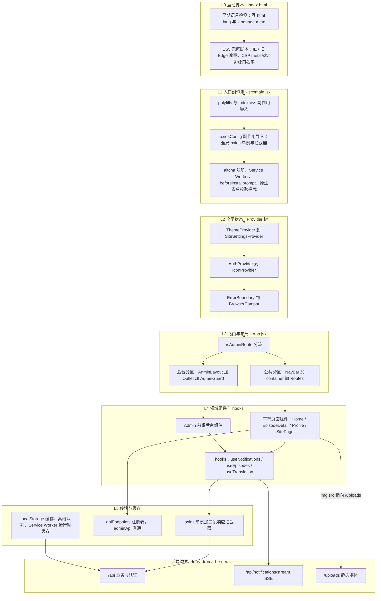
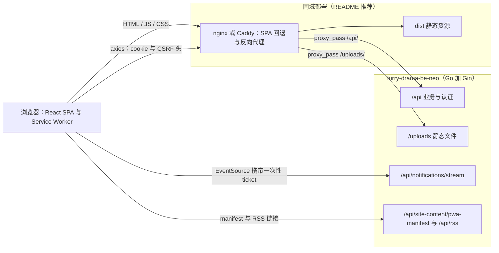

# 架构总览：浏览器侧分层与后端边界

这是一个纯浏览器侧 SPA：没有服务端渲染、没有路由级数据加载器、没有 BFF，仓库里除 `index.html`、`vite.config.js` 与静态资源外没有一行服务端代码。后端 [furry-drama-be-neo](https://github.com/xiedada05/furry-drama-be-neo)（Go + Gin，`README.md` 说明它是原 Express 后端的 drop-in 重写）是独立仓库，前端对它的全部认知收束为一条 HTTP 契约。因此任何一次改动要么落在浏览器侧的某一层内，要么就是在改这条契约——两者都不是「随手加个文件」。

阅读这份代码库时**不要按 `src/` 目录镜像理解**：`src/components` 下 80 余个文件全部平铺（其中 20 余个以 `Admin` 开头），它们在分层图上分属「通用 UI」「领域页面」「后台页面」三种职务；`src/utils` 里既有传输层（`axiosConfig.js`）也有端点注册表（`apiEndpoints.js`）与浏览器持久化（`offlineQueue.js`、`translationCache.js`）。按职责分层才是它们真正的组织方式。

## 浏览器侧分层

图注：从 `index.html` 早期脚本到后端 HTTP 契约的六层职责链；箭头是依赖方向，右侧唯一跨出浏览器的边就是契约边界。

| 层 | 代表实现 | 职责 | 不该放进这一层的东西 |
| --- | --- | --- | --- |
| L0 启动脚本 | `index.html` 两段内联脚本、CSP meta | 在打包产物下载前确定语言、拦住不兼容浏览器、锁定资源白名单 | 业务逻辑、新的外链依赖 |
| L1 入口副作用 | `src/main.jsx` | polyfills、全局样式、全局 axios 配置、Web Component 注册、SW 注册、文档级事件 | 依赖 React 状态的逻辑、按路由才需要的能力 |
| L2 全局状态 | `src/contexts/*` 五个 Context、`App.jsx` 的两个错误边界与 `BrowserCompat` | 跨路由共享的少量状态与文档级副作用（`document.title`、manifest、壁纸 CSS 变量） | 页面级状态、服务端列表数据 |
| L3 路由与布局 | `src/App.jsx` 的两张 `<Routes>`、`AdminLayout`、`AdminGuard`、`getRoutePageTitleKey` | 分区、懒加载边界、标题映射、体验层拦截 | 真正的授权判定 |
| L4 领域组件与 hooks | `src/components/*`、`src/hooks/*` | 业务 UI、交互、取数与组件内状态 | 全局副作用、直接改写主题之外的 DOM 全局样式 |
| L5 传输与缓存 | `axiosConfig.js`、`apiEndpoints.js`、`adminApi.js`、`offlineQueue.js`、`translationCache.js`、SW workbox 配置 | 一套凭据模型、端点地址、错误事件、离线与缓存策略 | 业务判断与界面文案 |
| 后端 | `furry-drama-be-neo` | 认证授权、数据读写、文件存储、SSE 推送、动态 manifest 与 RSS | —— |

## L0–L1：启动与入口副作用

这两层是「React 挂载之前」的世界，细节集中在[启动链与全局 Provider 树](./boot-and-providers.md)，这里只保留与分层相关的判断：

- **为什么存在**：早期语言检测必须在浏览器做首次语言判定之前完成；`axiosConfig` 必须在任何 Provider 的 effect 发请求之前注册拦截器；`altcha` 的 Web Component 必须早于懒加载路由注册。
- **不变量**：`src/main.jsx` 里 `import './utils/axiosConfig'` 是裸副作用导入，删掉或挪进懒加载 chunk 会同时失去 CSRF 注入、自动刷新与 401 跳转；`index.html` 的 CSP meta 是前端唯一的运行期安全策略，新增第三方域名（翻译接口、播放器、图片源）必须同步改对应指令。

## L2：全局状态只有五个 Context 加一组 window 事件

前端没有任何全局状态库：`package.json` 的运行时依赖只有 `react`、`react-dom`、`react-router-dom`、`axios`、`altcha`、`qrcode`、`lucide-react`。全局状态由 `App.jsx` 里嵌套的五个 Provider 承担：

| Context | 提供 | 数据来源与持久化 |
| --- | --- | --- |
| `ThemeContext` | `theme` / `themeMode` / `accentColor` / `setAccentColor` | `localStorage` 的 `theme`、`accent_color`，写入 `document.documentElement` 的 CSS 变量 |
| `I18nContext` | `lang` / `t` / `switchLang` | `localStorage.lang` + `src/locales/zh.js`、`en.js`；切换语言会整页 reload |
| `SiteSettingsContext` | 运行时站点配置（名称、Logo、PWA、favicon 等） | `GET /api/site-content/settings`，`localStorage.site_settings_cache` 缓存 30 分钟 |
| `AuthContext` | `user` / `initializing` / `login` / `logout` / `updateUser` | `GET /api/auth/me` 校验 httpOnly cookie 会话，`localStorage.user` 只是界面快照 |
| `IconContext` | 图标映射表 + 主题图标覆盖，`THEME_SELECTION_CHANGED_EVENT` | `/api/icons/*` 与主题接口；依赖 `useAuth()` |

**跨层同步不走状态库，走 `window` 自定义事件。** 传输层（L5）无法 import React 状态，于是派发事件、由 Context 或 `AppContent` 订阅：`auth:session-expired`、`auth:token-refreshed`、`auth:force-email-change`、`api-error` 四个由拦截器派发，`theme-selection-changed`（应用/取消主题后刷新图标）与 `pwa-install-available` 由业务侧派发。这套事件的语义与消费方见[状态管理与浏览器持久化契约](./state-and-persistence.md)与 [HTTP 层、CSRF 与双 Token 刷新](./http-and-session.md)。

**服务端状态不属于这一层。** 列表、详情、通知这类数据由 L4 的组件与 hooks 自己持有（见下文），因此「全局状态」与「服务端数据」是两套互不相通的缓存，别在 Context 里塞业务列表。

## L3：一次路径判断劈出两套路由树

`AppContent` 在渲染路由之前先算 `isAdminRoute = location.pathname.startsWith('/admin')`，随后走两条互不相交的返回分支：

- **公共分区**：`skip-link`、`AnnouncementBanner`、`NavBar`（包在 `NavBarErrorBoundary` 里）、`div.container#main-content` 内的路由树，以及 `FooterBeian`、`FeedbackModal`、`ThemeColorPicker`、`OfflineIndicator`、`InstallPrompt`、`AnnouncementPopup`、强制改邮箱浮层与 `api-error` 提示条。
- **后台分区**：只有 `<Routes>`（`/admin` 入口组件 + `AdminLayout` 下的 `Outlet` 子路由）与 `FooterBeian`；不渲染 `NavBar`，外壳由 `AdminLayout` 自己提供（顶栏、登出、心跳）。

这带来三个直接后果，改路由时必须一并考虑：后台页面拿不到 `NavBar` 提供的任何上下文 UI；所有后台子路由都被 `AdminGuard` 逐条包裹（再叠加 `AdminLayout` 自身的 `/api/admin/verify`），即同一个校验会触发两次；两套树共享同一个全局 `ErrorBoundary`，没有后台专属边界。

**懒加载边界是这一层的第二职责。** 同步导入的只有外壳与首屏：`NavBar`、`Modal`、`Home`、`EpisodeDetail`、`Login`、`Register`、`NotFound`、`BrowserCompat`、`AnnouncementBanner`、`AnnouncementPopup`、`OfflineIndicator`、`InstallPrompt`、`ForceEmailChange`（`FooterBeian`、`AdminGuard`、两个错误边界等则定义在 `App.jsx` 内部）；其余 47 个路由页面、弹窗与编辑器用 `React.lazy` + 单个 `<Suspense fallback={<LoadingFallback />}>` 切成独立 chunk，后台页面整体在首屏 bundle 之外。

**页面标题依赖一张硬编码的路径映射。** `getRoutePageTitleKey(pathname)` 用前缀匹配把路径映射成 i18n key，再由 `AppContent` 的 effect 拼成 `${pageTitle} - ${siteName}` 写入 `document.title`。新增路由若不同步这个函数，标题会静默退化成站点名。分区、守卫与标题映射的完整规则见[路由分区与访问守卫](./routing-and-guards.md)。

## L4：领域组件平铺，取数逻辑在 hooks 里

`src/components` 是平铺的单文件组件目录（无 folder-per-component），命名前缀是唯一的分组手段：`Admin*` 一律是后台页面或后台外壳，其余按领域命名（`Home`、`EpisodeDetail`、`Profile`、`UpdateCalendar`、`CreatorPage`、`ThemeWorkshop`…），少数是跨领域原语（`Modal`、`ConfirmModal`、`CustomSelect`、`Skeleton`、`SearchInput`、`ImageUploader`、`PasswordToggle`）。

**没有数据层，只有取数 hooks。** `src/hooks` 里的 `useEpisodes`、`useCategories`、`useEpisodeForm`、`useImageUpload`、`useNotifications`、`useTranslation`、`usePushNotifications` 都是「用 `useState` 装数据 + 用 `axios`/`adminApi` 拉取」。由于没有查询缓存，写操作后的刷新是手写的：`useEpisodes` 的 `addEpisode` / `updateEpisode` / `deleteEpisode` 每次成功后都再调 `fetchEpisodes()`。相应地，组件之间不会自动共享同一份数据，同一个接口被多个组件各拉一次是常态。

**惯例与代价**：新页面通常「组件 + 路由 + `getRoutePageTitleKey` + 导航入口 + zh/en 文案」五处同改；纯展示组件允许内联 `style` 对象（仓库里大量存在），所以视觉一致性靠 CSS 变量与设计 token 而不是样式封装。

## L5：一个 axios 单例、一张端点注册表、两层浏览器缓存

- **唯一客户端**：`axiosConfig.js` 在模块顶层改写全局 axios 默认值（`timeout = 15000`、`withCredentials = true`）并注册拦截器，全仓库没有 `axios.create()`。`adminApi.js` 只是对同一实例的转调，因此管理端与前台共享 CSRF 注入、401/419 刷新重试与 `api-error` 提示；给它单独建实例会立刻丢掉这一整套行为。
- **端点注册表**：`apiEndpoints.js` 以分组对象列出认证、会话、剧集、主题、图标、通知、管理、统计、翻译等路径（含 `:id` 风格的函数式端点）。它是导航索引而非唯一真源——仍有调用点内联字符串（如 `useTranslation` 的 `/api/translate`、`useNotifications` 的 `/api/auth/sse-ticket`、`useImageUpload` 的 `/api/episodes/upload`），改动路径时要全仓搜索。
- **两层缓存**：(1) 应用层——`SiteSettingsContext` 的 30 分钟站点配置缓存、`translationCache` 的 `localStorage` 机器翻译缓存（上限 2000 条、24 小时 TTL）、`offlineQueue` 的离线写操作队列（24 小时、单动作最多重试 3 次）、`Home` 的 `sessionStorage` 滚动位置（`home_scroll_pos`）；(2) 浏览器层——`vite-plugin-pwa` 生成的 Service Worker，对 `/api/(episodes|series|categories|banners|friend-links|site-content)` 用 `NetworkFirst`（10 秒超时、100 条、1 小时），对 `/uploads/` 用 `CacheFirst`（200 条、30 天）。
- **绕过 axios 的通道**：`EventSource`（通知流）与个别原生 `fetch`（导出个人数据）不经过拦截器，必须自行处理 CSRF 与会话失效。既有做法是 SSE 先 `GET /api/auth/sse-ticket` 换一次性 ticket，再用 `new EventSource('/api/notifications/stream?ticket=…')` 连接，失败后指数退避最多重连 5 次，并以 60 秒轮询 `unread-count` 兜底。

## 与 furry-drama-be-neo 的契约边界

前端对后端只有一种依赖形式：**HTTP**。全部调用都是根相对路径 `GET/POST/PUT/DELETE /api/...`，静态媒体引用 `/uploads/...`，实时推送走 SSE，站点品牌与 RSS 由后端动态提供。

| 契约面 | 前端调用点 | 后端承担 |
| --- | --- | --- |
| JSON API `/api/*` | 组件与 hooks 里的 axios / `adminApi`，路径集中在 `apiEndpoints.js` | 认证授权、数据读写、校验、错误码 |
| CSRF | `axiosConfig` 预热 `GET /api/csrf-token`，非 GET 带 `X-XSRF-TOKEN`，并在响应体回传 `csrfToken` 时续期 | 签发与校验 token |
| 会话 | 凭据只在 httpOnly cookie；`localStorage.user` 是快照 | access / refresh cookie 与 `/api/auth/refresh`、`419`、`409` 语义 |
| SSE | `useNotifications`：ticket + `/api/notifications/stream` | 一次性 ticket 端点与事件流 |
| 静态媒体 | ``、壁纸、头像直接引用 `/uploads/...`；上传走 multipart POST（`/api/episodes/upload`、`/api/themes/upload-wallpaper`、`/api/icons/upload`、`/api/users/avatar`） | 接收文件、落盘并返回 `/uploads/...` URL |
| 站点品牌与分发 | `AppContent` 把 `link[rel=manifest]` 指向 `/api/site-content/pwa-manifest`；`index.html` 声明 `/api/rss` | 动态 manifest、RSS、`/api/site-content/settings` 与 `/api/site-content/about` |
| 错误语义 | 拦截器把 `401`/`403 + forceEmailChange`/`419`/`409`/`5xx` 翻译成登出、打标、刷新、事件提示 | 稳定使用这套状态码约定 |

**同源是隐含假设。** `axiosConfig.js` 没有设置 `baseURL`，`src/` 内没有任何 `VITE_API_BASE_URL` 引用——`README.md` 描述的跨域部署要求手动给 axios 设 `baseURL` 并让后端开 CORS，也就是说跨域是一次**代码改动**，而不是改个环境变量。开发期由 `vite.config.js` 在 3000 端口把 `/api` 与 `/uploads` 代理到 `http://localhost:5000`；生产推荐同域 nginx：`try_files $uri $uri/ /index.html` 做 SPA 回退，`/api/` 与 `/uploads/` 反代后端。

图注：开发期把 `Proxy` 换成 Vite dev server 的代理即可；浏览器从不直连后端以外的第三方（CSP 白名单除外）。

契约的逐项清单、字段待核对项与内联端点漂移风险见[后端契约地图](../integrations/backend-api-map.md)；代理、CSP、`__APP_VERSION__`、PWA 产物等发布面见[构建、配置与部署](../operations/build-and-release.md)。

## 架构取舍

**没有外部状态库，也没有服务端状态缓存。** 取舍是「零额外抽象 + 显式刷新」：五个 Context 覆盖真正全局的东西，其余数据留在组件与 hooks 里；跨层同步靠 `window` 自定义事件。收益是依赖树极小、任何人打开文件就能看到数据从哪来；代价是同一接口可能被并发重复拉取、写操作后要手写重取、跨组件的乐观更新没有统一地方安放。**新增全局状态前先确认五个 Context 与事件是否已覆盖**（多数需求其实是在给已有 Context 加字段），引入 Redux/Zustand/TanStack Query 属于跨层决策，不是局部优化。

**样式是纯 CSS 变量，没有 CSS-in-JS 也没有预处理器。** `src/index.css` 的 `:root` 声明间距、圆角、字号、阴影、动效曲线与 z-index 的设计 token；颜色 token 由 `ThemeContext` 的 effect 逐条 `setProperty` 到 `document.documentElement` 并附 `data-theme`，accent 色再由 `applyAccentColor` 派生十余个色调变量；壁纸额外写入 `--bg-image` / `--bg-opacity` / `--bg-blur` 与 `data-custom-bg`。因此切主题是「改自定义属性」，不重挂组件树、也没有主题加载态。代价是全局命名空间无隔离（token 名必须守规范）、`index.css` 是单文件大样式表，而组件内联 `style` 对象与 CSS 变量混用需要靠约定维持一致。

**纯 JSX，无 TypeScript。** 全仓只有 `.js`/`.jsx`，类型约束靠 ESLint 9 flat config（`npm run lint` 带 `--max-warnings 0`）与人工评审。直接后果是前后端字段契约没有编译期校验，字段改名只能靠搜索与冒烟。

**i18n 有两条独立路径。** UI 文案走 `src/locales/zh.js` / `en.js` 的静态字典与 `t('key.path')`（缺失时回退中文，再缺失就返回 key 本身，新文案必须两份都加）；数据库内容的多语言走另一条：`useTranslation` 先读 `field + Lang` 后缀字段，缺失时调 `/api/translate`（6 并发、15 秒超时）并写入 24 小时本地缓存，失败则展示原文。

**质量门只有静态检查与手工冒烟。** 仓库没有测试运行器（`package.json` 只有 `dev`/`build`/`lint`/`preview`/`generate-icons`，`AGENTS.md` 也写明 "No test runner is configured"），所以回归靠 `npm run lint`、`npm run build`、`npm run preview` 加手工冒烟：硬刷新看首帧加载文案、`/admin` 直接访问看分区与守卫、断网看 SW 与离线提示、切主题看 CSS 变量、上传看 `/uploads` 回读。

## 扩展点：新东西该落在哪一层

| 你要做的事 | 落点 | 同步项 |
| --- | --- | --- |
| 新增公共/后台页面 | `src/components` 平铺新文件（后台用 `Admin*` 前缀） | `App.jsx` 对应分区的路由、`getRoutePageTitleKey`、导航或侧栏入口、`zh`/`en` 文案；受保护页面用 `user` 判空 `Navigate` |
| 新增数据请求 | 优先在 `apiEndpoints.js` 加路径，走全局 axios | 不要 `axios.create()` 绕过拦截器；非 axios 客户端自理 CSRF 与 401 |
| 新增全局状态 | 现有五个 Context 之一，或新增 Context（须插在依赖它的 hook 之内） | 跨传输层的同步用 `window` 自定义事件 |
| 新增颜色/主题变量 | `ThemeContext` 的 `themes.dark` / `themes.light` 与 `applyAccentColor` | 在 `index.css` 中以 `var(--token, 兜底值)` 消费 |
| 新增第三方域名或资源 | `index.html` 的 CSP meta | 若需 SW 缓存，同时改 `vite.config.js` 的 `workbox.runtimeCaching` |
| 新增运行时文案 | `src/locales/zh.js` 与 `en.js` | `main.jsx` 里的原生表单校验文案表是独立的第二套字典，需要单独补 |

## 相关页面

- [启动链与全局 Provider 树](./boot-and-providers.md)——L0–L2 的执行顺序、错误边界与不可改动的约束。
- [HTTP 层、CSRF 与双 Token 刷新](./http-and-session.md)——L5 的拦截器链与会话语义。
- [路由分区与访问守卫](./routing-and-guards.md)——L3 的完整规则与「守卫只是体验层」。
- [状态管理与浏览器持久化契约](./state-and-persistence.md)——Context、localStorage 键与事件总线。
- [后端契约地图](../integrations/backend-api-map.md)——端点分组与错误语义索引。
- [构建、配置与部署](../operations/build-and-release.md)——代理、CSP、PWA 产物与发布流程。
