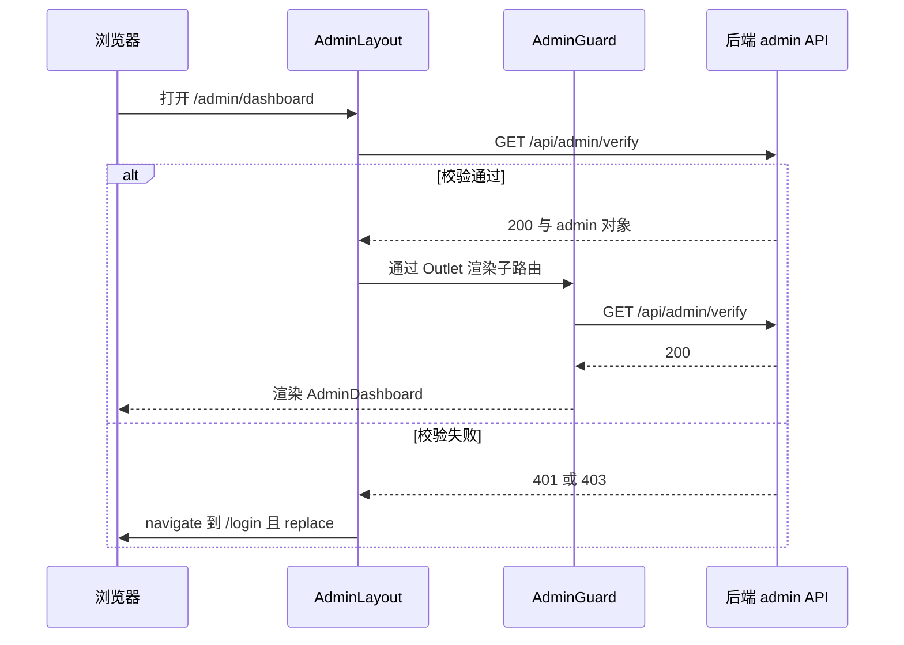

# 路由分区与访问守卫

前端只有一个路由装配点：`src/App.jsx`。`App()` 只负责套 Provider 与全局 `ErrorBoundary`（见[启动与 Provider 栈](boot-and-providers.md)），真正的路由表在 `AppContent` 里。它先做一次 **渲染前二分**，再在两条互斥的 `<Routes>` 里分别声明页面；后台页面因此完全脱离前台骨架，而不是靠布局路由嵌套共存。

理解这一页要注意的核心立场：**这些守卫只负责体验与导航，不构成授权**。所有 `/api/admin/*` 数据的放行由后端根据 httpOnly cookie 会话与角色决定（详见[HTTP 请求与会话生命周期](http-and-session.md)与[管理后台](../systems/admin-console.md)）。绕过前端守卫只能拿到一个空壳页面，拿不到数据。

## 分区：一次前缀判断，两棵互斥的路由树

`AppContent` 从 `useAuth()` 取 `initializing`，从 `useLocation()` 取 `location`，用 `location.pathname.startsWith('/admin')` 得出 `isAdminRoute`：

| 分区 | 判定 | 骨架 | 路由声明 | 兜底 |
| --- | --- | --- | --- | --- |
| 公共树 | `pathname` 不以 `/admin` 开头 | `skip-link` → `AnnouncementBanner` → `NavBarErrorBoundary`/`NavBar` → `.container#main-content` → `.page-enter`（`key={location.pathname}`）→ `Suspense` → `Routes` | 30 余条扁平路由 | `path="*"` → `NotFound` |
| 后台树 | `pathname` 以 `/admin` 开头 | 无前台骨架，只有 `Suspense` → 后台 `Routes` | `/admin` 跳板 + `/admin` 布局路由及其 24 个子路径 | **无** `*` 兜底 |

两个分区之前还有一道共同前置：`initializing` 为真时直接返回一个 `common.loading` 占位页，所以后台页面同样要等 `AuthContext` 的 `GET /api/auth/me` 初始化结束（无论用户是否登录）。两棵树都会渲染 `FooterBeian`，但前台独有的一批全局浮层（`FeedbackModal`、`ThemeColorPicker`、`OfflineIndicator`、`InstallPrompt`、`AnnouncementPopup`、`ForceEmailChange`、`apiError` 提示条）只出现在公共分支的返回值里。这个不对称有实际后果，见后文「forceEmailChange 拦截层」。

`.page-enter` 的 `key={location.pathname}` 意味着前台每次换路径都会重新挂载页面组件、重置页面内 state 并重放进入动画；后台分支没有这层包装。

## 公共路由树

公开页面（`/`、`/episode/:id`、`/login`、`/register`、`/reset-password`、`/verify-email`、`/verify-email-change`、`/verify-device`、`/shared-folder/:shareToken`、`/calendar`、`/timeline`、`/creator/:id`、`/privacy`、`/terms`、`/about`、`/friend-links`、`/license`）直接渲染；`/login` 与 `/verify-device` 复用同一个 `Login` 组件，只是后者对应跨设备登录确认流程。

需要登录的页面用统一的**内联判空**写法，而不引入独立守卫组件：

```jsx
<Route path="/profile" element={user ? <Profile user={user} setUser={updateUser} logout={logout} /> : <Navigate to="/login" />} />
```

覆盖 `/profile`、`/devices`、`/change-password`、`/change-email`、`/account-security`、`/two-factor`、`/delete-account`、`/settings`。两点值得注意：

- 这里用的是 `<Navigate to="/login" />`（不带 `replace`），而后台守卫用的是 `replace`。未登录访问受保护前台页会在历史栈压入新条目。
- `Login` 不读取 `location.state`/`from`，登录成功后固定 `navigate('/')`，因此**没有「登录后回到原页面」**的体验；深链被踢到登录页后只能自己再点回去。

## 后台路由树

后台分支里有两条同路径 `/admin` 的声明，职责不同：

- `/admin` **跳板** `Admin`（`components/Admin.jsx`）：不渲染 UI，仅 `GET /api/admin/verify`，成功后 `navigate('/admin/dashboard', { replace: true })`，失败则 `navigate('/login', { replace: true })`。
- `/admin` **布局路由** `AdminLayout`：为 24 个子路径提供外壳（顶栏、返回、回到前台首页、登出）与 `Outlet`。

子路径按能力大致分四组，便于定位新增页面的位置：

| 分组 | 典型路径 | 额外前端门槛 |
| --- | --- | --- |
| 审核与内容 | `/admin/review`、`/admin/episode-trash`、`/admin/theme-review`、`/admin/creator-profiles` | 部分页面自行判定 `superadmin` |
| 内容与站点配置 | `/admin/episodes`、`/admin/categories`、`/admin/banners`、`/admin/site-content`、`/admin/announcements`、`/admin/friend-links` | 无（创作者可见子集） |
| 账号与安全运维 | `/admin/users`、`/admin/sessions`、`/admin/audit-logs`、`/admin/backup`、`/admin/email-settings`、`/admin/api-usage` | `superadmin` |
| 统计与主题 | `/admin/stats`、`/admin/analytics`、`/admin/themes` | 主题管理 `superadmin` |

后台树没有 `path="*"`，`NotFound` 只注册在公共树里；因此未声明的 `/admin/...` 路径不会显示 404 页，也不会渲染任何后台内容（`isAdminRoute` 已把公共树挡在门外）。

## 守卫链：三次 verify 与一层角色过滤

后台访问的校验被拆成若干层，每层都独立请求后端：

| 层 | 位置 | 触发 | 判定 | 失败行为 |
| --- | --- | --- | --- | --- |
| 会话初始化 | `AuthContext` | 任意路由、启动时 | `GET /api/auth/me` | `user=null`，`initializing=false`，页面照常渲染 |
| 入口跳板 | `Admin` | 精确访问 `/admin` | `GET /api/admin/verify` | `replace` 到 `/login` |
| 布局校验 | `AdminLayout` | 挂载时一次 | `GET /api/admin/verify`（`adminApi`） | `replace` 到 `/login`，`loading`/无 `admin` 时返回 `null` |
| 页面守卫 | `AdminGuard` | 每个子路由各包一个，`useEffect` 依赖 `location.pathname` | `GET /api/admin/verify` | `<Navigate to="/login" replace />`，校验期间 `LoadingFallback` |
| 角色细分 | 各后台页面 | 挂载后 `useEffect` | `admin.role !== 'superadmin'` → `replace` 回 `/admin/dashboard` | 静默改道 |
| 真实授权 | 后端 | 每个 `/api/admin/*` | cookie 会话 + 角色 | 401/403 |

因此首次进入 `/admin/dashboard` 会连续发生两次 `verify`（`AdminLayout` 先挂载并返回 `null`，成功后才渲染 `Outlet`，`AdminGuard` 随后才挂载），此后每切换一个后台子页面再由新的 `AdminGuard` 追加一次。守卫请求本身没有取消逻辑，快速连点会叠加多次 `verify`。



首次进入后台页面的校验顺序：布局先验一次，页面守卫再验一次，全部通过才渲染内容。

`AdminGuard` 的 `catch` 是无差别捕获：网络失败、离线、`/api/admin/verify` 5xx 与 401 走同一条路径，都会把用户送到 `/login`。对离线可用的 PWA 场景，这等于「断网即掉出后台」。

### AdminLayout 的额外职责

除布局与守卫，`AdminLayout` 还承担三件事，构成后台页面的隐式契约：

1. 通过 `<Outlet context={{ admin }} />` 把 `verify` 返回的 admin 对象下发给所有子页面。**所有后台页面都用 `useOutletContext()` 读取 `admin`**，因此新页面必须声明为布局路由的子路由，否则解构 `null` 会直接抛错。
2. 每 5 分钟 `POST /api/user-sessions/heartbeat`，让后台常驻标签页不会因会话闲置被判失效。
3. 登出：`POST /api/admin/logout` 后清空 `admin` 并 `replace` 到 `/login`。

角色差异同时体现在导航层：`NavBar` 的「更多」菜单只在 `user.role` ∈ `{admin, superadmin, creator}` 时给出 `/admin/dashboard` 入口，`AdminDashboard` 再按 `admin.role`（`creator` / 非 `creator`）决定展示哪些卡片。这些是可见性过滤，不是安全边界。

## 守卫与后端授权的关系

前端的三层 `verify` 与逐页 `superadmin` 判定，只决定「是否渲染界面」。真正拦截在服务端，配合 `axiosConfig.js` 的全局拦截器：

- `axios.defaults.withCredentials = true`，认证靠 httpOnly cookie；`adminApi` 只是一层透传封装，不附加额外 header（仅请求拦截器为非 GET 补 `X-XSRF-TOKEN`）。
- 401：若当前 `pathname` 以 `/admin` 开头则无条件整页跳 `/login`；前台路径在 `/login`、`/register`、`/reset-password` 上不跳。期间会清空 `localStorage.user` 并派发 `auth:session-expired`。
- 419 走 refresh-token 重试，失败后同样落到登出与跳转逻辑。
- 403 且响应体带 `forceEmailChange` 时，不做跳转，而是标记用户并派发 `auth:force-email-change`。
- 5xx 派发 `api-error` 事件。

因此「守卫失效」的最坏后果是看到一个空列表或错误提示，而不是越权数据。修改访问控制的正确落点是后端角色判定；前端只需保持与之一致的导航体验。

## 页面标题：getRoutePageTitleKey

`getRoutePageTitleKey(pathname)` 是一个模块内的纯映射函数，把路径翻译成 i18n key，供 `AppContent` 的 effect 设置 `document.title`（`${页面标题} - ${站点名}`，无匹配时只写站点名），同一 effect 里还会同步 favicon。它依赖 `siteSettingsData`，设置未加载时直接跳过。

映射规则：

| 规则 | 例子 | 说明 |
| --- | --- | --- |
| 后台按前缀匹配 | `/admin/creator-profiles/x` → `pageTitle.adminCreatorProfiles` | 子路径继承列表页标题 |
| 公共多为精确匹配 | `/settings` → `pageTitle.settings` | 少一个字符就落到 `null` |
| 参数化路径用前缀 | `/episode/`、`/shared-folder/`、`/creator/` | 预留子路径 |
| 声明顺序即优先级 | `creator-profiles` 先于 `creator-profile`；`theme-review` 先于 `themes` | 更具体的前缀必须写在更宽前缀之前 |
| 共用标题 | `/login` 与 `/verify-device` 同为 `pageTitle.login` | 复用同一组件 |

它是与路由表**完全独立的第二份清单**，两者没有共享常量，所以新增页面时最容易漏的就是这里：漏了不报错，只是浏览器标签显示站点名。

## lazy 与 Suspense 边界

除首页、`EpisodeDetail`、`Login`、`Register`、`NotFound` 等少量首屏组件外，页面全部用 `React.lazy(() => import(...))` 动态加载；`SitePage` 是命名导出模块，通过 `.then(m => ({ default: m.PrivacyPage }))` 之类的映射转成默认导出后再 lazy。

两条 Suspense 边界各自包住自己的 `Routes`，`fallback` 都是 `LoadingFallback`（内部用 `useI18n` 读取 `common.loading`，因此必须在 `I18nProvider` 之下）。`NavBar`、`AnnouncementBanner`、`FooterBeian`、浮层都不在 Suspense 内，所以切页时只有内容区回退到加载态，外壳保持稳定；后台树没有外壳，加载态占满整页。

## forceEmailChange 全局拦截层

这是唯一把「会话状态」和「路由分区」耦合在一起的机制，链路分三段：

1. 后端在写操作上返回 `403` 且响应体含 `forceEmailChange`。`axiosConfig` 的响应拦截器把 `localStorage.user.forceEmailChange` 置真并派发 `auth:force-email-change`。
2. `AuthContext` 监听该事件，把 `user.forceEmailChange` 置真。
3. `AppContent` 的公共分支据此渲染 `ForceEmailChange`：一个不可关闭的 `Modal`（`closeOnOverlay={false}`、`closeOnEsc={false}`、`onClose` 为空函数），强制提交 `PUT /api/auth/change-email`；成功后 `onUpdate({ email, isEmailVerified: false, forceEmailChange: false })` 解除拦截。

关键限制：`ForceEmailChange` 与 `apiError` 提示条都写在公共分支的返回值里，后台分支提前 `return` 了。所以超管在 `/admin/*` 上被后端拦截时，**弹窗和 5xx 提示都不会显示**，只有写操作失败；要等回到前台页面才会看到强制改邮箱对话框。修改这段渲染位置时务必同步考虑后台树。

## 新增页面时的同步清单

添加一个页面要同时改动四处，缺一处就是静默降级：

| 步骤 | 位置 | 遗漏后果 |
| --- | --- | --- |
| 1. `lazy` 引入 | `App.jsx` 顶部 | —— |
| 2. 声明 `<Route>` | 公共树扁平声明；后台树加在 `/admin` 布局路由的子路径下并包 `AdminGuard` | 直接 404 或进入后台后空屏 |
| 3. 补 `getRoutePageTitleKey` | `App.jsx` 的映射函数，顺序靠前放更具体的规则 | 标签页标题退化为站点名 |
| 4. 加入口 | 前台 `NavBar` 菜单或 `AdminDashboard` 卡片 | 页面存在但无人可达 |

受保护的前台页面沿用 `user ? <Page /> : <Navigate to="/login" />`；后台页面如果只对超管开放，需在页面内（不是路由层）加 `admin.role !== 'superadmin'` 的判断并 `replace` 回 `/admin/dashboard`，与现有 `AdminUsers`、`AdminBackup`、`AdminApiUsage`、`AdminThemeReview` 保持一致。新增页面还要在 `src/locales` 中补 `pageTitle.*` 与页面文案 key。

## 已知边界与粗糙处

- `App.jsx` 导入了 `AdminErrorBoundary`，但两棵路由树都没有用它包裹；后台页面异常仍由 `App()` 根部的全局 `ErrorBoundary` 兜底，刷新即整页重载。
- 后台树缺少 `*` 兜底路由，未知 `/admin/...` 表现为空白而非 404。
- 页面内 `superadmin` 判定读的是 `verify` 返回的 admin 快照。后台期间角色被改动，要等下一次 `verify`（即下一次后台导航或刷新）才会生效。
- 后台页面无法假设 `AnnouncementBanner`、`InstallPrompt`、离线指示等前台浮层存在；需要这类能力时要显式在后台树补挂。

进一步阅读：后台各页职责见[管理后台](../systems/admin-console.md)，登录、双因子与设备信任流程见[认证与账号](../systems/auth-and-account.md)，cookie 刷新与 CSRF 细节见[HTTP 请求与会话生命周期](http-and-session.md)。
