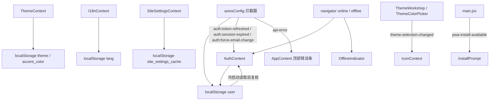
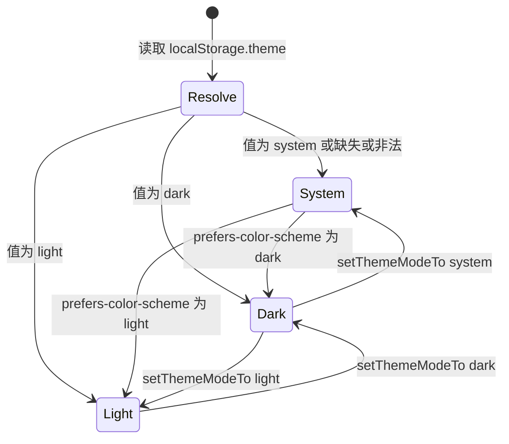

# 状态管理与浏览器持久化契约

前端**没有引入任何全局状态库**：`package.json` 里只有 `react`/`react-dom`/`react-router-dom`/`axios` 等运行时依赖，没有 Redux/Zustand/Jotai/MobX，也没有任何订阅式 store。全局状态只由 `src/App.jsx` 那棵 Provider 树上的五个 Context 持有，其余跨组件通信用两种更原始的手段——`localStorage` / `sessionStorage` 键，以及 `window.dispatchEvent(new CustomEvent(...))`。启动顺序本身见[启动链与全局 Provider 树](./boot-and-providers.md)，认证与会话的 HTTP 细节见[HTTP 层、CSRF 与双 Token 刷新](./http-and-session.md)；本页只回答三个问题：**状态归谁、落在哪个键上、什么时候被写/被清**。

图中每个箭头都是一次写入或一次事件派发：Context 拥有自己的存储键，`axiosConfig`、主题应用动作、`main.jsx` 与浏览器原生事件都是**不持有 React state 的第二写者**，只能靠「写键 + 广播事件」让 Context 跟上。

该图刻画状态所有权与跨组件同步通道：Context 与 storage 键一一归属，非 React 来源只能靠事件把变化送回 React。

## 五个 Context 的职责与持久化归属

| Context | 持有的状态 | 暴露 API | 主要消费者 | 自己拥有的存储键 |
| --- | --- | --- | --- | --- |
| `ThemeContext` | `theme`（解析后的 `dark`/`light`）、`themeMode`（`dark`/`light`/`system`）、`accentColor` | `setThemeModeTo`、`setAccentColor`、`presetColors` | `Settings`、`ThemeColorPicker`、`ThemeWorkshop`（三者都是写方）；颜色只通过 CSS 变量被全站读 | `theme`、`accent_color` |
| `I18nContext` | `lang`（`zh`/`en`）、`t`、`switchLang`、`locale`、`supportedLanguages` | `t(key, params)`、`switchLang` | 几乎每个组件、两个 class 错误边界的 `static contextType`、`BrowserCompat` | `lang` |
| `SiteSettingsContext` | `settings`（站点运行时配置对象）、`loading` | `refreshSettings` | `AppContent`（标题/favicon/manifest/meta）、`NavBar`、`Home`、`EpisodeDetail`、`CreatorPage`、`AdminSiteContent` | `site_settings_cache`（30 分钟 TTL） |
| `AuthContext` | `user`、`initializing` | `login`、`logout`、`updateUser`、`getAuthHeaders` | `AppContent`、`NavBar`、`IconProvider`、`useNotifications`、十余个页面组件 | `user`、并经 `offlineQueue` 间接拥有 `offline_queue` |
| `IconContext` | `icons`、`baseMappings`、`themeIcons`、`svgMap` | `refreshIcons`、`loadSvgContent`、`Icon` 组件 | 所有用 `<Icon name="..." />` 的位置 | **无**（纯服务端派生状态） |

这张表同时是「新增共享状态该放哪」的判据：属于外观的进 Theme，属于文案的进 I18n，属于站点级配置的进 SiteSettings，属于当前登录身份的进 Auth，属于图标/主题资源的进 Icon。

## AuthContext：服务端会话的本地快照

`AuthContext` 的名字容易让人以为它管登录态真相，实际上**真相在 httpOnly cookie 与服务端**，前端只有一份快照。

**冷启动不会用快照渲染。** `localStorage.user` 只在启动 effect 里被读出、`JSON.parse` 校验一次格式，然后 `initAuth()` 被调用——注意它接收的 `storedUser` 参数在函数体里根本没有被使用。真正的流程是：`fetchCsrfToken()` → `GET /api/auth/me`（带 `skipRedirect: true`、`_t: Date.now()` 破缓存、`AbortController`）→ 用响应覆盖 `user` 并重写快照 → 再串行 `POST /api/user-sessions/create`（上报 `screen.width/height` 与 `navigator.language`，失败 1 秒后重试一次）。`initializing` 直到 `me` 结束才置假，而 `AppContent` 在 `initializing` 为真时只渲染加载文案，所以**冷启动的可见结果完全取决于 `/api/auth/me`，与快照内容无关**。

快照的字段是**刻意收窄的六个字段**：`_id`、`accountId`、`username`、`isEmailVerified`、`role`、`avatar`（外加 `role` 兜底 `user`、`avatar` 兜底空串）。这意味着 `updateUser()` 传入的 `backgroundPrefs`、`emailNotificationPrefs`、`email` 等字段只活在 React state 里，不进快照——刷新后由 `/api/auth/me` 重新带回。唯一例外是 `axiosConfig` 在 token 刷新成功时会把 `me` 风格的对象（含 `email`、`forceEmailChange`）合并写回 `user` 键，因此该键的实际 schema 由两个写者共同决定，读方不要假设字段齐全。

**读方几乎都把它当布尔量用。** `EpisodeDetail`、`Profile`、`UpdateCalendar` 读 `localStorage.getItem('user')` 只为判断「有没有会话」再发请求（真正的用户数据来自 Context 或 API），`axiosConfig` 则把它当合并基底。这是它可以只存六个字段的前提。

**清理点有四个**：登出（`POST /api/auth/logout` 后无论成败都清）、`GET /api/auth/me` 失败、`401` 刷新失败与 `419` 刷新失败（两段响应拦截器各自 `removeItem('user')` 并派发 `auth:session-expired`）、以及快照 JSON 解析失败（此时直接 `initializing = false`，连 `me` 都不发）。**登出只清 `user` 一个键**——`site_settings_cache`、`translation_cache_v2`、`search_history`、`home_scroll_pos`、`push-notifications-enabled` 全部跨账号保留，登出不是「重置浏览器状态」。

**运行期有三个定时/事件驱动行为**：登录后每 5 分钟一次 `POST /api/user-sessions/heartbeat`（`document.visibilityState === 'hidden'` 时跳过，失败静默）；`visibilitychange` 回到前台时重发 `GET /api/auth/me` 与 `fetchCsrfToken()`（防止长时间挂起后 CSRF cookie 过期导致后续写请求 403）；`online` 时动态 `import('../utils/offlineQueue')` 并 `processOfflineQueue(axios)`。

**Context 也消费三件事**：`auth:session-expired`（仅当 `detail.type === 'user'` 才 `setUser(null)`）、`auth:force-email-change`（把 `forceEmailChange: true` 合并进当前 `user`，从而让 `AppContent` 渲染强制改邮箱弹窗）、`auth:token-refreshed`（用 `detail.user` 覆盖/合并当前 `user`）。这三条都来自 `axiosConfig` 的拦截器，详见[HTTP 层、CSRF 与双 Token 刷新](./http-and-session.md)。

## ThemeContext：两态一色，写的是 mode 不是结果

`theme` 与 `themeMode` 是两个不同的东西，混淆它们是改这块时最常见的错误：

- `theme` 是**渲染用的解析结果**，只有 `dark` / `light`，由它决定 `document.documentElement` 上整套 CSS 变量与 `data-theme` 属性；
- `themeMode` 是**用户意图**，可以是 `dark` / `light` / `system`，**只有它**被写进 `localStorage.theme`；
- 两者都从同一个 `localStorage.theme` 键初始化：`theme` 遇到 `system`（或任何非法值）就按 `matchMedia('(prefers-color-scheme: dark)')` 求值，`themeMode` 遇到非法值就回退 `system`。

该图刻画 `themeMode`（用户意图）到 `theme`（解析结果）的映射：只有 `setThemeModeTo` 会同时更新两者并落盘。

**样式写入是两级覆盖。** 第一个 effect 把 `themes[theme]` 里上百个 token 逐条 `setProperty` 到 `documentElement`；第二个 effect 再调用 `applyAccentColor(accentColor, theme)`，用 `generateColorShades()` 派生出的 `primary/primaryLight/primaryHover/primaryBg/...` 覆盖其中十几个 token，并按 dark/light 使用不同透明度，2026 增强 token（`--glow-primary`、`--mesh-color-*`、`--border-gradient-primary` 等）也在这里跟随 accent 重算。所以**改 token 表不会影响 accent 相关变量**，要改必须两处一起改。

**输入校验与兜底**：`accent_color` 只在匹配 `^#[0-9a-fA-F]{6}$` 时被采用（初值不匹配则回退 `#6366f1`），`setAccentColor` 对非法值直接 return 且不写盘；`setThemeModeTo` 只接受三个白名单值，同样非法即 return。

**`system` 模式的监听只在 `themeMode === 'system'` 期间挂载** `matchMedia` 的 `change`，切到显式 `dark`/`light` 会解绑——这是为什么手动选择后系统主题变化不再影响页面。

**没有清理钩子**：主题与 accent 是「这台设备的偏好」，登出、会话过期都不重置；也没有 `storage` 事件监听，多标签页不会自动同步（切换语言走整页 reload 是唯一的「同步」）。

## I18nContext：写键 + 整页 reload 是刻意设计

`lang` 的解析优先级是 `localStorage.lang`（只接受 `zh`/`en`，且必须存在于 `translations` 表）→ `navigator.language` 前两位 → `zh`。`t(key, params)` 按 `.` 拆路径查当前语言，缺失则回退 `zh`，再缺失返回 key 本身，支持 `{name}` 形式插值。

**`switchLang` 不更新 state，而是写 `localStorage.lang` 后 `window.location.reload()`。** 这不是省事：`index.html` head 里的同步内联脚本会在任何打包产物下载前读 `lang` 并把 `documentElement.lang` 与两处 meta 写成完整 locale，浏览器翻译/拼写检查/无障碍在首帧就完成语言判定；如果只在 React 里 `setState`，浏览器早已按旧语言做完初始判定。同理，旧浏览器遮罩里的语言切换按钮（`window.__switchCompatLang`）也是先写 `lang` 再重绘。

**effect 的副作用面**：每次 `lang` 变化写回 `localStorage.lang`，并同步四样东西——`document.documentElement.lang`、`meta[property="og:locale"]`、`meta[http-equiv="content-language"]`、`meta[name="language"]`（缺失则动态创建）。这些 meta 是给社交平台抓取与浏览器翻译用的，不是给 React 用的。

**HMR 例外**：`I18nContext` 对象优先复用 `import.meta.hot.data.I18nContext`，避免热更新时新旧 context 不匹配导致 `useContext` 拿到 `undefined`；这也是该文件没有 default export 的原因。

## SiteSettingsContext：一份带 TTL 的只读缓存

存储契约很小：键 `site_settings_cache`，值 `{ data, timestamp }`，TTL 30 分钟。

- **写**：每次 `GET /api/site-content/settings` 成功且 `res.data.content` 可解析时写入整份配置。
- **读**：`loadCachedSettings()` 命中且未过期则返回 `data`；**已过期则顺手 `removeItem` 并返回 `null`**；解析异常也只返回 `null`（不删键）。
- **不短路网络**：Provider 的挂载 effect 无论有无缓存都会 `fetchSettings()`（`if/else` 两个分支内容相同），缓存只让 `loading` 初值为假、让首帧就能渲染站点名，**正确性始终来自网络**。`fetchedRef` 保证一次挂载只拉一次。
- **刷新入口**：`refreshSettings()` 把 `fetchedRef` 复位、`loading` 置真后再拉一次，目前唯一调用方是 `AdminSiteContent` 保存站点内容之后。
- `loadCachedSettings()` 写在 Provider 函数体里，因此每次渲染都会读一次键（过期时顺带删除），但只有首次 `useState` 采用其结果。

`useSiteSettings()` 在 Provider 之外被调用时不会抛错，而是返回 `{ settings: null, loading: true, refreshSettings: noop }`——这与其他四个 Context 的「越界即抛」风格不同，改消费方时不要依赖抛错来发现位置错误。

## IconContext：零持久化的派生状态

图标引擎没有任何 storage 键，状态全部来自服务端：`GET /api/icons/list`（`icons` + `mappings`）、登录用户 `GET /api/themes/my/selection` 取 `iconsTheme`、未登录 `GET /api/themes/active` 取默认主题。拉到的 SVG 会被 `sanitizeSvg()` 清洗（去掉 `<?xml?>`/DOCTYPE、`script/foreignObject/iframe/object/embed/link` 节点、`on*` 属性与 `javascript:` 协议），并把 `fill`/`stroke` 的显式颜色改写为 `currentColor`，以 inline 方式渲染。

**它的生命周期被 `user` 与一个事件驱动**：`useEffect` 依赖 `[user, fetchThemeIcons]`，因此登录/登出会重新解析主题图标；同时监听 `theme-selection-changed` 事件，`ThemeWorkshop`/`ThemeColorPicker` 应用或取消主题后广播，它重新拉取覆盖。

**合并规则是覆盖 + 保护名单**：`mappings = { ...baseMappings, ...themeIcons }`，但 `THEME_PROTECTED_ICON_KEYS`（当前只有 `misc.logo`）内的 key 永远取全局映射——主题是用户个人外观包，不允许篡改站点品牌资产，后端同样会拒绝。因此 `IconProvider` 是「服务端配置 + 用户选择」的两层求值，不是本地可编辑状态。

## 存储键总表

### localStorage：全局/基础设施键

| 键 | 归属模块 | 写入时机 | 读取方 | 清理与过期 |
| --- | --- | --- | --- | --- |
| `user` | `AuthContext`、`axiosConfig` | 登录成功、`GET /api/auth/me` 成功、`updateUser`、token 刷新成功、`403 + forceEmailChange` 打标 | `AuthContext` 冷启动、`axiosConfig`（合并基底）、`EpisodeDetail`、`Profile`、`UpdateCalendar`（后三者只判断存在性） | 登出、`me` 失败、JSON 解析失败、`401`/`419` 刷新失败时 `removeItem` |
| `lang` | `I18nContext`、`index.html` 内联脚本 | `lang` effect 每次执行、`switchLang`、旧浏览器遮罩的语言按钮 | `I18nContext` 初值、`index.html` 早期语言脚本与遮罩 | 从不清理，仅被覆盖 |
| `theme` | `ThemeContext` | `setThemeModeTo`（存 `dark`/`light`/`system`，**不存解析结果**） | `ThemeContext` 两处初值 | 从不清理，仅被覆盖 |
| `accent_color` | `ThemeContext` | `setAccentColor`（仅 `#rrggbb`） | `ThemeContext` 初值 | 非法值不写；已存在的非法值回退默认色但**不删除** |
| `site_settings_cache` | `SiteSettingsContext` | 每次站点配置拉取成功 | `SiteSettingsContext` 挂载时 | TTL 30 分钟，读取时过期即 `removeItem` |
| `offline_queue` | `utils/offlineQueue.js` | `addToOfflineQueue`（`EpisodeDetail` 在离线且评分失败时入队）、`processOfflineQueue` 回写失败项 | `getOfflineQueue`/`processOfflineQueue`（由 `AuthContext` 的 `online` 监听触发） | 条目 24 小时过期并被过滤；同 `method+url+data` 去重；单个动作重试超过 3 次被丢弃；`clearOfflineQueue()` 已导出但**无调用方** |
| `push-notifications-enabled` | `hooks/usePushNotifications.js` | 订阅成功写 `'true'`、退订成功写 `'false'` | 同一 hook 挂载时作为 `subscribed` 初值（`NavBar`、`Settings` 各持一个实例） | 从不清理；它只是本地镜像，与浏览器 `PushManager`/服务端订阅状态可能不一致 |
| `browserCompat_bypass_<hash>` | `BrowserCompat` | 「继续访问」1 分钟后反馈选择「使用正常」时写 `'ok'` | `BrowserCompat` 挂载时 | 从不清理；`<hash>` 是 `navigator.userAgent` 的 32 位哈希，**与用户无关**，同浏览器所有账号共享 |
| `_icp` | `index.html` 遮罩、`BrowserCompat` | 取到 ICP 备案号时 | `index.html` 遮罩渲染、`BrowserCompat` 的 API 失败回退 | 从不清理；仅用于旧浏览器遮罩与兜底显示 |
| `translation_cache_v2` + `translation_cache_ttl_v2` | `utils/translationCache.js` | `setCache`（`/api/translate` 成功）后 500ms 防抖落盘 | 模块初始化时载入内存字典 | 单条 TTL 24 小时（按 `ttl` 表逐条过滤）；超过 2000 条按插入顺序淘汰；模块初始化时**主动删除**旧版 `translation_cache` / `translation_cache_ttl` |
| `search_history` | `EpisodeSearch` | 每次搜索提交 | 同一组件 | 最多 10 条，超出截断；`clearHistory()` 显式 `removeItem` |
| `fdt_dismissed_banners` | `AnnouncementBanner` | 用户关闭横幅 | 同一组件 | 只保留最近 50 个 id |
| `fdt_dismissed_announcements` | `AnnouncementPopup` | 用户关闭公告弹窗 | 同一组件 | 只保留最近 50 个 id |
| `pwa-install-dismissed` | `InstallPrompt`、`Settings` | 勾选「不再提醒」后关闭时写 `'true'` | `InstallPrompt`（挂载即退出）、`Settings`（开关初值） | `Settings` 重新打开提醒时 `removeItem` |

### sessionStorage

| 键 | 归属模块 | 写入时机 | 读取方 | 清理与过期 |
| --- | --- | --- | --- | --- |
| `home_scroll_pos` | `Home` | `scroll` 事件 100ms 防抖后写 `window.scrollY` | `Home` 在列表加载完成后恢复一次 | 从不显式清理，随标签页会话消失；只在首次加载后恢复一次（`scrollRestoredRef` 守卫） |

**存储层面没有 token。** 认证凭据只存在于 httpOnly cookie，`Login`/`ResetPassword`/`VerifyEmailChange` 里的 `token` 全部来自 URL query。`AGENTS.md` 里「token in `localStorage`」的说法与源码不符，不要据此新增 `localStorage.token` 写入。

## 跨组件同步：window 事件总线

因为没有全局 store，**非 React 来源的状态变化必须靠事件广播**。下表是当前全部通道，任何一条改动都同时影响派发方与监听方。

| 事件 | 派发方 | 监听方与行为 | 载荷/备注 |
| --- | --- | --- | --- |
| `auth:token-refreshed` | `axiosConfig` 两段响应拦截器（刷新成功） | `AuthContext` 合并 `user` | `detail.user` 为合并后的快照 |
| `auth:session-expired` | `axiosConfig`（`401` 与 `419` 刷新失败） | `AuthContext`（`detail.type === 'user'` 时置空 `user`）、`OfflineIndicator`（3 秒会话过期横幅） | `detail.type` 必须存在，否则 `AuthContext` 不处理 |
| `auth:force-email-change` | `axiosConfig`（`403` 且 body 带 `forceEmailChange`） | `AuthContext` 打标 → `AppContent` 渲染强制改邮箱弹窗 | 无 `detail` |
| `api-error` | `axiosConfig`（任何 `>= 500` 响应） | `AppContent` 顶部红色提示条，3 秒后自动消失 | `detail` 含 `status`、`message`、`messageKey`；`419` 不会触发 |
| `theme-selection-changed` | `ThemeWorkshop`、`ThemeColorPicker`（应用/取消主题、恢复默认） | `IconContext` 重新拉取主题图标覆盖 | 常量由 `IconContext` 导出，用 `new Event(...)` 而非 `CustomEvent` |
| `pwa-install-available` | `main.jsx` 的 `beforeinstallprompt` 兜底捕获 | `InstallPrompt` 读取 `window.__pwaDeferredPrompt` 并显示提示 | 原生事件可能在 React 挂载前就触发，故配合全局变量两路兜底 |
| `online` / `offline`（原生） | 浏览器 | `OfflineIndicator`（横幅）、`AuthContext`（`online` 时冲刷离线队列） | — |
| `visibilitychange`（原生） | 浏览器 | `AuthContext` 回前台时重取 `me` 与 CSRF；心跳在后台跳过 | — |

**应用主题时的写入顺序是契约**，不是实现细节：`PUT /api/themes/selection` → 用响应的 `backgroundPrefs` 调 `updateUser()` 让壁纸立即生效 → 若响应带合法 `accentColor` 则 `setAccentColor()`（写 `accent_color`）→ 最后 `dispatchEvent(theme-selection-changed)` 让图标跟上。顺序颠倒会让图标先于壁纸/主题色刷新，或让 accent 覆盖掉刚拉回的壁纸态。

## 改键与删键的影响面

存储键没有 schema 版本号，也没有迁移层，改名/删除的唯一安全做法是**同时改完读写两侧并显式处理旧数据**：

1. **先查读取方**。上表的「读取方」列就是影响面清单；`user` 与 `lang` 还有 `index.html` 内联脚本这一层 React 之外的读者——只改 `src/` 会让旧浏览器遮罩和首帧语言判定读到空值（表现为遮罩文案语言错、`<html lang>` 与页面实际语言不一致）。
2. **决定旧键怎么处置**。仓库现有两种范式：`translationCache` 在模块初始化时主动 `removeItem` 旧键名（`translation_cache`、`translation_cache_ttl`）；`SiteSettingsContext` 用 TTL 让旧结构自然失效（过期即删）。若新格式与旧值不兼容且没有 TTL，就必须像前一种那样在读取前显式删除，否则 `JSON.parse` 后的形状错误会一路传到渲染层。
3. **明确登出语义**。当前只有 `user` 会在登出时清理。任何承载「用户隐私数据」的新键都必须自己加清理（`logout` 与两个刷新失败分支），否则会跨账号泄漏到下一个登录者。
4. **明确浏览器维度**。需要「按设备/浏览器记住」而**不是按账号**的键，参考 `browserCompat_bypass_<hash>` 的写法，把维度编进键名而不是值里；不要在共享键里混合多用户数据。
5. **确认是否需要跨标签页**。目前没有任何 `storage` 事件监听，新键不会自动跨标签页同步；若确实需要，要显式加 `storage` 监听或事件广播，并说明理由。

## 新增共享状态时的决策路径

按顺序回答，命中即停：

| 问题 | 是 | 否 |
| --- | --- | --- |
| 真相是否在服务端？ | 进对应 Context，用 `GET /api/auth/me` 这类接口在启动时复核，本地只留缓存/快照 | 继续 |
| 是否「当前登录用户」的属性？ | 进 `AuthContext`；若需随刷新保留，先决定是进快照还是靠 `me` 取回（默认后者） | 继续 |
| 是否站点级配置/文案/主题/图标资源？ | 分别进 `SiteSettingsContext` / `I18nContext` / `ThemeContext` / `IconContext` | 继续 |
| 是否仅一个组件自用（抽屉开合、草稿、历史记录）？ | 组件内 `useState` + 可选 storage 键，不进 Context | 继续 |
| 是否需要跨组件即时同步？ | 用 Context；若写方不在 React 树内（拦截器、`index.html`、Service Worker），再用 `window` 自定义事件广播 | 组件局部状态 |

**不要为了「顺手」引入全局 store。** 现有约定的收益是：状态所有权与 Provider 顺序一一对应（见[启动链与全局 Provider 树](./boot-and-providers.md)），任何状态都能追到唯一持有者；代价是没有跨标签页同步、没有中间件、没有 devtools 时间旅行。引入 store 会让「谁写 `localStorage`」变成不可枚举的问题，因此必须给出理由并同步改写本页的所有权表。

## 已知缺口与失败语义

- **多标签页不同步**：`theme` / `accent_color` / `lang` / `user` 在其它标签页都不会刷新；`lang` 只是靠 reload 让本页生效。
- **`offline_queue` 不按用户隔离**：队列里只有 `method/url/data`，冲刷发生在任意一次 `online`，登出也不清空。若 A 用户离线评分后 B 用户登录，队列会带着 B 的 cookie 重放，失败会走 `401` → 清快照 → 跳登录。
- **`clearOfflineQueue` 是死代码**：导出了但无人调用，队列的收缩完全依赖 24 小时 TTL 与 3 次重试上限。
- **`push-notifications-enabled` 会失真**：它只在 `subscribe`/`unsubscribe` 成功时更新，浏览器侧被系统设置撤销或服务端清理订阅后，本地仍显示已开启。
- **`user` 快照字段不完整**：`AuthContext` 收窄写、`axiosConfig` 全量合并，两者对同一键的 schema 不一致；依赖 `email`、`forceEmailChange` 之外的扩展字段会出现「刷新后消失」。
- **`site_settings_cache` 不随管理端改动作废**：只有 `AdminSiteContent` 自己调 `refreshSettings()`，其它标签页/其它管理员的缓存最多滞后 30 分钟。
- **无测试防护网**：`package.json` 只有 `dev/build/lint/preview/generate-icons`，没有测试运行器。状态契约的验证只能靠 `npm run lint` 加手动场景：登出后刷新（`user` 已清）、断网评分后恢复网络（队列冲刷）、切换 `system` 主题后改系统外观（`matchMedia` 生效）、清空 `site_settings_cache` 后首帧（站点名回退）、以及应用主题后图标是否即时刷新（事件是否派发）。
