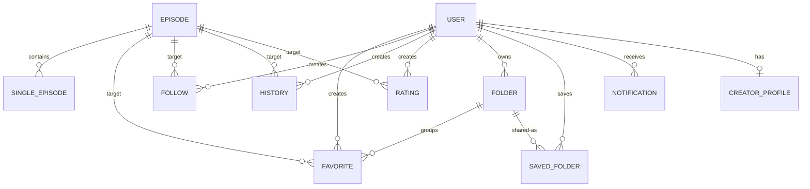
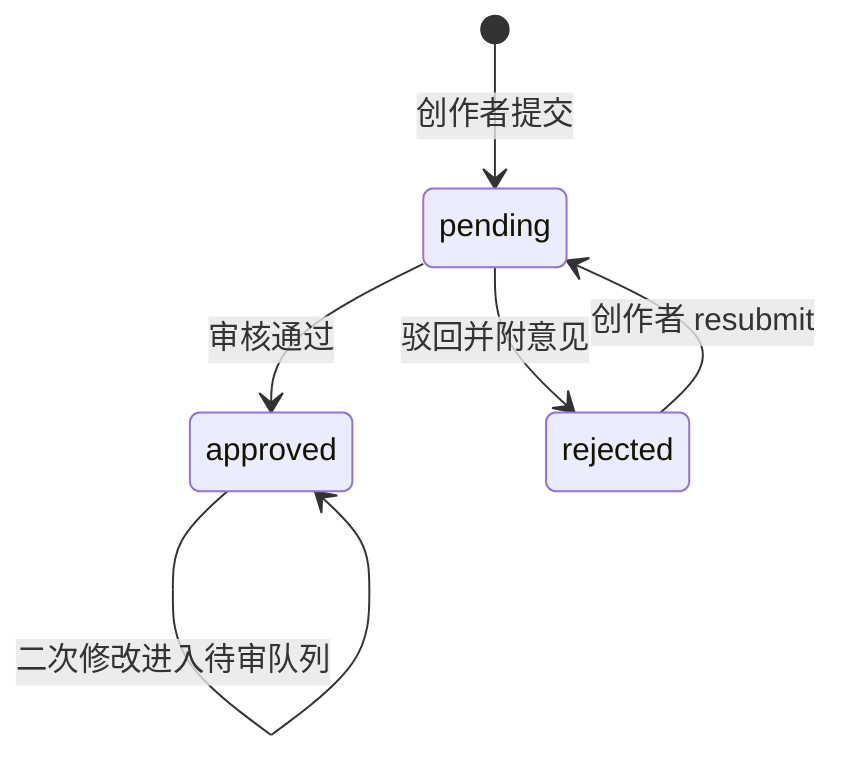

# 领域模型与术语表

这一页回答「前端到底认哪些字段、哪些取值、哪些约定」。所有条目都以前端代码实际读取或写入的形态为准：后端字段真值（索引、校验、默认值、级联删除规则）以后端仓库为唯一权威，本页只在能从前端调用点观察到的范围内陈述语义。名字对不上时，以 `src/utils/apiEndpoints.js` 里的路径与页面/组件里的字段拼写为准。

两个贯穿全站的前提：

- **认证与授权不在领域模型里表达**。会话靠 httpOnly cookie，`getAuthHeaders()` 直接返回空对象；前端的角色判断只决定渲染什么，不构成授权（见[路由分区与访问守卫](../architecture/routing-and-guards.md)）。
- **多语言字段是「同名字段 + 语言后缀」**。`title`/`titleEn`、`description`/`descriptionEn`、`siteName`/`siteNameEn` 成对出现；当前语言后缀缺失时回退到原始字段，再回退到服务端机器翻译（`POST /api/translate`，见 `src/hooks/useTranslation.js`）。

## 实体关系总览

图示：所有用户侧实体都以「用户 + 剧集」为复合语义（收藏、关注、历史、评分），文件夹再给收藏加一层分组；单集只挂在剧集下，不直接被收藏或评分。

## 剧集 Episode

剧集是内容主实体，`_id` 是前台路由 `/episode/:id` 的唯一标识，也是收藏、关注、历史、评分、通知里 `episodeId` 指向的对象。字段分三类。

| 字段 | 类型 / 取值 | 前端语义 |
| --- | --- | --- |
| `title` / `titleEn` | string | 主标题与英文标题；`getLocalizedTitle()` 按语言后缀取，缺失时回退 `title` 再走机翻 |
| `description` / `descriptionEn` | string | 简介，同上回退链 |
| `coverImage` | url | 封面，编辑时按 2:3、400×600 裁剪并上传到 `/api/episodes/upload` |
| `category` | string[] | 分类名数组（API 字段名是单数 `category`，表单内部叫 `categories`，提交时映射回 `category`） |
| `tags` | string[] | 自由标签，前台可点击跳 `/?tag=...` |
| `status` | `ongoing` \| `completed` \| `upcoming` | 连载中 / 已完结 / 即将上映；卡片按这三个值取 i18n 标签，**未知值回退成 `ongoing`**，而详情页的三元表达式会把未知值显示成「即将上映」 |
| `totalEpisodes` | number \| **null** | `null` 表示「总集数未知」，与 `0` 语义完全不同 |
| `currentEpisodes` | number | 已更新到的集号；配合 `totalEpisodes` 渲染「第 N/M 集」或「更新至第 N 集」 |
| `premiereDate` | ISO 时间 \| null | 首播时间，只在 `status === 'upcoming'` 时有意义，可显式「暂无首播时间」 |
| `updateDay` | string | 更新日（周更节奏），随剧集一起提交 |
| `views` | number | 浏览量，详情页加载时会 `PUT /api/episodes/:id/view` 自增 |
| `averageRating` / `ratingCount` | number | 评分聚合值，写入评分接口后由响应回填 |
| `hideCreator` | boolean | 仅隐藏 `createdBy`，不影响 `allowedEditors` 与 `customAuthors` |
| `createdBy` / `allowedEditors` / `customAuthors` | 用户对象或用户 id | 作者展示的三个来源，前端合并后按 `_id` 去重 |
| `qqGroupLink` / `qqGroupNumber` | string | 交流群链接与群号，纯展示与表单字段 |
| `reviewStatus` 等审核字段 | 见下节 | 内容是否对外可见的开关 |
| `episodes` | 单集数组 | 详情接口 `GET /api/episodes/:id` 直接内联返回，前端不再单独拉列表 |

几条容易踩的约定：

- **`totalEpisodes: null` 是「未知」，不是「零」**。表单用只存在于前端的 `unknownTotalEpisodes` 布尔开关表达它，并在提交前 `delete submitData.unknownTotalEpisodes`，同时把 `totalEpisodes` 置为 `null`。任何在后端或前端把它当数字兜底成 `0` 的地方都会导致进度条与「第 N/M 集」文案错乱。
- **作者展示是三个来源的并集**，`hideCreator` 只摘掉创建者，受权编辑者与自定义作者照常显示。
- **`status` 的取值同时驱动列表筛选**：首页 `?status=` 参数直接透传该枚举值，`rating` 筛选则映射为 `minRating` 查询参数。

`src/components/EpisodeFormModal.jsx` 与 `src/hooks/useEpisodeForm.js` 是一套更精简的剧集表单与校验（只校验 `title`/`description`/`coverImage`/`totalEpisodes`，编辑态多一个 `changeSummary`），但当前**没有任何组件引用 `EpisodeFormModal`**，线上真正使用的编辑入口是 `AdminEpisodes` 的内联表单。要改剧集字段与校验，应改 `AdminEpisodes`，不要以 `EpisodeFormModal` 为准。

## 单集 SingleEpisode

单集是剧集的子文档，接口路径分层如下：

| 动作 | 路径 |
| --- | --- |
| 列表 | `GET /api/episodes/:id`，取响应里的 `episodes` 数组 |
| 新增 | `POST /api/episodes/:id/episodes` |
| 修改 / 删除 | `PUT`、`DELETE /api/episodes/single/:id` |
| 播放计数 | `PUT /api/episodes/single/:id/view` |

| 字段 | 类型 | 语义 |
| --- | --- | --- |
| `episodeNumber` | number | 集号，是「已看集数」「新集提示」的全部比较基准 |
| `title` / `titleEn` | string | 集标题；多语言回退同剧集。转正时的更新请求还会把已有的 `titleJa` 原样透传，表单本身不编辑它 |
| `duration` | string | 时长，自由文本 |
| `platformLinks` | `{ 平台名: url }` | 跳转链接映射；表单内部用 `{name, url}` 列表编辑，提交时转成对象，读取时再转回列表 |
| `releaseDate` | ISO 时间 \| null | 已发布集的实际发布时间 |
| `isScheduled` | boolean | 是否为「预告」集 |
| `scheduledDate` | ISO 时间 \| null | 预告的预定发布时间；预告可「不设日期」 |
| `isUpcoming` | boolean | 预告状态标记；`true → false` 由后端解释为「转正」 |

**`isScheduled` 决定 `scheduledDate` 与 `releaseDate` 互斥**：提交时若 `isScheduled` 为真，`releaseDate` 一律置 `null`，`scheduledDate` 在勾选「不设预告日期」时也置 `null`；若为假，则 `scheduledDate` 置 `null`、`releaseDate` 取表单值（空则 `null`）。破坏这条互斥会让同一条单集同时带有「预告」与「已发布」两套时间语义。

「一键转正预告集」是前端能观察到的最重要副作用：`SingleEpisodeManager` 的发布按钮把 `isScheduled` 置 `false`、`releaseDate` 置当前时间后调用 `PUT /api/episodes/single/:id`。该组件的注释记录了后端的连锁反应——`isUpcoming` 由 `true` 变 `false` 时把 `currentEpisodes` 加一，并向追番用户发通知；注意请求体本身并**不显式发送 `isUpcoming`**，转正判定是后端根据这次更新推断的。因此**单集操作会改动剧集级别的计数与通知**，不是纯子文档写入。

## 审核态 reviewStatus

`reviewStatus` 是三值枚举，前端所有与审核相关的 UI 都围绕它：

| 值 | 含义 | 前端表现 |
| --- | --- | --- |
| `pending` | 待审核 | 黄色徽章；详情页禁止搜索引擎收录 |
| `approved` | 已通过 | 绿色徽章；正常公开 |
| `rejected` | 已驳回 | 红色徽章；附审核意见，创作者可重新提交 |

图示：剧集审核态的流转；`approved` 之后的新修改不直接改写正文，而是另存为待审修改。

- **徽章组件对未知值有兜底**：`ReviewStatusBadge` 用 `statusStyles[status] || statusStyles.pending` 取配色，`statusLabelKeys` 命中才翻译，否则直接显示原始字符串。所以拼错的状态值不会报错，只会静默变成黄色待审样式。
- **「待审修改」是独立于 `reviewStatus` 的第二层状态**：已通过的剧集被再次编辑时，后端把改动放进 `pendingChanges` 并置 `hasPendingChanges`，原审核通过的字段继续对外展示；`changeSummary`（`pendingChangeSummary`）记录这轮改动说明，同时写入剧集版本历史。创作者再次编辑时，表单优先加载 `pendingChanges` 而不是正文，避免覆盖已上线内容。
- **驳回重提**走 `POST /api/episodes/:id/resubmit`，把 `rejected` 拉回 `pending`。
- **兜底不一致**：详情页的 noindex 判定写作 `episode.reviewStatus && episode.reviewStatus !== 'approved'`，即**缺失 `reviewStatus` 视为可收录**；而审核列表用 `ep.reviewStatus || 'pending'`、创作者档案列表用 `reviewStatus || 'approved'`。历史数据里没有 `reviewStatus` 的剧集因此在三处得到不同默认值。
- 创作者（`role === 'creator'`）在后台只看到自己的剧集：列表走 `GET /api/creator/my-episodes`，而不是公开的 `/api/episodes`。

审核操作面与字段级差异见[剧集发布与审核流程](../workflows/episode-publishing-and-review.md)。

## 收藏、收藏夹与他人收藏夹

三个概念要分清：

| 概念 | 实体 | 关键字段 | 接口 |
| --- | --- | --- | --- |
| 收藏 | favorite | `episodeId`、`folderId`（可为 `null`） | `POST /api/favorites/add`、`/api/favorites/remove`、`GET /api/favorites/list`、`GET /api/favorites/counts` |
| 收藏夹 | folder | `name`、`description`、`type: 'favorite'`、`userId`（创建者，填充 `username`）、`createdAt` | `GET/POST/PUT/DELETE /api/folders[/:id]`、`POST /api/folders/:id/items`、`DELETE /api/folders/:id/items/:episodeId` |
| 他人收藏夹 | saved-folder | `shareToken`、`folderName`、`creatorName` | `GET/POST /api/saved-folders`、`DELETE /api/saved-folders/:id` |

- **文件夹按 `type` 分域**：查收藏夹必须带 `?type=favorite`，新建时也要显式传 `type: 'favorite'`，否则拿到的可能是别的用途的文件夹。
- **「未分类」不是一条真实文件夹记录**。前端用页内哨兵 `'unclassified'`，请求时把 `folderId` 参数写成**字符串 `'null'`**（`params.folderId = 'null'`），后端据此返回不属于任何文件夹的收藏；这些收藏记录的 `folderId` 是 `null`。分享未分类收藏时，前端为它临时构造一个带 `isUnclassified: true` 的假 folder 对象（仅用于切换分享端点），该标记不来自后端。把哨兵写成 `undefined` 会退化成「全部收藏」。
- **计数结构固定**：`GET /api/favorites/counts` 返回 `{ total, unclassified, folders: { [folderId]: count } }`，前端把它摊平成 `{ unclassified, ...folders }` 作为侧边栏角标。增删收藏/移动分组后，前端是**本地增减计数**而不是重拉，因此任何一条路径漏改计数都会让角标长期偏差。
- **移出文件夹等于回到未分类**：`DELETE /api/folders/:id/items/:episodeId` 之后该收藏仍然存在，只是 `folderId` 变 `null`；删除文件夹同理，前端把当前视图切回 `'unclassified'`。

### 分享与保存他人收藏夹

分享链路是「生成令牌 → 公开只读页 → 他人保存引用」：

1. 收藏夹所有者调用 `POST /api/folders/:id/share` 拿到 `shareToken`；未分类收藏用 `POST /api/folders/share-unclassified`。分享弹窗每次打开都会重新生成链接。
2. 任何人访问 `/shared-folder/:shareToken`，前端 `GET /api/folders/shared/:shareToken`，响应含 `name`、`description`、`count`、`creatorName`、`creatorId`、`createdAt` 与 `episodes[]`（剧集对象，含 `coverImage`、`currentEpisodes`、`totalEpisodes`、`averageRating`）。该页无需登录。
3. 登录用户可 `POST /api/saved-folders` 保存（请求体只带 `shareToken` 与 `creatorName`），得到一条 `saved-folder` 记录；个人中心按 `shareToken` 匹配展示，并用 `DELETE /api/saved-folders/:id` 移除。**保存的是引用而不是副本**：所有者删改收藏夹内容后，保存者看到的内容随之变化。
4. `creatorId === user._id` 时前端隐藏「保存」按钮（自己的收藏夹不能保存自己）。

## 关注、观看历史与继续观看

| 实体 | 字段 | 语义 |
| --- | --- | --- |
| follow | `episodeId`、`followedAtEpisodes` | 关注关系 + 关注当时的已更新集号 |
| history | `episodeId`、`watchedEpisodes: number[]` | 观看历史，元素是**集号**而非单集 `_id` |

- **`followedAtEpisodes` 是「新集」判定基线**：个人中心把 `1..currentEpisodes` 与 `watchedEpisodes` 求差集，其中集号 `> followedAtEpisodes` 的未看集显示红色「有更新 +N」，其余未看集只显示黄色计数。详情页同样用 `singleEpisode.episodeNumber > followedAtEpisodes && !isScheduled` 打「新」标记。该值为 `null` 时两类提示都不出现，所以关注接口必须回传它（`POST /api/follows/add` 的响应直接写入该状态）。
- **`watchedEpisodes` 存集号**，删除或重排单集会让历史记录指向不同的集，这是该模型固有的脆弱点。
- **记录观看是显式动作**：只有用户点击平台跳转链接后才 `POST /api/histories/record`（`{ episodeId, episodeNumber }`），打开播放弹窗本身只做 `PUT /api/episodes/single/:id/view` 计数。记录成功后前端顺手 `PUT /api/notifications/read-episode/:episodeId`，把该剧集相关通知标记为已读。
- **继续观看**由 `GET /api/histories/continue-watching` 提供，登录后首页拉取渲染「继续观看」栏。返回的元素就是历史记录本身：`episodeId` 已填充为剧集对象（取 `coverImage`、`title`、`totalEpisodes`），进度条宽度按 `watchedEpisodes.length / totalEpisodes` 计算，`totalEpisodes` 为 `null` 时进度固定为 0。删除单条历史用 `DELETE /api/histories/:episodeId`。
- **一次请求拿到全部用户态**：`GET /api/episodes/:id/user-status` 返回 `isFollowing`、`followedAtEpisodes`、`watchedEpisodes`、`score`、`isFavorite`。新增用户侧状态时应扩展这个聚合端点，而不是各自打请求。

## 评分 Rating

- 取值是**1–5 星整数**，UI 就是五个星按钮；提交 `POST /api/ratings`（`{ episodeId, score }`），响应回填剧集的 `averageRating` 与 `ratingCount`，前端就地更新，不重拉剧集。
- **重复评分覆盖本地记录**：前端只维护一个 `userRating`（当前用户对该剧集的分数），再次点星会重新 `POST /api/ratings` 并用响应覆盖本地 `userRating` 与聚合值。
- **撤回**走 `DELETE /api/ratings/:episodeId`，同样回填新的聚合值。
- 离线时评分请求失败会进入离线队列（`/api/ratings` + `{ episodeId, score }`），联网后重放。

## 创作者档案 CreatorProfile

创作者档案是挂在创作者账号上的公开主页数据，也是唯一一个有独立审核流的用户产出物。

| 字段 | 语义 |
| --- | --- |
| `displayName`、`avatar`、`bio` | 展示名、头像、简介 |
| `socialLinks` | `{ 平台名: url }` 映射，表单用列表编辑 |
| `qqGroupLink` | 交流群链接 |
| `reviewStatus`、`reviewNote`、`pendingChanges` | 与剧集同构的审核三元组 |

- 创作者自己（`role` ∈ `{creator, admin, superadmin}`）在 `/admin/creator-profile` 编辑，走 `GET/PUT /api/creator-profile/my-profile`；`pending` 状态下表单整体禁用，避免重复提交。
- 超管在 `/admin/creator-profiles` 审核：`PUT /api/admin/creator-profiles/:id/approve` 把 `pendingChanges` 落到正式字段并清空；`PUT .../reject` 保留 `pendingChanges` 供修改重提，请求体里的 `note` 由后端记录为 `reviewNote`，创作者侧在 `rejected` 状态下原样回显。
- 公开页 `/creator/:id` 用 `GET /api/creator-profile/by-creator/:id`，响应是 `{ profile, episodes }` —— 档案与其剧集列表一次返回。

## 通知 Notification

通知是纯消费型实体：前端只读（SSE 推送 + 列表 + 未读数）、标记已读、删除，不创建。

| 字段 | 语义 |
| --- | --- |
| `type` | 通知类型，决定文案模板 |
| `isRead` | 已读标记 |
| `message` | 兜底文案，未知 `type` 时直接渲染（可机翻） |
| `episodeTitle` / `episodeTitleEn` | 关联剧集标题 |
| `metadata` | 类型专用载荷，见下表 |

| `type` | `metadata` 关键字段 | 文案键 |
| --- | --- | --- |
| `new_episode` | `episodeNumber`、`isPreview`、`previewUpdateType`（`video` / `info`） | `notification.newEpisode`、`newEpisodePreview`、`previewVideoUpdate`、`previewInfoUpdate` |
| `status_change` | `status` | `notification.statusChange` |
| `review_result` | `status`、`note` | `notification.reviewApproved`、`reviewRejected` |
| `feedback_reply` | `reply` | `notification.feedbackReply` |
| `friend_link_apply` / `friend_link_status` | `name`、`status` | `notification.friendLinkApply`、`friendLinkStatus` |
| `report_result` | `status`（`resolved` 表示采纳） | `notification.reportResult` |
| `reminder` | 无 | `notification.reminder` |

- `new_episode` 有兼容逻辑：`metadata.episodeNumber` 缺失时从 `message` 里正则抓「第 N 集」。
- **未读数只有一个真源**：`GET /api/notifications/unread-count` 每 60 秒轮询一次，SSE 消息里携带的 `unreadCount` 直接覆盖本地值（不再按 `type === 'new'` 自增），避免虚增。
- SSE 需要先 `GET /api/auth/sse-ticket` 换票据再连 `/api/notifications/stream?ticket=...`，断线最多重连 5 次，退避从 5 秒指数增长到 60 秒上限。
- 提醒订阅是独立端点：`POST /api/notifications/subscribe-reminder`（`{ episodeId }`），用于更新日历里「更新提醒」。
- 阅读相关通知的另外两个批量动作：`PUT /api/notifications/read-all`、`DELETE /api/notifications/clear-read`（清除已读）。

## 主题两槽模型：壁纸槽 + 图标槽

主题（theme）是「壁纸 + 图标」的组合包，用户的选择被拆成**两个互不影响的槽**：

| 概念 | 前端标识 | 说明 |
| --- | --- | --- |
| 壁纸槽 | `wallpaperThemeId` | 决定页面背景，写入 `user.backgroundPrefs` |
| 图标槽 | `iconsThemeId` | 决定 `Icon` 组件的映射覆盖 |
| 站点默认主题 | `GET /api/themes/active` | 未登录或槽为空时的兜底 |

- 选择读：`GET /api/themes/my/selection` 返回 `{ wallpaperTheme, iconsTheme, wallpaperIsDefault, iconsIsDefault }`；`*IsDefault` 为真表示该槽在吃站点默认主题，界面上**不算用户的选择**，不高亮。
- 选择写：`PUT /api/themes/selection`，请求体可只带一个槽（`{ wallpaperThemeId }` 或 `{ iconsThemeId }`），也可两槽同写；传空字符串表示清空该槽。响应可能带 `backgroundPrefs`（需同步到当前 `user`）与 `accentColor`（主题色，合法 `#rrggbb` 才应用）。
- 背景生效优先级（`App.jsx`）：用户 `backgroundPrefs.image && enabled` → 用用户壁纸；用户壁纸槽为空 → 回落站点默认主题壁纸；用户**显式关闭**（`image` 存在但 `enabled === false`）→ 不回落。透明度与模糊通过 CSS 变量 `--bg-opacity`、`--bg-blur` 下发。
- 背景微调是独立端点 `PUT /api/themes/background-prefs`，只影响壁纸槽，不动图标槽。

### 主题内容与类型

主题文档的前端可见字段：`name`、`description`、`wallpaperUrl`、`wallpaperThumb`、`icons`（`{ 组件键: svgUrl }`）、`accentColor`、`themeType`、`status`。类型由内容推导（`computeThemeType`），`themeType` 缺失时才现算：

| 类型 | 判定 | 能否应用 |
| --- | --- | --- |
| `full` | 有壁纸且有图标 | 能，需选择应用到哪一部分（`wallpaper` / `icons` / `both`） |
| `wallpaper` | 只有壁纸 | 能，直接进壁纸槽 |
| `icons` | 只有图标 | 能，直接进图标槽 |
| `legacy` | 两者都没有（旧版配色主题） | **不能**，前端直接拒绝应用 |

主题审核与剧集审核同构但字段名不同：用 `status` ∈ `pending` / `approved` / `rejected`，审核入口 `POST /api/themes/:id/review`（`action: approve|reject`，驳回必须填 `note`）。**`status` 缺失的历史主题视为已上架**（归入「已通过」列表）。通过后主题升级为系统主题上架市场，结果由后端向作者发站内通知。把主题设成站点默认走 `PUT /api/themes/:id/default`。

两槽与图标引擎的完整机制见[主题与图标](../systems/theming-and-icons.md)。

## 图标组件键与映射

图标引擎的核心契约是「组件键」：`<Icon name="nav.home" />` 不直接引用文件，而是查一张 `组件键 → SVG URL` 的映射表。

- 注册表 `ICON_COMPONENT_KEYS` 是唯一的真源，按前缀分五组：`nav.*`（导航入口）、`action.*`（按钮动作）、`status.*`（播出状态徽章）、`tab.*`（首页栏目标题）、`misc.*`（站点身份与零散图示）。主题编辑器 `ThemeEditorModal`（管理后台 `/admin/themes` 与用户主题工坊共用）的图标选择器过滤掉保护名单后逐项渲染这个数组，`IconLocationPreview` 也按 key 取位置说明；新增可换图位置必须同时加入该数组并在使用点补 `<Icon name=... />`，否则无法被绑定。
- 运行时映射是两层合成：全局映射（`GET /api/icons/list` 的 `mappings`）+ 主题图标覆盖（登录取 `my/selection` 的 `iconsTheme.icons`，未登录取 `/api/themes/active` 的 `theme.icons`）。覆盖是逐键替换，不是整体替换。
- **保护名单 `THEME_PROTECTED_ICON_KEYS = ['misc.logo']`**：主题不得覆盖站点 Logo，前端合成时跳过、后端同样校验拒绝。这是唯一一类「主题不能改」的组件键。
- SVG 会先清洗再内联渲染：去掉 XML 声明/DOCTYPE、`script`/`foreignObject`/`iframe`/`object`/`embed`/`link` 节点、`on*` 事件属性与 `javascript:` 协议，并把显式 `fill`/`stroke` 颜色统一改成 `currentColor`，使图标跟随主题色。清洗失败或加载失败的键回退到调用方给的 `fallback`（通常是 emoji）。
- 主题选择变化通过 `window` 事件 `THEME_SELECTION_CHANGED_EVENT`（`'theme-selection-changed'`）广播，`IconProvider` 监听后重拉覆盖；增删图标后管理页调用 `refreshIcons()` 重建缓存。

## 站点内容键 SiteContent

站点文案是「键 → 一条记录」的键值模型，`content` 字段是**JSON 字符串**（不是对象），前端各处 `JSON.parse` 后再取字段。

| 键 | 消费方 | 内容形态 |
| --- | --- | --- |
| `settings` | `SiteSettingsContext`（全局缓存）、`NavBar`、`App` | 站点名、欢迎语、favicon、浏览器标题、PWA 名称/图标/主题色等，中英字段成对 |
| `about` | `/about` | `banner`、`logo`、`description`、`version`、`updates[]`、`changelog[]`、`icp`、`policeRecord`、`aiDisclaimer`、`copyright` |
| `privacy` / `terms` / `license` | `/privacy`、`/terms`、`/license` | 富文本，支持 `{zh, en}` 或 `contentZh`/`contentEn` 等本地化写法 |
| `email` | 后台邮件设置 | 邮件模板配置，`POST /api/site-content/test-email` 试发 |
| `pwa-manifest` | `App` 动态挂载 `<link rel="manifest">` | 非键值记录，直接返回 manifest JSON |

- 读单键：`GET /api/site-content/:key`；列出全部：`GET /api/site-content/`（返回带 `key`、`title`、`content` 的数组）；写：`PUT /api/site-content/:key`（`{ title, content }`）。
- `settings` 由 `SiteSettingsContext` 缓存到 `localStorage.site_settings_cache`，TTL 30 分钟；后台保存 `settings` 后调用 `refreshSettings()` 立即刷新，否则前台最长要等半小时才看到新的站点名/欢迎语。
- 本地化取值有两套兜底并存：`getLocalizedContent()` 先看 `字段 + 语言后缀`，再走机翻；`SitePage` 的通用 `resolveContent()` 还额外兼容 `{zh, en}` 对象与 `content`/`contentZh` 字段。新增内容键时应保留这层宽松解析，否则旧数据会渲染成空白。

站点文案与公告、友链的关系见[站点设置与公告](../systems/site-settings-and-announcements.md)。

## 角色 user / creator / admin / superadmin

`role` 存在于用户对象（默认 `'user'`，`AuthContext` 写入 localStorage 时补默认值），后台会话则由 `GET /api/admin/verify` 返回的 `admin.role` 表达。四种角色在前端的能力差异：

| 角色 | 前台 | 后台入口 | 典型可做动作 |
| --- | --- | --- | --- |
| `user` | 全部公开页；收藏/关注/评分/历史/主题工坊 | 无 | 消费者行为，可提交反馈与举报 |
| `creator` | 同 user | `/admin/dashboard`、`/admin/episodes`（仅自己的剧集）、`/admin/creator-profile` | 提交/维护自己的剧集，编辑创作者档案（需审核） |
| `admin` | 同 user | 增加 `/admin/categories`、`/admin/banners`、`/admin/review`、`/admin/episode-trash`、`/admin/feedback`、`/admin/reports`、`/admin/analytics` | 审核剧集、指派受权编辑者、处置举报与反馈、查看分析 |
| `superadmin` | 同 user | 全部后台页 | 用户与设备会话管理、创作者档案审核、站点内容、邮件设置、审计日志、备份、友链、主题管理与主题审核、API 用量 |

需要记住的边界：

- 「更多」菜单里的后台入口只对 `{admin, superadmin, creator}` 出现；`AdminDashboard` 再按 `admin.role` 增删卡片。两者都是**可见性过滤**。
- 每个后台页面自己再判一次角色，越权访问一律 `replace` 回 `/admin/dashboard`：`superadmin` 专属页（用户、会话、审计、备份、站点内容、邮件、友链、API 用量、主题审核、创作者档案列表）用 `admin.role !== 'superadmin'` 拦截；剧集审核 `review` 要求 `admin` 或 `superadmin`。
- 剧集列表的数据源随角色分叉：`creator` 走 `/api/creator/my-episodes`，其他后台角色走 `/api/episodes`。
- 角色改名、新增角色时必须同步四处：`AuthContext` 的默认值、`NavBar` 的入口集合、`AdminDashboard` 的卡片判定、各后台页的守卫与 `AdminUsers` 的角色标签/筛选。

## 术语表

| 中文 | English | 代码 / 接口标识 | i18n 键示例 |
| --- | --- | --- | --- |
| 剧集 | Episode | `episode`、`/api/episodes` | — |
| 单集 | Single episode | `episodeNumber`、`/api/episodes/:id/episodes` | `singleEpisode.title` |
| 预告集 / 转正 | Preview episode / publish | `isScheduled`、`isUpcoming`、`scheduledDate` | `singleEpisode.setPreview`、`markPublished` |
| 连载中 / 已完结 / 即将上映 | Ongoing / Completed / Upcoming | `status` | `home.statusOngoing`、`statusCompleted`、`statusUpcoming` |
| 总集数未知 | Unknown total episodes | `totalEpisodes: null` | `adminEpisodes.unknownTotalEpisodes` |
| 更新至第 N 集 | Updated to episode N | `currentEpisodes` | `home.episodeProgressUnknown` |
| 审核态 | Review status | `reviewStatus` | `adminReview.pending`、`approved`、`rejected` |
| 待审修改 | Pending changes | `hasPendingChanges`、`pendingChanges` | `adminEpisodes.pendingChangesTag` |
| 变更说明 | Change summary | `changeSummary` | `version.changeSummary` |
| 收藏 | Favorite | `/api/favorites/*` | `episode.favoriteLabel` |
| 收藏夹 | Favorite folder | `/api/folders?type=favorite` | `profile.defaultFolder` |
| 未分类 | Unclassified | `folderId: 'null'` 查询哨兵 | `profile.unclassified` |
| 分享令牌 | Share token | `shareToken`、`/shared-folder/:shareToken` | `share.shareFolder` |
| 他人收藏夹 | Saved folder | `/api/saved-folders` | `profile.savedFolders` |
| 关注 | Follow | `/api/follows/*`、`followedAtEpisodes` | `episode.follow`、`episode.unfollow` |
| 观看历史 | Watch history | `/api/histories/list`、`watchedEpisodes` | `profile.watched` |
| 继续观看 | Continue watching | `/api/histories/continue-watching` | `home.continueWatching` |
| 评分 | Rating | `/api/ratings`、`score`、`averageRating`、`ratingCount` | `episode.myRating` |
| 创作者档案 | Creator profile | `/api/creator-profile/*`、`pendingChanges` | `adminCreatorProfile.title` |
| 通知 | Notification | `/api/notifications/*`、`type`、`isRead` | `notification.newEpisode` 等 |
| 主题 | Theme | `/api/themes/*`、`wallpaperUrl`、`icons` | `themeEditor.typeFull` |
| 壁纸槽 / 图标槽 | Wallpaper slot / Icon slot | `wallpaperThemeId` / `iconsThemeId` | `themeWorkshop.applied` |
| 站点默认主题 | Site default theme | `GET /api/themes/active` | — |
| 组件键 | Icon component key | `ICON_COMPONENT_KEYS`、`name="nav.home"` | — |
| 图标映射 | Icon mapping | `mappings`、`/api/icons/list` | — |
| 站点内容键 | Site content key | `settings`、`about`、`privacy`… | — |
| 角色 | Role | `user`、`creator`、`admin`、`superadmin` | `adminUsers.superAdmin` |

## 改动这几处时要连带检查什么

- 改剧集字段：`AdminEpisodes` 表单、`EpisodeDetail` 展示、`EpisodeCard` 摘要、审核差异表 `PENDING_DIFF_FIELDS`、审核列表展示五处都要动；`EpisodeFormModal` 与 `useEpisodeForm` 目前是死代码。
- 改审核取值：`ReviewStatusBadge` 的样式/标签映射、`AdminReview` 的 tab、`EpisodeDetail` 的 noindex 判定，以及上文提到的三处默认值分歧。
- 改收藏/文件夹：`Profile`（增删改、移动、计数本地增减）与 `EpisodeDetail`（收藏按钮 + 文件夹选择器）是两条独立实现，容易只改一处。
- 改图标可绑定位置：必须同时更新 `ICON_COMPONENT_KEYS`、使用点的 `<Icon name=... fallback=...>`，并确认该键是否属于 `THEME_PROTECTED_ICON_KEYS`。
- 改站点内容结构：`AdminSiteContent` 的编辑器、`SitePage` 的宽松解析、`SiteSettingsContext` 的缓存 TTL 三者要一起评估，否则会出现「后台已保存、前台仍旧值」。
