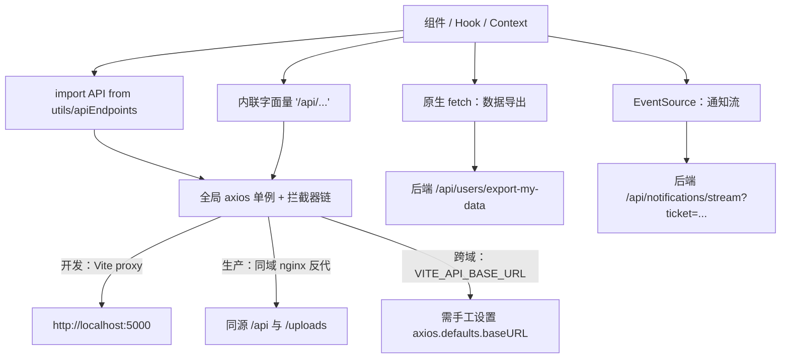
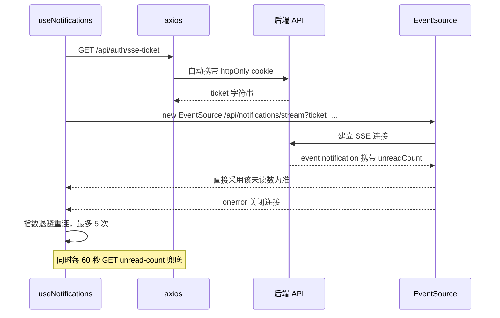
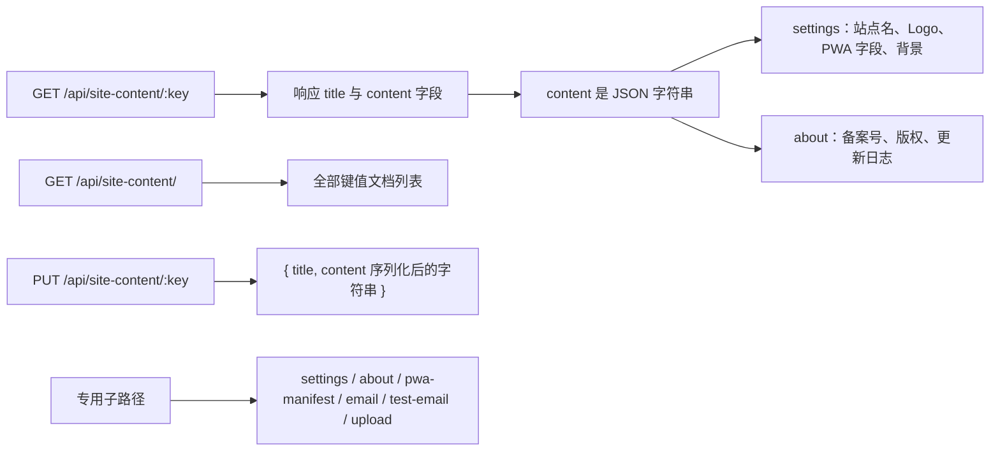

# 后端契约地图（API 分组与错误语义）

本仓库只有前端，后端是独立的 [furry-drama-be-neo](https://github.com/xiedada05/furry-drama-be-neo)（Go + Gin，README 标注为 Express 后端的 Drop-In 重写）。前端从不引入后端 SDK、也没有 OpenAPI/类型定义：**后端契约完全由字符串 URL、请求体字段与状态码约定隐式表达**。[src/utils/apiEndpoints.js](../../src/utils/apiEndpoints.js) 是唯一集中登记的端点清单，也是本页的索引——但它只是"索引"，不是完整真源：注册表里有整组条目（`ADMIN`）从未被引用，而真正在用的后台端点和若干关键端点（`/api/auth/refresh`、`/api/auth/sse-ticket`、`/api/translate` 等）只以组件内字面量存在。

因此改动任何一端都要双向核对：注册表 ↔ 组件内字面量 ↔ 后端路由；本页无法从前端代码确认的后端行为一律标注"待后端核对"。HTTP 层的机制细节（CSRF 预热、双 token 刷新、并发合并）见[HTTP 层、CSRF 与双 Token 刷新](../architecture/http-and-session.md)，会话与账号流程见[认证与账号体系](../systems/auth-and-account.md)。

## 调用通道与拓扑

后端交互有三条通道，只有第一条经过拦截器链：

该图说明：注册表与内联字符串最终汇入同一个 axios 单例（因此共享 CSRF 头、401/419 刷新与 5xx 提示），而 `fetch` 与 `EventSource` 两条通道必须自行承担这些职责。

两条例外通道的具体代价：

- **原生 `fetch`**（`AccountSecurity` 的数据导出）只显式传 `credentials: 'include'` 与 `getAuthHeaders()`（后者恒返回 `{}`），因此既没有 `X-XSRF-TOKEN`（GET 本不需要）、也没有 `X-Requested-With`，会话失效时不会触发自动刷新或跳转，失败只落到组件内的 `profile.exportDataFailed` 文案。
- **`EventSource`** 不受 axios 拦截器管辖，也无法自定义请求头，于是后端提供了 ticket 式鉴权（见[通知与 SSE](#通知与-sse-ticket)）。

## 三种部署拓扑

所有端点都以 `/` 开头的字面量书写，浏览器把它们解析为**同源路径**；三种拓扑靠"谁来接管这些路径"区分：

| 拓扑 | 前端侧配置 | 浏览器看到的请求 | 要点 |
| --- | --- | --- | --- |
| 开发 | `vite.config.js` 的 `server.proxy` | `http://localhost:3000/api/...`、`/uploads/...` | 代理到 `http://localhost:5000`，`changeOrigin: true`；dev 响应头 `Cache-Control: no-store`；PWA `devOptions.enabled: false`，开发期无 Service Worker 缓存 |
| 生产同域（推荐） | 无需改动 | `https://example.com/api/...` | nginx `location /api/` 与 `location /uploads/` 直接 `proxy_pass` 到后端，不做路径重写（后端必须自己吃掉 `/api` 前缀）；`location /` 用 `try_files $uri $uri/ /index.html` 做 SPA 回退 |
| 生产跨域 | `.env.production` 的 `VITE_API_BASE_URL` | 直连后端域名 | 只有 `VITE_` 前缀变量会进客户端产物；cookie 需 `SameSite=None; Secure` 且后端 CORS 放行前端源（待后端核对具体配置） |

跨域这条拓扑有一个必须知道的现状：README 要求"在 `src/utils/axiosConfig.js` 中加入 `axios.defaults.baseURL = import.meta.env.VITE_API_BASE_URL || ''`"，但**当前源码里没有任何 `baseURL` 赋值**（全仓库 grep 无匹配）。也就是说跨域部署今天需要改代码，`VITE_API_BASE_URL` 只是约定而非已接线；不要以为配好环境变量就能跨域。一旦补上该行，以 `/` 开头的字面量仍会拼在 baseURL 之后（axios 只把含协议头的 URL 视作绝对地址），而 `withCredentials = true` 已是全局默认值，跨站 cookie 与自定义 CSRF 头会触发 CORS 预检，后端需要相应放行。

`/uploads` 是独立的静态资源前缀（不是 `/api` 的子路径），开发代理、nginx 与 Service Worker 三处都要单独记住它；跨域拓扑下它也必须随 `VITE_API_BASE_URL` 一起迁移，否则数据库里存的 `/uploads/...` 相对地址会落到前端域名上。

## 注册表的形状

`src/utils/apiEndpoints.js` 默认导出一个 `API` 对象，按领域分组，两种取值形式：

- **字符串常量**：无路径参数的端点（`AUTH.LOGIN`、`EPISODES`、`NOTIFICATIONS.UNREAD_COUNT`）。
- **工厂函数**：带路径参数，调用方自己传 id（`THEMES.DETAIL(id)`、`NOTIFICATIONS.MARK_READ(id)`、`STATS.RECOMMENDATIONS(id)`、`USER_SESSIONS.UPDATE_NAME(id)`、`ADMIN.SITE_CONTENT(key)`）。

分组覆盖：`AUTH`、`EPISODES`、`SERIES`、`USERS`、`WALLPAPERS`、`THEMES`、`ICONS`、`FAVORITES`、`FOLLOWS`、`HISTORIES`、`RATINGS`、`FOLDERS`、`NOTIFICATIONS`、`ADMIN`、`STATS`、`USER_SESSIONS`，以及扁平常量 `TRANSLATE_BATCH`、`FEEDBACK`、`REPORTS`、`FRIEND_LINKS`、`CREATOR_PROFILES`、`HEALTH`。

实际引用情况并不均衡，这决定了"改注册表是否安全"：

| 分组 | 引用现状 |
| --- | --- |
| `THEMES` / `WALLPAPERS` / `NOTIFICATIONS` / `AUTH` / `USERS` / `USER_SESSIONS` / `ICONS.LIST` / `RATINGS` / `FOLDERS` / `EPISODES` / `STATS` | 主体端点被组件按需引用，但同组仍有空转条目（`ICONS.ALL`、`ICONS.UPLOAD`、`ICONS.DETAIL`、`THEMES.UPLOAD_WALLPAPER`、`THEMES.SET_DEFAULT`、`AUTH.CSRF_TOKEN`、`NOTIFICATIONS.LIST` 原样） |
| `ADMIN` | 整组未被任何组件引用；后台实际用的是 `adminApi` + 内联字面量 |
| `FAVORITES` / `FOLLOWS` / `HISTORIES` / `SERIES` / `TRANSLATE_BATCH` / `FEEDBACK` / `REPORTS` / `FRIEND_LINKS` / `CREATOR_PROFILES` / `HEALTH` | 扁平常量基本空转，对应调用全部写在内联字符串里 |

`adminApi` 本身不是一套独立客户端：它只是把 `get/post/put/delete/patch` 转发给全局 `axios`，`getAdminToken()`/`getAdminData()` 恒返回 `null`——管理端鉴权同样只靠 httpOnly cookie，没有 `Authorization` 头可注入。

## 端点分组

以下表格按"前端实际发出的请求"整理：路径来自注册表或组件内字面量，方法取自调用点。未标方法的行表示只确认了路径、方法待后端核对。

### 认证、CSRF 与用户会话

| 端点 | 方法 | 消费方 | 说明 |
| --- | --- | --- | --- |
| `/api/auth/login` | POST | `Login`、`DeleteAccount`（注销前重认证） | 请求体含邮箱/密码 + `deviceInfo` + `altcha`；响应分支见[错误与分支语义](#错误与分支语义) |
| `/api/auth/login-2fa` | POST | `Login` | 二步验证第二步，提交 `email`/`twoFactorToken`/`twoFactorChallenge`/`deviceInfo` |
| `/api/auth/verify-device`、`/api/auth/confirm-device-login` | POST | `Login` | 邮件链接带 `?token=` 调前者，响应 `{ verified, loginCode }`（只回显登录码、不建会话）；原浏览器回填 `loginCode` 调后者；**未注册** |
| `/api/auth/register` | POST | `Register` | 含 altcha 载荷 |
| `/api/auth/logout` | POST | `AuthContext.logout` | 失败被吞掉，前端仍清本地快照 |
| `/api/auth/me` | GET | `AuthContext` 启动与 `visibilitychange` | 带 `params._t = Date.now()` 破缓存与 `skipRedirect: true` |
| `/api/auth/verify-email`、`/api/auth/resend-verification`、`/api/auth/resend-verification-by-email` | POST | `Login`、`Register`、`VerifyEmail`、`Profile` | 后两个是"按当前用户"与"按邮箱（含 altcha）"两种重发 |
| `/api/auth/forgot-password`、`/api/auth/reset-password` | POST | `Login` | 重置用 `token` + `newPassword` |
| `/api/auth/change-password`、`/api/auth/change-email` | PUT | `ChangePassword`、`ForceEmailChange` | 改邮箱成功返回新 `email`，前端随后把 `isEmailVerified=false`、`forceEmailChange=false` |
| `/api/auth/request-email-change`、`/api/auth/verify-email-change` | POST | `ChangeEmail`、`VerifyEmailChange` | 双确认换邮箱流程 |
| `/api/auth/deletion-status`、`/api/auth/request-deletion`、`/api/auth/cancel-deletion` | GET / POST / POST | `DeleteAccount` | 注销申请与冷静期状态 |
| `/api/auth/email-notification-prefs` | PUT | `Settings` | 请求体是 `{ [偏好键]: 新值 }` 的单字段补丁 |
| `/api/auth/refresh`、`/api/auth/sse-ticket` | POST / GET | `axiosConfig`、`useNotifications` | **两者都不在注册表**；refresh 见 [HTTP 层](../architecture/http-and-session.md)，ticket 见下文 |
| `/api/csrf-token` | GET | `axiosConfig` 预热与 `fetchCsrfToken()` | 注册表登记为 `AUTH.CSRF_TOKEN` 但拦截器硬编码字面量；响应 `{ csrfToken }` |
| `/api/2fa/enable`、`/api/2fa/verify-enable`、`/api/2fa/disable` | POST | `TwoFactorAuth`、`TwoFactorPage` | **未注册** |

用户会话是 `AuthContext` 与后台共用的"在线设备"契约：

| 端点 | 方法 | 说明 |
| --- | --- | --- |
| `/api/user-sessions/create` | POST | 启动时 `/api/auth/me` 成功后立即创建，载荷 `{ screenWidth, screenHeight, language }`；失败重试一次（间隔 1s） |
| `/api/user-sessions/heartbeat` | POST | `AuthContext` 每 5 分钟一次且页面 `hidden` 时跳过；`AdminLayout` 也复用同一端点 |
| `/api/user-sessions/my`、`/api/user-sessions/my/all` | GET / DELETE | 我的设备列表 / 全部下线 |
| `/api/user-sessions/:id`、`/api/user-sessions/:id/name` | DELETE / PUT | 单设备下线、重命名（`{ deviceName }`） |
| `/api/user-sessions/all`、`/api/user-sessions/admin/:id`、`/api/user-sessions/admin/user/:userId/all` | GET / DELETE / DELETE | 后台会话管理（内联，未注册） |

### 剧集、单集与内容读取

内容侧路径层级值得记住，因为单集不是独立顶层资源：

| 端点 | 方法 | 说明 |
| --- | --- | --- |
| `/api/episodes` | GET / POST | 列表与创建共用；列表查询参数为 `search`、`category`、`sort`、`order`、`status`、`tag`、`minRating`、`year`、`page`、`limit` |
| `/api/episodes/:id` | GET / PUT / DELETE | 详情、更新、删除 |
| `/api/episodes/:id/user-status` | GET | 登录态聚合：`isFollowing`、`followedAtEpisodes`、`watchedEpisodes`、`score`、`isFavorite` |
| `/api/episodes/:id/view`、`/api/episodes/single/:id/view` | PUT | 播放量上报（详情页与点开播放各一次） |
| `/api/episodes/:id/episodes`、`/api/episodes/single/:id` | POST / PUT·DELETE | 在剧集下增删改单集 |
| `/api/episodes/upload` | POST | 图片上传（multipart），响应 `{ url }` |
| `/api/episodes/search`、`/api/episodes/search-suggestions`、`/api/episodes/popular-tags` | GET | 搜索框、搜索建议、标签云 |
| `/api/episodes/:id/resubmit` | POST | 被驳回后重新提交审核 |
| `/api/episode-trash`、`/api/episode-trash/:id/versions`、`/api/episode-trash/:id/restore`、`/api/episode-trash/:id` | GET / GET / PUT / DELETE | 回收站列表、版本、恢复、彻底清除（内联） |
| `/api/versions/:episodeId`、`/api/versions/:episodeId/diff/:v1/:v2`、`/api/versions/:episodeId/rollback/:version` | GET / GET / POST | 版本历史与回滚（内联） |
| `/api/series` | — | 注册表登记，组件未直接引用 |
| 分类与轮播 | 分类：`GET·POST /api/categories`、`PUT·DELETE /api/categories/:id`；轮播：`GET /api/banners`、`GET /api/banners/all`、`POST /api/banners`、`PUT·DELETE /api/banners/:id`（均内联） |
| `/api/activity`、`/api/activity/public` | GET | 动态时间线（我的 / 公开），回应 `{ activities, totalPages }` |
| `/api/stats/calendar?year=&month=` | GET | 更新日历；年视图省略 `month` |

`GET /api/episodes/:id` 还有一个**响应头契约**：待审核/未通过的剧集，后端返回 `X-Robots-Tag`，前端同时动态插入 `<meta name="robots" content="noindex, nofollow">` 作为 SPA 端兜底（`EpisodeDetail` 注释明确"后端同样对该情形返回响应头"）。

### 用户内容库：收藏、文件夹、历史、关注、评分

| 端点 | 方法 | 说明 |
| --- | --- | --- |
| `/api/favorites/add`、`/api/favorites/remove` | POST | 体 `{ episodeId, folderId? }`；`folderId` 缺省即"未分类" |
| `/api/favorites/list`、`/api/favorites/counts` | GET | `list` 用 `folderId=null` 取未分类；`counts` 给侧栏计数 |
| `/api/folders?type=favorite`、`/api/folders` | GET / POST | 文件夹列表（按类型过滤）与新建（`{ name, type }`） |
| `/api/folders/:id`、`/api/folders/:id/items`、`/api/folders/:id/items/:episodeId` | PUT·DELETE / POST / DELETE | 重命名、加入条目、移出条目 |
| `/api/folders/:id/share`、`/api/folders/share-unclassified` | POST | 生成分享，响应 `{ shareToken }` |
| `/api/folders/shared/:shareToken` | GET | 公开读取分享内容；`404` 映射为"分享不存在"文案 |
| `/api/saved-folders`、`/api/saved-folders/:id` | GET·POST / DELETE | 保存他人分享的文件夹（内联，未注册） |
| `/api/histories/list`、`/api/histories/record`、`/api/histories/continue-watching`、`/api/histories/:episodeId` | GET / POST / GET / DELETE | `record` 体 `{ episodeId, episodeNumber }`；`continue-watching` 供首页"继续观看" |
| `/api/follows/add`、`/api/follows/remove`、`/api/follows/list` | POST / POST / GET | `add` 响应带 `followedAtEpisodes`，用于显示"从第几集开始追" |
| `/api/ratings`、`/api/ratings/:episodeId` | POST / DELETE | 打分与撤销；响应回 `{ averageRating, ratingCount }` 让详情页局部刷新 |

用户内容库还承载了唯一一处离线写操作：评分失败且 `navigator.onLine === false` 时把 `{ method: 'post', url: '/api/ratings', data }` 压入 `offline_queue`，联网后由 `AuthContext` 监听 `online` 事件回放。队列里存的是**字面量 URL**，改路径会让历史排队动作永久失败（重试 3 次后丢弃，24 小时过期）。

### 通知与 SSE ticket

通知是唯一一条长连接契约，也是唯一"鉴权不靠请求头"的地方：

该图刻画 ticket 换取与断线重连：ticket 由 cookie 认证换取，SSE 连接本身只带查询参数；重连复用同一个 `connectSSE`，因此每次重连都会重新取一枚 ticket，而 ticket 获取失败与 SSE 报错共用同一套退避计数（上限 5 次，延迟 `5s × 1.5^n` 封顶 60s）。

| 端点 | 方法 | 说明 |
| --- | --- | --- |
| `/api/auth/sse-ticket` | GET | 响应 `{ ticket }`；**未注册** |
| `/api/notifications/stream?ticket=...` | SSE | 事件名 `notification`，载荷 JSON 含 `unreadCount`（前端不再自增，避免虚增） |
| `/api/notifications/unread-count` | GET | 响应 `{ count }`，60 秒轮询兜底 |
| `/api/notifications/list` | GET | 实际路径是 `API.NOTIFICATIONS.LIST + '/list'`；响应 `{ list }` 或数组 |
| `/api/notifications/read/:id`、`/api/notifications/read-all` | PUT | 单条 / 全部已读 |
| `/api/notifications/read-episode/:episodeId` | PUT | 记录观看进度后顺带把该剧集相关通知置读 |
| `/api/notifications/:id` | DELETE | 删除单条 |
| `/api/notifications/clear-read` | DELETE | 批量清空已读（内联，未注册；`clearRead` 与 `deleteAllRead` 走同一端点） |
| `/api/notifications/subscribe-reminder` | POST | 更新日历里订阅单集提醒（体 `{ episodeId }`，内联） |

SSE 载荷里 `unreadCount` 是权威值这一点有代码注释背书（后端是实时 `countDocuments`），这属于必须保留的契约：若后端改成增量或省略该字段，徽标会与列表不一致，直到下一次 60 秒轮询。

### 主题、图标与壁纸

主题是"两槽"模型：壁纸槽与图标槽可来自不同主题，站点默认主题只做兜底。

| 端点 | 方法 | 契约要点 |
| --- | --- | --- |
| `/api/themes/active` | GET | 站点默认主题，响应 `{ theme }`；未登录时的图标与壁纸来源 |
| `/api/themes/list`、`/api/themes/my`、`/api/themes/all` | GET | 公开列表 / 我的（草稿与审核中）/ 后台全量 |
| `/api/themes/my/selection` | GET | 返回 `wallpaperTheme`、`wallpaperIsDefault`、`iconsTheme`、`iconsIsDefault`；`*IsDefault` 为真表示回落站点默认，不算用户选择 |
| `/api/themes/selection` | PUT | 体 `{ wallpaperThemeId, iconsThemeId }`（传空串即清槽）；响应可带 `backgroundPrefs` 与 `accentColor`，前端据此同步 `localStorage.user` 与主题色 |
| `/api/themes/background-prefs` | PUT | 透明度/模糊/开关补丁，响应 `{ backgroundPrefs }` |
| `/api/themes/:id`、`/api/themes/:id/submit`、`/api/themes/:id/review`、`/api/themes/:id/admin` | PUT·DELETE / POST / POST / PUT | 编辑、提交审核、审核结论、后台改 `isDefault`/`enabled`/`isSystem` |
| `/api/icons/list` | GET | 响应 `{ icons, mappings }`；`mappings` 里的是 SVG URL，`IconContext` 再用 axios（`responseType: 'text'`）逐个取回并净化后内联 |
| `/api/wallpapers/system`、`/api/wallpapers/system/all`、`/api/wallpapers/system/:id` | GET·POST / GET / PUT·DELETE | 系统壁纸管理（后台） |
| `/api/wallpapers/personal` | GET / POST / DELETE | 个人壁纸；删除时用 `data: { url }` 传地址，后端同时删记录与 `/uploads` 下的文件 |

`POST /api/themes`（新建主题）没有注册表条目，`AdminThemes` 用 `API.THEMES.LIST.replace('/list', '')` 拼出来——这是把一个 GET 列表路径当字符串模板用，任何对 `THEMES.LIST` 的命名调整都会同时打断创建。

### 站点内容：一个前缀，多种语义

`/api/site-content` 同时是"键值文档存储"与"若干专用子资源"，这是整个契约里最容易踩错的一处。

该图对照"通用键值读写"与"同前缀专用子路径"两类语义：键名与子路径共享同一命名空间。

| 端点 | 方法 | 说明 |
| --- | --- | --- |
| `/api/site-content/settings` | GET | 站点设置；响应 `{ content }`，前端 `JSON.parse` 后写 30 分钟 TTL 的 `site_settings_cache` 与 `SiteSettingsContext` |
| `/api/site-content/about`、`/api/site-content/:pageKey` | GET | 关于页/静态页；`SitePage` 用页面 key 直接拼路径 |
| `/api/site-content/` | GET | 后台列表（注意尾斜杠） |
| `/api/site-content/:key` | PUT | 体 `{ title, content }`，`content` 是序列化后的 JSON 字符串；保存 `settings` 后前端调 `refreshSettings()` 让导航/标题/PWA 立即生效 |
| `/api/site-content/pwa-manifest` | GET | 后端生成的动态 manifest，见下 |
| `/api/site-content/email` | GET | 只读邮件配置；`content` 内为 `host`/`port`/`user`/`fromName`/`enabled`，口令不回传。代码注释明确 `PUT /api/site-content/email` 已在后端禁用，配置改由服务端 env/ini 提供 |
| `/api/site-content/test-email` | POST | 诊断发信，前端**手动**提交 SMTP 参数 + `to`，响应 `{ message }` |
| `/api/site-content/upload` | POST | 通用图片上传默认端点（multipart），响应 `{ url }`；`ImageUploader` 支持 `uploadEndpoint` 覆盖 |

**运行时 PWA manifest 是双份的**：构建期 `vite-plugin-pwa` 按 `vite.config.js` 的 `manifest` 注入 `<link rel="manifest" href="/manifest.webmanifest">`；运行时站点设置就绪后，`App` 把该 link 的 `href` 改成 `/api/site-content/pwa-manifest`（仅当尚未指向该端点时），并顺带更新 `apple-touch-icon`、`apple-mobile-web-app-title`、`application-name`、`theme-color`、`msapplication-TileColor`。改动 manifest 字段时必须知道：用户可见的名称/图标来自后端，构建期 manifest 只是首次加载前的占位。这一点与[构建、配置与部署](../operations/build-and-release.md)的 PWA 段落对应。

### 后台管理与审核

后台所有调用都走 `adminApi` + 内联字面量（`API.ADMIN` 整组无人引用）。分组如下：

| 领域 | 端点（方法） |
| --- | --- |
| 后台身份 | `GET /api/admin/verify`（响应 `{ admin }` 或 admin 对象本身，调用方两种都兼容）、`POST /api/admin/logout`、`POST /api/admin/verify-password`（敏感操作二次确认，`ConfirmModal`） |
| 待办 | `GET /api/admin/pending-counts` → `{ episodes, friendLinks, themes, feedbacks, reports }` 等徽标计数 |
| 用户 | `GET /api/admin/users?limit=9999`、`POST /api/admin/register`、`DELETE /api/admin/users/:id`、`PUT /api/admin/role/:id`、`PUT /api/admin/user-admin-access/:id` |
| 剧集与创作者 | `GET /api/creator/my-episodes`、`GET /api/admin/creators`、`POST /api/episodes/upload`、`GET /api/admin/creator-profiles`、`PUT /api/admin/creator-profiles/:id/approve`、`PUT /api/admin/creator-profiles/:id/reject`、`GET·PUT /api/creator-profile/my-profile`、`GET /api/creator-profile/by-creator/:id` |
| 审核 | `GET /api/review/pending`、`GET /api/review/all`、`PUT /api/review/approve/:id`、`PUT /api/review/reject/:id`、`PUT /api/review/assign-editor/:id`、`PUT /api/review/remove-editor/:id`（均带 `{ note }` 或 `{ editorId }`） |
| 分类/轮播 | 与"内容读取"一节同一组端点，后台以管理身份调用增删改接口 |
| 站点内容与邮件 | 见上一节；后台超管专属（非超管被 `navigate('/admin/dashboard')` 挡回） |
| 公告 | `GET·POST /api/announcements`、`PUT·DELETE /api/announcements/:id`、`POST /api/announcements/:id/send-email`、`POST /api/announcements/:id/send-notification`；用户侧读 `GET /api/announcements/active?channel=banner` 或 `?channel=popup` |
| 友链 | `GET·POST·PUT·DELETE /api/friend-links(/:id)`、`GET /api/friend-links/all`；用户侧 `GET /api/friend-links`、`GET /api/friend-links/my-applications`、`POST /api/friend-links/apply` |
| 反馈与举报 | `POST /api/feedback`；`GET /api/feedback?page=&limit=&status=` → `{ list, total }`；`PUT /api/feedback/:id`（`{ status: 'replied', reply }`）；`POST /api/reports`、`GET /api/reports/list`、`PUT /api/reports/resolve/:id` |
| 会话 | `GET /api/user-sessions/all`、`DELETE /api/user-sessions/admin/:id`、`DELETE /api/user-sessions/admin/user/:userId/all` |
| 运维 | `GET /api/audit-logs?…`（审计，内联）、`GET /api/backup/export`、`POST /api/backup/import`、`GET /api/rss/api-usage?days=`、`POST /api/auto-status/auto-complete`、`POST /api/auto-status/check-premieres` |

注册表里有一处**与代码不一致**的端点对：注册表写的是 `ADMIN.BACKUP_EXPORT = '/api/admin/backup/export'`、`ADMIN.BACKUP_IMPORT = '/api/admin/backup/import'`，而 `AdminBackup` 实际请求 `/api/backup/export`、`/api/backup/import`；究竟哪一侧正确**待后端核对**，改动时先确认后端路由，再把两侧统一。

### 统计、翻译、RSS 与健康检查

| 端点 | 方法 | 说明 |
| --- | --- | --- |
| `/api/stats/overview`、`/api/stats/overview?period=` | GET | 后台概览，`period` 由分析页传入 |
| `/api/stats/realtime`、`/api/stats/activity-heatmap`、`/api/stats/episode-lifecycle` | GET | 实时在线、活动热力图、单集生命周期（内联，未注册） |
| `/api/stats/recommendations/:id` | GET | 详情页相关推荐；首页用魔法值 `personalized` 走同一路径 |
| `/api/translate` | POST | 单条翻译：体 `{ key, targetLang }` → `{ translation }`；**未注册**；前端有 6 并发上限 + 15s 超时 |
| `/api/translate/batch` | POST | 批量：体 `{ texts, targetLang }` → `{ translations }`（顺序与入参一一对应）；`useTranslation` 用 30s、`TranslatableText` 用 120s 超时，后者还额外用 130s `Promise.race` 兜底 |
| `/api/feedback`、`/api/reports`、`/api/friend-links`、`/api/creator-profiles` | 见上一节 | 前三个见"反馈与举报 / 友链"两行；`/api/creator-profiles`（注册表登记）在前端无调用点，实际用的是 `/api/creator-profile/my-profile`、`/api/creator-profile/by-creator/:id` 与后台的 `/api/admin/creator-profiles` |
| `/api/rss` | GET | 后端提供的 RSS feed；由 **`index.html` 静态链接**发现（`<link rel="alternate" type="application/rss+xml" href="/api/rss">`），前端运行时不请求 |
| `/api/health` | GET | 注册表登记 `HEALTH`，但全仓库无调用点（推测供反代/探活使用，**待后端核对**语义） |

## 响应形态：没有统一 envelope

后端逐端点返回"最自然"的形状，前端在若干处做双形态兼容，改契约时不要假设统一外壳：

| 响应 | 形状 | 证据 |
| --- | --- | --- |
| 剧集列表 | `{ episodes, total }` 或裸数组 | `Home` 对两种都做了分支，`hasMore` 依据 `total` 或"本页是否满 24 条" |
| 后台 verify | `{ admin }` 或 admin 对象本身 | `AdminLayout` 用 `res.data.admin \|\| res.data` |
| 通知列表 | `{ list }` 或数组 | `useNotifications` 用 `res.data.list \|\| res.data` |
| 站点内容 | `{ key, title, content }`，`content` 是 JSON **字符串** | `SiteSettingsContext`、`useTranslation.getLocalizedContent` 都显式 `JSON.parse` |
| 上传 | `{ url }` | `ImageUploader`、`AdminEpisodes` 上传分支 |
| 未读数 / ticket / 分享 | `{ count }` / `{ ticket }` / `{ shareToken }` | 对应 hook 与 `FolderShareModal` |
| 翻译 | `{ translation }` / `{ translations }` | `useTranslation`、`TranslatableText` |
| 审核与写操作 | 多为 `{ message }`（成功/失败文案） | 后台各处 `err.response?.data?.message` |

`content` 为"JSON 字符串"这一点尤其重要：任何在站点内容里新增字段的改动，前端都要跟着改解析分支（`settings` 与 `about` 各有独立的默认值表），并且这些字段名同时被 `App`（PWA/标题）、`NavBar`、`FooterBeian` 消费。

## 错误与分支语义

前端对后端的错误约定是硬依赖，不只是提示文案：

| 状态 / 条件 | 归属 | 前台效果 |
| --- | --- | --- |
| `401` | 响应拦截器 1 | 先 `POST /api/auth/refresh` 并重试一次原请求；刷新失败或命中跳过名单才清 `localStorage.user`、派发 `auth:session-expired`、必要时整页跳 `/login`。代码注释说明后端在 access cookie 被浏览器按 `maxAge` 丢弃时返回 `401(noToken)` |
| `419` | 响应拦截器 3 | 视为 access token 过期，同样刷新并重试；失败时**自行**复制一份登出逻辑（链尾拿不到前一段收尾），并 `reject` 刷新请求的错误 |
| `403` + body `forceEmailChange` | 响应拦截器 1 | 不登出，只把 `forceEmailChange` 写入快照并派发 `auth:force-email-change`，`App` 弹出不可关闭的强制改邮箱 Modal（调用 `PUT /api/auth/change-email`，成功后建议登出） |
| `409`（仅刷新端点） | `refreshAccessToken` | 当作**成功**：另一标签页刚轮换了同一枚 refresh token，浏览器 cookie 已更新，直接重试原请求 |
| `>= 500` | 响应拦截器 2 | 派发 `api-error`，3 秒提示"服务器不可用"或后端 `message`；注意 refresh 返回 5xx 会同时被当成会话失效 |
| `404` | 组件自处理 | 例如分享文件夹 `404` → "分享不存在" |
| 其它 `4xx` | 组件读取 `err.response.data.message` | 表单/操作错误提示；前端不解析业务错误码，只认 `message` 与几个布尔标志 |

请求侧的约定同样属于契约（后端必须接受）：认证只走 httpOnly cookie；所有非 GET 请求需要 `X-XSRF-TOKEN`（值来自 `GET /api/csrf-token`，或任一响应体里出现的 `csrfToken` —— 拦截器会自动替换内存值）；每个请求带 `X-Requested-With: XMLHttpRequest`；上传为 `multipart/form-data`。

登录是唯一"用响应体分支驱动 UI"的端点，标志位必须齐全：

| 响应 | 标志 | 前端行为 |
| --- | --- | --- |
| `2xx` | `need2FA`（+ `email`、`twoFactorChallenge`） | 切到二步验证视图，再 `POST /api/auth/login-2fa` |
| `2xx` | 无标志 | `login(res.data)`，写 `localStorage.user` 快照并跳首页 |
| `4xx` | `needVerification` + `email` | 展示邮箱验证码表单 → `POST /api/auth/verify-email` |
| `4xx` | `needDeviceVerify` + `email` + `deviceInfo` | 展示设备验证（邮件链接 `POST /api/auth/verify-device` 或回填 `loginCode`） |
| `4xx` | `accountNotFound` | 展示"去注册"引导 |
| `4xx` | 仅 `message` | 常规错误提示 |

同时 `POST /api/auth/login` 的请求体要求 `altcha`（altcha 由 `public/altcha.js` 本地提供，`main.jsx` 通过 `import 'altcha'` 注册）与 `deviceInfo`（`getDeviceInfo()` 给出 `browser`/`os`/`deviceType`/`screenWidth`/`language` 等）。缺少 `altcha` 时前端直接不提交，所以这是"前端强校验 + 后端应复核"的双重约定。

## 漂移风险清单

注册表与内联字符串并存是当前最大的结构性风险。以下清单按"改错会怎样"排序：

1. **注册表与代码互相矛盾**：`ADMIN.BACKUP_*` 指 `/api/admin/backup/*`，代码打 `/api/backup/*`；`NOTIFICATIONS.LIST` 是 `/api/notifications`，实际请求是 `${LIST}/list`；`ADMIN.SITE_CONTENT(key)` 与公开读取路径完全相同（同一个 URL 既当后台写入口又当公开读取，权限只能靠方法区分）。改任一侧前先用后端路由确认真实路径。
2. **注册表整组空转**：`API.ADMIN.*` 没有任何组件引用，后台 20+ 页全部用内联字面量；`ICONS.UPLOAD/DETAIL/ALL`、`THEMES.UPLOAD_WALLPAPER`、`THEMES.SET_DEFAULT`、`AUTH.CSRF_TOKEN`、`SERIES`、`FAVORITES`、`FOLLOWS`、`HISTORIES`、`TRANSLATE_BATCH`、`HEALTH` 等同样空转。删条目不会破坏功能，但"改注册表 = 改接口"的假设不成立。
3. **关键端点未注册**：`/api/auth/refresh`（会话续命）、`/api/auth/sse-ticket`（实时通知）、`/api/translate`（运行时翻译）、`/api/notifications/clear-read`、`/api/announcements/*`、`/api/categories`、`/api/banners`、`/api/review/*`、`/api/version(s)/*`、`/api/episode-trash/*`、`/api/saved-folders`、`/api/activity/*`、`/api/stats/calendar|activity-heatmap|episode-lifecycle`、`/api/2fa/*`、`/api/auto-status/*`、`/api/backup/*`、`/api/rss/api-usage`、`/api/admin/creators|register|role|user-admin-access|verify-password`。
4. **字符串模板被当路径工厂**：`API.THEMES.LIST.replace('/list', '')` 生成 `POST /api/themes`；`API.STATS.RECOMMENDATIONS('personalized')` 把"id 参数"当魔法值。两者都把语义藏在字符串处理里。
5. **路径前缀与缓存/离线耦合**：`vite.config.js` 的 workbox `runtimeCaching` 用正则 `^https?://.*/api/(episodes|series|categories|banners|friend-links|site-content)` 做 NetworkFirst（10s 超时、1 小时），`^https?://.*/uploads/` 做 CacheFirst（30 天）。新增"可离线读"的资源前缀必须同步该正则；反过来，把一个鉴权接口挪进这些前缀会让响应进入共享缓存。
6. **URL 字面量会长期存活**：`offline_queue` 存 `{ method, url, data }`；`index.html` 静态写死 `/api/rss`；`ThemeEditorModal` 用 `/^(\/uploads\/|https?:\/\/)/` 校验壁纸地址，只接受 `/uploads/...` 或绝对 http(s) 地址——后端若把上传目录改名或返回相对无前缀路径，主题壁纸会静默失效。
7. **站点内容键与子路径同命名空间**：新增一个名为 `email`、`settings`、`upload`、`test-email`、`pwa-manifest` 的内容键会与专用子路径冲突；新增专用子路径也可能遮蔽同名键。
8. **跨域未接线**：`VITE_API_BASE_URL` 在 README 中有说明，但源码无 `axios.defaults.baseURL`；`/uploads` 也没有对应的环境变量。

## 改动端点时的检查清单

- **新增**：优先登记到 `API`（按领域分组，带参数用工厂函数），再在组件里引用；不要把新字面量写进组件，除非它确实是特殊通道（如 `EventSource`）。
- **改路径**：全仓库搜索字面量（含模板字符串）与注册表两侧；同时检查第 5、6 条的耦合点（缓存正则、离线队列、静态 `index.html`、`/uploads` 校验）。
- **改响应**：先确认前端是否有双形态兼容分支（列表、verify、通知列表），再决定是否保留旧字段；`content` 是 JSON 字符串的端点要同时改 `JSON.parse` 一侧。
- **改状态码语义**：`401`/`419`/`409`/`403+forceEmailChange`/`5xx` 五个语义点是被拦截器写死的，改动会直接影响登录态存续与全局提示；相关流程细节见[HTTP 层、CSRF 与双 Token 刷新](../architecture/http-and-session.md)。
- **新增后台页**：沿用 `adminApi` + `GET /api/admin/verify` 的鉴权模型（cookie），不要引入 `Authorization` 头；角色可见性仍由后端最终判定，前端只做体验层，详见[管理后台：布局、角色可见性与待办](../systems/admin-console.md)。

## 验证

仓库没有自动化测试（`package.json` 只有 `dev`/`build`/`lint`/`preview`/`generate-icons`），因此契约改动只能靠质量门禁 + 手动冒烟：`npm run lint`、`npm run build`，再对着一台真实后端跑关键路径（登录/刷新、通知 SSE、站点内容保存后 PWA 生效、上传回显）。质量门禁的完整清单见[验证与质量门禁](../testing/verification-and-quality-gates.md)；构建与部署细节见[构建、配置与部署](../operations/build-and-release.md)。
