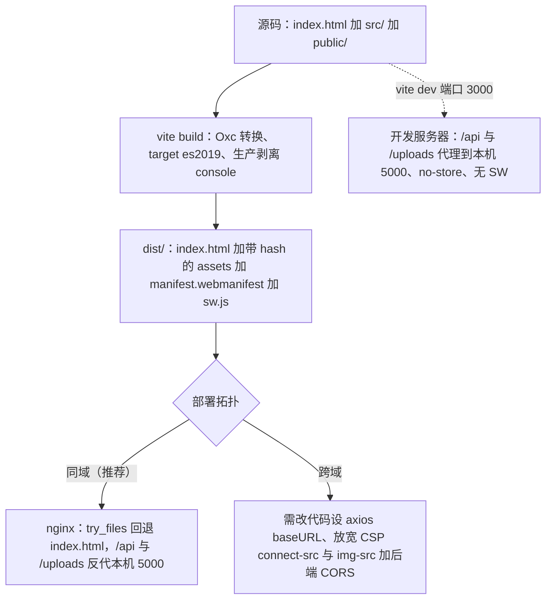

# 构建、配置与部署

这个仓库的发布面很窄：`package.json`（脚本与依赖）、`vite.config.js`（构建与开发服务器全部开关）、`index.html`（CSP、字体、社交元信息、两个内联启动脚本）、`generate-icons.mjs`（图标栅格化）、`README.md`（部署拓扑文档），再加上 `.github/workflows/openwiki-update.yml` 这一条 CI 工作流。构建产物 `dist/` 不入库，所以"发一个版本"= 在某个环境里跑 `npm run build`，再让 nginx 或任何静态服务器把 `dist/` 与后端一起暴露出去。

本页按"命令 → 构建期注入 → 配置开关 → 部署拓扑 → 安全与元信息 → CI"组织，重点标注那些**改错了不会报错、只会在运行时静默降级**的地方：`__APP_VERSION__` 变成 `dev`、CSP 拦掉嵌入播放器、跨域部署被 `connect-src 'self'` 挡住、依赖预打包白名单漏了新依赖。

## 命令与工具链

| 命令 | 实际执行 | 作用与注意 |
|---|---|---|
| `npm run dev` | `vite` | 开发服务器固定 3000 端口，带 `no-store` 与 `/api`、`/uploads` 代理，见下文 |
| `npm run build` | `vite build` | 只做构建：**不跑 lint、不跑 `generate-icons`**，产物 `dist/` 被 `.gitignore` 忽略，必须由部署流程自己构建 |
| `npm run preview` | `vite preview` | 本地托管 `dist/` 验证产物；它不模拟 nginx 的 `/api`、`/uploads` 反代，所以预览里 API 调用会打到 preview 服务器自己 |
| `npm run lint` | `eslint . --ext js,jsx --report-unused-disable-directives --max-warnings 0` | 唯一自动化门禁。`--max-warnings 0` 让任何警告变成失败；`dist`、`dev-dist`、`node_modules` 在 `eslint.config.js` 里被忽略 |
| `npm run generate-icons` | `node generate-icons.mjs` | 手动步骤，从 `public/icon.svg` 重生成 PNG 图标，见"图标与静态资源" |

**Node 版本没有仓库内约束。** `package.json` 没有 `engines` 字段，唯一的书面要求出现在 `README.md` 的"环境要求"（Node.js >= 20、npm >= 9），而 `.github/workflows/openwiki-update.yml` 固定用 Node 22。也就是说 Node 20.0 这类低于工具链实际下限的版本不会被 npm 拦下，只会在安装或启动时炸；给 `package.json` 补 `engines` 是唯一能让 CI/本地统一的地方。

**仓库没有测试运行器。** `AGENTS.md` 明确写着 "No test runner is configured"，`package.json` 里也没有 `test` 脚本；`devDependencies` 里的 `playwright` 在源码与脚本中没有任何引用，不要以为存在端到端测试套件。发布前能自动化的检查只有 lint（质量门禁的整体视图见[验证与质量门禁](../testing/verification-and-quality-gates.md)）。

## 构建期注入的两个常量

### `__APP_VERSION__`：从 `.git/HEAD` 读 short sha

`vite.config.js` 在配置求值时调用 `getGitShortSha()`，把结果通过 `define.__APP_VERSION__` 注入为字符串字面量：

1. 读 `resolve(process.cwd(), '.git')` 下的 `HEAD`；
2. 若内容是 `ref: refs/heads/xxx`，再读该引用文件；
3. 取前 8 位；
4. 任何一步抛错（没有 `.git`、`.git` 在 worktree 里是一个文件而非目录、CWD 不是仓库根）都返回空串，最终注入 `'dev'`。

后果很直接：**把源码复制进 Docker 镜像再构建（不 COPY `.git`）时，产物里的版本号就是 `dev`**，而不是 commit sha。页脚把 `__APP_VERSION__` 与 `/api/site-content/about` 返回的 `version` 并列展示，所以线上看到 `v1.2.3 · dev` 基本等于"构建时没有 git 元数据"。

由于 `__APP_VERSION__` 是构建期注入的裸全局符号，`eslint.config.js` 必须把它声明为 `readonly` global，否则 `no-undef` 会让 lint 失败——**新增任何 `define` 常量都要同步改 ESLint globals**。

### `oxc.drop`：生产构建剥离 `console` 与 `debugger`

```js
oxc: {
  drop: process.env.NODE_ENV === 'production' ? ['console', 'debugger'] : [],
}
```

两个容易踩的点：

- 这个开关读的是 `process.env.NODE_ENV`，不是 Vite 的 `--mode`。`vite build` 默认把 `NODE_ENV` 设为 `production`，所以默认构建会剥离日志；而 `NODE_ENV=development vite build` 会保留全部 `console`，`--mode staging` 之类的切换不改变它。
- `AGENTS.md` 仍写作"通过 `esbuild.drop` 剥离"——那是 Vite 7 及更早版本的配置位置；本仓库装的是 Vite 8，转换器是 Oxc，配置位置是顶层 `oxc` 键。照着 AGENTS.md 去加 `esbuild.drop` 不会生效。

顺带一个相关的运行时分叉：`App.jsx` 的错误边界用 `import.meta.env.PROD` 决定显示通用 i18n 文案还是原始 `error.message`，即开发期能看到真实报错、生产构建只给用户一句提示——排查线上问题要依赖别的手段（例如 `oxc.drop` 之外保留的后端日志）。

## `vite.config.js` 的开关

| 键 | 值 | 改错的后果 |
|---|---|---|
| `define.__APP_VERSION__` | git short sha，失败回退 `'dev'` | 版本号恒为 `dev` |
| `plugins: VitePWA` | `registerType: autoUpdate`、内联 manifest、workbox 缓存策略 | 见"构建期 manifest"与 [PWA 与离线兼容](../systems/pwa-offline-and-compat.md) |
| `resolve.dedupe` | `['react', 'react-dom']` | 多份 React 实例导致 hooks 报错 |
| `optimizeDeps.include` / `noDiscovery` | 显式白名单 + 关闭自动发现 | 新依赖未列入时 dev 首屏走按需优化 |
| `server.port` | `3000` | 与 README、代理文档不一致 |
| `server.headers` | `Cache-Control: no-store` | 开发期缓存住旧模块 |
| `server.proxy` | `/api`、`/uploads` → `http://localhost:5000` | 全站请求失败 |
| `build.target` | `es2019` | 产物语法超出现有浏览器兜底 |
| `oxc.drop` | 生产剥离 `console`、`debugger` | 见上文 |
| `base` | （未设置，默认 `/`） | 只能部署在域名根路径 |

### 依赖预打包白名单

`optimizeDeps.noDiscovery: true` 关掉了 Vite 的依赖扫描，只有 `include` 里列出的包会被预打包：`react`、`react-dom`、`react-dom/client`、`react/jsx-dev-runtime`、`react/jsx-runtime`、`react-router-dom`、`axios`、`qrcode`。这份名单是**显式 allowlist**，新增运行时依赖时必须同步加进去，否则首次请求会走按需优化路径（通常表现为开发期一次整页刷新）。

白名单本身已经漂移：`src/main.jsx` 直接 `import 'altcha'`，多个组件 `import { ... } from 'lucide-react'`，两者都不在 `include` 里。它们靠"按需发现"能跑，但这正是不该依赖的路径。

### 开发服务器：代理与缓存头

```js
server: {
  port: 3000,
  headers: { 'Cache-Control': 'no-store' },
  proxy: {
    '/api':     { target: 'http://localhost:5000', changeOrigin: true, secure: false },
    '/uploads': { target: 'http://localhost:5000', changeOrigin: true, secure: false },
  },
}
```

`/api` 与 `/uploads` 必须被分别代理：`/uploads` 是后端媒体前缀而非 `/api` 子路径，前端代码里以 `/uploads/...` 形式内联（数据库里存的就是相对地址）。**后端没起时所有 API 调用会失败或挂起**，这是本地开发最常见的"页面空白"原因。`no-store` 只作用于开发服务器，它避免了"改了文件浏览器还拿旧模块"。

### 构建产物与语法目标

`build.target: 'es2019'` 是唯一的语法目标来源。`package.json` 里的 `browserslist`（`> 0.5%`、`last 2 versions`、`Firefox ESR`、`not dead`、`not ie 11`）**没有被任何工具消费**——仓库没有 babel、没有 PostCSS/autoprefixer 配置、Vite 也不读 browserslist，所以它目前只是文档性字段，改它不会有任何构建差异。运行时 API 的缺口由 `src/utils/polyfills.js`（ES2019/ES2020：`Object.fromEntries`、`Promise.allSettled`、`Array.prototype.flat/flatMap`、`String.prototype.matchAll`，目标 Safari 13+ / Chrome 80+ / Firefox 80+）在入口副作用里补齐；降低 `build.target` 而不补 polyfill 不会有帮助。

## 从源码到可安装应用：三条拓扑



上图给出本仓库支持的三条拓扑：开发代理、生产同域反代、以及需要额外代码改动的跨域。三者的共同前提是**前端假设自己与后端同源**。

### 同域部署（推荐）

`README.md` 给出的 nginx 骨架：

```nginx
server {
    listen 80;
    server_name example.com;

    root /var/www/frontend/dist;
    index index.html;

    location / {
        try_files $uri $uri/ /index.html;
    }

    location /api/ {
        proxy_pass http://127.0.0.1:5000;
        proxy_set_header Host $host;
        proxy_set_header X-Real-IP $remote_addr;
    }

    location /uploads/ {
        proxy_pass http://127.0.0.1:5000;
    }
}
```

要点与常见坑：

- `try_files $uri $uri/ /index.html` 是 SPA 回退的必需品，所有前端路由（`/episode/:id`、`/admin/dashboard`）都靠它落到同一个 `index.html`。
- `proxy_pass http://127.0.0.1:5000;` **没有尾部 URI**，所以 `/api/...` 原样透传，与开发代理行为一致；写成 `proxy_pass http://127.0.0.1:5000/;` 会把 `/api` 前缀剥掉导致 404。
- 示例里没有设缓存头。实际部署应给 `/assets/`（文件名带 hash）长缓存，给 `index.html`、`sw.js`、`manifest.webmanifest` 加 `Cache-Control: no-cache`——否则浏览器可能拿旧 `index.html` 去请求已被替换的 hash 资源，而 `sw.js` 被缓存会拖住 PWA 的 `autoUpdate`。
- 前端没有配置 `base`，所有资源引用都是根绝对路径（`/icon.svg`、`/assets/...`、`/api/rss`），manifest 的 `start_url`/`scope` 与 Service Worker 作用域也都是 `/`。**子路径部署（如 `example.com/app/`）需要同时改 `base`、这些绝对引用与 manifest 字段，不是改一行 nginx 能解决的。**

### 跨域部署：改环境变量不够

`README.md` 描述的做法是：在 `.env.production` 里写 `VITE_API_BASE_URL=https://your-backend-api.example.com`，再在 `src/utils/axiosConfig.js` 里加 `axios.defaults.baseURL = import.meta.env.VITE_API_BASE_URL || ''`，最后让后端开 CORS。

现状要说清楚：**第二步在源码里并不存在**。`src/utils/axiosConfig.js` 只设了 `timeout` 与 `withCredentials`，全仓库没有任何 `import.meta.env.VITE_*` 引用，也没有 `baseURL` 赋值。所以跨域部署今天是一次代码改动，`VITE_API_BASE_URL` 目前只是约定；配好环境变量并不会发生任何事（细节见[后端契约地图](../integrations/backend-api-map.md)与[HTTP 与会话](../architecture/http-and-session.md)）。

即使补上了这行，还有三处会拦住跨域：

1. `index.html` 的 CSP `connect-src` 只允许 `'self'` 与三个翻译域名，跨域 API 请求会被浏览器直接拒绝；
2. CSP `img-src 'self' data: blob:` 不含后端域名，跨域后所有 `/uploads` 图片加载失败；
3. `withCredentials: true` 是全局默认，跨站 cookie 与自定义 CSRF 头（`X-XSRF-TOKEN`、`X-Requested-With`）会触发预检，后端必须放行对应源与头；`/api/rss` 这类写死在 `index.html` 里的同源链接也会指向错误域名。

## 环境变量与密钥边界

- Vite 只把 `VITE_` 前缀的变量注入客户端产物（`import.meta.env`）。`.env` 本身在 `.gitignore` 里；文档化的变量只有 `VITE_API_BASE_URL` 一个。
- **任何进入产物字符串的配置都是公开的**：CSP 里的域名、manifest 里的名称、API base URL 都能被用户直接读到。SMTP 之类的敏感配置由服务器端 env/ini 提供，管理后台的邮件页是只读展示 + 发送测试邮件，不走前端配置。需要保密的常量（密钥、内部地址）只能放在后端，通过 API 间接使用。
- CI 侧的密钥是 GitHub 仓库 secret/variable（`OPENAI_COMPATIBLE_API_KEY`、`OPENAI_COMPATIBLE_BASE_URL`、`OPENWIKI_LANGSMITH_API_KEY` 等），只存在于工作流运行环境，不进任何前端产物。

## `index.html`：CSP 与其他发布面

CSP 以 `<meta http-equiv>` 写在 `index.html` 里，因此**它随构建产物原样保留，并且在 `vite dev` 阶段同样生效**——CSP 相关问题在本地就能复现，不必等到部署。

| 指令 | 值 | 为什么是这个值 / 改动影响 |
|---|---|---|
| `script-src` | `'self' 'unsafe-inline' blob:` | 页内有两个内联 `<script>`（早期语言检测、IE/旧 Edge 遮罩），遮罩还用内联 `onclick="window.__switchCompatLang()"`；去掉 `'unsafe-inline'` 这两个脚本与语言切换按钮都会失效。注意 CSP 里**没有 `'unsafe-eval'`**，IE 分支里的 JSON polyfill 用 `new Function` 构造解析器，只有在真正缺少 `JSON` 的古董浏览器上才会撞上这条限制 |
| `style-src` | `'self' 'unsafe-inline' fonts.googleapis.com` | 组件大量使用 React 内联 `style`，同时要放行 Google Fonts 的 CSS |
| `img-src` | `'self' data: blob:` | 只允许同源、`data:`、`blob:`；**没有 `https:`**，任何跨域图片（跨域后端、外部图床、外链 logo）都会被拦 |
| `font-src` | `'self' fonts.gstatic.com` | 字体文件从 gstatic 取 |
| `connect-src` | `'self'` + `api.mymemory.translated.net`、`translate.googleapis.com`、`api.cognitive.microsofttranslator.com` | `'self'` 覆盖 axios 与 SSE；三个翻译域名是历史直连许可——当前翻译走后端 `/api/translate`（`useTranslation` 里 `axios.post`），`src/` 内没有任何直接请求这些域名的代码 |
| `frame-src` | `'self'` + `player.bilibili.com`、`www.youtube.com`、`embed.nicovideo.jp` | `EpisodeDetail` 会把 B 站（含 `b23.tv`、`av`/`BV` 号）、YouTube、niconico 链接转换成恰好这三家的嵌入地址；缺一个域名该播放器就白屏 |
| `object-src` | `'none'` | 禁用插件 |

由于**没有 `default-src`**，未列出的指令（`media-src`、`worker-src`、`manifest-src`、`frame-ancestors` 等）不受约束：Service Worker 注册、视频播放、动态注入的 manifest link 因此能正常工作。增删 CSP 时必须同时评估三类消费者——机器翻译域名、三家嵌入播放器、以及图片/上传资源域；收紧 `img-src` 或 `connect-src` 是最容易造成"某些页面图片不显示、翻译不工作"的两处。

`index.html` 里其余发布相关的内容：

- **早期语言检测脚本**：在 React 挂载前读 `localStorage.lang`，否则看 `navigator.language`，把 `<html lang>` 与 `content-language`、`language` 两个 meta 一起改成 `zh-CN`/`en-US`。目的是让浏览器翻译、拼写检查、读屏在首屏就拿到正确语言，而不是靠"检测到的语言"。它写的是与 `I18nContext` 同一个 `lang` 键，两边必须保持同一套取值（`zh`/`en`）。
- **IE/旧 Edge 遮罩**：一段 ES5 脚本（含 JSON polyfill），检测到 Trident/旧 EdgeHTML 时整屏替换为"换浏览器"提示，并用 `XMLHttpRequest` 拉 `/api/site-content/about` 解析出 ICP 备案号写进 `localStorage._icp`。新增接口或改 `/api/site-content/about` 的响应结构时，这段**不经过 axios、不走 CSRF、没有类型检查**的代码也要一起看。
- **字体**：`fonts.googleapis.com` 的 `Noto Sans SC` + `Plus Jakarta Sans`，配两条 `preconnect`（gstatic 那条带 `crossorigin`）。
- **元信息**：`title`、`description`、`keywords`、`og:title/description/type/site_name`、`twitter:card/title/description`、`theme-color`、iOS 的 `apple-mobile-web-app-*`、`msapplication-TileColor`、`<link rel="alternate" type="application/rss+xml" href="/api/rss">`，以及中英双语 `<noscript>`。没有 `og:image`/`twitter:image`，社交平台分享时不会有预览图；`theme-color` 与 `apple-mobile-web-app-title` 会在运行时被站点设置覆盖（见下一节）。

## 图标与静态资源

`generate-icons.mjs` 用 `sharp` 读 `public/icon.svg`，栅格化出三份文件：

| 输出 | 尺寸 | 用途 |
|---|---|---|
| `public/icon-192x192.png` | 192×192 | manifest icon、shortcuts 图标 |
| `public/icon-512x512.png` | 512×512 | manifest icon，同时被声明为 `purpose: "maskable"` |
| `public/apple-touch-icon.png` | 180×180 | iOS 主屏图标，并被 `includeAssets` 收进预缓存 |

它是**手动步骤**（`npm run generate-icons`），不在 `build` 链路里；生成的 PNG 提交在 `public/` 下，所以既是构建输入（Vite 原样拷贝进 `dist/`）又是 manifest 的图标来源。改 `public/icon.svg` 后忘记重跑脚本，得到的是"新 favicon + 旧应用图标"的不一致状态。用同一个 512 图兼任 maskable 意味着没有额外安全边距，部分 Android 启动器会裁掉边缘；管理后台里的 `pwaMaskableIcon` 是运行时可替换的对应项。

## 构建期 manifest 与运行时 manifest 的分工

这是 PWA 侧最容易混淆的一点：存在**两套 manifest**，浏览器最终用的那一套取决于 `siteSettingsData` 是否加载成功。

| | 构建期静态 manifest | 运行时动态 manifest |
|---|---|---|
| 生成者 | `vite-plugin-pwa`，配置内联在 `vite.config.js` 的 `VitePWA({ manifest })` | 后端 `/api/site-content/pwa-manifest` |
| 落地形态 | `dist/manifest.webmanifest`，并在构建后的 `index.html` `</head>` 前注入 `<link rel="manifest" href="/manifest.webmanifest">` | 由 `App.jsx` 在站点设置加载后把同一个 link 的 `href` 改指后端端点 |
| 内容来源 | 源码里写死：名称"兽剧聚合平台"、`start_url: "/"`、`display: standalone`、`background_color: #0f172a`、`theme_color: #6366f1`、192/512/svg 图标、两个 shortcuts、`share_target` | 后台"站点内容"里的 `pwaName`、`pwaShortName`、`pwaThemeColor`、`pwaIcon192`、`pwaIcon512` 等 |
| 何时生效 | 构建即有；dev 阶段不产出（`devOptions.enabled: false`，既不生成 SW 也不注入 manifest link） | 站点设置请求成功之后；API 不可用或首屏未完成时保持构建期那一套 |

同一段运行时逻辑还会一并更新 `apple-touch-icon`（用 `pwaIcon512 || pwaIcon192`）、`apple-mobile-web-app-title`、`application-name`、`theme-color`、`msapplication-TileColor`。**不随之改变的是** `index.html` 里写死的 `<link rel="icon" href="/icon.svg">`——浏览器标签页图标始终来自 `public/icon.svg`。

后台还能配置 `pwaMaskableIcon` 与 `pwaBackgroundColor`，但 `App.jsx` 的运行时逻辑不消费这两项：它们只可能通过后端 manifest 端点生效（后端是否真的写进 manifest 需在该仓库核对）。站点设置各字段的完整语义见[站点设置与公告](../systems/site-settings-and-announcements.md)。

Service Worker 本身由构建产物提供：`registerType: 'autoUpdate'` + `main.jsx` 里导入 `virtual:pwa-register` 并调用 `registerSW`，预缓存 `**/*.{js,css,html,ico,png,svg,woff2}`，运行时对 `/api/(episodes|series|categories|banners|friend-links|site-content)` 走 `NetworkFirst`（10s 超时、100 条、1 小时），对 `/uploads/` 走 `CacheFirst`（200 条、30 天）。新增一个需要离线兜底的 API 分组，必须改这条 `urlPattern`，否则不会进缓存。

## OpenWiki 定时更新工作流

`.github/workflows/openwiki-update.yml` 每天 08:00 UTC（`cron: "0 8 * * *"`）并支持手动 `workflow_dispatch` 刷新本 wiki：

1. `permissions` 申请 `contents: write` 与 `pull-requests: write`；`actions/checkout` 用 **`fetch-depth: 0`**——`openwiki code --update` 要和"上次文档化到的提交"做 diff，浅克隆会让变更摘要为空。
2. `actions/setup-node` 固定 Node 22，全局安装 `openwiki@0.7.2` 与可选的 `mermaid@11.16.0`、`jsdom@29.1.1`（后者用于 Mermaid 图的高保真校验）。
3. 运行 `openwiki code --update --print`，凭 `OPENWIKI_PROVIDER: openai-compatible`、`OPENAI_COMPATIBLE_API_KEY`（secret）、`OPENAI_COMPATIBLE_BASE_URL`（variable）、`OPENWIKI_MODEL_ID: deepseek-flash` 调模型；LangSmith 相关变量是可选的追踪配置。该步骤 `continue-on-error: true`。
4. 删除 `openwiki/.run.json`（每次运行的临时状态，不该入库）。
5. 用 `peter-evans/create-pull-request` 把 `openwiki`、`AGENTS.md`、**工作流文件自身**、以及存在时的 `CLAUDE.md` 提交到固定分支 `openwiki/update`，标题固定为 `docs: update OpenWiki`。
6. 最后一步 `Propagate OpenWiki failure` 在 `openwiki` 步骤结局为 `failure` 时 `exit 1`。

这套设计的语义值得记住：

- **失败也开 PR**，且 PR 描述里会写明结果；合并它等于把"失败前已完成的页面"变成下一次的基线，这是刻意的增量策略。
- 工作流没有 `concurrency` 分组，手动触发与定时触发撞车时都指向同一个 `openwiki/update` 分支与同一个 PR，后完成者覆盖先完成者。
- 因为工作流文件自己也在 `add-paths` 里，改动它会成为 OpenWiki PR 的一部分；`AGENTS.md` 中 `OPENWIKI:START/END` 之间的区块同样由 OpenWiki 维护——**要修正 wiki 内容应该改源码/文档让 OpenWiki 重新生成，而不是手改生成出来的页面**（这条约定本身写在 `AGENTS.md` 里）。
- 仓库缺少上述 secret/variable 时，定时任务会稳定失败；它不影响前端构建，只影响文档刷新。

## 发布检查清单

| 你要改的东西 | 必须同步的位置 |
|---|---|
| 新增运行时依赖 | `optimizeDeps.include`；若需离线兜底还要加 workbox `urlPattern`；若暴露全局符号要加 ESLint globals |
| 新增 `define` 全局常量 | `eslint.config.js` 的 `globals` |
| 引入新的第三方域名（字体、图片、接口、嵌入播放器） | `index.html` 的 CSP 对应指令（`img-src`/`connect-src`/`font-src`/`frame-src`/`script-src`） |
| 换成跨域部署 | CSP `connect-src` 与 `img-src`、`axios.defaults.baseURL`（当前需改代码）、后端 CORS 与 cookie 策略、`/api/rss` 链接 |
| 换域名或子路径部署 | `base`、`index.html` 里的根绝对路径、manifest 的 `start_url`/`scope`、nginx `try_files` |
| 换应用图标 | `public/icon.svg` → `npm run generate-icons`；运行时图标在后台"站点内容"里配 |
| 换 Node 版本 | `README.md` 环境要求、CI `node-version`，并考虑补 `package.json` `engines` |
| 升 Vite 大版本 | `oxc`/`esbuild` 选项位置、`build.target`、`optimizeDeps` 行为都可能变，先跑 `npm run build` 与 `npm run lint` |

相关页面：[架构总览](../architecture/overview.md)、[HTTP 与会话](../architecture/http-and-session.md)、[PWA 与离线兼容](../systems/pwa-offline-and-compat.md)、[站点设置与公告](../systems/site-settings-and-announcements.md)、[后端契约地图](../integrations/backend-api-map.md)、[验证与质量门禁](../testing/verification-and-quality-gates.md)。
