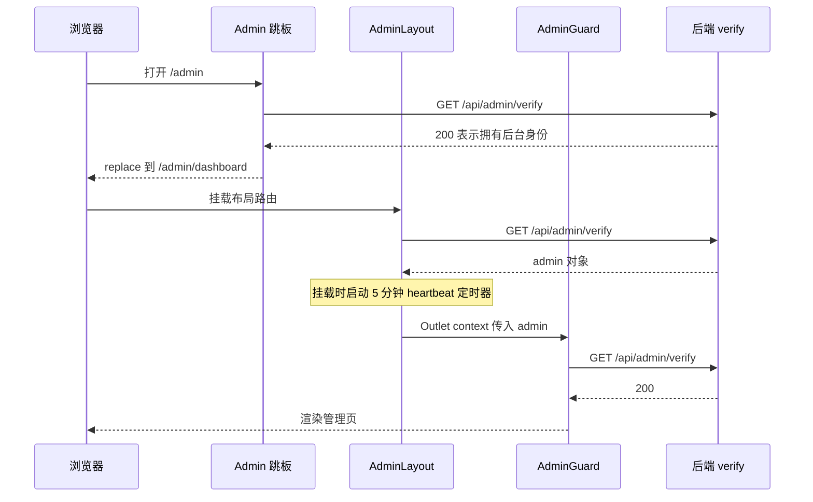
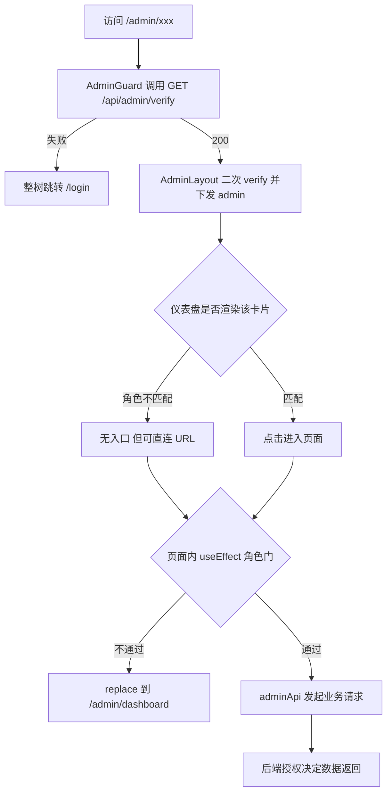

# 管理后台：布局、角色可见性与待办

管理后台是同一份前端 SPA 内的第二棵路由树：只要 `location.pathname` 以 `/admin` 开头，`AppContent` 就切到后台的 `<Routes>`，不渲染 `NavBar`、`AnnouncementBanner` 等前台组件，只在末尾保留 `FooterBeian`。因此后台没有独立的构建产物、没有第二套登录体系，也没有侧边导航——**页面发现完全依赖仪表盘卡片**。

整体结构、`verify` 校验链与标题映射已在 [路由与守卫](../architecture/routing-and-guards.md) 中详述，本文只补齐后台自身的分工：外壳负责"谁是 admin"，仪表盘负责"你该看到什么"，各管理页负责"这件事怎么做"，`adminApi` + 全局 axios 拦截器负责"请求怎么发出去"。

## 进入链路：跳板、外壳、守卫的三次 verify

从 `/admin` 跳板到具体管理页之间的三次校验，以及外壳持有的心跳定时器。

链路中的三段职责各不相同：

- **`src/components/Admin.jsx`（`/admin` 跳板）**：只做一次 `GET /api/admin/verify`，成功则 `navigate('/admin/dashboard', { replace: true })`，失败跳 `/login`；不渲染任何 UI。它使 `/admin` 成为一个永远不停留的中转页。
- **`AdminLayout`（布局路由）**：挂载即再校验一次，成功后用 `<Outlet context={{ admin }} />` 把 admin 对象下发给所有子页——这是后台唯一的"当前操作者"来源。注意它在 `loading` 与 `!admin` 两种状态下都 `return null`，所以校验期间后台是**纯白屏**而不是骨架屏。
- **`AdminGuard`（每个子路由各包一层）**：依赖 `location.pathname` 重新校验，未通过则 `<Navigate to="/login" replace />`。

因此冷启动直接打开 `/admin/dashboard` 会连续发生两次 `verify`（Layout + Guard），而经由 `/admin` 跳板进入则是三次。这段重复校验的开销与叠加行为见 [路由与守卫](../architecture/routing-and-guards.md)。

### 外壳提供的四个动作

`AdminLayout` 的顶栏只有 48px 高的一条 sticky 条，没有侧边栏，动作固定为四个：

| 动作 | 实现 | 说明 |
| --- | --- | --- |
| 控制台首页 | `navigate('/admin/dashboard')` | 后台唯一的"总入口" |
| 返回 | `navigate(-1)` | 浏览器历史回退，不区分来源页 |
| 网站首页 | `<a href="/">` | 原生锚点，整页跳出后台路由树 |
| 退出登录 | `POST /api/admin/logout` → `navigate('/login', { replace: true })` | 即使接口失败也会清空本地 `admin` 状态并跳转 |

除校验外，外壳还持有一个 **5 分钟间隔的心跳**：`POST /api/user-sessions/heartbeat`，失败静默吞掉（`.catch(() => {})`）。它刻意不依赖 `AuthContext` 的 `user` 状态——后台只持有 admin 会话 cookie 时也要维持设备会话记录，`AdminSessions`（设备管理）里的在线设备列表才能反映后台操作者。若同一浏览器同时存在登录用户，`AuthContext` 的心跳会并行打同一个端点，二者并不互斥。

## 仪表盘：角色分层入口与待办徽章

`AdminDashboard` 从 `useOutletContext()` 取 `admin`，做两件事：按 `admin.role` 渲染卡片集合，以及把 `/api/admin/pending-counts` 的计数渲染成卡片右上角的红色徽章。

### 角色分层

三档角色在仪表盘上的可见集合是包含关系，但**并非严格包含**（creator 有独占卡片，admin 反而看不到创作者主页管理）：

- **creator**：剧集管理（文案切换为"创建和管理我的剧集"）+ 创作者主页。
- **admin**：剧集管理、分类、轮播图，以及审核管理、剧集回收站、举报、用户反馈、数据分析。
- **superadmin**：以上全部，外加用户管理、创作者主页管理、公告通知、网站内容、邮件服务、操作日志、数据备份、友链、设备、API 用量、主题、主题审批，并额外获得"⚙️ 自动状态流转"面板。

自动状态流转面板是仪表盘上唯一的写操作入口，两个按钮分别 `POST /api/auto-status/auto-complete`（自动标记已完结）与 `POST /api/auto-status/check-premieres`（发布到期预告），返回的 `message` 显示在面板下方，并由 `clearStatusMsg` 在 3 秒后清空；失败的文案统一为 `adminDashboard.operationFailed`。

### 待办徽章

`pending-counts` 返回的对象被整体塞进 `pendingCounts` state，字段名与消费点如下：

| 字段 | 消费卡片 | 徽章语义 |
| --- | --- | --- |
| `episodes` | 剧集管理、审核管理 | 待审剧集；**同一数值挂在两张卡片上** |
| `reports` | 举报管理 | 待处理举报 |
| `feedbacks` | 用户反馈 | 待回复反馈（注意是复数 `feedbacks`） |
| `friendLinks` | 友链管理 | 待审友链 |
| `themes` | 主题审批 | 待审投稿主题 |

`Badge` 组件在计数为假值（`0`/`undefined`）时直接返回 `null`，所以"没有待办"与"接口失败"在界面上无法区分——`pending-counts` 的 `.catch(() => {})` 会把错误也压成"无徽章"。徽章只在仪表盘挂载时拉取一次，没有轮询；停留在仪表盘不会自动更新，离开再回来才会重新请求。

### 角色 × 功能可见性矩阵

下表合并了三层信息：仪表盘卡片的角色条件、页面内是否存在角色重定向、以及是否带待办徽章。"直连"一列指跳过卡片直接用 URL 访问时的行为。

| 功能（路由） | creator | admin | superadmin | 页面内角色门 | 直连行为 | 徽章 |
| --- | --- | --- | --- | --- | --- | --- |
| 剧集管理 `/admin/episodes` | 卡片可见 | 卡片可见 | 卡片可见 | 无重定向，按角色切数据源 | 正常渲染 | `episodes` |
| 创作者主页 `/admin/creator-profile` | 卡片可见 | **无卡片** | **无卡片** | 仅 creator/admin/superadmin 放行，否则重定向 | 正常渲染 | — |
| 分类 `/admin/categories` | 隐藏 | 卡片可见 | 卡片可见 | 无 | 仍会渲染并发请求 | — |
| 轮播图 `/admin/banners` | 隐藏 | 卡片可见 | 卡片可见 | 无 | 仍会渲染并发请求 | — |
| 审核管理 `/admin/review` | 隐藏 | 卡片可见 | 卡片可见 | 非 admin/superadmin 重定向到仪表盘 | 重定向 | `episodes` |
| 剧集回收站 `/admin/episode-trash` | 隐藏 | 卡片可见 | 卡片可见 | 无 | 仍会渲染并发请求 | — |
| 举报 `/admin/reports` | 隐藏 | 卡片可见 | 卡片可见 | 无 | 仍会渲染并发请求 | `reports` |
| 用户反馈 `/admin/feedback` | 隐藏 | 卡片可见 | 卡片可见 | 无 | 仍会渲染并发请求 | `feedbacks` |
| 数据分析 `/admin/analytics` | 隐藏 | 卡片可见 | 卡片可见 | 无 | 仍会渲染并发请求 | — |
| 用户管理 `/admin/users` | 隐藏 | 隐藏 | 卡片可见 | 非 superadmin 重定向 | 重定向 | — |
| 创作者主页管理 `/admin/creator-profiles` | 隐藏 | 隐藏 | 卡片可见 | 非 superadmin 重定向 | 重定向 | — |
| 公告通知 `/admin/announcements` | 隐藏 | 隐藏 | 卡片可见 | 无 | 仍会渲染并发请求 | — |
| 网站内容 `/admin/site-content` | 隐藏 | 隐藏 | 卡片可见 | 非 superadmin 重定向 | 重定向 | — |
| 邮件服务 `/admin/email-settings` | 隐藏 | 隐藏 | 卡片可见 | 非 superadmin 重定向 | 重定向 | — |
| 操作日志 `/admin/audit-logs` | 隐藏 | 隐藏 | 卡片可见 | 非 superadmin 重定向 | 重定向 | — |
| 数据备份 `/admin/backup` | 隐藏 | 隐藏 | 卡片可见 | 非 superadmin 重定向 | 重定向 | — |
| 友链 `/admin/friend-links` | 隐藏 | 隐藏 | 卡片可见 | 无 | 仍会渲染并发请求 | `friendLinks` |
| 设备 `/admin/sessions` | 隐藏 | 隐藏 | 卡片可见 | 非 superadmin 重定向 | 重定向 | — |
| API 用量 `/admin/api-usage` | 隐藏 | 隐藏 | 卡片可见 | 非 superadmin 重定向 | 重定向 | — |
| 主题 `/admin/themes` | 隐藏 | 隐藏 | 卡片可见 | 软门：`isSuper` 只决定系统级开关，无重定向 | 仍会渲染 | — |
| 主题审批 `/admin/theme-review` | 隐藏 | 隐藏 | 卡片可见 | 非 superadmin 重定向 | 重定向 | `themes` |
| 数据统计 `/admin/stats` | **无卡片** | **无卡片** | **无卡片** | 无 | 任何后台角色都能打开 | — |

## 两道可见性防线

后台的角色控制是"入口过滤 + 页面重定向"两道**前端体验层**，第三道始终是后端接口授权。下图展示一次直连 URL 的完整判定：

一次直连 URL 时的完整可见性判定：仪表盘卡片过滤入口，页面内角色门兜底，最终由后端授权决定数据。

由此得出两条改动时必须遵守的不变量：

1. **卡片是唯一入口**。新增页面若忘记在 `AdminDashboard` 注册卡片，它就只能靠手输 URL 抵达——`/admin/stats` 正是这种状态：路由、`pageTitle.adminStats`、页面组件都齐全，但仪表盘没有对应卡片，其他组件也没有链接指向它。
2. **页面内角色门不完整**。目前只有 9 个页面会在 `useEffect` 里主动 `navigate('/admin/dashboard', { replace: true })` 做角色重定向（`AdminUsers`、`AdminSessions`、`AdminApiUsage`、`AdminAuditLogs`、`AdminBackup`、`AdminSiteContent`、`AdminEmailSettings`、`AdminCreatorProfiles`、`AdminThemeReview`），外加两个条件放行（`AdminReview` 要求 admin/superadmin，`AdminCreatorProfile` 允许三种后台角色）。**分类、轮播图、公告、友链、举报、反馈、回收站、数据分析、数据统计、主题**这些页面没有任何组件内角色判断：一个 `admin` 直接输入 `/admin/announcements` 会照常挂载并发出请求，最终能否看到数据完全取决于后端。这不是漏洞（授权在后端），但意味着前端的"超管专属"只是视觉约定，不能当作安全边界。

## 管理页职责边界（按职责域分组）

后台 23 个子路由按职责可以收敛成四组。每组的共同点是：一个页面 = 一类资源 + 一组 CRUD/处置接口，页面自身不缓存跨页状态，切页即重新拉取。

### 内容生产与审核

| 页面 | 职责 | 主要接口 |
| --- | --- | --- |
| `AdminEpisodes` | 剧集与单集的全量增删改、封面/图片上传、版本历史 | `/api/episodes`、`/api/episodes/single/*`、`/api/episodes/upload`、`/api/episodes/:id/resubmit` |
| `AdminReview` | 待审队列、审批/驳回、授权编辑人 | `/api/review/pending`、`/api/review/all`、`/api/review/approve/:id`、`/api/review/reject/:id`、`/api/review/assign-editor/:id` |
| `AdminEpisodeTrash` | 被删除/被拒剧集的收容、版本快照、恢复与彻底删除 | `/api/episode-trash`、`/api/episode-trash/:id/versions`、`/api/episode-trash/:id/restore` |
| `AdminCreatorProfile` | 创作者编辑自己的展示主页（含待审内容回填） | `/api/creator-profile/my-profile` |
| `AdminCreatorProfiles` | 超管管理所有创作者主页并审批其修改 | `/api/admin/creator-profiles`、`/:id/approve`、`/:id/reject` |

这一组的分工对应剧集从创作、送审、上架到删除的生命周期；审核状态语义（`pending`/`approved`/`rejected`）通过共享的 `ReviewStatusBadge` 组件统一呈现。剧集审核与版本变更的完整流程见 [剧集发布与审核](../workflows/episode-publishing-and-review.md)。

`AdminEpisodes` 是唯一按角色分裂数据源与列的页面：creator 走 `GET /api/creator/my-episodes?limit=100` 只看自己的剧集，其他角色走 `GET /api/episodes?limit=100` 看全量；creator 视图把"审核状态"列换入、隐藏"创建者"与"授权编辑"列、没有删除按钮，且仅在 `reviewStatus === 'rejected'` 时出现"重新提交"按钮（`POST /api/episodes/:id/resubmit`）。删除操作本身是软删除——记录进入回收站，由 `AdminEpisodeTrash` 承接恢复或彻底清除。

### 站点外观与内容

| 页面 | 职责 | 主要接口 |
| --- | --- | --- |
| `AdminCategories` | 分类树/列表的增删改 | `/api/categories` |
| `AdminBanners` | 首页轮播图增删改与启用开关 | `/api/banners`、`/api/banners/all` |
| `AdminSiteContent` | 以 key 为单位的站点文案：`about`、`settings`（站点名/欢迎语/PWA/背景）与隐私政策、用户协议等页面 | `/api/site-content/`、`PUT /api/site-content/:key` |
| `AdminThemes` | 主题（壁纸+图标组合）管理：系统/个人、启用停用、默认主题、JSON 导入导出 | `API.THEMES.ALL`、`API.THEMES.ADMIN_UPDATE(id)` |
| `AdminThemeReview` | 主题投稿三档审批（`pending`/`approved`/`rejected`），通过即上架为系统主题 | `API.THEMES.ALL`、`API.THEMES.REVIEW(id)` |
| `AdminAnnouncements` | 公告的发布/编辑/删除，以及横幅、弹窗、站内通知、邮件推送开关 | `/api/announcements`、`/api/announcements/:id/send-email`、`/api/announcements/:id/send-notification` |

`AdminSiteContent` 的保存是"读全量 → 按 key 拼 JSON → 回写"的模式，且当 `editingKey === 'settings'` 时会调用 `SiteSettingsContext` 的 `refreshSettings()`，让站点名、欢迎语、PWA 图标等立即在全站生效，无需刷新页面。写入 `settings` 与 `about` 的连带影响见 [站点设置与公告](./site-settings-and-announcements.md)。

主题两个页面的分工值得强调：`AdminThemes` 是"素材与上架状态的家"，`AdminThemeReview` 是"投稿的审批台"。前者用 `isSuper` 决定新建主题是否直接标为系统主题（`isSystem: isSuper`），并承载 `isDefault`/`enabled`/`isSystem` 三个开关；后者只做审批动作并通知作者。主题渲染与图标映射的机制见 [主题与图标](./theming-and-icons.md)。两个页面都通过 `src/utils/apiEndpoints.js` 的 `API.THEMES.*` 常量取路径，是后台上少数不手写字符串路径的页面。

### 运营处置

| 页面 | 职责 | 主要接口 |
| --- | --- | --- |
| `AdminReports` | 举报分档（`pending`/`resolved`/`dismissed`）与处理备注 | `/api/reports/list`、`/api/reports/resolve/:id` |
| `AdminFeedback` | 用户反馈的状态流转（`pending`/`read`/`replied`）与回复 | `/api/feedback`（`GET`/`PUT`） |
| `AdminFriendLinks` | 友链增删改与申请审批（`approved`/`rejected`） | `/api/friend-links/all`、`PUT /api/friend-links/:id` |
| `AdminAnalytics` | 实时在线、周期概览、活跃热力图、剧集生命周期，30 秒轮询实时数据 | `/api/stats/realtime`、`/api/stats/overview?period=`、`/api/stats/activity-heatmap`、`/api/stats/episode-lifecycle` |
| `AdminStats` | 聚合指标卡（总剧集/待审/总用户/关注/评分/待处理举报/30 天新增/7 天与 30 天活跃）与分布图 | `/api/stats/overview` |

这一组大多是"列表 + 状态按钮"的形态，写操作集中在一个 `PUT` 上，因此页面代码量与状态机都比较小。`AdminAnalytics` 与 `AdminStats` 数据源重叠（都读 `/api/stats/overview`），区别是前者带 `period` 参数与多张图表、后者是一次性快照且没有入口卡片。

### 账号与平台运维

| 页面 | 职责 | 主要接口 |
| --- | --- | --- |
| `AdminUsers` | 账号列表、搜索/角色筛选、新建后台账号、改角色、删除 | `/api/admin/users`、`/api/admin/register`、`/api/admin/role/:id`、`/api/admin/user-admin-access/:id` |
| `AdminSessions` | 全站登录设备列表，踢单个设备或某用户全部设备 | `/api/user-sessions/all`、`/api/user-sessions/admin/:id`、`/api/user-sessions/admin/user/:userId/all` |
| `AdminAuditLogs` | 管理员操作流水，按动作/管理员过滤，30 条分页 | `/api/audit-logs` |
| `AdminBackup` | 数据库 JSON 导出下载与导入（可选 `overwrite`） | `/api/backup/export`、`/api/backup/import` |
| `AdminEmailSettings` | SMTP 配置读写与测试发信 | `/api/site-content/email`、`/api/site-content/test-email` |
| `AdminApiUsage` | RSS/接口调用量按天聚合与热点端点排行 | `/api/rss/api-usage?days=` |

`AdminUsers` 是后台唯一的角色写入口，其改角色逻辑按目标角色分流：涉及 `superadmin` 或 `creator` 的升降级走 `PUT /api/admin/role/:id`，普通用户与管理员之间的切换走 `PUT /api/admin/user-admin-access/:id`（`adminAccess: true/false`）。当前登录账号自身那一行不渲染选择器与删除按钮，`handleDeleteUser` 也会先拦截"删除自己"。新建账号只允许 `admin` / `creator` 两种角色，因此**新增超管无法通过界面完成**，只能由既有超管走角色变更接口授予。

## 共用模式

后台页面在实现上高度同构，改动时按这些共同点定位能少走很多弯路：

- **传输层：`adminApi`**。`src/utils/adminApi.js` 只是 `axios` 的五个方法别名，刻意不加任何 `Authorization` 头——认证完全依赖 httpOnly cookie。因此所有后台请求都会经过 `src/utils/axiosConfig.js` 的全局拦截器：请求侧为写操作挂 `X-XSRF-TOKEN`；响应侧遇到 `401` 先尝试 `/api/auth/refresh` 再重试，最终失败时因为路径以 `/admin` 开头会**整页跳转** `/login`；遇到 `419` 走同一套刷新逻辑；遇到 `403` 且带 `forceEmailChange` 则触发强制改邮箱流程。对后台的直接后果是：任何一次权限失效都会导致整页卸载重载，页面上未提交的编辑内容随之丢失。
- **列表**：主流形态是 `<table className="admin-table">`（`AdminEpisodes`、`AdminEpisodeTrash`、`AdminUsers`、`AdminAuditLogs` 等），反馈与举报则是卡片列表；分页有前端切分（`AdminUsers` 一次性 `limit: 9999`）和后端 `page`/`limit`（`AdminEpisodeTrash` 20、`AdminAuditLogs` 30、`AdminReports` 10）两种。
- **弹窗与确认**：编辑表单统一用 `Modal`，破坏性操作多数再叠一层 `window.confirm(t(...))`（`AdminUsers`、`AdminSessions`、`AdminThemes`），较新的页面改用 `ConfirmModal`（`AdminEpisodeTrash`）。
- **提示**：没有全局 toast。每个页面自管 `error` / `success`（或 `message`）state，渲染成 `.error-message` / `.success-message` 区块，成功文案多用 3 秒定时器自动清除。
- **i18n**：所有可见文案走 `useI18n()` 的 `t()`，日期用 `new Date(...).toLocaleDateString(locale)` 适配中英格式。核心命名空间为 `adminDashboard`（卡片标签与描述）、`pageTitle`（浏览器标题）与各页自己的命名空间（`adminEpisodes`、`adminUsers`、`adminThemeReview`…）。
- **错误边界**：`src/components/AdminErrorBoundary.jsx` 实现了后台专用的错误面板（⚠️ + 错误信息 + 刷新按钮，通过 `static contextType = I18nContext` 取文案），但 `App.jsx` 只 `import` 了它、**从未挂载**；后台实际由 `App.jsx` 底部的通用 `ErrorBoundary` 包裹。也就是说当前后台任何一个页面抛错都会让整棵 App 树落到通用错误页，而不是后台局部面板。若需要"后台单页崩溃不影响外壳"，必须显式把 `AdminErrorBoundary` 包到 `AdminLayout` 的 `Outlet` 外层。
- **路径常量**：`src/utils/apiEndpoints.js` 里有完整的 `ADMIN` 区块，但除主题两页用 `API.THEMES.*` 外，后台基本都直接写 `/api/...` 字面量；同一能力可能有两套前缀（例如 API 用量走 `/api/rss/api-usage`）。改接口路径时需要全局搜索，不能只改常量表。

## 新增后台页的同步清单

后台的"一个功能"分散在五个位置，漏一处就会出现孤立页面或缺失文案。按顺序核对：

1. **`src/App.jsx`**：用 `lazy(() => import('./components/AdminXxx'))` 声明，并在 `/admin` 布局路由下加 `<Route path="xxx" element={<AdminGuard><AdminXxx /></AdminGuard>} />`。
2. **`src/App.jsx` 的 `getRoutePageTitleKey`**：加 `if (pathname.startsWith('/admin/xxx')) return 'pageTitle.adminXxx';`，否则浏览器标题会回落到默认值。注意该函数用 `startsWith`，`/admin/creator-profile` 与 `/admin/creator-profiles` 这类前缀重叠的路径必须把更长的写在前面。
3. **`src/components/AdminDashboard.jsx`**：加 `<Link className="dashboard-card" to="/admin/xxx">`，并用 `admin.role === 'superadmin'` 或 `(admin.role === 'admin' || admin.role === 'superadmin')` 或 `admin.role !== 'creator'` 决定可见性；有待办队列的再加 `<Badge count={pendingCounts.xxx} />` 且卡片容器需要 `position: 'relative'`。
4. **页面自身的角色门**：在 `useEffect` 里 `if (admin.role !== 'superadmin') navigate('/admin/dashboard', { replace: true })`，与现有 9 个页面保持一致。
5. **`src/locales/zh.js` 与 `src/locales/en.js` 同步**：`adminDashboard.*`（卡片标题与描述）、`pageTitle.adminXxx`、以及页面自己的文案命名空间。项目约定新字符串必须同时加到两个语言文件，缺英文键会回退到中文文案。
6. **（可选）`/api/admin/pending-counts` 消费**：若新页承接一种待办，需要后端在该响应里加字段，并在 `pendingCounts` 初值对象里补上默认 `0`，否则首帧渲染会取到 `undefined`（`Badge` 会静默隐藏）。

## 已知陷阱

| 现象 | 原因 | 影响 |
| --- | --- | --- |
| 进入后台白屏一小段 | `AdminLayout` 在 `loading`/`!admin` 时 `return null` | 无 loading 指示，弱网下像卡死 |
| 一次进入触发 2–3 次 `verify` | 跳板 + Layout + Guard 各校验一次，且都是新请求 | 后端 verify 压力与延迟叠加 |
| `/admin/stats` 无人可达 | 仪表盘没有对应卡片，其他页面也无链接 | 数据统计页形同隐藏功能 |
| 超管专属页可被 `admin` 直连渲染 | 分类/轮播/公告/友链/举报/反馈/回收站/分析/统计/主题缺组件内角色门 | 前端"专属"只是视觉约定，安全边界在后端 |
| 待办徽章不消失 | 徽章只在仪表盘挂载时拉一次，无轮询 | 处理完待办后需离开并回到仪表盘才更新 |
| 后台单页报错导致整块界面消失 | `AdminErrorBoundary` 已实现但未挂载，实际由通用 `ErrorBoundary` 兜底 | 后台丢失外壳与返回入口 |

## 验证与运维

仓库没有配置测试运行器（`AGENTS.md` 明确"No test runner is configured"），后台改动的验证依赖 `npm run lint`（`--max-warnings 0`）、`npm run build` 与手工走查。手工走查最小路径：用三种角色分别登录后台，确认仪表盘卡片集合与上表一致；对每个组件内角色门页面直接输入 URL，确认重定向到 `/admin/dashboard`；确认 `pending-counts` 各字段为 0 时无徽章、非 0 时红色徽章出现在正确卡片上。本地联调需要先启动后端（Vite 将 `/api` 与 `/uploads` 代理到 `localhost:5000`），否则所有 `adminApi` 请求都会失败并触发跳登录，无从判断界面行为。

相关阅读：[路由与守卫](../architecture/routing-and-guards.md)、[后端接口地图](../integrations/backend-api-map.md)、[剧集发布与审核](../workflows/episode-publishing-and-review.md)、[站点设置与公告](./site-settings-and-announcements.md)、[主题与图标](./theming-and-icons.md)。
