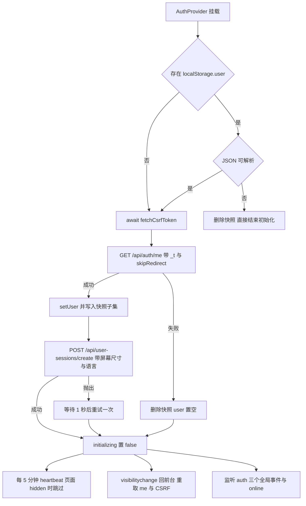
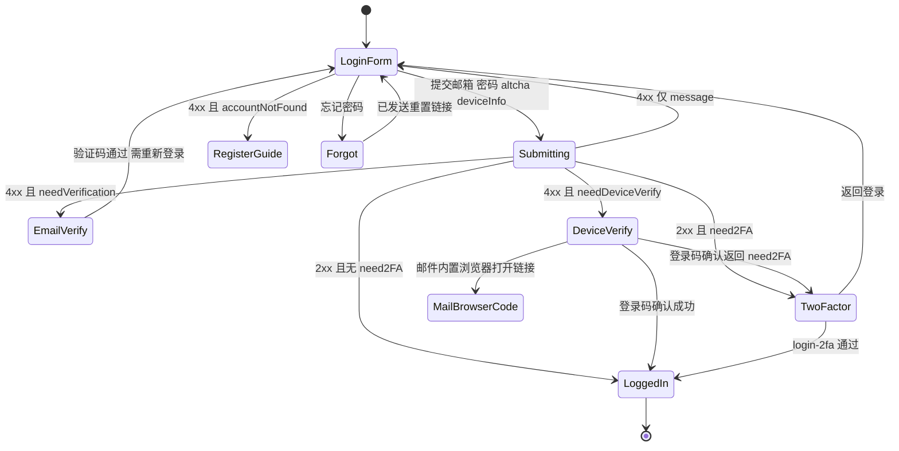
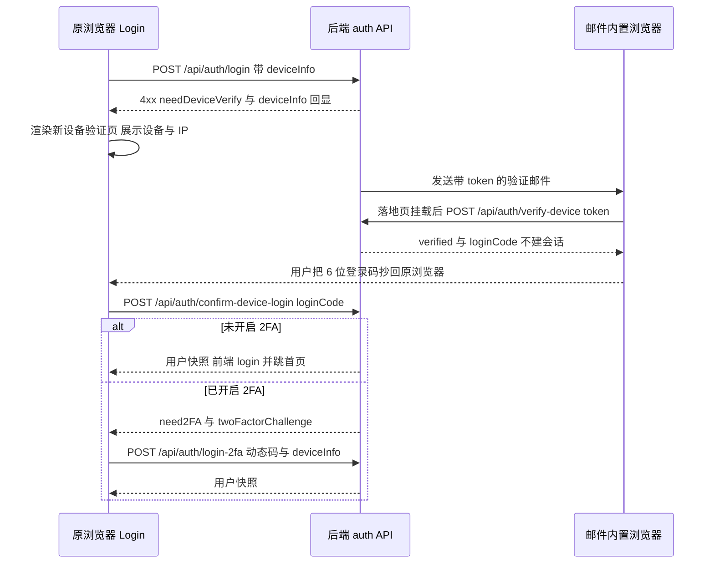

# 认证与账号体系

这一页覆盖用户侧账号的全部前端行为。先给出最重要的立场：**登录态的真相在 httpOnly cookie 与服务端，前端只持有一份可丢弃的快照**。所有「已登录」判断（`user` 非空）都是体验层的，真正的准入由后端按 cookie 会话判定；cookie、CSRF 与 401/419 刷新重试的机制在[HTTP 请求与会话生命周期](../architecture/http-and-session.md)，本页只讲账号流程如何消费它们。路由层的分区与守卫（谁能进入 `/profile`、`/admin`）见[路由分区与访问守卫](../architecture/routing-and-guards.md)。

## 页面地图

账号相关页面全部挂在公共路由树上，彼此通过 `/account-security` 这个入口页串联：

| 路由 | 组件 | 路由层登录态 | 主要端点 |
| --- | --- | --- | --- |
| `/login`、`/verify-device` | `Login` | 公开 | `POST /api/auth/login`、`login-2fa`、`verify-device`、`confirm-device-login`、`forgot-password` |
| `/register` | `Register` | 公开 | `POST /api/auth/register`、`verify-email` |
| `/reset-password` | `ResetPassword` | 公开（凭 `?token=`） | `POST /api/auth/reset-password` |
| `/verify-email` | `VerifyEmail` | 公开（凭 `?email=`） | `POST /api/auth/verify-email`、`resend-verification-by-email` |
| `/verify-email-change` | `VerifyEmailChange` | 公开（凭 `?token=`） | `POST /api/auth/verify-email-change` |
| `/account-security` | `AccountSecurity` | `user ? … : <Navigate to="/login" />` | `GET /api/users/export-my-data` |
| `/change-password` | `ChangePassword` | 同上 | `PUT /api/auth/change-password` |
| `/change-email` | `ChangeEmail` | 同上 | `POST /api/auth/request-email-change` |
| `/devices` | `UserDevices` | 同上 | `/api/user-sessions/*` |
| `/two-factor` | `TwoFactorPage` | 同上 | `/api/2fa/enable`、`verify-enable`、`disable` |
| `/delete-account` | `DeleteAccount` | 同上 | `/api/auth/deletion-status`、`request-deletion`、`cancel-deletion` |
| 全局浮层（公共分支） | `ForceEmailChange` | 仅当 `user.forceEmailChange` | `PUT /api/auth/change-email` |

`/login` 与 `/verify-device` 复用同一个组件：设备验证邮件里的链接指向后者，`Login` 只看 `?token=` 查询参数来判断自己是「登录页」还是「验证落地页」。`Login`、`Register` 是少数没有走 `React.lazy` 的首屏组件，因此它们的 altcha 依赖必须在入口就注册好（见[altcha 人机校验](#altcha-人机校验)）。

### 新增账号页的三件套

沿用现有写法新增一个账号页，需要同时完成三件事，漏一项都是静默降级：

1. **路由与登录态判空**：在 `App.jsx` 公共树里加一条扁平的 `<Route>`；需要登录的页面照抄内联判空 `user ? <Page user={user} /> : <Navigate to="/login" />`（仓库没有独立的 `RequireAuth` 组件），并补 `getRoutePageTitleKey` 的映射，否则标签页标题退化为站点名。
2. **i18n 文案**：账号文案分布在 `auth.*`、`profile.*`、`devices.*`、`twoFactor.*` 四组键下，`src/locales/zh.js` 与 `src/locales/en.js` 必须同时补齐（zh 是回退语言，缺失键会显示原始 key）。
3. **组件内再判一次空**：路由守卫只处理「跳走」，不保证组件内一定拿到 `user`。`UserDevices` 就额外在自己的 `useEffect` 里 `if (!user) navigate('/login')`，`AccountSecurity`/`DeleteAccount` 则直接依赖传入的 `user` 字段，因此它们只应被受保护路由渲染。

## 凭据模型：AuthContext 里的快照

`src/contexts/AuthContext.jsx` 暴露 `{ user, login, logout, initializing, getAuthHeaders, updateUser }`，但它不持有任何 token：

- `getAuthHeaders()` **恒返回空对象**，保留它只是历史兼容——凭据由 `axios.defaults.withCredentials` 自动携带的 httpOnly cookie 承担。账号页组件普遍把它透传给 axios，看起来像在加鉴权头，实际不起作用。
- `login(userData)` 只做两件事：`setUser`，以及把快照子集写进 `localStorage.user`（`_id`、`accountId`、`username`、`isEmailVerified`、`role`、`avatar`）。注意**快照里没有 email**：`AccountSecurity` 显示的 `user.email` 来自 `/api/auth/me` 或登录响应，而不是本地快照。
- `updateUser(next)` 支持函数式更新，并在结果非空时重写快照。`TwoFactorPage`、`ForceEmailChange`、`Profile` 都靠它同步 `twoFactorEnabled`、`forceEmailChange`、邮箱变更等字段。
- `logout()` 先 `POST /api/auth/logout`，**无论成败**都清空 `user` 与 `localStorage.user`，且不负责跳转；调用方（`NavBar` 的登出按钮、`ForceEmailChange` 成功页）自己决定去哪。

`initializing` 是渲染门禁：`AppContent` 在它为真时只渲染加载占位，所以任何账号页面都要等一次 `/api/auth/me` 结束才会出现。快照字段与 `localStorage` 侧的完整清单见[状态管理与持久化](../architecture/state-and-persistence.md)。

## 启动初始化：me + 会话创建

`AuthProvider` 挂载时按固定顺序跑一次初始化，并用 `AbortController` 承载 StrictMode 双挂载与卸载后的取消（每步之后都检查 `signal.aborted`）：

初始化顺序即语义：`/api/auth/me` 是唯一能恢复身份的调用，`user-sessions/create` 是它的副作用。

几个必须知道的行为：

- **无快照也会请求 `/api/auth/me`**。这样只靠 cookie 的回访（换了标签页、清了 `localStorage`）也能恢复登录态；快照只是首屏避免闪烁的缓存。
- **`params: { _t: Date.now() }`** 是为了绕开浏览器与中间层缓存；`skipRedirect: true` 让匿名访客收到 401 时既不跳转也不弹提示，直接落到「未登录」。
- **会话创建的重试是 1 次、间隔 1 秒**，第二次失败只 `console.error`，不影响登录态。载荷是 `{ screenWidth, screenHeight, language }`（直接读 `window.screen` 与 `navigator.language`），与登录时的 `deviceInfo` 是两套字段来源。
- **`user-sessions/create` 在每次应用启动（含刷新）都会随 `me` 成功再发一次**，因此「我的设备」的粒度是「每个通过 `me` 校验的浏览器启动」，不是「每次密码登录」。

## 心跳与回前台同步

有 `user` 时启动两个独立的 effect，它们的职责容易混淆：

| 机制 | 触发 | 行为 | 注意 |
| --- | --- | --- | --- |
| 心跳 | `setInterval` 5 分钟 | `POST /api/user-sessions/heartbeat`，失败静默 | **挂载时不立即发一次**；`document.visibilityState === 'hidden'` 时整次跳过，且回前台不补发，最长可能 10 分钟无心跳 |
| 回前台 | `visibilitychange` → `visible` | 重新 `GET /api/auth/me`（同样带 `_t`）并 `fetchCsrfToken()` | `/api/auth/me` 的**响应被丢弃**（只 `.catch(() => {})`），因此这里并不会刷新 React 侧的 `user`；实际收益是刷新 CSRF token、以及借拦截器顺带触发 401/419 的续期路径 |

这两段都不判断「页面是否刚被恢复」以外的状态：心跳用一个 `AbortController` 在 `user` 变化或卸载时中止，回前台的监听器同理。因此切换账号后不会残留上一次的心跳定时器。

同一文件里还有全局事件接线，它们把 axios 层的会话状态翻译成 React state：

- `auth:session-expired`（`detail.type === 'user'`）→ `setUser(null)`。
- `auth:force-email-change` → 给现有 `user` 打 `forceEmailChange: true`。
- `auth:token-refreshed` → 用 `detail.user` 合并快照（角色、邮箱、`isEmailVerified` 可能在刷新响应里变化）。
- 原生 `online` → 动态 `import('../utils/offlineQueue')` 并回放离线队列（评分的离线写就排队在这里）。

## altcha 人机校验

注册、登录、忘记密码、按邮箱重发验证码这四个入口都受 altcha 保护，形态完全一致：`challenge="/api/auth/captcha"`、`auto="onload"`、`hidefooter`/`hidelogo`。

- 组件是 Web Component `<altcha-widget>`，`public/altcha.js` 是它的本地副本（自执行并 `customElements.define('altcha-widget', …)`）。运行时真正生效的注册发生在 `src/main.jsx` 的 `import 'altcha'`：它必须在首屏执行，因为使用它的表单一半在首屏（`Login`、`Register`）、一半在懒加载路由里（`VerifyEmail`、`FriendLinks`），等路由 chunk 再注册就晚了。
- **payload 只能通过 `statechange` 事件拿**：监听器读 `ev.detail.payload`，存进组件 state，提交时作为 `altcha` 字段随请求发送。`Login` 与 `VerifyEmail` 用 callback ref 实现（元素切换时先解绑旧监听、清空 payload 再绑新的），因为同一组件会在「登录表单」和「忘记密码表单」两个分支里各渲染一次；`Register` 则用普通的 `useRef` + 一次性 `useEffect`。
- **未通过校验时提交是被静默吞掉的**：`Login.handleSubmit` 与 `Register.handleSubmit` 都以 `if (!altchaPayload) return;` 开头，而提交按钮只受 `submitting`（以及注册页的协议勾选）控制，不会因为 altcha 未完成而禁用；只有 `VerifyEmail` 的重发按钮把 `!altchaPayload` 用在 `disabled` 上。
- 仓库里**没有任何源码引用 `public/altcha.js`**（`index.html` 也没有 `<script>` 指向它）。它是随包发布的离线兜底/历史副本，与 `package.json` 的 `altcha` 依赖并列存在；改动验证码接入方式时不要误以为改那个文件就会生效。

## 注册流程

`Register` 是四字段表单（`accountId`、`username`、`email`、`password`）加一次 altcha，客户端先做一轮与后端同构的校验：

| 规则 | 位置 | 失败表现 |
| --- | --- | --- |
| 密码 ≥ 8 位 | 提交前 + 失焦 | `auth.passwordHint` |
| 密码含字母与数字 | 提交前 | `auth.passwordMustContainLetterAndNumber` |
| 两次密码一致 | 无（注册只有一个密码框） | —— |
| `accountId` 匹配 `[A-Za-z0-9_]+`，3–20 位 | `pattern` + `minLength`/`maxLength` + 失焦 | `auth.accountIdHint` |
| 必须勾选协议与隐私政策 | 提交前 + 按钮 `disabled` | `auth.agreeTermsFirst` |

提交体是 `{ ...formData, altcha, deviceInfo: getDeviceInfo() }`。失败时若响应带 `emailTaken`，页面不显示普通错误条，而是换成「该邮箱已注册过，直接登录即可」的引导条 + 跳转按钮，跳转时把已填邮箱带到 `/login?email=`（登录页对应地用 `?email=` 预填，且不覆盖用户已输入的值）。

**注册成功不等于可用账号**：成功后组件切到 `registered` 状态，要求输入邮件里的 6 位验证码，调 `POST /api/auth/verify-email { code, email }`；验证成功后显示成功页并给出「去登录 / 回首页」。这一页没有重发入口——重发在 `/verify-email?email=` 的 `VerifyEmail` 组件里（内部再挂一个 altcha，调 `resend-verification-by-email`）。`Register` 里声明的 `codeResendLoading`/`codeResendMsg`/`codeResendSuccess` 三个 state 从未被使用，是这块 UI 演进后的残留。

## 登录分支：一个状态机

`Login` 把「登录两次请求之间的所有中间态」收进同一组件，用一组互斥的布尔 state 驱动不同视图。分支判定完全靠响应体里的标志位，且**成功与失败的通道不对称**：

这张图是理解整个账号模块的入口：2FA 既可能从密码登录进入，也可能从设备验证的登录码确认进入。

| 响应 | 标志 | 前端行为 |
| --- | --- | --- |
| `2xx` | `need2FA`（+ `email`、`twoFactorChallenge`） | 不调用 `login()`，切到 2FA 视图并保留 challenge |
| `2xx` | 无标志 | `login(response.data)` 写状态与快照，`navigate('/')` |
| `4xx` | `needVerification`（+ `email`） | 切到邮箱验证码视图 |
| `4xx` | `needDeviceVerify`（+ `email`、`deviceInfo`） | 切到新设备验证视图，回显浏览器/系统/设备类型/IP |
| `4xx` | `accountNotFound` | 登录表单上方替换为「去注册」引导条（同样带邮箱跳 `/register?email=`） |
| `4xx` | 仅 `message` | 普通错误提示 |

两条硬性细节：

- **每次提交先重置所有分支 state**（`needVerification`/`needDeviceVerify`/`need2FA`/`suggestRegister` 及验证码与错误），所以重复提交不会把上一次的视图叠在当前视图上。
- **登录成功固定 `navigate('/')`**，不读 `location.state` 也不读 `from`。深链被守卫踢到 `/login` 后，登录完成只会回到首页——这是账号流程里最容易让人误期望落空的地方。

视图渲染顺序是固定的 `if` 链：`deviceLoginCode` → `deviceVerifyLoading` → `needDeviceVerify` → `need2FA` → `needVerification` → 重置 → 忘记密码 → 登录表单。调整顺序会改变多条分支同时为真时的优先级。

## 新设备验证：邮件链接与登录码回填

新设备登录是唯一跨浏览器/跨客户端的流程，因此它**故意不共享 cookie**，改用一次性登录码传递结果：

实现上分成两半，落在同一个组件里：

- **落地页半边**：`?token=` 存在时，挂载即 `POST /api/auth/verify-device`。成功且响应带 `loginCode` 时，整个组件只渲染一个「验证成功 + 6 位大字登录码」页面（配「回到发起登录的浏览器输入」文案与 10 分钟有效期提示）。邮件 App 内置浏览器与发起登录的浏览器不共享 cookie，所以这里刻意**不执行登录**。等待期间渲染「正在验证设备」，失败则把 `deviceVerifyFailed` 写进错误条并回落到登录表单。
- **原浏览器半边**：`needDeviceVerify` 视图同时展示两样东西——「验证码已发送至某邮箱」和**一个 6 位登录码输入框**。输入框只接受数字、`maxLength=6`，长度不足 6 时确认按钮禁用。提交走 `POST /api/auth/confirm-device-login { loginCode }`：若响应 `need2FA`，则置 `fromDeviceVerify`（该标志目前只写不读）、带上 `twoFactorChallenge` 转入 2FA 视图；否则直接 `login(res.data)` 并跳首页。页面还提供「返回登录」按钮重置状态。

设备信息由 `src/utils/deviceInfo.js` 的 `getDeviceInfo()` 解析 `navigator.userAgent` 得出：`browser`/`browserVersion`/`os`/`osVersion`/`deviceType`/`deviceModel`/`carrier`，外加 `screenWidth`/`screenHeight`/`language`。它包含了三处针对 Apple 的版本号纠偏——macOS 11+ 的 Safari 把 `Mac OS X` 冻结在 `10.15.x`、iOS 26+ 冻结 `iPhone OS`、iPadOS 26+ 同理，真实版本要从 `Version/` 反推；`UserDevices` 与设备验证视图都会对 `iOS`/`iPadOS`/`macOS` 条目加一条「版本号可能不准」的星标说明。

## 二步验证

2FA 有两个入口、两套端点，别混：

| 场景 | 入口 | 请求 |
| --- | --- | --- |
| 登录时的 2FA | `Login` 的 `need2FA` 视图 | `POST /api/auth/login-2fa`，体含 `email`、`twoFactorToken`、`twoFactorChallenge`、`deviceInfo` |
| 账号内启停 2FA | `/two-factor` → `TwoFactorPage` | `POST /api/2fa/enable` → `verify-enable` → 之后 `disable` |

`TwoFactorPage` 是一个四态向导（`disabled`/`setup`/`enabled`，外加一次性 `success` 展示）：

1. `enable` 返回 `{ secret, otpauthUrl, backupCodes }`，页面用 `qrcode` 库把 `otpauthUrl` 画成 data URL 的二维码（纯前端生成，不请求第三方），同时给出可手动输入的密钥和可展开的备份码。
2. 输入 6 位动态码后 `verify-enable`，成功即 `setUser({ ...user, twoFactorEnabled: true })` 并切到 `enabled`。
3. `enabled` 视图反过来要求输入 6 位码才能 `disable`，成功后置 `twoFactorEnabled: false`。

要点：初始步骤是 `useState(user?.twoFactorEnabled ? 'enabled' : 'disabled')`，**只在挂载时取值一次**，之后 `user` 变化不会重算；所有输入框都用 `replace(/\D/g, '').slice(0, 6)` 过滤；三处按钮都以 `token.length !== 6` 作为禁用条件。`components/TwoFactorAuth.jsx` 是一个未被任何路由或组件引用的旧实现，路由使用的是 `TwoFactorPage.jsx`，改 2FA 界面时要改后者。

## 密码找回与重置

完整链路是「登录页发起 → 邮件链接 → 独立页面设密码」：

1. `Login` 的忘记密码视图收集邮箱，连同 altcha 一起 `POST /api/auth/forgot-password`。无论后端真实结果如何，前端只显示「如果该邮箱已注册，重置链接已发送」（`auth.resetLinkSent`），不做账号存在性泄露。
2. 邮件里的链接指向 `/reset-password?token=…`，由 `ResetPassword` 组件处理：无 `token` 直接渲染「链接无效或已过期」页；有 token 则校验新密码（≥8 位、含字母与数字、两次一致）后 `POST /api/auth/reset-password { token, newPassword }`，成功后显示提示并在 2 秒后 `navigate('/login')`。

`Login` 里还留着一套内嵌的重置分支（`showReset` + `resetToken`），但**它是死代码**：全文件没有任何地方调用 `setShowReset(true)`，`resetToken` 也从未被赋值（只有清空）。排查「密码重置为什么不生效」时应直接改 `ResetPassword.jsx`，不要在那段分支上花时间。

## 邮箱验证与邮箱变更

邮箱相关的路径有四条，区别在于「验证的是哪个邮箱」和「是否需要旧凭据」：

| 流程 | 组件 | 端点 | 关键点 |
| --- | --- | --- | --- |
| 注册后验证 | `Register` | `POST /api/auth/verify-email` | 6 位码 + 注册邮箱，成功后不自动登录 |
| 登录时补齐验证 | `Login` 的 `needVerification` 视图 | 同上 | 成功后回到登录表单并提示重新登录（无重发入口，需去 `/verify-email`） |
| 独立验证/重发 | `VerifyEmail` | `verify-email`、`resend-verification-by-email` | 依赖 `?email=`，重发需 altcha |
| 变更邮箱 | `ChangeEmail` → `VerifyEmailChange` | `request-email-change` → `verify-email-change` | 双确认：旧密码发起，新邮箱收信确认 |

`ChangeEmail` 只负责第一步：提交当前密码 + 新邮箱，`POST /api/auth/request-email-change` 成功后渲染「邮件已发送」，**页面上不显示新邮箱已生效**——真正的切换发生在 `VerifyEmailChange` 里，后者在 `/verify-email-change?token=…` 挂载时立刻 `POST /api/auth/verify-email-change`，用 `verifying`/`success`/`error` 三态展示结果并显示新邮箱，最后跳回 `/profile`。

### 强制改邮箱拦截

这条链路把后端的一次 403 变成了全局不可回避的弹窗，分成三段（拦截器细节见[HTTP 层、CSRF 与双 Token 刷新](../architecture/http-and-session.md)）：

1. 后端在写操作上返回 `403` 且响应体带 `forceEmailChange`，`axiosConfig` 把 `localStorage.user.forceEmailChange` 置真并派发 `auth:force-email-change`。
2. `AuthContext` 监听该事件，给 `user` 打标。
3. `AppContent` 在**公共分支**的返回值里按 `user?.forceEmailChange` 渲染 `ForceEmailChange`：一个 `closeOnOverlay={false}`、`closeOnEsc={false}`、`onClose` 为空函数的 `Modal`，提交 `PUT /api/auth/change-email { newEmail, password }`，成功后 `onUpdate({ email, isEmailVerified: false, forceEmailChange: false })` 解除拦截，并给出「登出」按钮。

因为 `ForceEmailChange` 只挂在公共分支，后台 `/admin/*` 上被拦截时弹窗不会出现，只有写操作失败——这与路由分区的不对称是同一件事，改动时需一并考虑。

## 设备与会话管理

`/devices` 的 `UserDevices` 读 `GET /api/user-sessions/my`，把每条会话渲染成卡片：`deviceInfo.deviceType` 决定图标，`deviceName`（用户可改的别名，回退到浏览器名+版本）、`os`/`osVersion`、屏幕分辨率、`ip`、`loginAt`/`lastActiveAt`/`logoutAt`，并用三个徽标表达状态——`isActive`（在线/离线，离线卡片整体降透明度）、`isCurrent`（当前设备）、Apple 版本星标。

可执行的动作与约束：

| 动作 | 端点 | 约束 |
| --- | --- | --- |
| 单设备下线 | `DELETE /api/user-sessions/:id` | 仅对 `isActive && !isCurrent` 的会话显示按钮；`isCurrent` 不能从本页下线 |
| 登出其他设备 | `DELETE /api/user-sessions/my/all` | 按钮仅在 `activeCount > 1` 时出现；**调用后不重新拉取列表**，页面提示成功但卡片仍显示旧状态，需手动刷新或重进页面 |
| 重命名设备 | `PUT /api/user-sessions/:id/name { deviceName }` | 行内编辑，Enter 保存、Esc 取消 |

所有删除类操作都先弹 `ConfirmModal`（`danger`/`warning` 两种类型），成功后 3 秒自动清除提示条。注意这些组件里的路径都是**内联字面量**，而不是 `API.USER_SESSIONS.*` 常量（该常量只有 `AuthContext` 用到），重命名端点的风险因此是双份的。

## 账号安全入口与数据导出

`AccountSecurity` 是账号侧的聚合页，六个区块依次是：邮箱（默认掩码显示 `a***z@domain`，可切换显示完整值，并展示 `isEmailVerified` 徽标）、密码、管理设备、两步验证（按 `user.twoFactorEnabled` 显示已启用/未启用与「管理/启用」按钮）、导出数据、注销账号。除了导出与注销，其余都只是跳转到对应子页面。

数据导出是账号模块里**唯一绕过 axios 的请求**：`fetch(API.USERS.EXPORT, { headers: getAuthHeaders(), credentials: 'include' })` 拿到 blob，再用临时 `<a download>` 存成 `my_data_YYYY-MM-DD.json`。因为是 `GET`，缺少 CSRF 头无影响；但它也不享受 axios 拦截器的 401 自动刷新与 419 重试，会话刚过期时导出会直接失败并显示「导出失败」文案。

## 账号注销

`DeleteAccount` 把「申请删除」做成三步不可跳过的对话，且进入页面先查状态：

1. `GET /api/auth/deletion-status`，只有 `requested` 为真才渲染倒计时面板。
2. 未申请时点「申请注销」进入步骤 0：列出冷却期、可随时取消、7 天后永久删除等条款；点「我已了解」进入步骤 1。
3. 步骤 1 要求输入登录密码做身份确认。**这一步实际调用的是 `POST /api/auth/login`（`{ email, password }`，不带 altcha、不带 deviceInfo）**，并把**任何**失败都显示为「密码错误」。因此若账号开启了 2FA，后端会返回 `need2FA`（属于 2xx，不是错误），前端会把它当成密码验证通过而直接放行到步骤 2——这个「重认证」并不构成真正的二次确认。
4. 步骤 2 是最终确认，`POST /api/auth/request-deletion`（无请求体），成功后用响应里的 `deletionRequestedAt`/`deleteAt` 渲染倒计时面板。
5. 倒计时面板用 `formatCountdown` 把 `deleteAt` 差值格式化为「天+小时 / 小时+分钟 / 分钟」，已过期显示「即将删除」，并可用 `POST /api/auth/cancel-deletion` 撤销（成功后本地清空状态，回到申请面板）。

## 已知粗糙处与改动检查清单

| 现象 | 位置 | 影响 |
| --- | --- | --- |
| `showReset` 分支不可达、`resetToken` 从未赋值 | `Login` | 内嵌重置流程是死代码，改动请去 `ResetPassword` |
| 注销的密码验证复用登录端点、不区分 `need2FA` | `DeleteAccount` | 2FA 账号的「密码验证」形同虚设；同时会顺带触发一次登录成功响应（被忽略） |
| 回前台的 `/api/auth/me` 响应被丢弃 | `AuthContext` | 长时间挂起后回前台，`user` 的角色/邮箱变化要等下一次刷新或重新挂载才反映 |
| 心跳不补发 | `AuthContext` | 后台标签页休眠时可能出现超过 5 分钟的空档 |
| 「登出其他设备」后不重新拉取 | `UserDevices` | 列表与真实会话状态短暂不一致 |
| `public/altcha.js` 无任何引用 | 仓库根 | 误以为改它就能改验证码行为 |
| `TwoFactorAuth.jsx` 未被引用 | `components/` | 改错文件的典型陷阱 |
| `fromDeviceVerify`、`codeResend*` 只写不读 | `Login`、`Register` | 无害但会误导后续维护者 |
| 登录成功固定回首页 | `Login` | 受保护页面的深链体验丢失 |

改动账号相关代码时，按此顺序自查：**先确认端点契约**（响应标志位与状态码是前后端唯一协议，见[后端 API 地图](../integrations/backend-api-map.md)）→ **再确认凭据路径**（不要在组件里加 `Authorization`，会话续命交给拦截器）→ **最后补路由、i18n 与判空**。

## 验证方式

仓库没有自动化测试脚本（`package.json` 只有 `dev`/`build`/`lint`/`preview`/`generate-icons`），因此账号流程只能靠质量门禁加手动冒烟：

- 静态：`npm run lint`、`npm run build`。
- 冒烟主路径：注册（含错邮箱/重复邮箱）→ 邮箱验证码 → 登录 → 新设备验证（另一浏览器打开邮件链接抄码）→ 2FA 登录 → 忘记密码 → 重置后重新登录。
- 边界：未完成 altcha 直接点提交（应无任何反馈）、在 `/login?token=` 打开设备链接（应只显示登录码）、会话过期时点数据导出（应显示失败而不是白屏）。

更完整的门禁清单见[验证与质量门禁](../testing/verification-and-quality-gates.md)；通知与邮件偏好（`/settings` 的 `email-notification-prefs`）见[通知与实时推送](notifications.md)。
