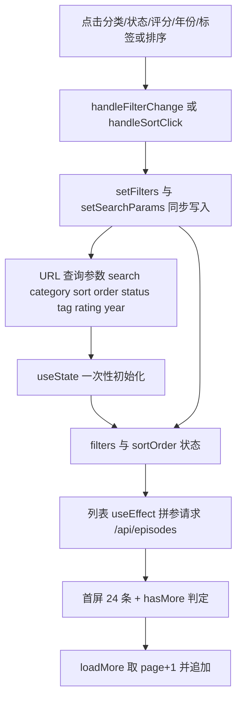
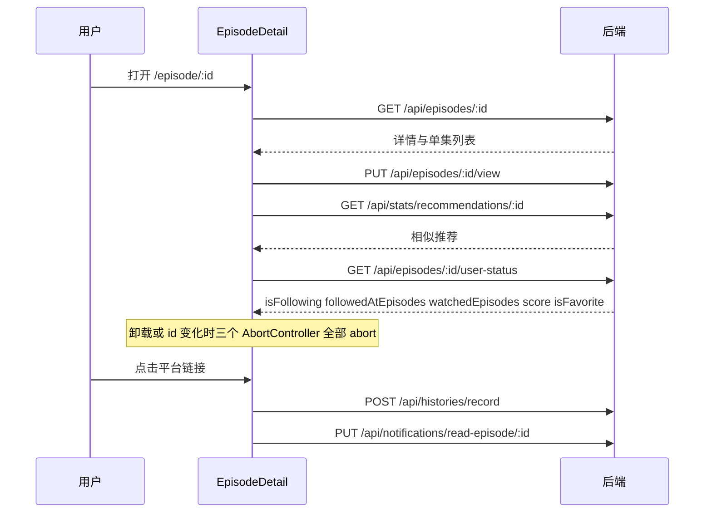

# 内容发现、剧集详情与用户内容库

前台的内容消费链路可以拆成四段：**列表发现**（`Home` 的筛选、排序、分页与推荐位）、**详情消费**（`EpisodeDetail` 的多次请求装配与写操作）、**横向发现面**（更新日历、时间线、创作者主页、搜索与标签云）、**个人内容库**（`Profile` 的收藏夹、关注与历史）。它们共用同一套后端契约，但对登录态的依赖程度差别很大：列表与详情的主体内容匿名可读，而推荐、继续观看、收藏、关注、评分、历史、提醒订阅全部以 `user` 是否存在作为开关。

接口清单与错误语义见 [后端契约地图](../integrations/backend-api-map.md)，实体字段与术语见 [领域模型与术语表](../concepts/domain-model.md)，审核与发布流转见 [剧集创作、审核与版本流转](../workflows/episode-publishing-and-review.md)。

## 列表发现：Home

`Home` 同时承担三件事：渲染站点欢迎区与筛选器、维护列表的查询参数、在没有数据时给出空态。它只从 `AuthContext` 取 `user`（不接收 props），因此同一页面在登录前后会呈现不同的推荐区块。

### URL 查询参数是筛选/排序的复原依据

七个筛选维度中，`search` 是唯一**不被复制进组件状态**的：它每次渲染都直接从 `searchParams` 读取并作为列表请求的依赖项。其余六个（`category`、`sort`、`status`、`tag`、`rating`、`year`）与 `order` 在挂载时被拷入 `filters` / `sortOrder` 状态，之后通过回调写回 URL。

筛选/排序的写入与读取构成一个环：URL 提供初值，交互同时更新状态与 URL，状态再驱动请求。

| 前端状态键 | URL 参数 | 请求参数 | 说明 |
| --- | --- | --- | --- |
| `category` | `category` | `category` | 传分类**名称**而不是 `_id`，与 `EpisodeFilters` 的胶囊标识一致 |
| `sort` | `sort` | `sort` | `latest` / `views` / `premiere` / `rating` |
| `sortOrder` | `order` | `order` | 默认 `desc`；再次点击当前排序项才翻转 |
| `status` | `status` | `status` | `ongoing` / `completed` / `upcoming` |
| `tag` | `tag` | `tag` | 标签云与卡片上的 `#标签` 共用这一个键 |
| `rating` | `rating` | `minRating` | 前端键名与后端参数名不同，改动时两处都要动 |
| `year` | `year` | `year` | 选项为当前年份回退到 2016，另有 `earlier` |
| — | `search` | `search` | 由搜索框导航写入，`Home` 只读不写 |

两个刻意的约定：空值不是"传空字符串"而是**删除该参数**，因此未筛选状态的 URL 是干净的 `/`；`search` 由 `SearchInput` 通过 `navigate('/?search=…')` 写入，`Home` 自身不提供清空搜索的控件，只能靠搜索框重搜覆盖。

**单一真源的边界**：`filters` / `sortOrder` 只在挂载时从 URL 初始化，没有"URL 变化 → 状态"的反向 effect。因此在同一次挂载内状态是权威的（浏览器后退若只改 URL 而不卸载组件，筛选器 UI 不会跟着变）；而 `Home` 会因为跳到详情页而卸载，返回时重新挂载、重新读参，于是筛选条件与顺序可复原——这正是本页要求"返回列表时要保持可复原"的实现方式。

### 分页、无限滚动与滚动位置恢复

列表请求固定 `page=1&limit=24`。首屏把响应当作 `{ episodes, total }` 或裸数组两种形态都兼容，`hasMore` 用 `episodes.length < total` 判定；`loadMore` 则改用"本页是否取满 24 条"判定 `hasMore`——两套判定并存，服务端若忽略 `total` 只回数组，首屏会走裸数组分支并直接置 `hasMore=false`。

自动加载由 `IntersectionObserver` 承担：哨兵是列表底部 1px 高的 `div`，`rootMargin: 200px`，仅在 `hasMore && !loadingMore` 时调用 `loadMore`；同一位置还有一个显式的"加载更多"按钮作为兜底（并在 `loadingMore` 时置灰）。已加载页数只在追加成功后通过 `setPage` 提交，失败时只把 `hasMore` 置 false，不再重试。

滚动恢复使用 `sessionStorage` 的 `home_scroll_pos` 键：滚动事件以 100ms 节流写入当前 `window.scrollY`；读取只发生一次——首次 `loading` 变 false 后通过 `requestAnimationFrame` 滚回。`scrollRestoredRef` 保证每次挂载最多恢复一次，所以后续 `loadMore` 不会再次校正位置，深度滚动的位置在只加载首批 24 条时可能被浏览器夹取到文档底部。

列表请求本身**没有** `AbortController` 或请求序号：连续快速点选多个筛选条件时，属于前一组参数的响应理论上可以后到并覆盖列表。对比详情页的取消策略，这是 `Home` 已知的竞态缺口。

### 个性化推荐与继续观看的登录门槛

`user` 为真时才并发两个请求：`GET /api/stats/recommendations/personalized` 与 `GET /api/histories/continue-watching`；`user` 变为假时清空两块数据并提前返回。未登录时代替推荐区渲染一条点击跳 `/login` 的引导条。

- **继续观看**：横滑卡片，数据形如 `{ episodeId, watchedEpisodes, lastWatchedEpisodeNumber }`；进度条宽度为 `watchedEpisodes.length / episode.totalEpisodes`，而 `totalEpisodes === null`（总量未知）时改用"已看 n 集"文案而不是比例。`episodeId` 为空（剧集被删/不可见）的条目直接跳过渲染。
- **猜你喜欢**：推荐对象携带 `reason` 字段，按三种取值映射文案：`becauseYouFollow`（带 `reasonName`）、`popularInCategory`、其余归为"相似用户也喜欢"。`averageRating > 0` 时叠加角标。

推荐的原因标签是后端驱动的枚举，新增一种 `reason` 必须同时补 `home.*` 文案与这里的映射，否则会静默落到最后一个分支。

### 其他首屏数据

`/api/categories` 与 `/api/banners` 各自独立请求、错误静默（失败即空），因此分类胶囊缺失不会阻塞列表。标签云 `TagCloud` 只在挂载时请求一次 `/api/episodes/popular-tags`，用 `count` 线性映射到字号（12–26px）与透明度；无数据或加载中直接 `return null`。标签点击是"选中/取消"语义：`Home.handleTagClick` 发现点击的是当前 `filters.tag` 就清空，因此标签云与卡片上的 `#标签` 走同一条路径。

## 详情页：EpisodeDetail 的数据装配

`EpisodeDetail` 是全站写操作最密集的页面。它接收 `user` prop（来自路由），同时从 `AuthContext` 取 `getAuthHeaders()`——后者当前返回空对象，认证完全依赖 httpOnly cookie（见 [HTTP 层、CSRF 与双 Token 刷新](../architecture/http-and-session.md)），因此组件里对 `localStorage.getItem('user')` 的检查只是"要不要发这个请求"的开关，不是凭证。

### 三个请求 effect 与取消策略

详情、推荐、登录态三条请求互不阻塞；播放量上报串在详情成功之后。

三个 effect 各持一个 `AbortController`，`episodeId` 变化时清理函数执行 `abort()`，`catch` 里对 `axios.isCancel` / `status === 'CanceledError'`（或 `ERR_CANCELED`）直接 return，避免卸载后 `setState`。这解决了"同一路由内切换 id"和 StrictMode 双挂载两种竞态。

- **详情 + 播放量**：`GET /api/episodes/:id` 成功后立刻 `PUT /api/episodes/:id/view`，并用同一个 signal——view 上报是详情请求的**后续步骤**，详情失败就不计数。
- **推荐**：`GET /api/stats/recommendations/:id`，空数组时不渲染区块。
- **登录态聚合**：仅当 `user` 存在且 `localStorage` 有 `user` 才发 `GET /api/episodes/:id/user-status`，一次拿回五个字段（`isFollowing`、`followedAtEpisodes`、`watchedEpisodes`、`score`、`isFavorite`），避免为每个按钮单独建请求。

### 单集徽章的两套数据源

单集列表默认只显示 5 条，可升/降序切换，超出时可"展开全部"。每条单集最多叠加四类徽章，其中三类依赖登录态：

| 徽章 | 判定 | 数据来源 |
| --- | --- | --- |
| 预告 | `isScheduled` | 单集自身字段，带 `scheduledDate` 时显示日期 |
| 已看 | `watchedEpisodes.includes(episodeNumber)` | `user-status.watchedEpisodes` |
| 新更新 | `episodeNumber > followedAtEpisodes`（且已关注） | `user-status` / `POST /api/follows/add` 的响应 |
| 未看 | 非预告、已登录、未看、且不满足"新更新" | 同上两者的组合 |

因此"新更新"是**追番水位线**语义（关注时的集数为界），"未看"是**已看集合**语义。二者不能互相替代：一个老用户重新关注后，历史集数不会被标为新更新。已看条目会降低不透明度，形成视觉上的已消费标记。

### 写操作一览

| 动作 | 端点 | 触发点与副作用 |
| --- | --- | --- |
| 关注 / 取消关注 | `POST /api/follows/add`、`/api/follows/remove` | 关注响应回填 `followedAtEpisodes`，取消时清空该值 |
| 收藏 | `POST /api/favorites/add`（可带 `folderId`）、`/api/favorites/remove` | 已收藏时点击直接取消；未收藏时先拉文件夹列表 |
| 评分 / 撤销 | `POST /api/ratings`、`DELETE /api/ratings/:episodeId` | 用响应回填 `averageRating` / `ratingCount`；离线失败入队 |
| 观看历史 | `POST /api/histories/record` | 仅由播放弹窗内平台链接的 `onClick` 触发 |
| 单集播放量 | `PUT /api/episodes/single/:id/view` | 点击"观看"打开弹窗时触发 |
| 通知已读 | `PUT /api/notifications/read-episode/:id` | 跟随历史记录成功后发出，失败静默 |

几个边界值得注意：

- **收藏的文件夹选择**：未收藏时先 `GET /api/folders?type=favorite` 打开一个 `createPortal` 到 `body` 的浮层（按按钮 `getBoundingClientRect` 定位），列出"默认文件夹"与各收藏夹；拉取失败则回退为直接收藏到默认文件夹，保证主流程不被文件夹服务拖垮。
- **离线评分**：`POST /api/ratings` 抛错且 `navigator.onLine === false` 时，把请求塞进 `offlineQueue`（去重、24 小时过期、最多 3 次重试，见 [PWA、离线缓存与浏览器兼容](pwa-offline-and-compat.md)），网络恢复后统一重放。
- **历史与通知的耦合**：历史记录成功后紧接着把该剧集相关通知标为已读——即"看了就说明这条更新通知已经被消费"。通知侧的未读数权威值仍由后端下发，见 [通知投递：SSE、轮询与 Web Push](notifications.md)。
- **播放弹窗**：只对 `platformLinks` 的**第一个**链接尝试生成内嵌地址（bilibili 的 `BV`/`av`、YouTube 的 `v=`/`youtu.be`、niconico 的 `sm` 号）；命中则在 `iframeReady`（300ms 延时，等 Modal 动画）后挂 `sandbox` iframe，移动端对 bilibili 播放器直接显示"不支持内嵌"提示；未命中则提示"选择平台跳转"，链接列表始终完整保留。关闭弹窗先播退出动画再清空 `watchModal`，避免内容提前消失。

### 可见性、标题与 noindex

详情页对 `episode.status`（连载/完结/待播）做中文展示，但**不渲染审核状态**：`ReviewStatusBadge` 只被管理页引用（`AdminEpisodes`、`AdminReview`、`AdminCreatorProfiles` 等）。用户侧看到哪些剧集由接口决定——即"用户可见集 = 后端按 `reviewStatus` 与角色过滤后的结果"，前端不做二次裁剪。前端只做一件事兜底：当 `episode.reviewStatus` 存在且不等于 `approved` 时，动态插入 `<meta name="robots" content="noindex, nofollow">` 并在卸载时移除，对应后端对同一情形的 `X-Robots-Tag` 响应头。

同一页面还负责把 `document.title` 改写为"剧集名 - 站点名"，站点名优先取 `browserTitle{Lang}`，回退到 `browserTitle` 与默认名；标题的复位由 `App` 的路由副作用处理，详情页自身不重置。多语言标题/描述的取值链见 [界面国际化与运行时内容翻译](i18n-and-translation.md)。

分享与举报入口都以弹窗形式挂在详情页底部：`ShareModal` 传 `title` 与 `episodeId`，`ReportModal` 传 `targetType="episode"`、`targetId`、`targetName`（`targetType` 是举报对象类型的分发键）。分享按钮对所有人可见，举报按钮只在 `user` 存在时渲染。

## 横向发现面

### 时间线 Timeline

两个 tab，登录用户默认"我的时间线"、匿名用户只有"发现"，且 `user` 变空时会把当前 tab 强制回落：

- **我的时间线**：`GET /api/activity?page=&limit=20`，带上一页/下一页分页器（`page / totalPages`）。
- **发现（公开）**：`GET /api/activity/public`，**不带**分页参数，也不渲染分页器——`totalPages` 仍会被写入，但只在 `my` tab 使用。

活动类型固定为 `new_episode`、`status_change`、`new_rating`，各自有图标与 `timeline.*` 文案模板；渲染时会优先用 `episodeTitle` / `metadata` 重建文案，标题缺失才回退到后端存下来的 `description` / `descriptionEn`。因此新增活动类型必须同时补图标映射与文案，否则落进 `default` 分支直接显示原始描述。时间用相对格式（刚刚 / n 分钟 / n 小时 / n 天），点击任意条目跳详情页。

### 更新日历 UpdateCalendar

数据源是 `GET /api/stats/calendar`：年视图只传 `year`，月视图传 `year` + `month`；响应形如 `{ year, month, calendar: { 'YYYY-MM-DD': { released, scheduled, premieres } } }`。组件按日期键聚合出三种条目类型：已更新（绿）、预告（黄）、开播（蓝），并把"我的关注"作为第四种视觉标记。

- **两种可达视图**：年视图（12 个月卡片，含每月统计与最多 3 条预览）与月视图（日历网格 + 当月明细列表）。点击年份标题与月份标题在两者间切换，`goToday` 返回当前年月。源码里还存在 `renderWeekView` 与 `showYearPicker` / `getYearList` 等成员，但没有任何调用点——周视图与年份选择器是**未接线的死代码**，改动日历时不应误以为它们生效。
- **关注高亮与提醒**：挂载时若 `localStorage` 有 `user` 则 `GET /api/follows/list`，把剧集 id 收进 `followingIds`；命中的条目加主色描边。对"已关注 + 预告"的条目额外给出 🔔 提醒按钮，点击 `POST /api/notifications/subscribe-reminder`（失败静默，无乐观提示）。
- **移动端**：`window.innerWidth < 768` 时判定为移动端，网格改为横向可滚动并提示滑动。

### 创作者主页 CreatorPage

单个请求 `GET /api/creator-profile/by-creator/:id` 同时拿回 `{ profile, episodes }`——主页资料与作品列表一次装配，没有分页、没有二次请求，失败只 `console.error` 并落到 `creator.notFound` 空态。`socialLinks` 兼容对象与 `Map` 两种形态（后端可能返回 `Map` 序列化结果）。作品卡只展示当前集数/总集数（`totalEpisodes === null` 时显示"更新至 n 集"）、状态与封面，不展示审核状态。

### 搜索与标签

`SearchInput` 是唯一的搜索入口（`EpisodeFilters` 在筛选区顶部直接渲染它）：组件**不接收任何 props**，300ms 防抖后请求 `GET /api/episodes/search?q=…&limit=10` 并每次请求前 abort 上一个；方向键上下选择、回车跳详情；没有选中项时回车 `navigate('/?search=…')`，即把查询交给 `Home` 的 URL 参数。`AdminEpisodes` / `AdminUsers` 传入的 `data`、`searchKey`、`onSearch` 等 props 会被忽略。

`EpisodeSearch.jsx` 是另一套更完整的搜索组件（`/api/episodes/search-suggestions`、标题与标签分组的建议、`localStorage` 的 `search_history` 最多 10 条、可跳 `/?tag=`），但当前没有任何页面引用它——新增搜索入口时应先确认复用它还是复用 `SearchInput`。

## 个人内容库：Profile

`Profile` 的依赖数组是 `[location]`，因此**每次路由变化都会重新拉全量数据**；六个请求用 `Promise.allSettled` 并行发出，任一失败只降级为 `[]` 而不影响其它区块：

| 请求 | 用途 |
| --- | --- |
| `GET /api/follows/list` | 关注列表（含 `followedAtEpisodes`） |
| `GET /api/histories/list` | 观看历史（按剧集聚合的 `watchedEpisodes`） |
| `GET /api/favorites/list?folderId=null` | 默认（未分类）收藏夹内容 |
| `GET /api/folders?type=favorite` | 用户自建收藏夹 |
| `GET /api/favorites/counts` | 总收藏数与各夹计数 |
| `GET /api/saved-folders` | 从别人分享链接保存下来的收藏夹 |

三个 tab 的角标分别取 `followedEpisodes.length`、`totalFavoriteCount`（不是当前夹的条数）、`historyEpisodes.length`；三个面板都用 `display: none` 隐藏而不是卸载，切换 tab 不触发重新请求。

### 收藏夹模型与操作

"未分类"是前端约定值：`activeFolderId === 'unclassified'`，请求时映射为 `folderId: 'null'` 字符串（后端据此查 `folderId` 为空/null 的记录）。自定义收藏夹走后端 `/api/folders` 资源：

| 操作 | 端点 | 前端状态处理 |
| --- | --- | --- |
| 新建 | `POST /api/folders`（`type: 'favorite'`） | 追加到列表并把计数初始化为 0 |
| 改名/改简介 | `PUT /api/folders/:id` | 用响应整体替换该夹 |
| 删除 | `DELETE /api/folders/:id` | 移除计数；若删的是当前夹则回落 `unclassified` 并重取默认夹内容 |
| 移入 | `POST /api/folders/:id/items` | 本地把 `folderId` 改写为目标夹并按源/目标夹增减计数 |
| 移出 | `DELETE /api/folders/:id/items/:episodeId` | `folderId` 置 null，计数归还 `unclassified` |
| 取消收藏 | `POST /api/favorites/remove` | 从列表剔除并同步递减总数与当前夹计数 |

各类计数都是**本地增量更新**而非重新拉取，因此与后端的真实计数只在这六类操作的成功路径上保持一致；任何绕过 UI 的改动（如另一台设备）都要刷新页面才会对齐。

### 分享收藏夹

收藏夹分享是"生成 token → 公开只读页 → 可被保存"三段式：

1. `FolderShareModal` 每次打开都重新生成链接：普通夹走 `POST /api/folders/:id/share`，默认夹走 `POST /api/folders/share-unclassified`，返回 `shareToken`，前端拼成 `/shared-folder/{token}`。关闭时不重置状态，留给退出动画展示。
2. `SharedFolder`（路由 `/shared-folder/:shareToken`）用 `GET /api/folders/shared/:token` 匿名读取（404 显示"收藏夹不存在"），并对比 `user._id === data.creatorId` 判断是不是自己的夹。
3. 登录用户可 `POST /api/saved-folders` 保存（携带 `shareToken` 与 `creatorName`），或 `DELETE /api/saved-folders/:id` 取消；保存过的夹以 🌐 条目出现在 `Profile` 收藏侧边栏底部，点回同一个分享链接。

分享文案/二维码/微信与 QQ 的回退路径都集中在 `FolderShareModal`，属于纯前端能力，后端只负责发 token。

### 关注与历史管理

- **关注**：卡片上的取消关注直接 `POST /api/follows/remove` 并本地过滤；历史卡片若该剧集未被关注，提供"关注"按钮补 `POST /api/follows/add`，并把响应里的 `followedAtEpisodes` 写进本地条目——与详情页共用同一水位线语义。
- **历史**：`DELETE /api/histories/:episodeId` 删除整部剧的观看记录（不是单集），随后从列表移除，因此"已看 n 集"与进度条会随之后端重算。
- **未看提示**：关注卡片同时算出 `unwatchedNewEps`（大于水位线）与 `unwatchedAllEps`，前者优先显示为红色"有更新 +n 集"，后者降级为黄色"n 集未看"——与详情页单集徽章的两套判定同源。

## 与 useEpisodes 的边界

`src/hooks/useEpisodes.js` **不是**用户侧列表的 hook：它基于 `adminApi`（依赖管理端 cookie）实现剧集与单集的增删改查，分页参数为 `page` / `limit`（默认 20），并用 `paginationRef` 保存当前分页以避免 `addEpisode` 等回调把 `pagination` 拉进依赖数组；`fetchPage` 在跳页时复用当前 `limit`。它目前只被 `SingleEpisodeManager`（管理端单集管理）消费。

用户侧因此存在两套完全独立的列表访问方式：`Home` 直接 `axios.get('/api/episodes')` + 查询参数 + 无限滚动；管理端走 `useEpisodes` + 页码分页。给剧集列表加筛选条件时应只改用户侧那一套，改动 `useEpisodes` 不会影响前台，反之亦然。

## 改动清单（易漏点）

- **新增筛选维度**需同步三处：`Home` 的 `filters` 初始值、`handleFilterChange` 的 URL 写入、首屏与 `loadMore` 两个请求构造器（这两个构造器是重复代码，容易只改一处）；`EpisodeFilters` 还要补胶囊与 i18n 键。
- **新增推荐 `reason`** 需补 `home.*` 文案与 `reason === …` 三元链，否则落到"相似用户也喜欢"。
- **新增活动类型**需补 `Timeline` 的 `typeIcons`、`getDescription` 分支与 `timeline.*` 文案。
- **详情页新增请求**必须自带 `AbortController` 并在 `catch` 里忽略取消错误，否则会重现卸载后 `setState` 与路由切换竞态。
- **收藏夹相关改动**要同时考虑 `unclassified` 这个伪 id 在 URL 参数（`'null'`）与分享端点（`/share-unclassified`）上的两处映射。
