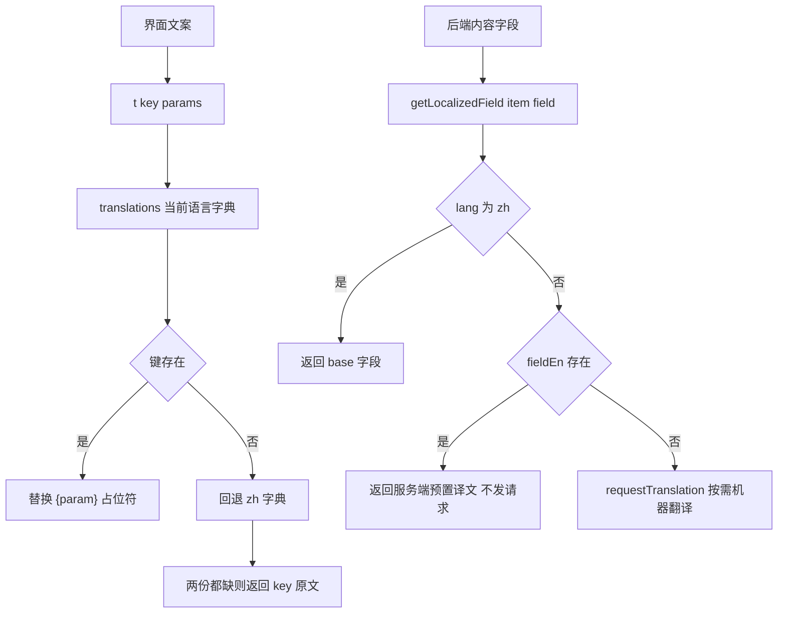
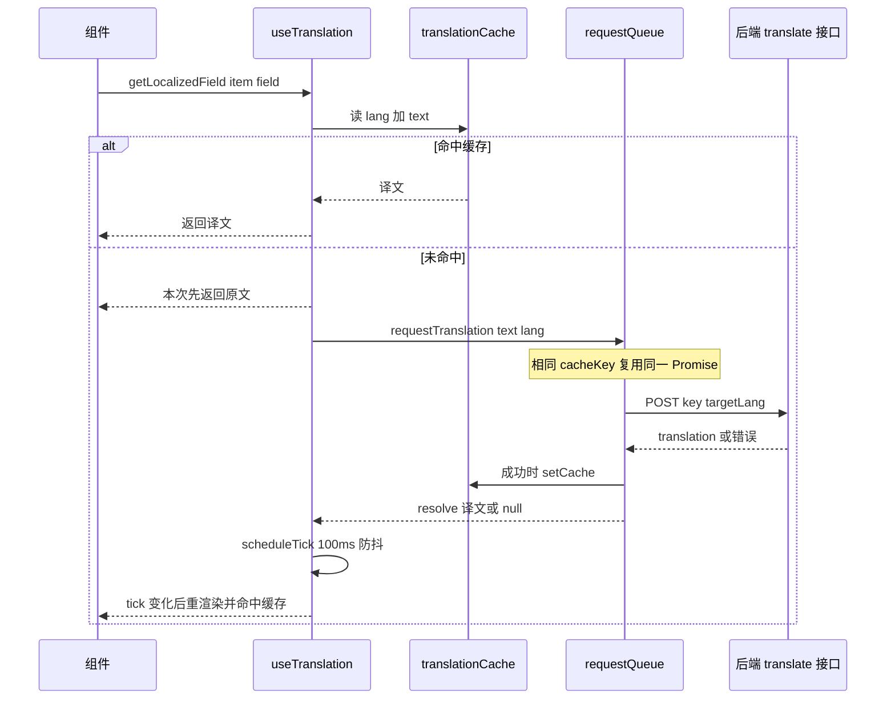

# 界面国际化与运行时内容翻译

这个前端有**两条互相独立、不可互换**的翻译路径，混用会把可维护的文案变成运行时请求：

- **静态 UI 文案**：`src/locales/zh.js` / `src/locales/en.js` 两份字典，组件通过 `useI18n().t('key.path')` 取值，永不发请求。
- **后端内容**：数据库里的剧集标题、简介、站点文案等，先看服务端是否已存了 `field + En` 后缀字段，缺失时才按需调用 `/api/translate` 做机器翻译，失败就展示原文。

边界很清楚：**UI 文案必须走 `t()`，机器翻译只服务后端内容字段**。把界面文案塞进机器翻译会让每次文案微调都变成一次网络往返，也失去了 `{param}` 插值与回退语义；反过来，把用户/管理员录入的正文写进 locales 则根本无法维护。启动顺序与 Provider 嵌套见[启动链与全局 Provider 树](../architecture/boot-and-providers.md)，站点内容字段的来源见[站点设置与公告](./site-settings-and-announcements.md)。

两条路径的分叉：左侧纯内存计算，右侧在字段缺失时才会触网。

## 路径一：静态 UI 文案

### 字典、语言集合与 locale

`I18nContext.jsx` 只认识两种语言：`translations = { zh, en }`，配 `SUPPORTED_LANGUAGES`（供语言选择器渲染）与 `LOCALE_MAP`（`zh → zh-CN`、`en → en-US`）。Provider 暴露 `{ lang, t, switchLang, supportedLanguages, locale }`。`locale` 是给 `Intl` 用的完整标签，后台表格里的 `new Date(x).toLocaleString(locale)` 全靠它，改动 `LOCALE_MAP` 会同时影响时间格式与 `<html lang>`。

**硬约束**：新增 UI 文案必须同时写进 `src/locales/zh.js` 与 `src/locales/en.js`（`AGENTS.md` 中的项目约定）。没有任何构建期校验，靠的是下面的回退语义暴露问题。

### `t()` 的解析、插值与回退

`t(key, params)` 的实现刻意很小：

1. 用 `.` 拆分 key 后在当前语言字典里逐层下钻。
2. 取到值后，若传了 `params` 且值是字符串，用 `/\{(\w+)\}/g` 替换占位符；**参数缺失时保留 `{name}` 字面量**而不是替换成空串（所以漏传参数在界面上是可见的）。
3. 当前语言没有该键时，用同一路径在 `zh` 字典里再查一次。
4. `zh` 也没有则**返回 key 字符串本身**。
5. 非字符串值（对象、数组）原样返回，这使 `t()` 理论上可承载结构化文案，但现有 locale 文件里全部是字符串。

由此得到两条排障事实：

- **英文缺键的表现是「显示中文」，不是显示 key**——因为 zh 是回退语言。这类漏配静默无害，只能靠人工审 en 文案或对比两份文件发现。
- **只有 zh 也缺时才看到裸 key**（例如页面上出现 `settings.someNewLabel`）。这是定位漏配最强的信号，看到就说明 `t()` 的 key 与两份字典都不匹配（常见于重命名 key 后忘了改调用点）。

`zh.js` 与 `en.js` 是同一套命名空间（`common.*`、`nav.*`、`notification.*`、`browserCompat.*`、`sitePage.*`、`settings.*`、`pageTitle.*`、`adminXxx.*` 等）的平行结构，`en.js` 行数与 `zh.js` 仅差几行，出现新命名空间时两份都要建。带插值的典型用法是通知文案：`t('notification.newEpisode', { title, ep })`、`t('notification.feedbackReply', { reply })`。

### 初始语言判定

Provider 的 `useState` 初始化器按序判定：`localStorage.lang` 是受支持的语言 → 用；否则 `navigator.language` 前两位命中 `translations` → 用；否则 `zh`。

同一套判定在 `index.html` 的 head 内联脚本里**又写了一遍**（只接受已保存的 `en` / `zh`，否则看 `navigator.language` 是否以 `en` 开头）。两份实现必须保持一致，否则会出现"首屏 `<html lang>` 与 React 认为的语言不同"的不一致状态。

### 切换语言 = 整页 reload

`switchLang(newLang)` 先校验目标语言在 `translations` 里、且不同于当前语言，然后 **写 `localStorage.lang` 并 `window.location.reload()`**，不做状态更新。

原因写在代码注释里且值得记住：head 内联脚本必须在**文档解析期**就把 `<html lang>` 与 `content-language` / `language` meta 写对，浏览器翻译、拼写检查、无障碍服务才会在初始加载时正确识别语言；如果只在 React 挂载后改 DOM，可能已经错过浏览器的首次语言判定。代价是切换语言会丢失当前页面状态与滚动位置，这是刻意的取舍。因此 Provider 里 `lang` 状态在运行期实际上不会变化，`switchLang` 之外没有别的写入口。

### 语言元数据的同步

`lang` 变化（实际是挂载）时，一个 effect 会写 `localStorage.lang`，并把下列位置统一设成**完整 locale**：`document.documentElement.lang`、`meta[property="og:locale"]`（不存在则创建）、`meta[http-equiv="content-language"]`、`meta[name="language"]`（不存在则创建）。`index.html` 里静态写死的是 `zh-CN`，`<noscript>` 刻意做成中英双语，避免浏览器通过纯中文内容误判语言——这几点与启动链里的说明是同一件事的两端。

### HMR 安全的 context 对象

`I18nContext` 用 `import.meta.hot?.data?.I18nContext || createContext()` 取，并在 `import.meta.hot.dispose` 里存回 `hot.data`。原因是热更新时模块会被重新求值，若每次新建 context，旧 Provider（旧 context）与新 Consumer（新 context）不匹配，消费方拿到的就是 `undefined`。相应地该文件**不用 default export**（注释说明是为了兼容 Vite React Fast Refresh），只提供具名 `I18nContext` 与 `useI18n`。

具名 context 还有真实的消费者：`App.jsx` 里两个 class ErrorBoundary 与 `AdminErrorBoundary` 都用 `static contextType = I18nContext` 取 `t` 兜底渲染错误页，这条 legacy 路径不能改成 hooks。`useI18n()` 在 Provider 外调用会直接抛错（`useI18n must be used within I18nProvider`），这是刻意的快速失败。

### locales 之外的两套硬编码字典

UI 文案并非 100% 收敛在 `src/locales/`，还有两处必须单独维护：

- **`index.html` 的旧浏览器遮罩**：body 末段 ES5 脚本内置自己的 `I18N.zh` / `I18N.en`（标题、原因、下载入口、`langToggle` 等），必须早于任何模块下载就能渲染，所以不可能引用 `src/locales/`。它的字段与 `zh.js` 的 `browserCompat.*` 高度重合但**不是同一份**，改文案要改两处。
- **`src/main.jsx` 的原生表单校验文案**：`VALIDATION_MSG_MAP` 中英两套，语言取自 `document.documentElement.lang` 前缀（而不是 React i18n），因为在文档级 `invalid` 监听里没有 React 上下文。

## 路径二：后端内容的按需机器翻译

### 字段后缀策略

`useTranslation()` 基于 `useI18n().lang`，对外给出 `getLocalizedField` 与 `getLocalizedTitle` / `getLocalizedDescription` / `getLocalizedName` / `getLocalizedSubtitle` / `getLocalizedContent`。`getLocalizedField(item, field)` 的优先级：

1. `lang === 'zh'` → 直接返回 `item[field]`（中文是源语言，永不翻译）。
2. 否则把语言码首字母大写拼成后缀（`en` → `En`），若 `item.titleEn` 有值就直接用——**服务端预置译文优先，不发任何请求**。
3. 否则取 `item[field]` 原文；原文为空返回空串。
4. 原文非空时依次检查：内存/持久缓存命中 → 返回译文；`failedRef` 已登记 → 返回原文；`pendingRef` 已登记 → 返回原文；都没有才 `requestTranslation` 并入队，**本次仍然返回原文**，等请求回来再触发重渲染。

后缀只做了首字母大写，因此这套机制**只对单段语言码成立**（`en` / `ja` / `fr` 可以，`zh-TW` 会拼出 `fieldZh-TW`）。当前只有 zh/en，所以没有暴露这个问题；新增语言时要先想清楚后缀命名，或改写这段拼接。

这个"先返回原文、后补译文"的形状是刻意的：列表页不会因为翻译未到达而阻塞或闪空，代价是英文用户会看到一小段中文原文随后被替换。

### 请求流水线与并发控制

请求管线在模块作用域（`useTranslation.js` 顶层），因此 `useTranslation` 与 `TranslatableText` 共享同一套状态：

| 机制 | 实现 | 效果 |
| --- | --- | --- |
| 并发上限 | `MAX_CONCURRENT = 6` + `activeRequests` 计数 | 单条翻译最多 6 个在飞 |
| 排队 | `requestQueue` 数组，FIFO，`processQueue()` 在每次完成/失败后递归续批 | 超出的请求挂起而不是被丢弃 |
| 超时 | `REQUEST_TIMEOUT = 15000`（显式传 `timeout`，覆盖 axios 全局 15s） | 慢请求按失败处理 |
| 请求体 | `POST /api/translate`，`{ key: text, targetLang }` | 注意字段名是 `key`，值是**原文全文**而非 i18n 键 |
| 成功 | `res.data.translation` → `setCache` → `resolve(译文)` | 天然进入跨会话缓存 |
| 失败 | `catch` → `resolve(null)`，不写缓存 | 上层决定展示原文并标记 |

所有翻译请求都带 `skipRedirect: true`，这是与 `axiosConfig.js` 401 拦截器的配合：翻译失败绝不会把用户弹去登录页。但要注意拦截器的其余部分仍会执行——清 `localStorage.user` 并派发 `auth:session-expired`——只是省掉了 `window.location.href = '/login'` 这一步跳转。

### 去重：三层，键是「语言 + 原文」

`requestTranslation(text, lang)` 的缓存键是 `` `${lang}:${text}` ``——**基于原文内容而不是字段名或实体 id**。因此两个实体只要中文原文完全相同（例如同名分类、重复的「暂无简介」占位），就只会有一次请求、一条缓存。

去重分三层，依次生效：内存/持久缓存命中（同步返回 resolved Promise）→ `inFlightRequests` Map（在飞请求复用同一 Promise）→ `requestQueue.find`（尚在排队、还没被 `processQueue` 取走的同键请求复用同一 Promise）。三层都空了才会真正入队。这也是 `SitePage` 能把 `getLocalizedContent(...)` 的结果再喂给 `TranslatableText` 而不产生双倍请求的原因。

一次翻译的完整生命周期：渲染期同步读缓存，未命中则异步入队，回来后靠 tick 触发重渲染。

### 失败语义：把重试风暴挡在渲染循环之外

失败不写缓存、不重试队列。每个 `useTranslation` 实例各有一份 ref 状态：

- `pendingRef`（对象，按 cacheKey 打标）防止同一次渲染/连续渲染重复入队；
- `failedRef`（Set，按 cacheKey 打标）在 resolve 为 `null` 时登记，此后该实例对该字符串**永远返回原文**，不再发请求；
- 成功时 `failedRef.delete(cacheKey)` 并 `scheduleTick()`。

`tick` 是唯一的强制重渲染开关：`scheduleTick` 用 100ms `setTimeout` 防抖（同一批返回的多个译文只触发一次渲染），`mountedRef` 守卫避免卸载后 setState。`getLocalized*` 的回调依赖里包含 `tick`，因此 tick 变化会换掉函数身份，让消费组件的 memo 失效并重渲染——这也是为什么在渲染期读一个可变对象（`translationCache`）是安全的：读取本身不会触发渲染，tick 才是触发器。

两个必须知道的作用域限制：

- `failedRef` / `pendingRef` 是**实例级**的，没有全局的"这个字符串翻译失败过"记忆。同一原文被另一个组件渲染、或组件重新挂载（含切换语言后的整页 reload 之外的路由往返），都会再试一次。前端不会无限重试，但后端持续故障时，每个新挂载的组件仍会各打一次失败请求。
- `useEffect` 依赖 `[lang]`，在挂载与语言变化时清空两份 ref 并 bump 一次 tick；由于切换语言走 reload，清空逻辑实际只在挂载时生效，保留它是为了将来出现非 reload 的语言变更路径。

### 长文本：`TranslatableText` 与 `TranslatableBlock`

站点协议、关于页这类整段正文不适合走 `getLocalized*`（单条请求体过大、失败即全段不译），因此 `src/components/TranslatableText.jsx` 提供了两种渲染器，两者都直接复用 `requestTranslation` 与 `translationCache`：

- **`TranslatableText`**：单段文本，`lang === 'zh'` 时直接渲染，否则查缓存 / 入队，译文到达前渲染原文。用于页面标题、描述、版权行等短文本。
- **`TranslatableBlock`**：按空行切段落，再按 `MAX_CHUNK_LENGTH = 450` 切块，切分点优先找句号 `。`、逗号 `，`、`.`、空格，都找不到才硬切；随后以 `BATCH_SIZE = 10` 走 `POST /api/translate/batch`（`timeout: 120000`，外加 130s 的 `Promise.race` 作为兜底超时），每批完成就刷新已译段落与进度百分比。部分缓存命中时先渲染已译部分，失败的块回落为原文，保证长文永远有内容可读。

`TranslatableBlock` 的进度提示文字「Translating...」是硬编码英文，没有走 `t()`；改动这里的 UI 时把它一起收进 locales 才算完整。

### 本地缓存：`translationCache`

`src/utils/translationCache.js` 是一个模块级内存字典 + `localStorage` 镜像：

| 项 | 值 |
| --- | --- |
| 键 | `translation_cache_v2`（条目）、`translation_cache_ttl_v2`（每条写入时间） |
| 写入 | `setCache(key, value)` 同步改内存，随后 500ms 防抖落盘（高频翻译只写一次） |
| TTL | 24 小时，**只在模块初始化时逐条过滤**；同一次会话内过期的条目仍会被继续使用，直到下次加载 |
| 容量 | 上限 2000 条，超出时按 `Object.keys` 顺序（近似插入顺序）淘汰最旧的 |
| 迁移 | 初始化时主动删除旧版 `translation_cache` / `translation_cache_ttl` |
| 容错 | 所有 `localStorage` 读写都包在 `try/catch` 里，隐私模式或被禁用时退化为纯内存缓存 |

`translationCache` 默认导出**内存对象本身**，组件在渲染期直接 `translationCache[\`${lang}:${text}\`]` 读；只有 `setCache` 是函数，负责同时写 TTL 表与触发落盘。写缓存的地方只有三处：`useTranslation` 的单条管线、`translateBatch` 的批量响应、`TranslatableBlock` 的批量响应。

### 不走机器翻译的内容字段

并非所有后端字段都会经过翻译接口。`document.title` 的拼装就是纯后缀策略：`siteSettingsData[\`browserTitle${suffix}\`] || siteSettingsData.browserTitle || t('site.defaultName')`，再接上 `t('pageTitle.*')`；`browserTitle` 没有预置英文时直接显示中文站点名，**不会**触网翻译。同理，路径未登记在 `getRoutePageTitleKey` 时标题只剩站点名。

## 两条路径的组合点

真实的调用点经常把两者叠在一起，形成「服务端文案 → UI 兜底」的回退链：

- `Home`：`getLocalizedContent(siteSettingsData, 'welcomeTitle') || t('home.welcomeTitle')` —— 后台没填欢迎语就用 locales 里的默认文案。
- `NavBar`：`getLocalizedContent(siteSettingsData, 'siteName') || t('site.defaultName')`。
- `SitePage`：先用 `resolveContent` 处理 `{ zh, en }` 与 `content`/`contentEn`/`contentZh` 几种历史数据形状，再把结果交给 `TranslatableBlock`；`content` 字段解析失败时整体回落为原文。
- `FooterBeian`：`getLocalizedContent(aboutData, 'copyright') || aboutData.copyright || ''`。

顺序不能颠倒：先取后端译文/原文，再回落到 `t()`。反过来写会让后台配置的站点文案永远不生效。

## CSP 与信任边界

`index.html` 的 `Content-Security-Policy` meta 的 `connect-src` 是 `'self'` 加上三家翻译服务：`https://api.mymemory.translated.net`、`https://translate.googleapis.com`、`https://api.cognitive.microsofttranslator.com`。

这三条是历史遗留的直连许可：`src/` 内**没有任何代码直接请求它们**，所有翻译都打到同源 `/api/translate`（`'self'` 已覆盖），具体的供应商与密钥在独立后端。含义有两点：一是换翻译供应商不需要改前端 CSP；二是若将来真要前端直连某家服务，必须先把域名加进这条 meta，否则请求会被静默拦截。CSP 的其他指令与构建期关系见[构建与发布](../operations/build-and-release.md)。

## 改动检查清单

- **新增/重命名 UI 文案**：同时改 `src/locales/zh.js` 与 `src/locales/en.js`；`browserCompat.*` 还要同步 `index.html` 的内联字典。页面上出现裸 key 就是漏配，显示中文说明只漏了英文。
- **新增后端多语言字段**：后端需要产出 `fieldEn` 之类的成对字段；前端用 `getLocalizedField(item, 'field')` 或加一个 `getLocalizedXxx` 别名即可自动获得「预置译文优先、缺失才机器翻译」的行为。命名要避开 `content`/`title` 之外的自造后缀。
- **新增语言**：`translations`（两份字典）、`SUPPORTED_LANGUAGES`、`LOCALE_MAP`、`index.html` 内联脚本的判定与 `I18N` 字典、以及后缀大写拼接逻辑（只支持单段语言码）全部要动。
- **调整缓存/限流**：`MAX_CONCURRENT`、`REQUEST_TIMEOUT`、`MAX_CACHE_ENTRIES`、`CACHE_TTL` 都是模块常量，改动会同时影响 `useTranslation` 与 `TranslatableText` 的观感（翻译出现延迟 vs 请求数量）。
- **不要把 `t()` 换成机器翻译，也不要把用户正文塞进 locales**。这是本页最重要的一条边界。

## 验证方式

仓库**没有配置测试运行器**（`AGENTS.md`「No test runner is configured」），`npm run lint` 是唯一自动化的静态检查，因此 i18n 的改动只能靠人工验证，最小闭环是：

1. 切到英文后刷新，确认 `<html lang>`、`content-language`、`language`、`og:locale` 都是 `en-US`（语言切换本来就会整页 reload）。
2. 打开一个列表页与详情页，观察英文下字段从中文原文切换为译文的时机；清掉 `localStorage` 里的 `translation_cache_v2` / `translation_cache_ttl_v2` 可以复现首次翻译路径。
3. 断开后端或让 `/api/translate` 返回错误，确认页面显示原文、控制台无未捕获 rejection、且同一字符串不会持续重试。
4. 逐个路由检查 `document.title` 与页面标题（`pageTitle.*`）。
