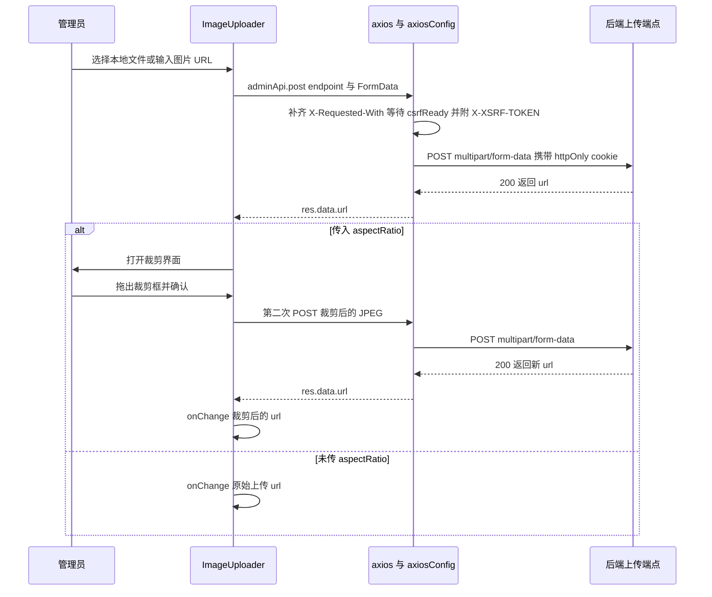
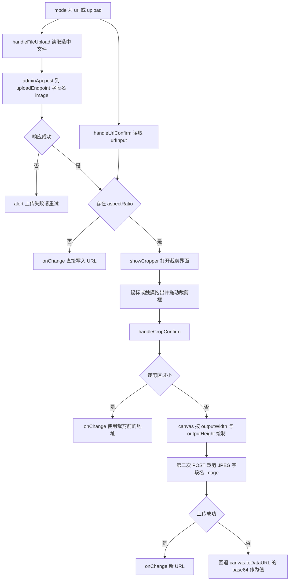

# 图片上传与裁剪管线

这个仓库里的「上传图片」并不是一条统一管线，而是**一个共享交互组件（`ImageUploader`）+ 若干页内自建上传**的组合：管理员侧几乎所有位图都用 `ImageUploader`（可选裁剪），用户侧头像与主题工作室的壁纸/图标则各自写 `FormData` 直发对应的用户级端点。三者唯一的共同底座是 axios——`adminApi` 只是 `axios` 的薄包装，而 `src/utils/axiosConfig.js` 在 `main.jsx` 里以副作用方式装载了全局拦截器，因此**只有走 axios 的上传才会带上 CSRF 头、`withCredentials` cookie 与 401 自动续期**。

相关阅读：[后台管理控制台](admin-console.md)（各管理页在后台中的位置）、[主题与图标体系](theming-and-icons.md)（主题壁纸/图标的运行时覆盖）、[剧集创作、审核与版本流转](../workflows/episode-publishing-and-review.md)（封面在发布流程中的角色）、[后端契约地图](../integrations/backend-api-map.md) 与 [HTTP 与会话](../architecture/http-and-session.md)（cookie、CSRF 与 401 处理细节）。

## 请求基座：为什么上传必须走 axios

`adminApi` 本身不设任何请求头，它对 `axios.get/post/put/delete/patch` 做一对一转发；真正的横切逻辑全部在 `axiosConfig` 的全局拦截器里：

- `axios.defaults.withCredentials = true`，httpOnly 的访问/刷新 cookie 自动随请求发出，所以管理端不需要手动拼 `Authorization`。
- 请求拦截器先补齐 `X-Requested-With: XMLHttpRequest`，非 GET 请求会 `await csrfReady`（启动时向 `/api/csrf-token` 取令牌）再附上 `X-XSRF-TOKEN`。
- 响应拦截器缓存响应体里回传的新 `csrfToken`，并在 401 时用 refresh token 续期后**重放原请求**。

因此上传请求若改用 `fetch`/`XMLHttpRequest` 手写，会同时丢掉 CSRF 头与 401 续期重放，表现为 419 或「上传后立刻被踢回登录页」。这也是全部调用点都直接 import `adminApi` 或 `axios` 的原因。

图注：一次「本地上传 + 裁剪确认」实际会发两次 POST——先存原图，再存裁剪结果。

## ImageUploader：双模式与受控值

`ImageUploader` 是受控组件：只通过 `value`/`onChange` 与父表单交互，内部状态仅服务于交互过程。

| 内部状态 | 作用 |
| --- | --- |
| `mode` | `'url'`（默认）或 `'upload'`，两个按钮切换输入方式 |
| `urlInput` | URL 文本框的值，由 `useEffect` 跟随 `value` 同步 |
| `uploading` | 上传中，禁用「选择图片文件」按钮并显示保存中 |
| `showCropper` | 为真时整个组件**只渲染裁剪界面**（早返回，原表单不可见） |
| `cropImageUrl` | 待裁剪的图片地址（原图上传结果或用户输入的 URL） |
| `cropRect` | 归一化裁剪矩形 `{x1,y1,x2,y2}`，取值 `0–1` |
| `cropLoading` / `cropError` | 裁剪确认中的忙碌态与行内错误文案 |

两种模式的收敛点是 `aspectRatio`：

图注：`aspectRatio` 是否存在是「上传后立刻写值」与「先裁剪再写值」的唯一分叉条件。

细节约定：

- **URL 模式不会校验可达性**，`handleUrlConfirm` 只做 `trim()`，空串等价于清空（`onChange('')`）。图片能否加载由裁剪界面的 `img.onerror` 兜底（文案 `imageUploader.imageLoadError`：「图片加载失败，请检查URL是否正确」）。
- **`accept` 只是选择器提示**：文件输入固定为 `image/jpeg,image/jpg,image/png,image/gif,image/webp`，组件内部**不做**大小与 MIME 校验（见下文「校验的真实位置」）。
- **「移除」只清前端值**：`handleRemove` 调 `onChange('')` 并清空输入框，不会通知后端删除已上传文件；「取消」只是关掉裁剪界面，`value` 保持不变，因此取消一次裁剪同样会在服务器留下孤儿文件。
- 预览区在 `value` 非空时出现，`aspectRatio` 存在时额外给一个 ✂️ 按钮，用当前 `value` 重新进入裁剪（`handleStartCrop`）。
- `AdminCreatorProfile` 向该组件传了 `disabled={isPending}`，但组件签名并不消费 `disabled`，该 prop 实际无效。

## 裁剪矩形：归一化坐标、鼠标与触摸、宽高比约束

### 坐标系与指针

所有几何都在**归一化坐标**里完成：`getPointerPos` 取容器 `getBoundingClientRect()`，把指针位置换算成 `0–1` 的比例并夹取到边界，触摸事件取 `e.touches[0]`。这样做的好处是裁剪框与渲染无关（用百分比定位覆盖层），代价是比例与源图像素无关（见下文「已知边界」）。

容器同时监听 `onMouseDown` 与 `onTouchStart`，并按 CSS `touchAction: 'none'` 抑制滚动；拖拽开始后把 `mousemove`/`mouseup`/`touchmove`/`touchend` 挂到 `window` 上（`touchmove` 用 `{ passive: false }` 以便 `preventDefault`），拖拽结束即移除，因此拖出容器边界也不会断线。

### 创建与移动是两种拖拽语义

`handlePointerDown` 用 `isInsideRect` 判断落点：落在已有矩形内 → `dragType='move'`，记录起始指针与起始矩形快照；否则 → `dragType='create'`，以落点为锚点重建矩形。

- **create**：每次 `mousemove` 都以「起点 → 当前点」重新调用 `constrainAspectRatio`。
- **move**：位移量加到快照矩形的四个角上，再对四条边做 `0–1` 夹取，从而保持宽高不变、贴边不越界。
- 覆盖层的四个白色小方块只是**装饰**，没有绑定 resize 处理器——想改尺寸只能在矩形外重新起拖。

### 宽高比约束

`constrainAspectRatio(startX, startY, endX, endY)` 在归一化空间里强制 `dx/dy = aspectRatio`：

1. 无 `aspectRatio` 时原样返回。
2. 位移（`dx`、`dy`）任一绝对值小于 `0.005` 时按另一轴推算，仍不足则保留近乎为零的矩形（避免除零与抖动）。
3. 若 `|dx|/|dy| > aspectRatio` 则收窄高度，否则收窄宽度。
4. 最后把 `x2`/`y2` 夹进 `[0,1]`，夹取时用 `aspectRatio` 反算另一轴，维持比例。

### 确认裁剪：canvas 输出与退让规则

`handleCropConfirm` 用 `new Image()`（`crossOrigin='anonymous'`）加载 `cropImageUrl`，然后按 `naturalWidth/naturalHeight` 把归一化矩形翻译成源像素矩形 `sx/sy/sw/sh`：

- 无 `cropRect`，或宽高都小于归一化 `0.01` → 视为「没有实际裁剪」，直接 `onChange(cropImageUrl)`。
- `sw < 10 || sh < 10`（源像素不足 10px）同样退让为原图。
- 否则建 `canvas`，尺寸取 `outputWidth || Math.round(sw)` 与 `outputHeight || Math.round(sh)`，`drawImage(img, sx, sy, sw, sh, 0, 0, targetW, targetH)` 把裁剪区**拉伸填满**目标尺寸。
- 随后调用 `uploadCroppedImage(canvas)`；成功则 `onChange(新 URL)` + `setUrlInput`，失败置 `cropError`。

裁剪框右下角会显示 `outputWidth×outputHeight` 的角标，提示面板文案也引用这两个数（`imageUploader.cropFixedRatio`，形如「固定比例 {w}:{h}」）。

**已知边界**：比例约束作用在归一化空间，屏幕上的裁剪框像素比等于 `aspectRatio × (图宽/图高)`，而 canvas 又把它拉伸到 `outputWidth×outputHeight`。因此只有当源图为正方形时，屏幕选框的观感比例才与 `outputWidth:outputHeight` 一致；非正方形源图被裁出的内容会被横向或纵向拉伸。改这里时不要在归一化空间里"修正"比例，而应把约束改到源像素空间，或按目标比例做 `cover` 式中心裁切。

### `uploadCroppedImage` 的双重回退

`canvas.toBlob(..., 'image/jpeg', 0.9)` 回调里构造 `FormData`，字段名固定 `image`，文件名固定 `cropped.jpg`，端点取 `uploadEndpoint || '/api/site-content/upload'`，成功时 resolve `res.data.url`。**若 POST 抛错，它会 `canvas.toDataURL('image/jpeg', 0.9)` 并 resolve 这个 base64 字符串**——即上传失败时 `value` 仍会被写入一个 `data:` URL。这层回退只在 `toDataURL` 也抛错（典型是跨域图片污染 canvas）时才转成 `imageUploader.cropSaveFailed`。注意 base64 值不满足 `ThemeEditorModal` 里 `/^(\/uploads\/|https?:\/\/)/` 的 URL 校验，落库体积也很大，新增消费方时不要假设「写进 `value` 的一定是服务器 URL」。

跨域图片还有一种失败面：`img.crossOrigin` 需要对方返回 CORS 头，否则 `toBlob`/`toDataURL` 抛 SecurityError，错误区展示的是浏览器的原始 message（`err.message || t('imageUploader.cropCrossOriginError')` 只在 message 为空时回退到 i18n 文案）。

## 调用点：端点、字段名与输出尺寸

同一张表就是「新增页面时该抄哪一行」的答案。默认端点为 `ImageUploader` 内置的 `/api/site-content/upload`（该字符串**没有**登记进 `apiEndpoints.js`）。

| 调用点 | uploadEndpoint | FormData 字段 | aspectRatio / 输出 | 结果去向 |
| --- | --- | --- | --- | --- |
| `EpisodeFormModal`（剧集创建/编辑弹窗） | `/api/episodes/upload` | `image` | `2/3` → `400×600` | `formData.coverImage` → 提交剧集 |
| `AdminEpisodes`（页内新建/编辑表单） | `/api/episodes/upload` | `image` | `2/3` → `400×600` | `newEpisode.coverImage` |
| `AdminBanners`（首页轮播图） | `/api/episodes/upload`（**借用**剧集端点） | `image` | `3` → `1200×400` | 轮播项 `image` |
| `AdminSiteContent`（站点设置） | 默认 `/api/site-content/upload` | `image` | `1` → `32×32` | `settingsData.favicon` |
| 同上 | 默认 | `image` | `1` → `64×64` | `settingsData.navLogo` |
| 同上 | 默认 | `image` | `1` → `192×192` | `settingsData.pwaIcon192` |
| 同上 | 默认 | `image` | `1` → `512×512` | `settingsData.pwaIcon512` |
| 同上 | 默认 | `image` | `1` → `512×512` | `settingsData.pwaMaskableIcon` |
| 同上（关于页） | 默认 | `image` | `3` → `1200×400` | `aboutData.banner` |
| 同上（关于页） | 默认 | `image` | `1` → `200×200` | `aboutData.logo` |
| `AdminCreatorProfile` / `AdminCreatorProfiles` | 默认 | `image` | `1` → `200×200` | 创作者 `avatar` |

两条值得记住的例外：

- `AdminBanners` 的轮播图走的是 `/api/episodes/upload` 而不是站点内容端点。它不是笔误就是历史遗留，但复制它到新页面会继承同样的语义错配；新素材应优先用 `/api/site-content/upload`。
- 创作者头像同样落到站点内容端点（默认值），与「用户头像」完全是两套路径（见下）。

## 不使用 `ImageUploader` 的上传路径

1. **用户头像**（`Profile`）：自建隐藏 `<input type="file" accept="image/*">`，先校验 `file.size > 2 * 1024 * 1024`（`profile.avatarSizeLimit`：「图片大小不能超过2MB」）与 `file.type.startsWith('image/')`（`profile.selectImageFile`），再 `axios.post(API.USERS.AVATAR, FormData{ avatar })`，成功后写回 `user.avatar`。源码里留着一行注释解释了为什么不复用组件：「TODO: 替换为支持裁剪的 ImageUploader（需适配用户认证）」——`ImageUploader` 依赖管理员的 `adminApi` 会话假设。
2. **系统壁纸库**（`SystemWallpaperManager`）：`FormData` 追加 `image` 与 `name`（取原文件名去扩展名），POST `/api/wallpapers/system`，**无客户端大小/类型校验**、无裁剪，失败仅 `alert(adminContent.wallpaperUploadFail)`。
3. **主题工作室**（`ThemeEditorModal`）：壁纸 `FormData{ image }` → `API.WALLPAPERS.PERSONAL`（`/api/wallpapers/personal`，上传即存入「我的壁纸」）；图标 `FormData{ file }` → `API.THEMES.UPLOAD_ICON`（`/api/themes/upload-icon`）。两者都用 `URL_RE = /^(\/uploads\/|https?:\/\/)/` 校验响应里的 `url`，不匹配即报 `themeEditor.uploadFailed`。
4. **未被使用的注册项**：`apiEndpoints.js` 里还登记了 `THEMES.UPLOAD_WALLPAPER`（`/api/themes/upload-wallpaper`）与 `ICONS.UPLOAD`（`/api/icons/upload`），前端没有任何调用点；实际的主题壁纸上传走 `WALLPAPERS.PERSONAL`，主题图标上传走 `THEMES.UPLOAD_ICON`。照抄注册表容易选错端点。

## 校验的真实位置

前端的大小/类型校验是**体验层，不是安全边界**：它只出现在个别路径上，且每种路径各写一遍。

| 路径 | 大小限制 | 类型限制 | 校验失败反馈 |
| --- | --- | --- | --- |
| `useImageUpload.uploadImage` | `5 * 1024 * 1024`（`adminEpisodes.imageSizeExceeded`：「图片大小不能超过5MB」） | `['image/jpeg','image/jpg','image/png','image/gif','image/webp']`（`adminEpisodes.imageFormatUnsupported`：「只支持 JPEG、PNG、GIF、WebP 格式的图片」） | `error` 状态（hook 返回 `error` / `clearError`） |
| `AdminEpisodes.handleFileUpload` | 同上 5MB | 同上白名单 | `setError` 行内提示 |
| `Profile.handleAvatarUpload` | `2 * 1024 * 1024` | `file.type.startsWith('image/')` | `alert` |
| `ImageUploader` | 无 | 仅 `accept` 提示 | 无（由后端拒绝后 `alert(imageUploader.uploadFailedRetry)`） |
| `SystemWallpaperManager` | 无 | 仅 `accept="image/*"` | `alert`，无大小提示 |
| `ThemeEditorModal` | 无 | 无 | 依赖后端 `err.response.data.message` |

`useImageUpload` 的校验逻辑值得注意，但它目前**没有调用点**：它 POST 到 `/api/episodes/upload` 却把字段名写成 `coverImage`，而同一端点的其它三处调用（`ImageUploader`、`AdminEpisodes` 自己的 handler）都用 `image`。若将来接入这个 hook，字段名必须先核对后端，否则会得到 400/`MulterError`；反之若后端只认 `coverImage`，则现有的三处都会坏——这正是「同端点必须只有一种字段名」的价值所在。

本仓库**不含后端代码**：开发态由 Vite 把 `/api` 与 `/uploads` 代理到 `http://localhost:5000`，生产态由 nginx/Caddy 同域转发。因此体积上限、MIME/魔数校验、存储路径、写入权限与文件清理全部由外部后端决定；前端的 `accept`、`file.size`、`file.type` 判断都可被绕过，只能用于减少无效请求。

## 上传结果 URL 的消费位置

上传只产出「一个字符串 URL」，它落在不同字段上，由不同的消费者渲染：

| 素材 | 存储字段 | 消费点 |
| --- | --- | --- |
| 剧集封面 | `Episode.coverImage` | `EpisodeCard`、`Home` 列表与推荐位、`EpisodeDetail`、`UpdateCalendar`、`SearchInput`、`Timeline`、`Profile` 的收藏/关注/历史、`AdminReview`/`AdminEpisodeTrash` 的后台预览 |
| 用户头像 | `User.avatar` | `Profile` 头部圆形头像（无图时回退 `username` 首字母）；`AuthContext` 的 `user` 经 `localStorage` 持久化 |
| 站点素材（favicon / navLogo / PWA 图标 / 关于页 banner、logo） | `site-content` 的 `settings` 与 `about` JSON | `App` 注入 `<link rel="icon">`、`apple-touch-icon`；manifest 链接指向后端动态端点 `/api/site-content/pwa-manifest`；`NavBar` 渲染 `navLogo`；`SiteSettingsContext` 提供运行时配置 |
| 首页轮播图 | banner `image` | `AdminBanners` 列表；`Home` 拉 `/api/banners` 交给 `BannerCarousel` 渲染 |
| 创作者头像 | 创作者档案 `avatar` | 创作者页与管理后台档案 |
| 主题壁纸 | 主题 `wallpaperUrl` / `wallpaperThumb` | 应用主题后写入用户 `backgroundPrefs.image`，由 `App` 设为 CSS 变量 `--bg-image`（含 `--bg-opacity`、`--bg-blur`）；未选个人主题时回退站点默认主题 `/api/themes/active` 的壁纸 |
| 主题图标 | 主题 `icons`（键 → URL 映射） | `IconContext` 拉取 `/api/icons/list` 的全局映射，主题图标在用户勾选时覆盖它；受保护键 `misc.logo` 不允许被主题覆盖，后端同样校验 |
| 系统壁纸 | 壁纸记录的 `url` | `SystemWallpaperManager` 网格与启用开关；`ThemeEditorModal` 作为可选素材列表读取 |

站点素材与主题素材都是**两步保存**：先上传拿到 URL，再由父表单 `PUT /api/site-content/:key`（内容为 JSON 字符串）或主题保存接口落库。上传成功而保存失败会留下无引用的文件；删除素材（如 `ThemeEditorModal` 删除个人壁纸走 `DELETE /api/wallpapers/personal`）由后端顺带清理 `/uploads/` 下的自有文件，前端不做回收。

## 新增上传点的检查清单

1. **端点**：管理端站点素材用 `/api/site-content/upload`；剧集封面用 `/api/episodes/upload`；主题壁纸用 `/api/wallpapers/personal`；主题图标用 `/api/themes/upload-icon`。不要复制 `AdminBanners` 的跨域用法，也不要使用注册表里没有调用点的 `UPLOAD_WALLPAPER` / `ICONS.UPLOAD`。
2. **字段名**：`ImageUploader` 与壁纸上传是 `image`，主题图标是 `file`，用户头像是 `avatar`，`useImageUpload` 是 `coverImage`。这个不一致是目前最容易踩的坑。
3. **是否裁剪**：需要固定版式就传 `aspectRatio` 与 `outputWidth`/`outputHeight`（两者数值上应互相吻合），并接受「先上传原图、再上传裁剪图」的两次请求；不需要裁剪就不传 `aspectRatio`，`onChange` 会立即拿到上传 URL。
4. **校验**：需要 5MB + 白名单时抄 `AdminEpisodes.handleFileUpload` 的写法（而不是引入没有调用点的 hook），并把文案沿用 `adminEpisodes.imageSizeExceeded` / `imageFormatUnsupported`。
5. **失败与文案**：新增用户可见文案必须同时加到 `src/locales/zh.js` 与 `src/locales/en.js`（`imageUploader.*`、`themeEditor.*` 是既有命名空间）。
6. **清理预期**：前端不负责删除已上传文件；若业务要求「换图即删旧图」，需要在保存接口里做，而不是在上传组件里做。

## 验证方式

本仓库没有配置测试运行器（`AGENTS.md` 明确写明 "No test runner is configured"，`package.json` 只有 dev/build/lint/preview/generate-icons 脚本），因此这条管线靠手工核对：

- `npm run dev` 需要后端在 `http://localhost:5000` 运行，否则上传只会看到 `alert` 或静默失败——代理未接通时不要误判为前端回归。
- 逐项覆盖：URL 模式（含空串清空、非法 URL 的 `imageLoadError`）、本地上传（裁剪与非裁剪）、`aspectRatio` 下的拖拽新建、拖动移动、贴边不越界、确认后输出尺寸等于 `outputWidth×outputHeight`、极小选区退让为原图、取消后 `value` 不变。
- 触摸路径必须在移动端或 DevTools 触摸仿真下验证：`touchAction: 'none'` 与 `window` 级 `touchmove` 的 `passive: false` 共同决定「拖拽不滚动页面」。
- `npm run lint` 至少保证改动不引入未使用变量（如 `coverImageMode` 这类历史遗留状态）。
