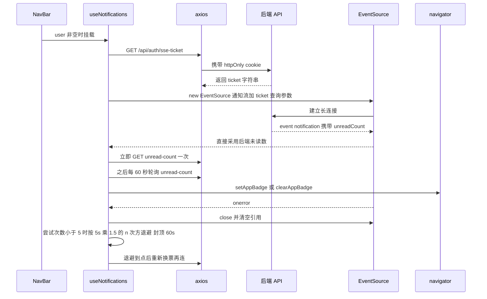

# 通知投递：SSE、轮询与 Web Push

通知是这个前端里唯一一条长连接，也是唯一一处"鉴权不靠请求头、页面状态要靠轮询兜底"的数据流。整条链路的宿主只有一个组件：[`NavBar`](../../src/components/NavBar.jsx)——它调用 `useNotifications` 建立事件流并持有未读数，调用 `usePushNotifications` 管理浏览器推送订阅，并在通知面板里把后端下发的通知翻译成文案。后端端点清单本身在[后端 API 契约地图](../integrations/backend-api-map.md)，本页讲前端如何消费它、在什么条件下会静默降级、以及改动时哪些地方必须同步。

**核心不变量：未读数的权威值在后端。** SSE 事件与 60 秒轮询都是"把后端算好的数写进本地 state"，前端**不因为收到新通知而本地 +1**；只有显式的已读/删除操作才会做一次本地递减，且下一次轮询会校正。

## 四条并行通道

| 通道 | 触发时机 | 承载数据 | 前端职责 |
| --- | --- | --- | --- |
| SSE 事件流 | `user` 非空时由 `useNotifications` 建立 | 事件名 `notification`，JSON 载荷含 `unreadCount` | 只更新未读数，不插入列表项 |
| 未读数轮询 | 建链时立即一次，之后每 60 秒 | `GET /api/notifications/unread-count` → `{ count }` | SSE 断开或被代理拦截时的兜底 |
| 列表按需拉取 | 通知面板打开时 | `GET /api/notifications/list` → `{ list }` 或裸数组 | 面板内容、动态生成"标记全部已读/清除已读"按钮 |
| Web Push 订阅 | 用户在设置页开启推送 | VAPID 公钥 + `PushSubscription` | 只负责把订阅登记到后端，不负责展示 |

四条通道互不依赖：SSE 挂了轮询仍在跑，列表只在打开面板时拉一次，推送订阅状态是纯本地的开关镜像。

## 状态归属：NavBar 是唯一宿主

`useNotifications` 与 `usePushNotifications` 都没有 Provider、也不进任何 Context，状态完全活在 NavBar 这一棵子树里。`AppContent` 在普通路由分支渲染 `<NavBar />`，而 `/admin` 走的是另一条分支、只渲染 `AdminLayout`——因此**后台页面里没有 SSE 连接、没有徽标、也不会更新 PWA 角标**。这是"通知是前台用户侧功能"的具体体现，也意味着一进后台就等于断开实时通道（`user` 不变，重连逻辑不会自发起作用）。

`useNotifications` 暴露的 shape 是 `{ notifications, unreadCount, loading, markAllRead, markRead, clearRead, deleteNotification, deleteAllRead, refreshNotifications }`，内部另有三类 ref：连接 `sseRef`、重连定时器 `reconnectTimerRef`、尝试计数 `reconnectAttemptsRef`，以及一个用于卸载后抑制 setState 的 `mountedRef`。NavBar 实际只解构了 `notifications`、`unreadCount`、`loading`、`markAllRead`、`clearRead`、`deleteAllRead`、`refreshNotifications`——**单条 `markRead` 与 `deleteNotification` 有实现但没有调用点**，这是下面"点击不置读"的原因。

## 建链：ticket → SSE

`EventSource` 无法设置自定义请求头，而本项目的会话凭据是 httpOnly cookie + CSRF 头，因此后端提供了一个"用 cookie 换一次性票据"的入口：先走普通 axios `GET /api/auth/sse-ticket`（自动携带 cookie、受拦截器管辖），拿到 `ticket` 后拼接成 `new EventSource(`${API.NOTIFICATIONS.STREAM}?ticket=...`)`。ticket 是查询参数里唯一的鉴权载体，所以**每次重连都必须重新换票**，这也是重连入口被写成可复用的 `connectSSE` 而不是只捕获 `EventSource` 实例的原因。

注意 `'/api/auth/sse-ticket'` 是**内联字面量**，不在 `apiEndpoints.js` 的 `NOTIFICATIONS` 分组里（那里只有 `STREAM`、`LIST`、`UNREAD_COUNT`、`MARK_READ(id)`、`MARK_ALL_READ`、`DELETE(id)`）。改动这些路径时不能只信注册表，必须全仓搜索；`/api/notifications/list`、`/api/notifications/clear-read` 同样是拼出来或内联的。

图：建链、断线退避重连与 60 秒轮询兜底是同一条 effect 里的三条并行路径。

## 未读数：后端是唯一权威

`notification` 监听器只做一件事——若载荷里带 `unreadCount` 就 `setUnreadCount(data.unreadCount)`。源码里有一段必须保留的注释，说明为什么不能按 `type === 'new'` 再 `+1`：后端的 `unreadCount` 来自实时 `countDocuments`，前端再自增会让徽标虚增 1，并且要等到下一次 60 秒轮询才被修正。**新增任何通知类型时都要遵守这条规则：只渲染、不计数。**

与之对照的是三个显式的本地写入点，它们都发生在用户主动操作后：

| 动作 | 端点 | 未读数处理 |
| --- | --- | --- |
| `markAllRead` | `PUT /api/notifications/read-all` | 直接置 0，并把列表项 `isRead` 全部改真 |
| `markRead(id)` | `PUT /api/notifications/read/:id` | `Math.max(0, prev - 1)` 本地递减（端点不返回计数） |
| `deleteNotification(id)` | `DELETE /api/notifications/:id` | 仅当被删项未读时本地递减 |
| `clearRead` / `deleteAllRead` | `DELETE /api/notifications/clear-read` | 不动未读数，只从列表剔除已读项 |

未读数唯一的对外出口是 PWA 角标：`unreadCount > 0` 时 `navigator.setAppBadge(unreadCount)`，否则 `clearAppBadge`，两者都用能力探测并在失败时静默吞掉 Promise。这意味着角标与徽标永远同源——角标不准确时应该去查未读数来源，而不是查角标代码。

## 断线与重连语义

退避公式是 `Math.min(5000 * Math.pow(1.5, attempts), 60000)`，上限 5 次尝试。三个细节决定了实际行为，改这段代码前必须理解：

1. **尝试计数在 `EventSource` 构造成功后立即归零。** 计数只有两条增长路径：`onerror` 与 `connectSSE` 的 `catch`（即换票 axios 抛错）。由于 `new EventSource(...)` 本身几乎不会抛，模型是"换票失败会累积计数直至放弃，而连接成功后计数被清零"，所以**事件流反复报错时会一直重连下去、5 次上限实际主要约束换票失败**。
2. **重连不参与会话刷新协议。** `onerror` 只 `close()`、清引用、排下一次定时器，不派发 `auth:session-expired`、不跳登录页。会话只能通过 `user` 变化（重新登录、退出）触发 effect 重建。这条边界与 [HTTP 请求与会话生命周期](../architecture/http-and-session.md) 里"长连接不进入 401 刷新重试"的说法是同一件事。
3. **放弃重连后没有自愈路径。** 计数达到 5 且都被换票失败占用时，定时器不再排；此后只能靠 `user` 变化、页面刷新或重新挂载 NavBar 恢复。轮询仍在跑，所以未读数不会长期失真，但实时性会退化为 60 秒粒度。

清理逻辑覆盖三类资源：卸载或 `user` 变空时清 interval、清重连定时器、关 `EventSource`；`user` 变空还会把 `reconnectAttemptsRef` 归零并把 `notifications`、`unreadCount` 重置成空/0，避免换账号后看到上一个人的通知。

## 列表：查看即刷新，点击不置读

`notifications` 不会随 SSE 增长（事件只带未读数），唯一刷新途径是 NavBar 里依赖 `[showNotifPanel, user]` 的 effect：**只要面板从关变开就调一次 `refreshNotifications()`**。这就是"查看即刷新"——面板内容的新鲜度绑定在"打开"这个动作上，而不是绑定在时间上。

`refreshNotifications` 是个刻意的间接层：它以空依赖 `useCallback` 保持引用稳定，实际实现写在每次渲染都重新赋值的 `onRefreshRef.current` 上，因此既能让 NavBar 的 effect 依赖最小化，又能读到最新的 `user`。改动时不要把它"优化"成依赖 `user` 的普通 `useCallback`，那会让 effect 每次渲染都重新拉列表。

请求地址是 `API.NOTIFICATIONS.LIST + '/list'`，响应兼容 `{ list }` 与裸数组两种形状（`res.data.list || res.data`）。**前端不做排序、不做条数截断**，展示顺序与数量完全由后端决定。

行点击行为只有导航，没有置读：优先 `navigate(n.link)`，否则有 `n.episodeId` 时 `navigate('/episode/:id')`；两者都没有就只是关掉面板。实际的置读通道有四处：

- 面板头部的"全部已读"（仅在 `unreadCount > 0` 时出现）；
- 面板头部的"清除已读"（仅在列表里存在 `isRead` 项时出现，调 `deleteAllRead` → `DELETE /api/notifications/clear-read`）；
- 未读项右侧的圆点只是视觉标记，不触发任何请求；
- **跨模块写入**：`EpisodeDetail` 记录观看进度后顺带 `PUT /api/notifications/read-episode/:episodeId`，把所有与该剧集相关的通知置读；`UpdateCalendar` 的"订阅提醒"调 `POST /api/notifications/subscribe-reminder`（体 `{ episodeId }`，内联未注册），成功后会收到类型为 `reminder` 的通知。

也就是说，通知的读态是"进剧集页看"和"手动点全部已读"两条路驱动的，而不是"点开面板里那条"。

## 类型 → 文案映射

面板文案由 `getNotificationMessage` 里的一个 `switch (n.type)` 决定，返回 `t('notification.*')` 的插值结果。标题走 `getLocalizedTitle({ title, titleEn })` 双语解析，因此同一条通知在中英文界面下标题也不同。

| `type` | 使用的 metadata | 词条 |
| --- | --- | --- |
| `new_episode` | `episodeNumber`；`isPreview` 时再看 `previewUpdateType` 为 `video` / `info` | `notification.newEpisode`、`newEpisodePreview`、`previewVideoUpdate`、`previewInfoUpdate` |
| `status_change` | `status` | `notification.statusChange` |
| `feedback_reply` | `reply` | `notification.feedbackReply` |
| `friend_link_apply` | `name` | `notification.friendLinkApply` |
| `friend_link_status` | `name`、`status` | `notification.friendLinkStatus` |
| `review_result` | `status`（`approved` 为通过）、`note` | `reviewApproved` / `reviewRejected` |
| `reminder` | — | `notification.reminder` |
| `report_result` | `status === 'resolved'` 决定"已采纳/未采纳" | `reportResult` + `reportAccepted` / `reportDismissed` |

两条回退路径保证"后端先上新类型、前端未更新"不会白屏：

- `switch` 未命中任何分支时 `getNotificationMessage` 返回 `null`，`renderNotificationMessage` 改用 `<TranslatableText text={n.message} />` 渲染后端原文——中文环境直接用原文，其它语言走运行时机器翻译。`status_change` 缺 `metadata.status` 时也走这条回退。
- `new_episode` 缺 `metadata.episodeNumber` 时用 `n.message.match(/第(\d+)集/)` 抽集数。这个正则只认中文，若后端文案改成英文，集数会在文案里留空。

**新增通知类型的完整清单**（漏一步就是静默降级）：

1. 在 `getNotificationMessage` 里加 `case`，并确定它读取哪些 `metadata` 字段；
2. 在 `src/locales/zh.js` 与 `src/locales/en.js` 的 `notification.*` 分组里**同时**加词条（两者都带 `{title}`、`{ep}`、`{status}` 之类的插值占位；zh 是回退语言，缺键会直接把 key 显示出来）；
3. 检查面板是否需要新的行内动作（例如带 `link` 就要后端下发 `link`，否则只能靠 `episodeId` 跳剧集详情）。

## Web Push：订阅管理在前端，展示不在

`usePushNotifications` 是一个纯"订阅簿记"hook，四个状态：`supported`（`'serviceWorker' in navigator && 'PushManager' in window`）、`permission`（挂载时读 `Notification.permission`）、`subscribed`（挂载时读 `localStorage['push-notifications-enabled'] === 'true'`）、`loading`。

订阅流程：`Notification.requestPermission()`（非 `granted` 直接返回 `false`）→ `navigator.serviceWorker.ready` → `GET /api/notifications/vapid-public-key` 拿 `publicKey` → `pushManager.subscribe({ userVisibleOnly: true, applicationServerKey: urlBase64ToUint8Array(publicKey) })` → `POST /api/notifications/push/subscribe`（体 `{ subscription: subscription.toJSON() }`）→ 本地写 `'true'`。退订流程反向：取当前 `subscription` → `POST /api/notifications/push/unsubscribe`（体 `{ endpoint }`）→ `subscription.unsubscribe()` → 本地写 `'false'`。`urlBase64ToUint8Array` 负责把 URL-safe base64 的公钥补齐 padding、还原 `+`/`/` 再转 `Uint8Array`；这是 `applicationServerKey` 唯一接受的格式。

两处已知的弱点是改这块时必须先知道的：

- **`subscribed` 只是 localStorage 镜像，从不向 `pushManager.getSubscription()` 复核。** 用户在浏览器设置里撤销权限、清站点数据、或在另一台设备退订后，本机 UI 仍会显示"已开启"；`permission` 是实时读的，`subscribed` 不是。
- **设置页的开关与 hook 状态并不同步。** `Settings` 的 `notification` 项初值来自 `Notification.permission === 'granted'`；关闭时 `handleToggleNotification` 只 `setNotificationEnabled(false)`、**根本没有调用 `unsubscribe()`**（浏览器订阅仍然存在、后端记录仍在）；开启时先 `await push.toggle()` 再 `setNotificationEnabled(push.subscribed)`——读的是本次渲染前的旧值，因此即使订阅成功，UI 也可能显示为关闭。真正可靠的判断是 `localStorage['push-notifications-enabled']` 与后端订阅记录。

另一个结构性事实：仓库里没有自定义 Service Worker 源文件，SW 由 `vite-plugin-pwa` 生成（`registerType: 'autoUpdate'`，workbox 只配了 `runtimeCaching`，无 `push`/`notificationclick` 处理器），入口只在 `src/main.jsx` 里注册 `virtual:pwa-register`。所以**推送的展示样式与点击后的落地页不由本仓库代码决定**；前端的责任止于"把有效的 `PushSubscription` 交给后端"。

## 配置与运维要点

| 项 | 值 | 说明 |
| --- | --- | --- |
| `localStorage['push-notifications-enabled']` | `'true'` / `'false'` | 推送开关的本地镜像，仅由 `usePushNotifications` 读写 |
| SSE 端点 | `/api/notifications/stream?ticket=...` | 注册表 `API.NOTIFICATIONS.STREAM`；查询参数是唯一鉴权载体 |
| 换票端点 | `GET /api/auth/sse-ticket` | 内联字面量，未进注册表 |
| 轮询端点 | `GET /api/notifications/unread-count` | 60 秒固定间隔，与 SSE 状态无关 |
| 推送端点 | `GET /api/notifications/vapid-public-key`、`POST /api/notifications/push/subscribe`、`POST /api/notifications/push/unsubscribe` | 均未进注册表 |
| 浏览器依赖 | `EventSource`、`navigator.serviceWorker`、`PushManager`、`navigator.setAppBadge` | 缺失时各自静默降级，不做功能开关 |

多标签页场景下，每个标签页的 NavBar 都会各自建一条 SSE 连接并各自写角标，未读数可能因操作在不同标签间短暂不一致（各自靠自己的轮询与事件收敛）。

## 变更检查清单

1. **新增通知类型**：`switch` 分支 + `zh.js`/`en.js` 词条 + 后端 `metadata` 字段三者对齐；不要在客户端加计数逻辑。
2. **新增通知上的行内动作**（标记已读、删除单条）：hook 已导出 `markRead`/`deleteNotification`，但没有任何组件在用；接入时要接受它们"本地递减 + 靠轮询校正"的语义。
3. **改端点路径**：`sse-ticket`、`notifications/list`、`notifications/clear-read`、`push/*`、`vapid-public-key` 都不在注册表里，必须全仓搜索字面量。
4. **改重连策略**：留意"成功建连即清零计数"这一顺序约束，改动它等同于把 5 次上限从"换票失败"扩展到"流错误"。
5. **验证方式**：仓库没有自动化测试（`package.json` 只有 playwright 依赖、无测试目录），通知链路的验证靠手测——断网/杀后端看退避节奏、退出登录看徽标归零、切换语言看文案、撤销浏览器通知权限看设置页开关是否说谎。`npm run lint` 是唯一的静态门禁。

相关页面：[HTTP 请求与会话生命周期](../architecture/http-and-session.md)（cookie、CSRF 与 401 刷新、长连接为何不参与）、[认证与账号体系](auth-and-account.md)（`user` 与 `logout` 如何拆掉整条链路）、[后端 API 契约地图](../integrations/backend-api-map.md)（端点与载荷全表）、[内容目录与剧集详情](content-catalog.md)（`read-episode` 置读的触发方）、[PWA 离线与浏览器兼容](pwa-offline-and-compat.md)（SW 注册、角标与离线提示）。
