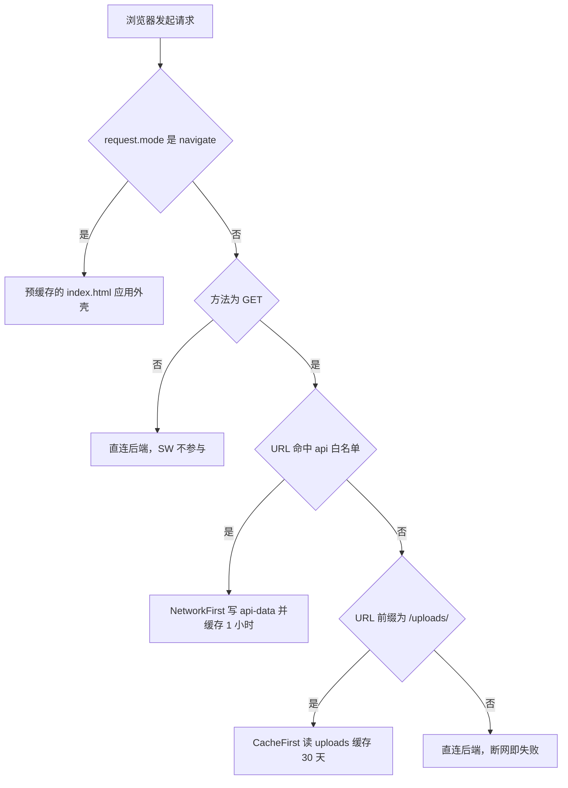
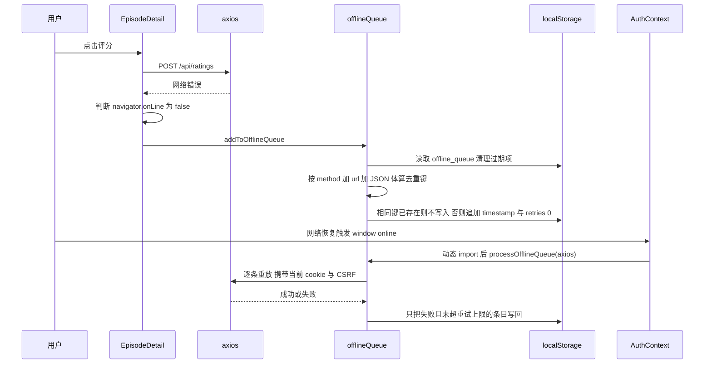
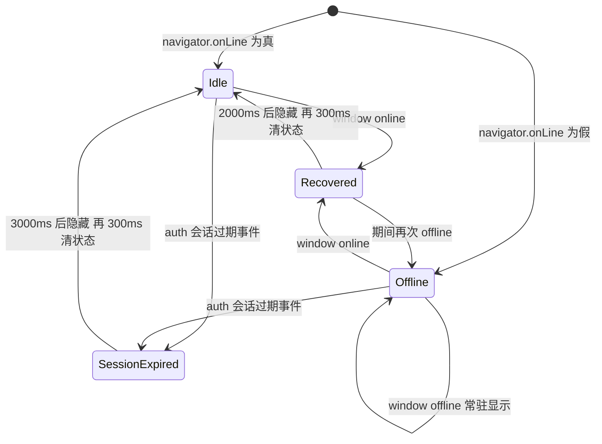

# PWA、离线缓存与浏览器兼容

这个前端有两条完全独立的「离线性」来源，混在一起读会误判：**浏览器缓存层**（Service Worker 决定哪些请求在断网时还有答案）与**应用层补偿**（`offlineQueue` 把少数写操作排队重放）。再加上一条「可安装性」链路（manifest + `beforeinstallprompt`）和一条「老浏览器闸门」（`index.html` 内联遮罩 + `BrowserCompat`），四件事共享同一批边界：都只在真实的预构建产物里生效、都依赖 `vite.config.js` 与 `index.html` 这类入口文件、且都不经过 React 的正常渲染路径。

**先记住三条不变量：**

1. **开发环境没有 Service Worker。**`vite.config.js` 的 `devOptions: { enabled: false }` 让 `vite dev` 既不生成 SW 也不注入 manifest link，`npm run dev` 下观察到的一切 "离线/不弹安装" 都不是线上行为。
2. **缓存白名单就是离线能力的上限。**只有命中 `workbox.runtimeCaching` 两条 `urlPattern` 的 GET 请求，断网时才可能有答案；其余请求（鉴权、通知、评分、历史）离线即失败。
3. **只有可重放的写操作才允许进离线队列。**当前唯一入队点是评分，且回放用的是「当前会话身份」。

## 全景：四层各自负责什么

| 层 | 由谁产生 | 生效时机 | 失效后果 |
| --- | --- | --- | --- |
| Service Worker（预缓存 + 运行时缓存） | `vite-plugin-pwa` 在 `npm run build` 时生成 `sw.js` | `window.load` 后由 `main.jsx` 注册，接管本域请求 | 断网时白屏 / 无数据，只剩浏览器原生错误页 |
| manifest（可安装性） | 构建期 `vite.config.js` 内联 + 运行时后端 `/api/site-content/pwa-manifest` | 构建即有；站点设置加载后 link 被改指后端 | 安装提示不弹、已安装应用的名称/图标不更新 |
| 安装提示 | `main.jsx` 的 `beforeinstallprompt` 桥 + `InstallPrompt` 卡片 | 浏览器认为可安装且未安装时 | 用户只能靠浏览器菜单手动安装 |
| 兼容闸门 | `index.html` 内联 ES5 遮罩 + `BrowserCompat` | 首字节解析期 / React 挂载时 | 老浏览器看到白屏或错误堆栈而不是解释页 |

四层的宿主文件（`index.html`、`vite.config.js`、`src/main.jsx`、`src/App.jsx`）在[启动链路与 Provider](../architecture/boot-and-providers.md)里有完整顺序，本页只讲这四件事本身的机制与陷阱。

## Service Worker：注册、接管与"没有更新提示"

注册代码是一段纯副作用，位于 `src/main.jsx` 顶部：

- 仅在 `'serviceWorker' in navigator` 时，**动态** `import('virtual:pwa-register')` 然后 `registerSW({ onOfflineReady })`。动态导入把注册逻辑切成独立 chunk（构建产物里是 `assets/virtual_pwa-register-*.js`），`onOfflineReady` 只打一行 console 日志，没有任何 UI。
- `vite.config.js` 里 `registerType: 'autoUpdate'`，因此**没有"有新版本，点击更新"的交互**：插件在 autoUpdate 模式下生成的注册代码会在 SW `activated` 且 `isUpdate`/`isExternal` 为真时直接 `window.location.reload()`（`registerSW` 调用没有传 `onNeedReload`，所以走默认的整页刷新）。这就是"发版后旧标签页会自己刷新一次"的来源，也是为什么新增更新提示组件时必须显式传 `onNeedReload`，否则会和默认刷新打架。
- 调用没有传 `immediate`，注册被推迟到 `window` 的 `load` 事件之后（workbox-window 的默认行为）；首屏资源因此不会和 SW 安装抢带宽。
- 生成的 `sw.js` 顶层调用 `skipWaiting()` + `clientsClaim()`，并调用 `cleanupOutdatedCaches()` 清掉旧版本预缓存——这正是 `autoUpdate` 的落地形态。

**开发环境的正确读法**：`devOptions.enabled: false` 同时关掉了 SW 与 manifest 注入，所以 `vite dev` 下 `beforeinstallprompt` 不会触发、`navigator.serviceWorker` 永远是空。想验证离线行为必须 `npm run build && npm run preview`。另外因为 `sw.js` 本身不在预缓存里，它的 HTTP 缓存头会直接决定 `autoUpdate` 的灵敏度（见[构建、配置与部署](../operations/build-and-release.md)的 nginx 建议）。

## 缓存策略：预缓存清单 + 两条运行时路由

`vite.config.js` 的 `workbox` 段只做了三件事：声明预缓存通配、额外收进一个图标、注册两条运行时路由。

| 配置 | 值 | 效果 |
| --- | --- | --- |
| `globPatterns` | `**/*.{js,css,html,ico,png,svg,woff2}` | 构建产物（含 `index.html`、所有懒加载 chunk、字体、图标）进预缓存，条目版本由内容指纹或文件名哈希决定 |
| `includeAssets` | `['apple-touch-icon.png']` | 显式把 iOS 主屏图标收进预缓存 |
| `navigateFallback` | 未覆写 | 使用插件默认的 `index.html` 导航回退：任意路由（`/episode/x`、`/timeline`…）在断网时返回预缓存的应用外壳，而不是浏览器错误页 |

运行时缓存只有两条，**按 URL 前缀命中，且只对 GET 生效**：

| cacheName | `urlPattern` | 策略 | 参数 | 语义 |
| --- | --- | --- | --- | --- |
| `api-data` | `^https?://.*/api/(episodes|series|categories|banners|friend-links|site-content)` | `NetworkFirst` | `networkTimeoutSeconds: 10`、100 条、1 小时 | 优先网络；10 秒无响应或断网时回退缓存副本 |
| `uploads` | `^https?://.*/uploads/` | `CacheFirst` | 200 条、30 天 | 命中缓存直接返回，永不再请求网络（直到条目过期/被挤出） |

图：一次请求在 Service Worker 层被四种方式分流，只有导航回退与两条运行时路由带离线答案。

由此可以推出几条改动时最容易踩的结论：

- **新增一个需要离线兜底的接口分组，必须改这条 `urlPattern`。**它不在白名单里就不会被缓存——`/api/notifications/*`、`/api/auth/*`、`/api/ratings`、`/api/histories/*` 目前都不在，所以"离线能刷首页、但点进后台或拉通知就报错"是设计结果，不是 bug。
- **`site-content` 也在白名单里**（`/api/site-content/:key` 与 `/api/site-content/pwa-manifest` 都命中），这意味着断网时站点文案、`about`、甚至 manifest 都可能拿到 1 小时内的旧副本。
- **`uploads` 的 `CacheFirst` 把"文件命名是否唯一"变成了前端可见的正确性问题。**上传成功后后端返回的 URL 形如 `/uploads/...`（命名规则不在本仓库，见[媒体上传](media-upload.md)）；只要后端对同一路径做了覆盖写而不是生成新文件名，已经缓存过的客户端在 30 天内**仍会看到旧图**，且没有任何失效入口。换图时优先让 URL 变化（换名或加指纹），不要只为省流量而放宽这条策略。
- 写请求永不进缓存池：`ratings`、`histories`、`comments` 之类的 POST 断网一律失败，需要离线支持只能走下面的应用层队列。

## manifest：构建期占位与运行时后端端点

`vite.config.js` 的 `manifest` 段写死了应用名（兽剧聚合平台 / 兽剧）、`start_url: '/'`、`display: standalone`、`background_color`、`theme_color`、四个图标（含一个 `maskable`）、两个 `shortcuts` 与一个 `share_target`。构建后插件把 `<link rel="manifest" href="/manifest.webmanifest">` 注入 `index.html`，并把 `manifest.webmanifest` 一并预缓存。

运行时 `AppContent` 会在站点设置就绪后覆盖它（`src/App.jsx`）：

1. `pwaName` / `pwaShortName` / `pwaThemeColor` 取自 `SiteSettingsContext`，缺省回落到 `siteName` 与构建期颜色；
2. 找到（或创建）`link[rel="manifest"]`，**仅当 href 尚未包含 `/api/site-content/pwa-manifest` 时**改指该端点；源码注释明确记录了为什么不用 `blob:` URL——浏览器无法验证 blob manifest，安装提示不会弹出；
3. 顺带更新 `apple-touch-icon`（`pwaIcon512 || pwaIcon192`）、`apple-mobile-web-app-title`、`application-name`、`theme-color`、`msapplication-TileColor`。

**缓存与安装性在这里互相影响，改缓存策略前必须一起想：**

- 改指之后，浏览器拉 manifest 的请求落在 `site-content` 的 `NetworkFirst` 路由上——manifest 会被写进 `api-data` 并保留 1 小时。好处是断网时浏览器仍可能读到一份旧 manifest；代价是后台改完名称/图标后，客户端最长可能要等到这条缓存条目过期才看到新值，而**不是**立即生效。
- 若 `api-data` 里没有 manifest 的副本、网络又不可达（首次访问即离线），浏览器就拿不到 manifest：安装提示不会弹，已安装应用的元数据也刷新不了。这是「把 manifest 从静态文件改成动态端点」换来的耦合，缓解手段只有让站点设置/首屏请求尽早成功（`SiteSettingsContext` 自身还有 30 分钟 localStorage 缓存，见[状态与持久化](../architecture/state-and-persistence.md)）。
- 站点设置**取不到**时 link 保持构建期那一套，而 `/manifest.webmanifest` 是预缓存资源，因此「离线且设置未加载」的首次访问仍然有 manifest 可用——这是双份 manifest 设计里唯一的兜底路径。
- 后台还能配 `pwaMaskableIcon`、`pwaBackgroundColor`，但上述运行时逻辑不消费这两项，它们只能通过后端 manifest 端点生效；字段语义与保存链路见[站点设置与公告](site-settings-and-announcements.md)，端点清单见[后端契约地图](../integrations/backend-api-map.md)。

**声明了但没有消费方的 manifest 字段**（属于可扩展点，也是当前缺口）：

| 声明 | 期望行为 | 现状 |
| --- | --- | --- |
| `shortcuts`：`/?tab=latest`、`/?action=search` | 长按图标直达"最新/搜索" | `Home` 只读 `category`/`sort`/`status`/`tag`/`rating`/`year`/`order`/`search`，没有 `tab` 或 `action` 分支，两个快捷方式都落到默认首页 |
| `share_target`：`GET /` + `title`/`text`/`url` | 系统分享菜单把内容带进应用并预填 | 仓库内没有任何读取这三个参数的位置，分享进来的值被忽略 |

## 安装入口：`beforeinstallprompt` 事件桥

`beforeinstallprompt` 只能被 `prompt()` 消费一次，且可能在 React 挂载**之前**就触发，因此 `src/main.jsx` 在模块顶层就挂上监听：`preventDefault()` 后把事件存进 `window.__pwaDeferredPrompt`、置 `window.__pwaPromptFired = true`，并派发自定义事件 `pwa-install-available` 通知可能已经挂载的组件。

`InstallPrompt`（渲染在普通站点的外壳里，`/admin` 分支没有它）用两路兜底接住这条事件：

| 阶段 | 行为 |
| --- | --- |
| 挂载 | 若 `localStorage['pwa-install-dismissed'] === 'true'` 直接 `return`（永久关闭）；否则先读 `window.__pwaDeferredPrompt`，有值就展示卡片 |
| 订阅 | 监听 `pwa-install-available`，再读一次全局变量后展示 |
| 点"安装" | `deferredPrompt.prompt()` → `await userChoice`；无论结果都把组件状态与 `window.__pwaDeferredPrompt` 置空，`accepted` 时关闭卡片 |
| 点"关闭" | 勾了"不再提醒"就写 `pwa-install-dismissed='true'`；否则只隐藏本次卡片，刷新后可能再弹 |

几个容易被当成 bug 的行为都源自这段实现：

- **安装被用户取消后卡片不会消失，但"安装"按钮变成空操作**：`handleInstall` 把 `deferredPrompt` 置空了，而卡片仍在；只能点关闭。
- **重新打开提醒需要刷新页面**：设置页的"安装提示"开关读写的是同一个 `pwa-install-dismissed` 键（`DISMISSED_KEY` 在 `Settings.jsx` 与 `InstallPrompt.jsx` 里各定义了一次），但 `InstallPrompt` 只在挂载时读该键，所以关闭后再开启，本次会话里不会重新弹出。
- **`NavBar` 里还有一份 `beforeinstallprompt` 监听**（同时 `preventDefault()` 并存进自己的 state），但它的 `handleInstallClick` 与 `isInstalled` 在 JSX 中没有任何引用，属于死代码；`appinstalled` 也只在这里监听且结果无人消费。因此真实的安装入口只有 `InstallPrompt`，而"通过浏览器地址栏安装"不会自动关掉这张卡片。改安装相关逻辑时不要去改 NavBar 那份。

## 离线写队列：只有评分走这条路

`src/utils/offlineQueue.js` 是一条很窄的补偿通道，唯一入队点是剧集详情页的评分：`POST /api/ratings` 抛错**且** `navigator.onLine === false` 时，动态 `import('../utils/offlineQueue')` 后 `addToOfflineQueue({ method: 'post', url: '/api/ratings', data: { episodeId, score } })`。收藏、历史进度、评论、反馈都没有这条路。

图：入队只发生在一个 catch 分支里，回放只发生在 `window` 的 `online` 事件上。

| 规则 | 实现 | 后果 |
| --- | --- | --- |
| 存储 | 单个 localStorage 键 `offline_queue`，值是数组 | 所有账号、所有标签页共用一份队列 |
| 去重键 | `` `${method}:${url}:${JSON.stringify(data)}` `` | 同一集打同一个分数只会排一次；同一集先后打两个不同分数会排出两条，回放顺序即写入顺序 |
| 过期 | `MAX_AGE_MS = 24h`，入队时先过滤、读取时再过滤 | 超过一天的离线动作静默消失，不通知用户 |
| 重试 | `MAX_RETRIES = 3`，失败后 `retries + 1`，仅当 `retries <= 3` 才回写 | 单条动作最多被尝试 4 次（首次 + 3 次重试），第 4 次失败即丢弃，避免 4xx 永久失败任务堆积 |
| 回放触发 | `AuthContext` 的 `window.addEventListener('online', …)` | **应用在离线时被关闭、恢复网络后直接打开，队列不会重放**——没有"启动时也跑一次"的入口 |
| 回放身份 | 传入的是全局 `axios` 实例（带 CSRF 与 cookie 拦截器） | 重放使用**当前**会话身份；换账号后回放会用新账号的凭据提交旧账号排下的评分 |
| 可观测性 | `getOfflineQueue` / `clearOfflineQueue` 已导出但无调用方 | 界面上没有任何"待同步 N 条"的提示，用户无从得知评分是否会补上 |

实现上的两处脆弱点：`addToOfflineQueue` 与 `processOfflineQueue` 都用裸 `JSON.parse(localStorage.getItem(...) || '[]')`，被外部写坏的 JSON 会直接抛错（前者在动态 import 的 `then` 里抛成未处理拒绝，后者在 `online` 监听里没有 try/catch）；`processOfflineQueue` 也没有并发锁，短时间内两次 `online` 事件（或折网抖动）可能同时读到同一份队列并各自重放一遍，造成重复 POST。

**新增入队点时的硬性要求**（缺一条就会产生脏数据）：

1. **只允许可重放的幂等写**：重放时不带原请求的自定义 header 与 `getAuthHeaders()` 结果，只有 cookie/CSRF，因此动作必须能仅凭 `method + url + body` 唯一确定意图；带"绝对值"语义（`PUT 评分为 8`）的动作可以重放，"增量"语义（`+1 播放数`）不可以。
2. **明确去重键**：默认键只覆盖方法、路径与请求体——写进 query string 的参数（如 `/api/x?id=1`）会天然进入键（因为 `url` 含查询串），但放在 header 或依赖时间的字段会让同一操作重复入队。
3. **明确失败丢弃策略**：现有实现是"4 次后丢弃"，若新动作不能承受静默丢失（例如支付、反馈提交），必须先做一层"待同步"UI 或换成后端幂等键，而不是直接复用这套队列。

## OfflineIndicator：三态提示与它的计时器

`OfflineIndicator` 是一个纯展示组件，没有 Provider、不参与任何数据流，状态全部来自三个事件：

图：离线提示常驻，恢复与"登录已过期"都是定时自动消失的临时态；三者共用同一条顶部横幅。

| 事件 | 状态变化 | 文案 / 配色 | 停留 |
| --- | --- | --- | --- |
| `offline` | `isOffline = true`、`showBackOnline = false`、`visible = true` | `pwa.offline` + warning 变量 | 一直显示直到 `online` |
| `online` | `isOffline = false`、`showBackOnline = true`、`visible = true` | `pwa.backOnline` + success 变量 | 2 秒后滑出，再 300ms 清 `showBackOnline` |
| `auth:session-expired` | `sessionExpired = true`、`visible = true` | `auth.sessionExpired` + destructive 变量 | 3 秒后滑出，再 300ms 清状态 |

渲染优先级是 `sessionExpired` > 恢复提示 > 离线提示；组件在 `!visible && !isOffline && !sessionExpired` 时返回 `null`，否则用一个 `translateY(-100%)/opacity:0/pointerEvents:none` 的固定横幅做进出场动画，`z-index: 9999`（比安装卡片的 9998 高一层）。它和 `InstallPrompt` 一样只挂在普通站点外壳，`/admin` 分支不渲染。

两个必须知道的时序问题：

- **定时器从不取消。**`online` 后那个 2 秒的隐藏定时器不会被随后的 `offline` 打断：如果 2 秒内再次断网，横幅已经被 `visible = false` 滑出屏幕，而 `isOffline` 为真仍让它保持挂载，于是用户**看不到**离线提示。unmount 时也没有清这些 timeout。
- **"登录已过期"通常来不及被看到。**`axiosConfig` 在 401 与 419 刷新失败两条路径上都会派发 `auth:session-expired`，紧接着（除非当前已在 `/login`、`/register`、`/reset-password`，或请求带 `skipRedirect`）就 `window.location.href = '/login'` 整页跳转，横幅随页面卸载。真正能稳定看到这条红色提示的场景，是用户本来就在登录相关页面、或 419 刷新失败后落在认证页。会话与刷新语义见[HTTP 与会话](../architecture/http-and-session.md)。

## 浏览器兼容：静态遮罩 + React 闸门

兼容性有两道闸门，第二道不是第一道的重复，而是覆盖了第一道够不到的部分。

### 第一层：`index.html` 的 ES5 遮罩

`body` 末尾、`<script type="module" src="/src/main.jsx">` 之前的那段内联脚本刻意只用 ES5（先给缺失环境补一个 `JSON.parse/stringify`），因为它的目标环境恰恰是跑不动现代语法的地方。它用 UA 判定两类目标：`MSIE|Trident`（IE）与 `Edge/\d+` 且不含 `Edg/`（EdgeHTML）。命中后：

- 构造一个 `z-index: 2147483647` 的全屏遮罩插到 `body` 最前，内容由中英双语字典 `I18N` 渲染：标题、具体原因（IE / 旧 Edge 各一套）、支持的浏览器版本、三款浏览器的国内/国际下载入口；
- 提供语言切换按钮 `window.__switchCompatLang()`，写 `localStorage.lang` 后**只重绘遮罩**、不刷新页面；
- 用 `XMLHttpRequest`（IE 下回退 `ActiveXObject` 的 `Msxml2.XMLHTTP` / `Microsoft.XMLHTTP`）请求 `/api/site-content/about`，把解析出的 `icp` 写进 `localStorage._icp` 并回填遮罩底部——这条请求不经过 axios、不带 CSRF、没有类型检查。

必须注意它的边界：它**不阻断启动**。IE 之所以被"挡住"，是因为 IE 不执行 `type="module"`；EdgeHTML 很可能照样下载并挂载 React，只是被遮罩盖住。它也**不认绕过记录**（下面那个 `browserCompat_bypass_*` 键），只做 UA 判断、不做版本阈值与特性检测，而且它的判定名单里没有 Chrome/Firefox/Safari 的旧版本。

### 第二层：`BrowserCompat`

`App` 把 `BrowserCompat` 包在 `ErrorBoundary` 与 `AppContent` 之间（`Router → Theme → I18n → SiteSettings → Auth → Icon → ErrorBoundary → BrowserCompat → AppContent`），因此它可以用 `useI18n()`，并且在对不兼容时**用遮罩替换整棵子树**——`AppContent` 不挂载，也就不会发出鉴权、站点设置、壁纸等任何请求。

挂载时的判定顺序（`src/components/BrowserCompat.jsx`）：

1. 先查绕过记录 `browserCompat_bypass_<UA 哈希> === 'ok'`，命中直接视为兼容、跳过一切检测；
2. UA 分支：IE → `ie`；EdgeHTML → `edgeLegacy`；Chrome 主版本 < 60（排除 `Edg/`、`OPR/`）→ `oldChrome`；Firefox < 55 → `oldFirefox`；`Version/x Safari` 且非 Chrome 且主版本 < 12 → `oldSafari`。注意**没有 `Edg/` 分支**：Chromium Edge 既不进 Chrome 分支也不单独识别，只落到特性探测，失败时 `browser` 是 `Unknown`、遮罩会隐藏浏览器名标签；
3. 特性探测：缺 `Promise`、`fetch`、`IntersectionObserver`、`ResizeObserver`、`Object.assign`、`Array.from` 各对应一个 reason；
4. CSS 自定义属性：用 `el.style.setProperty('--test-var','0')` 再读回是否为空的**元素探针**，而不是 `CSS.supports('--a','0')`——后者在 Safari 上对自定义属性有两参数形式的已知 bug 会误报。

命中任一不兼容时渲染 `IncompatibleOverlay`：同样的亮色卡片、中英切换（走 `switchLang`，即写 `localStorage` 后整页 reload）、浏览器下载入口、以及一个"继续访问"按钮。ICP 备案号同样从 `/api/site-content/about` 拉取，成功后写 `localStorage._icp`，失败则从该键回退读取——与 `index.html` 遮罩共用同一个缓存键。

绕过与反馈闭环：点"继续访问"后子树正常渲染，60 秒后弹出 `FeedbackDialog`；选"使用正常"把 `browserCompat_bypass_<hash>` 写成 `ok`（下次启动在检测之前就放行），选"有问题"只是关掉对话框——**不落盘、不上报、也不会重新弹**。哈希是 `navigator.userAgent` 的 32 位整数哈希，与账号无关：同一浏览器所有用户共享同一个绕过记录，而浏览器升级导致 UA 变化后该记录失效、提示会重新出现。

### 两层对照

| | `index.html` 内联遮罩 | `BrowserCompat` |
| --- | --- | --- |
| 运行时机 | 解析期，模块脚本之前 | React 挂载后（effect 内） |
| 语法约束 | 纯 ES5 + `JSON` polyfill | 正常现代语法 |
| 判定依据 | 仅 UA：IE / EdgeHTML | UA 阈值 + 6 个特性探测 + CSS 变量探针 |
| 是否认绕过记录 | 否（每次都会显示） | 是（`browserCompat_bypass_<hash>`） |
| 语言切换 | 写 `localStorage` 后就地重绘 | `switchLang` → 整页 reload |
| 是否真正阻断应用 | 否（IE 靠不执行 module 才"挡住"，EdgeHTML 可能仍挂载） | 是（不渲染 children） |
| ICP 来源 | XHR 直连 `/api/site-content/about`，`ActiveXObject` 回退 | axios 同端点，失败读 `localStorage._icp` |

## 阈值、文案与 polyfill：一处改动要动三处

"本站支持 Chrome 60+ / Firefox 55+ / Safari 12+ / Edge 79+" 这句承诺在仓库里存在**三份互不引用的副本**：

| 位置 | 形态 |
| --- | --- |
| `src/components/BrowserCompat.jsx` 的 `checkCompatibility` | 真正生效的阈值（`< 60` / `< 55` / `< 12`；Edge 79 只出现在文案里，Chromium Edge 不在 UA 分支中） |
| `index.html` 内联遮罩的 `I18N.*.supportedVersions` 与 `reason*` | ES5 脚本里手写的双语字符串 |
| `src/locales/{zh,en}.js` 的 `browserCompat.*` | React 遮罩用 `t()` 取文案 |

改支持范围、新增一种"不兼容原因"、或换下载链接时，这三处必须同步；漏掉 `index.html` 那份的后果是"遮罩说支持某版本，React 却说它不支持"。

与阈值相关的还有两条底层约束，读起来像矛盾但其实是分工：

- `vite.config.js` 的 `build.target: 'es2019'` 只把**语法**降级到 ES2019，不会给运行时 API 打补丁；缺失 API 由 `src/utils/polyfills.js` 手补（`Object.fromEntries`、`Promise.allSettled`、`Array.prototype.flat/flatMap`、`String.prototype.matchAll`、`globalThis`）。
- 但兼容检测要求的是 `Object.assign` 与 `Array.from`，这两个**没有**进 `polyfills.js`；反过来 polyfills 补的几个 API 也**不在**检测列表里。因此不存在"过了闸门就一定有 polyfill"的保证：`Object.assign`/`Array.from` 缺失的浏览器会被判定不兼容（然后用户可以"继续访问"进一个可能真的会崩的环境），而 `flat`/`matchAll` 缺失则会被 polyfill 静默接住。要新增运行时 API，两个文件都要看。

## 改动清单

| 你要改的东西 | 必须同步的位置 |
| --- | --- |
| 新增需要离线可读的 GET 接口 | `vite.config.js` 的 `runtimeCaching.urlPattern`（白名单即契约）；并确认响应体足够小、`maxAgeSeconds` 与业务新鲜度匹配 |
| 调整 `uploads` 缓存策略 | 确认上传路径是否会同名覆盖（`CacheFirst` + 30 天会让旧图长期可见） |
| 改 manifest 字段（名称/图标/主题色/启动参数） | 记住用户可见值来自后端 `/api/site-content/pwa-manifest`，构建期那份只是首次加载占位；改完还要考虑 `api-data` 里最长 1 小时的旧副本 |
| 实现 `shortcuts` / `share_target` | `Home` 需要新增 `tab`/`action`/分享参数分支，否则 manifest 里的声明永远无效 |
| 改安装提示行为 | `src/main.jsx` 的事件桥（全局变量 + `pwa-install-available`）、`InstallPrompt`、`Settings` 里同名的 `pwa-install-dismissed` 键；`NavBar` 里那份监听是死代码，改不改都不生效 |
| 新增离线写操作 | `offlineQueue` 的去重键与丢弃策略（见上文"硬性要求"）；给用户一个"待同步"提示，因为当前没有任何 UI 或重放入口 |
| 提高/降低浏览器支持范围 | `BrowserCompat.checkCompatibility`、`index.html` 的 `I18N`、`locales` 的 `browserCompat.*` 三处 |
| 新增运行时 API | `polyfills.js` 与 `checkCompatibility` 的特性探测要一起评估 |
| 验证以上任何一项 | 只能 `npm run build && npm run preview`：dev 环境没有 SW、没有 manifest 注入（`devOptions.enabled: false`），`beforeinstallprompt` 也不会触发 |

仓库没有自动化测试，PWA 与兼容闸门的改动只能靠构建 + 真机冒烟；质量门禁与冒烟清单见[构建、配置与部署](../operations/build-and-release.md)。

## 相关页面

- [启动链路与 Provider](../architecture/boot-and-providers.md)——`index.html` 两段内联脚本、`main.jsx` 的模块级副作用、Provider 与 `BrowserCompat` 的位置。
- [状态与持久化](../architecture/state-and-persistence.md)——`offline_queue`、`browserCompat_bypass_*`、`_icp` 等 localStorage 键的全表与归属。
- [构建、配置与部署](../operations/build-and-release.md)——构建期与运行时两套 manifest 的分工、`sw.js` 的缓存头要求、图标生成脚本。
- [站点设置与公告](site-settings-and-announcements.md)——`pwaName`/`pwaIcon512` 等字段的保存链路与 `settings` JSON 结构。
- [通知投递：SSE、轮询与 Web Push](notifications.md)——未读数写入 PWA 角标（`setAppBadge`）的那条链路。
- [内容目录与剧集详情](content-catalog.md)——离线评分的入队现场与 `POST /api/ratings` 的响应处理。
- [HTTP 与会话](../architecture/http-and-session.md)——401/419 刷新流程，决定了"登录已过期"提示何时可见。
- [后端契约地图](../integrations/backend-api-map.md)——`/api/site-content/pwa-manifest` 与站点内容多路复用的端点清单。
