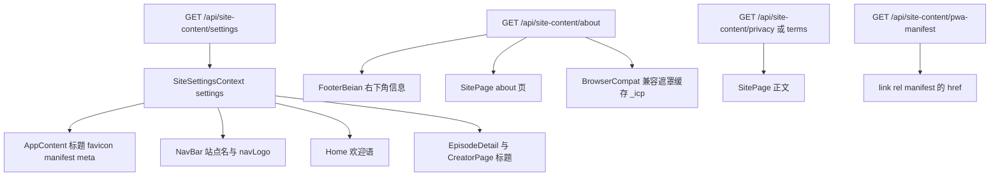
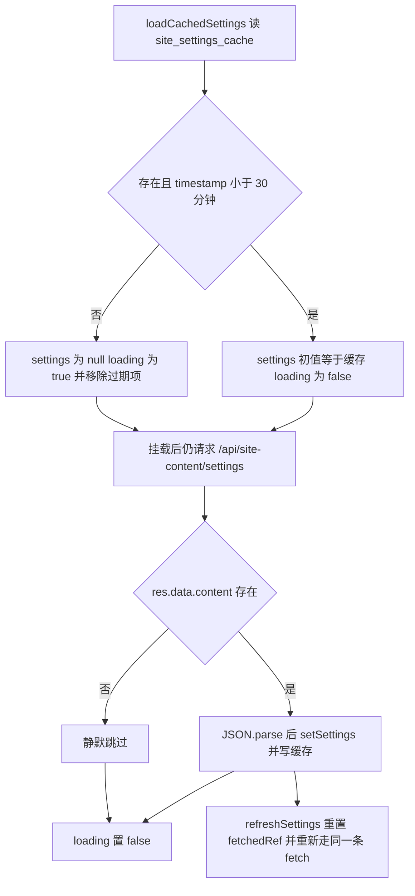
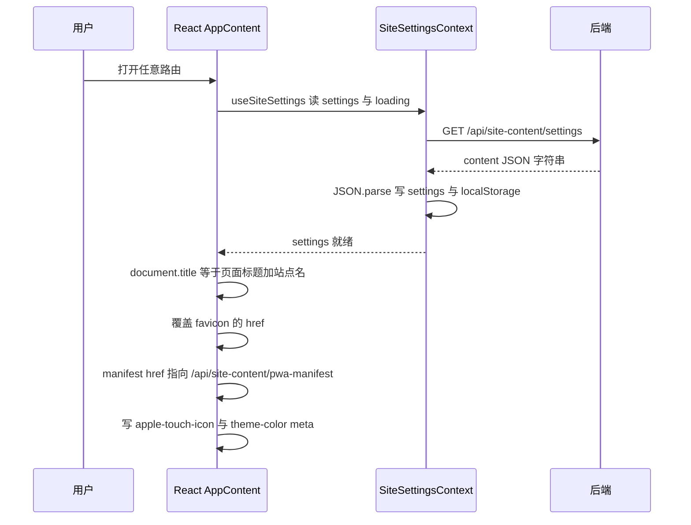
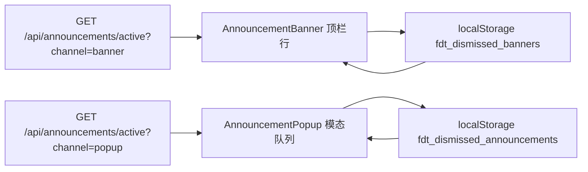

# 运行时站点配置、公告与静态页

这个前端没有配置文件式的「站点设置」，只有一个**键值文档存储**：后端 `/api/site-content/:key` 返回的 `content` 是**一段 JSON 字符串**，前端按用途解析成三类完全不同的东西——`settings` 是运行时配置对象、`about` 是结构化的页脚/关于页数据、`privacy`/`terms` 则是 `{ zh, en }` 双语文档。公告走的是另一条独立链路（`/api/announcements/active?channel=`），友链与许可页干脆不读 `site-content`。

读这页之前先记住三条不变量：

1. **所有 `content` 都是字符串，解析必须容错。**任何一处 `JSON.parse` 抛错都被 `try/catch` 吞掉并回退到安全形态（原文渲染、或整块不渲染），没有全局错误边界兜底页面内容。
2. **`settings` 的缓存是 30 分钟的 localStorage 副本，不是权威数据。**管理端保存只让**当前标签页**立即生效，其它标签页/别的管理员最多滞后 30 分钟。
3. **公告有两种呈现通道，各自一份本地已读记录。**横幅用 `fdt_dismissed_banners`，弹窗用 `fdt_dismissed_announcements`，关掉弹窗不会影响同一公告的横幅。

## 全景：谁读什么



图：四类 `site-content` 文档与四个独立消费点；只有 `settings` 经过 Context 与 localStorage 缓存。

| 文档 key | 前端消费点 | 写入侧 |
| --- | --- | --- |
| `settings` | `SiteSettingsContext` → `AppContent`、`NavBar`、`Home`、`EpisodeDetail`、`CreatorPage` | `AdminSiteContent`（`PUT`，保存后调 `refreshSettings`） |
| `about` | `SitePage` 的关于页、`FooterBeian`、`BrowserCompat`、`index.html` 老浏览器遮罩（经 `_icp`） | `AdminSiteContent` |
| `privacy` / `terms` | `SitePage`（`pageKey` 直接拼进 URL） | `AdminSiteContent` |
| `pwa-manifest` | 浏览器读，前端只改 `link[rel=manifest]` 的 `href` | 后端生成，前端无写入口 |
| `email` | `AdminEmailSettings`（只读） | 后端已禁用 `PUT`，配置在服务端 env/ini |

## `SiteSettingsContext`：缓存、拉取与刷新

Provider 挂载在 `Router → ThemeProvider → I18nProvider` 之内、`AuthProvider` 之外，因此它在**任何鉴权状态**下都会发起请求——这也解释了为什么它用 `skipRedirect: true` 调 `axios.get('/api/site-content/settings')`：站点名、favicon 属于公开信息，不该因为一个 401 就把访客弹去登录页。



图：缓存只决定首帧是否处于 loading 状态；`useEffect` 的两个分支都调用同一次拉取，所以每次挂载都是一次「先展示缓存、再静默校正」。

机制细节与由此产生的行为：

- **缓存契约**：键 `site_settings_cache`，值 `{ data, timestamp }`，TTL `30 * 60 * 1000`。读取时发现过期就 `removeItem`，读写都包在 `try/catch` 里（隐私模式/配额满时退化为无缓存，不抛错）。
- **`loading` 的语义**：初值是 `!cached`，只在一次 `fetchSettings` 结束时置 `false`。`NavBar` 与 `Home` 把 `loading` 当作「先别渲染文案」的开关（`loading ? '' : …`），所以有缓存时首帧直接是正确站点名，无缓存时先空一拍再出文案——**不会**先闪一个默认站点名。
- **`fetchedRef` 的作用**：`main.jsx` 用 `<React.StrictMode>` 挂载，effect 在开发环境会被执行两次；这个 ref 让第二次直接 `return`，避免重复请求与重复写缓存。
- **失败即静默**：`fetchSettings` 的 `catch` 是空的，只有末尾的 `setLoading(false)` 一定执行。网络错误、后端 500、`content` 缺失都不会冒泡到 UI，`settings` 保持 `null`（或保持旧缓存）。
- **`refreshSettings()` 是唯一的失效入口**：它重置 `fetchedRef`、置 `loading = true`、重新拉取，被 `AdminSiteContent` 在保存 `settings` 后调用。副作用是 NavBar/Home 会因为 `loading = true` 短暂清空文案，这是保存后「全站立即可见」的代价。
- **`useSiteSettings()` 可以在 Provider 外安全调用**：拿不到 context 时返回 `{ settings: null, loading: true, refreshSettings: () => {} }`，不抛错。这意味着任何组件都能直接消费，也意味着**忘记挂 Provider 不会报错，只会永远拿默认值**。

缓存与 Session 的关系见[状态与持久化](../architecture/state-and-persistence.md)：登出只清 `user` 一个键，`site_settings_cache` 跨账号保留。

## `settings` 的字段与消费边界

`AdminSiteContent` 的 settings 编辑器把这些字段按「浏览器标签页 / 导航 Logo / 站点名 / 欢迎语 / PWA」分区编辑，保存时整段 `JSON.stringify` 回写。真正被前端读取的字段如下：

| 字段 | 回退链 | 消费点与行为 |
| --- | --- | --- |
| `browserTitle`、`browserTitleEn` | `browserTitle{En}` → `browserTitle` → `t('site.defaultName')` | `document.title` 的站点名后缀；`EpisodeDetail`、`CreatorPage` 各自单独拼标题时也用它 |
| `favicon` | 无回退（空则不动） | 只有非空时才改 `link[rel~='icon']` 的 `href`，否则保持 `index.html` 里的 `/icon.svg` |
| `siteName`、`siteNameEn`、`navLogo` | `getLocalizedContent` → `t('site.defaultName')` | `NavBar` 标题与 Logo；`siteSettingsLoading` 为真时标题渲染空串 |
| `welcomeTitle`、`welcomeSubtitle`（含 `En`） | `getLocalizedContent` → `t('home.welcomeTitle')` / `t('home.welcomeSubtitle')` | `Home` 首屏欢迎语，同样受 `loading` 抑制 |
| `pwaName` | `pwaName` → `siteName` → 默认站点名 | `apple-mobile-web-app-title`、`application-name`、后端 manifest 的名称来源 |
| `pwaShortName` | 空则取 `pwaName` 前 12 个字符 | 同上（短名） |
| `pwaIcon192`、`pwaIcon512` | 二者任一存在即可 | 写 `link[rel='apple-touch-icon']`，优先 512 |
| `pwaThemeColor` | `#6366f1` | `meta[theme-color]` 与 `meta[msapplication-TileColor]` |
| `pwaDescription`、`pwaMaskableIcon`、`pwaBackgroundColor` | — | **前端不消费**，只可能经后端 manifest 端点生效 |
| `backgroundImage`、`backgroundEnabled`、`backgroundOpacity`、`backgroundBlur` | — | 后台仍会读出并原样回写，但前端背景已改由主题壁纸提供（`user.backgroundPrefs` + `/api/themes/active`），编辑器里也没有对应输入项 |

两条容易踩空的边界：

- **改字段名会同时打断三处**：`AdminSiteContent` 的读写、`AppContent` 的 effect、`getLocalizedContent` 的 `field + En` 约定。新增可翻译字段必须同时加 `${field}En`，否则英文用户看到的是机器翻译结果而不是预置文案（见[界面国际化与运行时内容翻译](./i18n-and-translation.md)）。
- **`pwaMaskableIcon` / `pwaBackgroundColor` 是「后台能填、前端不读」的字段。**排查「后台换了图标但桌面端没变」时不要在前端找消费点。

## `AppContent` 的三个设置消费 effect

`AppContent` 把 `settings` 映射到 document 级别的副作用，三个 effect 都以 `if (!siteSettingsData) return;` 开头——**这条守卫定义了整套降级语义**：只要 `settings` 没拿到（后端故障、离线且无缓存、解析失败），`document.title` 就停在 `index.html` 里的静态标题，manifest、`theme-color`、`apple-touch-icon` 全部保持构建期值，页面照常可用。



图：一次挂载里设置从接口到 DOM 的传播顺序（首个 effect 还依赖 `location.pathname` 与 `lang`）。

- **标题**：用 `getRoutePageTitleKey(pathname)` 把路径映射成 `pageTitle.*` 文案键，拼成 `${pageTitle} - ${siteName}`；没有映射则只用站点名。这张映射表是手写的 if 链，**新增路由忘记登记的表现是「标题只有站点名」**，不报错。`EpisodeDetail`（剧集名 - 站点名）与 `CreatorPage` 会在自己的 effect 里再次覆盖 `document.title`，二者都独立读 `browserTitle{En}`。
- **favicon**：只在 `settings.favicon` 非空时改写既有 `link[rel~='icon']`，不存在则创建一个；不清空、不删除。
- **运行时 PWA**：只在 `href` 尚不包含 `/api/site-content/pwa-manifest` 时才改写，避免重复设置；随后写四个 meta。为什么不用 `blob:` URL（浏览器无法校验 manifest，安装提示不弹）以及构建期 manifest 与运行时 manifest 的双份关系，见[PWA、离线缓存与浏览器兼容](./pwa-offline-and-compat.md)。

## 公告：双通道与本地已读

两个组件互不感知，各自在挂载时请求一次，并在卸载时用 `AbortController` 取消：



图：同一份公告可以由后台勾选「横幅 / 弹窗」分别出现在两条通道，两条已读记录互不影响。

**挂载位置决定了可见范围**：`AnnouncementBanner` 在 `App` 的非后台布局里位于 `NavBar` 之上，`AnnouncementPopup` 与 `InstallPrompt`、`OfflineIndicator` 一起在布局末尾；`/admin/*` 分支的返回值里只有 `FooterBeian`，所以**管理后台看不到横幅与弹窗**。

**`AnnouncementBanner`**：

- 拉取后立即用 `fdt_dismissed_banners` 里的 `_id` 过滤；过滤后为空则 `return null`，不占任何高度。
- 按 `type`（`info` / `warning` / `maintenance` / `update`）选图标与 CSS 变量配色，未识别的类型回退 `info`。
- 有 `content` 时标题行可点击/可回车展开，收起态显示前 60 字；有 `link` 时渲染一个 `target="_blank"` 的「查看详情」。
- 关闭按钮写 `markDismissed(id)` 并就地把自己从列表移除（不重新请求）。已读列表只保留最近 50 个 id，超长时丢弃最旧的。

**`AnnouncementPopup`**：

- 过滤后若仍有可见公告则 `setOpen(true)`，一次只展示一条，底部显示「第 n / 共 m 条」，关闭当前条后自动切下一条，全部过完才 `setOpen(false)`。
- `dismissible` 是硬开关：为 `false` 时关闭按钮不渲染、`closeOnOverlay` / `closeOnEsc` 都关闭，且任何一种关闭路径都会调用 `markDismissed`——即「不可关闭」的公告**关一次就永久不再出现**。
- 语言切换只影响展示：`titleEn` / `contentEn` 缺省时回退中文原值。
- 已读键是 `fdt_dismissed_announcements`，同样是最近 50 个 id 的滚动窗口。

写入侧是 `AdminAnnouncements`：`showBanner`、`showPopup`、`sendNotification`、`sendEmail` 四个开关在**同一条公告**上并存，另有 `active`、`pinned`、`dismissible`、`publishAt`、`expireAt`、`link`。`publishAt`/`expireAt` 在提交前被转成 ISO 字符串（`expireAt` 允许显式 `null`），过期与排序判定由后端 `/api/announcements/active` 负责——前端不做时间判断。公告管理与通知推送的整体关系见[通知系统](./notifications.md)，权限细节见[管理后台](./admin-console.md)。

## 静态页：privacy、terms、about、license

`SitePage` 用一个 `pageKey` 参数服务三个页面（`PrivacyPage`、`TermsPage`、`AboutPage` 都是薄包装），路由在 `App` 里懒加载并具名导出。

**privacy / terms**：`GET /api/site-content/${pageKey}` 拿到 `{ title, content }`；失败时 `content` 保持 `null`，页面只显示返回按钮与加载文案，不崩。正文由 `resolveContent` 按固定顺序降级：

1. `JSON.parse(content)` 得到对象且含 `zh`/`en` 键 → 取 `parsed[lang]`，再退 `zh`、`en`；
2. 否则取 `content{En}` → `content` → `contentZh`；
3. `JSON.parse` 抛错 → **直接当纯文本渲染原文**（所以历史遗留的非 JSON 正文也能显示，不会白屏）。

这正是 `AdminSiteContent` 对非 `about`/`settings` 键写入 `JSON.stringify({ zh, en })` 的对应读法。

**about**：同一个接口，但 `content` 被解析成一个结构化对象，`JSON.parse` 失败时降级成 `{ copyright: content.content }`。前端消费的字段：`banner`、`logo`、`description`(+`En`)、`version`、`updates`、`changelog`、`icp`、`policeRecord`、`aiDisclaimer`(+`En`)、`copyright`(+`En`)。其中：

- `updates` 是「当前版本的待发布更新」，条目兼容旧字符串与 `{ content, date }` 两种形态；`changelog` 是按版本号归档的条目数组，前端按每页 5 条分页，首条打「最新」标记。
- 后台有一处关键写入语义：**发布版本日志**会把 `updates` 的文本并进 `changelog` 里**同版本号**的条目（已存在的条目做去重合并，不新增重复条目），随后清空 `updates`。所以「改了版本号但忘了点发布」的表现是：关于页只显示 `version`，更新条目还躺在 `updates` 里。
- 关于页底部的版权/备案/免责区块与 `FooterBeian` 读的是同一批字段，两处都可能显示，改文案时别只改一处。

**`FooterBeian`** 是独立请求方（不复用 Context，也不进缓存）：它自己 `GET /api/site-content/about`，解析失败就保持 `null` 并**整块不渲染**。显示条件值得单独记住：

```
if (!aboutData.icp && !aboutData.policeRecord && !copyright && !aiDisclaimer && !aboutData.version) return null;
```

`version` 也算有效内容——**即使备案与版权全空，只要设置了版本号，右下角这块就会显示且至少显示版本行**（`v{aboutData.version}` 与构建期 `__APP_VERSION__` 用 ` · ` 连接，后者来自 `vite.config.js` 的 git 短 sha）。这块还监听 `data-custom-bg` 属性决定是否加毛玻璃背景，以保证自定义壁纸下的可读性。

**license**：`LicensePage` 完全静态——许可证说明、第三方依赖清单、免责声明全部来自 `t('sitePage.*')`，**不读 `site-content`**。想改许可页文案只能改 `src/locales/*.js`。

`about` 文档因此最多被三处独立请求（`FooterBeian`、关于页、`BrowserCompat` 的兼容遮罩），彼此没有共享缓存；`BrowserCompat` 与 `index.html` 还会把 `icp` 落到 `localStorage._icp`，供老浏览器内联遮罩在无 React 的情况下显示备案号。缓存层上，`/api/site-content/*` 命中 Service Worker 的 `api-data` NetworkFirst 白名单，断网时可能拿到 1 小时内的副本。

## 友链页：不属于 site-content 的另一条内容链路

`FriendLinks` 虽然和上面几个页面同属「站点静态信息」，数据却完全走友链接口：

- 列表：`GET /api/friend-links`（公开）；「我的申请」页签额外请求 `GET /api/friend-links/my-applications` 并带 `getAuthHeaders()`，未登录时该页签不渲染。
- 申请：`POST /api/friend-links/apply`，除 `name`/`url`/`logo`/`description` 外必须携带 `altcha` 的 payload（`<altcha-widget challenge="/api/auth/captcha">` 的 `statechange` 事件写入），缺失时前端直接拦下并提示。
- 渲染安全：每条链接的 `url` 只有匹配 `^https?://` 才包成 `<a href target="_blank" rel="noopener noreferrer">`，否则降级为不可点击的 `div`——`javascript:` 之类的协议因此不会被激活。
- 名称与描述走 `getLocalizedName` / `getLocalizedDescription`（字段缺译文时请求机器翻译），logo 缺失时显示占位方块。

写入侧是 `AdminFriendLinks`：`GET /api/friend-links/all` 取全量（含待审），`PUT /api/friend-links/:id` 既做内容编辑也做 `status: approved|rejected` 的审核流转，`POST`/`DELETE` 增删。用户侧看到的申请状态徽标（`pending`/`approved`/`rejected`）与驳回原因都来自这些记录。

## 后台写入侧：两个页面、两种权限模型

| 页面 | 门禁 | 能力 | 接口 |
| --- | --- | --- | --- |
| `AdminSiteContent` | `admin.role === 'superadmin'`，否则 `navigate('/admin/dashboard', { replace: true })` | 读写 `about`、`settings`、`privacy`、`terms` | `GET /api/site-content/`（注意尾斜杠）、`PUT /api/site-content/:key` |
| `AdminEmailSettings` | 同样的 superadmin 门 | **只读**当前生效配置 + 独立诊断发信 | `GET /api/site-content/email`、`POST /api/site-content/test-email`；`PUT /api/site-content/email` 已被后端禁用 |

`AdminSiteContent` 的保存模型是「读全量 → 按 key 拼 JSON → 回写」：列表接口拿回全部文档，`settings` 与 `about` 各自进专门编辑器，其余键进 `{ zh, en }` 双栏编辑器；保存时统一 `PUT` 一份 `JSON.stringify` 后的 `content`，并且**仅在 `editingKey === 'settings'` 时**调用 `refreshSettings()`。列表渲染时用 `contents.filter(item => item.key !== 'email')` 把邮件文档藏起来——所以后台卡片数比接口少一项是预期行为。

`AdminEmailSettings` 的注释写明了它为什么只读：邮件配置在重构后改由服务端 env/ini 提供（`EMAIL_HOST` / `EMAIL_PORT` / `EMAIL_USER` / `EMAIL_PASS` / `EMAIL_FROM_NAME`），不再存数据库，口令不回传；页面只做「展示当前生效值 + 用手填 SMTP 参数发一封测试信」。**在这页找不到保存按钮不是缺陷**，改配置要去服务端。后台整体权限矩阵与「前端角色门只是视觉约定」的说明见[管理后台](./admin-console.md)。

## 改动清单与已知陷阱

- **新增 `settings` 字段**：`AdminSiteContent` 的 state 初值、`startEdit` 的 `data.x || 默认值`、编辑 UI、以及真正的消费点（`App`/`NavBar`/`Home`）四处都要动；可翻译字段再加 `${field}En`。
- **新增静态页**：在 `SitePage` 加导出、在 `App` 加懒加载路由、在 `getRoutePageTitleKey` 登记 `pageTitle.*`，后台还需确认 `contents` 里存在对应 key（列表是后端返回的，前端不会创建）。
- **不要在渲染期直接 `JSON.parse`** 任何 `content`。`FooterBeian`、`SitePage`、`SiteSettingsContext` 都各自包了 `try/catch`，新代码照抄这个模式；`AdminEmailSettings` 里的解析也同样受保护。
- **管理端保存不会广播**：其它标签页的站点名/PWA 名称最多滞后 30 分钟（或用户刷新）。需要「立即全站生效」以外的语义时必须自己加失效机制。
- **`AdminSiteContent` 的保存粒度是整个文档**：两个管理员同时编辑 `about` 时后保存者覆盖前者，没有字段级合并。
- **没有自动化测试网**：`package.json` 只提供 `dev/build/lint/preview/generate-icons`。这类改动的验证方式是手动的——清 `site_settings_cache` 后看首帧是否回退默认站点名、把 `settings` 的 `content` 改成非法 JSON 看是否白屏、`/admin/site-content` 保存后看 NavBar 与页面标题是否立即变化、以及后台与前台切换确认公告只在非后台布局出现。

## 相关阅读

- [管理后台](./admin-console.md)——角色矩阵与 `AdminSiteContent` 在后台中的位置
- [界面国际化与运行时内容翻译](./i18n-and-translation.md)——`t()` 回退语义与 `getLocalizedContent` 的机器翻译边界
- [PWA、离线缓存与浏览器兼容](./pwa-offline-and-compat.md)——运行时 manifest、`theme-color` 与兼容遮罩的完整链路
- [状态与持久化](../architecture/state-and-persistence.md)——`site_settings_cache` 与公告已读键在 localStorage 契约中的位置
- [启动链路与 Provider](../architecture/boot-and-providers.md)——`SiteSettingsProvider` 在 Provider 树中的层级
- [后端契约地图](../integrations/backend-api-map.md)——`/api/site-content` 与 `/api/announcements` 的端点清单
