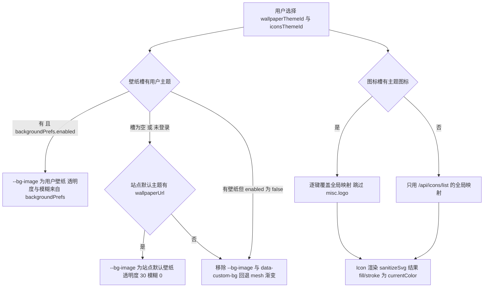
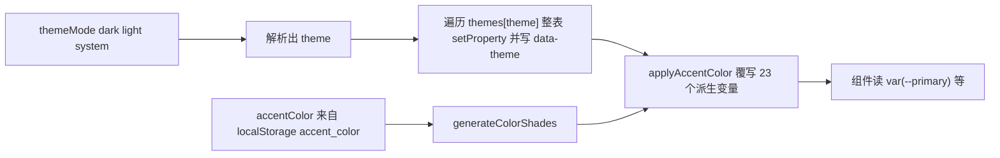

# 主题、外观与图标引擎

这个仓库的「外观」不是一套东西，而是**三条互不依赖的通道**，最终都收敛到 `document.documentElement` 上的 CSS 自定义属性与少量 data 属性。样式出口只有 `src/index.css` 一份纯 CSS：组件全部通过 `var(--x)` 取色、取阴影、取圆角，因此换肤不需要重新渲染组件树，只需要重写变量（`AGENTS.md` 明确禁止 CSS-in-JS 与预处理器，新增 token 必须在暗/亮两套表里同时定义）。

| 层 | 真源与状态持有者 | 落到 DOM 的东西 | 主要消费方 |
| --- | --- | --- | --- |
| ① 明暗 + 主题色 | `ThemeContext`（`localStorage` 的 `theme` / `accent_color`） | 上百个 `--*` 变量 + `data-theme` | `index.css` 与所有组件 |
| ② 壁纸 | 用户 `backgroundPrefs`（来自 `PUT /api/themes/selection` 响应）+ `GET /api/themes/active` | `--bg-image`、`--bg-opacity`、`--bg-blur`、`data-custom-bg` | `index.css` 的 `body::before/::after`、`FooterBeian` |
| ③ 图标 | `IconContext`（`/api/icons/list` 全局映射 + 主题图标槽覆盖） | 无变量，直接内联 SVG | `<Icon>`、`SvgIconPreview` |

相关阅读：[状态与持久化](../architecture/state-and-persistence.md)（`localStorage` 键位与用户对象同步）、[领域模型](../concepts/domain-model.md)（主题两槽、`status` 生命周期与图标键注册表）、[后台管理控制台](admin-console.md)（`/admin/themes` 与 `/admin/theme-review` 的位置）、[站点设置与公告](site-settings-and-announcements.md)（站点 Logo、favicon 等身份资产不走主题）、[后端接口地图](../integrations/backend-api-map.md)（`/api/themes/*`、`/api/icons/*` 契约）。

## 选择、槽位与覆盖的优先级

壁纸与图标是**独立的两个槽**，因此同一页面可以出现「主题 A 的背景 + 主题 B 的图标」；只有当某个槽为空或未登录时，才由站点默认主题兜底。图标再做一层逐键覆盖，被保护名单挡下的键始终取全局映射。

图注：壁纸槽的三分支（用户壁纸 / 显式关闭 / 回落站点默认）与图标槽的两分支互不影响，这是「两槽模型」在前端的全部含义。

## 第一层：ThemeContext 的全量变量表

### 两套 token 表

`themes.dark` 与 `themes.light` 是同一个键集合的两份完整取值（primary 家族、语义色 `--success`/`--warning`/`--destructive`/`--info`/`--purple`、`--card`/`--popover`/`--border`/`--input`、玻璃层 `--glass-*`、遮罩 `--overlay-*`、滚动条与选区、`--banner-*`、以及一组标注「2026 现代化增强」的 `--glow-*`、`--mesh-color-*`、`--card-shadow*`、`--text-gradient`、`--btn-sheen` 等）。生效方式是**整表落盘**：主题变化时遍历 `Object.entries(themes[theme])` 逐个 `root.style.setProperty`，并写 `data-theme` 供 CSS 选择器使用。

这带来一条硬约束：**任何新增 token 必须在暗/亮两套里都定义**。缺失的键不会被重置，而是残留上一套主题（或 accent 派生）写下的值，表现为切换主题后个别元素颜色不同步——这类 bug 只能靠成对定义避免。也正因为是「整表覆盖 + 内联样式」，`themes` 表里的值优先级高于 `src/index.css` 中同样作用于 `:root` 的声明。

### accent 派生：`generateColorShades` → 23 个派生变量

主题色与明暗是正交的：用户选的 accent 不替换整张表，而是**改写 primary 家族**。`generateColorShades(hex)` 从 6 位十六进制算出一组色调：

| 输出 | 算法 | 用途 |
| --- | --- | --- |
| `primary` | 输入值原样 | `--primary` |
| `primaryLight` | 每个通道向 255 混合 30% | `--primary-light` |
| `primaryHover` | 每个通道 × 0.85 | `--primary-dark` 与 `--primary-hover` |
| `primaryBg` | `rgba(r,g,b,0.15)` | `--primary-bg`（暗色态） |
| `primaryBorder` | `rgba(r,g,b,0.3)` | `--primary-border`（暗色态） |

输入不是合法 6 位 hex 时函数返回 `null`，`applyAccentColor` 直接返回、一个变量都不写（回落到主题表里的紫色系）。合法输入时会写入 **23 个变量**：primary 家族 9 个 + `--ring`、`--selection-bg`、`--gradient-bg1/2`、`--btn-gradient*`、`--glow-primary*`、`--mesh-color-1/2`、`--border-gradient-primary`、`--scrollbar-thumb-hover`、`--card-shadow-hover`。其中一半按 `isDark` 分叉 alpha（例如 `--primary-bg-strong` 暗 0.2 / 亮 0.15，`--selection-bg` 暗 0.32 / 亮 0.2），所以**切换明暗时必须重算 accent**——这就是 accent 的 effect 依赖 `[accentColor, theme]` 的原因。

图注：先铺主题表、再由 accent 覆写，顺序由两个 effect 的声明顺序与依赖数组保证；accent 永远赢。

### 模式状态与持久化

`theme`（实际生效的 `dark`/`light`）与 `themeMode`（用户的 `dark`/`light`/`system` 选择）是两个 state：`themeMode` 默认 `system`，是三档设置界面高亮所依据的值；`theme` 是解析结果。初始化时读 `localStorage.theme`——`system` 走 `matchMedia('(prefers-color-scheme: dark)')`，非法/缺失值同样按系统处理；`accent_color` 通过 `/^#[0-9a-fA-F]{6}$/` 校验，否则默认 `#6366f1`。`setThemeModeTo` 只接受三值白名单，`setAccentColor` 只接受合法 hex，两者都会写回 `localStorage`。仅在 `themeMode === 'system'` 时注册 `matchMedia` 的 `change` 监听，用户显式选色后即不再跟随系统。

### 分层的静态设计 token

`src/index.css` 的 `:root` 里还有一批**不参与换肤**的设计 token：间距 `--space-*`、圆角 `--radius-*`、字号阶梯、阴影 `--shadow-sm…2xl`、缓动与时长、`z-index` 层级（`--z-base` … `--z-overlay`）。它们与 ThemeContext 下发的颜色/表面 token 分属两层：前者是版式骨架（改它等于改设计系统），后者是外观皮肤（改它等于换主题）。改动样式时先把值映射到这两层，再决定是否需要新 token。

## 第二层：壁纸注入与优先级

壁纸没有专门的 Provider，注入逻辑就在 `AppContent` 的两个 effect 里：

1. **拉站点默认**：挂载时 `GET /api/themes/active` 取 `theme.wallpaperUrl` 存进 `defaultThemeWallpaper`。这个请求整个会话只发一次，不响应主题选择事件——应用个人主题后的即时变化来自 `backgroundPrefs` 同步，而不是重拉 `/active`；站点默认主题被后台改掉时，已打开的页面要刷新才看得到。
2. **决定并写入**：依赖 `[user, defaultThemeWallpaper]`，按三档语义决策：
   - `backgroundPrefs.image && enabled` → 用用户壁纸，连同自调 `opacity`/`blur`；
   - `backgroundPrefs.image` 存在但 `enabled === false` → **用户主动关闭，不回落站点默认**（图标槽不受影响）；
   - 壁纸槽为空（重置/清槽）或未登录 → 回落站点默认壁纸，此时 `opacity` 默认 30、`blur` 默认 0；
   - 三者都不成立 → `removeProperty` 掉 `--bg-image`/`--bg-opacity`/`--bg-blur` 并移除 `data-custom-bg`。

写入的三个变量语义是：`--bg-image: url(...)`、`--bg-opacity: opacity/100`（存的是 0–100 的百分数，除 100 后直接喂给 CSS `opacity`）、`--bg-blur: Npx`。

`data-custom-bg` 是这一层的**总开关**，被两处消费：

- `index.css` 的 `html[data-custom-bg] body::before` 把默认的 mesh 光晕层换成 `var(--bg-image)`（`background-size: cover`、`background-attachment: fixed`、`opacity: var(--bg-opacity)`、`filter: blur(var(--bg-blur))`）并关闭漂移动画；`html[data-custom-bg] body::after` 隐藏噪点层，保证背景图纯净。没有该属性时 `body::before` 回到 `--mesh-color-*` 的四点径向渐变。
- `FooterBeian` 用 `MutationObserver` 盯这个属性，仅在启用自定义背景时给右下角信息加 `rgba(var(--background-rgb), 0.6)` + `blur(8px)` 的毛玻璃底，否则保持透明。这是「属性即状态」的一个正面例子：任何新组件想知道「现在有没有自定义背景」，观察属性即可，不必接进 Context。

## 第三层：图标引擎

`IconProvider` 挂在 `AuthProvider` 内部（因为要按登录态切换数据源），对外暴露 `{ icons, mappings, svgMap, refreshIcons, loadSvgContent, themeIcons }`。

### `sanitizeSvg` 是唯一入口

用户与管理员上传的 SVG 只经过这一个函数就被 `dangerouslySetInnerHTML` 插进页面，因此它的规则就是**安全边界**：

- 去掉 `<?xml ...?>` 声明与 `<!DOCTYPE ...>`（防 XXE），并要求字符串以 `<svg` 开头，否则返回 `null`（拒绝）；
- 删除 `script` / `foreignObject` / `iframe` / `object` / `embed` / `link` 元素（成对与自闭合两种写法都覆盖）；
- 删除 `on*` 事件属性，并抹掉 `href` / `xlink:href` 上的 `javascript:` 协议；
- 把**显式颜色值**（`#rgb`/`#rrggbbaa`、`rgb()/rgba()`、`hsl()/hsla()`）统一改写成 `currentColor`，属性写法和 `style="fill:..."` 内联写法都处理。

配色由此自动跟随主题：`Icon` 外层 span 设 `color: inherit`，SVG 里的 `currentColor` 就取到所在容器的文字色（导航是 `--foreground`，主色按钮上是按钮文字色）。两个容易踩的边界：只改写「显式颜色」，所以 `fill="none"`、`stroke="currentColor"` 原样保留，而**完全没写 `fill` 的图形会保留 SVG 默认的黑色**——做图标时应显式声明 `fill="currentColor"` 或走 stroke；命名色（如 `fill="red"`）也不在改写范围内。

**不要绕过该入口渲染用户 SVG。** 预览路径（`SvgIconPreview`、`loadSvgContent`）与正式渲染路径（`Icon`）都从 `svgMap` 取清洗后的字符串，任何「直接 `` 或直接内联原文」的写法都会同时失去清洗与主题色跟随。

### 双源主题覆盖与映射合成

- 全局层：`GET /api/icons/list` 返回 `{ icons, mappings }`，`mappings` 是 `组件键 → SVG URL`，其所有 URL 会被预加载。
- 主题层：登录用户取 `GET /api/themes/my/selection` 的 `iconsTheme`，未登录取 `GET /api/themes/active` 的 `theme`；只有 `theme.icons` 非空才设为覆盖，否则置 `null`（无覆盖）。
- 合成：`mappings = { ...baseMappings }`，然后**逐键**用主题图标替换，`THEME_PROTECTED_ICON_KEYS = ['misc.logo']` 中的键被跳过（后端同样校验拒绝）。所以主题不能整体接管图标表，也不能改动站点 Logo 这类身份资产——NavBar 的 Logo 实际来自站点设置 `navLogo`，`misc.logo` 只是注册表里的受保护占位。

注册表 `ICON_COMPONENT_KEYS`（`nav.*` / `action.*` / `status.*` / `tab.*` / `misc.*`）是唯一的键真源：主题编辑器的图标选择器、位置示意图、后台图标映射下拉都从它取，运行时由组件以 `<Icon name="nav.notifications" fallback="🔔" />` 消费。目前真正接线的键并不多（导航通知、首页栏目标题、评分星、空状态、收藏夹操作等），**新增可换图位置必须同时做两件事**：往注册表加一项，并在使用点补 `<Icon name=... />`，否则该键在编辑器里可选却不会出现在页面上。

### 缓存、刷新与失败语义

`svgMap` 以 URL 为键缓存清洗结果；`preloadSvgs` 遇到已存在的键直接跳过（`prev[url] ? prev : {...}`），单个图标请求失败只静默忽略。清理时机只有两处：`refreshIcons()` 用一次性构建的新 map 整体替换（同时刷新全局与主题覆盖的 URL），或整页重载。`refreshIcons` 作为扩展点暴露在 Context 上，但当前没有页面调用它——上传/删除图标后不会自动重建缓存。主题选择变化不走 `refreshIcons`，而是 `ThemeWorkshop` / `ThemeColorPicker` 在应用或取消主题后 `window.dispatchEvent(new Event(THEME_SELECTION_CHANGED_EVENT))`（`'theme-selection-changed'`），`IconProvider` 监听后重新拉取覆盖（并在 `user` 变化时自动重拉）。

渲染契约：`Icon` 按 `mappings[name]` 找 URL、再查 `svgMap`；命中则注入 `width`/`height` 后内联渲染，未命中或加载失败则渲染 `fallback`（通常是 emoji），`fallback` 为 `null` 时返回 `null`。`SvgIconPreview` 用于卡片/编辑器预览，未加载完成时显示 `◈` 占位，因此列表页不会因为图标 404 而塌陷。

## 主题包：类型、编辑器与工坊

主题 = 壁纸 + 图标组合包。类型由内容推导（`computeThemeType`），只在后端 `themeType` 缺失时才现算：

| 类型 | 判定 | 应用行为 |
| --- | --- | --- |
| `full` | 有 `wallpaperUrl` 且有 `icons` | 弹窗让用户选「仅背景 / 仅图标 / 全套」 |
| `wallpaper` | 只有壁纸 | 直接写壁纸槽，图标槽不动 |
| `icons` | 只有图标 | 直接写图标槽，壁纸槽不动 |
| `legacy` | 两者都无（旧版配色主题） | 前端直接拒绝，卡片不出现「应用」按钮，也从悬浮面板列表里被过滤掉 |

`ThemeEditorModal`（`/admin/themes` 与用户主题工坊共用）的要点：

- 「包含壁纸 / 包含图标」两个开关决定类型，且**至少保留一项**（关掉最后一项会被拦下）；关闭的部分在保存时输出为空串 / `{}`，因此同一个编辑器既能做仅壁纸也能做仅图标主题。
- 壁纸来自素材库（系统壁纸 `GET /api/wallpapers/system`、个人壁纸 `GET /api/wallpapers/personal`）或上传（走个人壁纸端点，上传即可复用）；图标从图标库挑选或 `POST /api/themes/upload-icon` 上传。个人壁纸可在此删除（后端连带删文件）。
- 主题色是可选项：关闭时保存 `accentColor: ''`（不改用户当前主题色），开启时存 `#rrggbb`；应用主题时若响应带合法 `accentColor`，调用 `setAccentColor` 覆盖用户主题色。
- 导入/导出是纯前端 JSON：导出把当前表单序列化成 `theme-<name>.json`；导入逐项校验——`wallpaperUrl`/`wallpaperThumb` 必须匹配 `^(\/uploads\/|https?:\/\/)`，图标键必须匹配 `^[a-zA-Z][\w.-]*$`、值必须是同类 URL 且长度 ≤ 500，不合法项静默丢弃，解析失败给出行内错误。
- 保存前校验：名称必填、≤30 字，描述 ≤200 字，类型不得为 `legacy`。

`ThemeWorkshop`（内嵌在 `/settings`）负责用户的完整闭环：拉系统主题 + 我的主题 + 当前两槽选择；`doApply(theme, part)` 只把对应槽写进 `PUT /api/themes/selection`，并把响应里的 `backgroundPrefs` 同步进 `user`（壁纸立即生效）、`accentColor` 交给 `setAccentColor`，最后广播事件刷新图标。新建主题保存成功后**自动应用一次**（全套 → 两槽），实现所见即所得。删除主题时只清空它占用的槽（主题 A 背景 + 主题 B 图标，删 B 不动 A），同样同步 `backgroundPrefs` 并广播。审核态用 `status` 表达（`draft` / `pending` / `approved` / `rejected`），驳回原因在卡片上回显；只有 `draft`/`rejected` 能提交审核。入口还有一条深链：`/settings?createTheme=1` 进页自动打开新建编辑器，并立刻用 `history.replaceState` 消费掉参数，避免刷新重复弹窗。

三档外观设置出现在两处，共用同一 state：`/settings` 的「主题」行（跟随系统 / 浅色 / 深色）与左下角常驻的 `ThemeColorPicker` 悬浮面板。后者分「外观」与「主题」两个 tab——外观 tab 放三档模式与主题色（9 个预设 + 自定义取色器），主题 tab 是带类型筛选的快捷主题市场，未登录只显示提示与登录按钮（外观可用、应用主题需登录）。

## 后台两槽：上架管理与审核

两个页面职责分明，都通过 `src/utils/apiEndpoints.js` 的 `API.THEMES.*` 取路径：

- **`AdminThemes`（`/admin/themes`）**：主题的「素材与上架状态的家」。列表支持全部 / 系统 / 个人 / 待审核筛选；卡片展示类型徽章、壁纸缩略图、最多 8 个图标预览与状态徽章（默认 > 待审核 > 驳回 > 系统 > 个人）。操作含编辑、删除、系统主题启停、`isSystem` 双向切换（需确认），以及仅超管可见的「设为站点默认」开关——站点默认主题全站唯一，也允许一个都没有。超管新建主题时直接 `isSystem: isSuper` 落库；待审核卡片给一个跳转审核页的入口。
- **`AdminThemeReview`（`/admin/theme-review`，superadmin 专用）**：投稿的审批台。非超管进入即 `navigate('/admin/dashboard', { replace: true })`；分「待审核 / 已通过 / 已驳回」三档，其中**已通过一档把 `status` 缺失的历史主题也算进来**（早于审核流程创建的主题视为已上架）。通过 → 升级为系统主题上架；驳回 → 必须填写 `note`（否则前端拦下），原因回写卡片并通知作者；已通过/已驳回的卡片还提供反向复核（再次驳回 / 再次通过），动作统一走 `POST /api/themes/:id/review`。

## 扩展与改动须知

| 想做的事 | 必须一起改的地方 |
| --- | --- |
| 新增颜色/表面 token | `themes.dark` 与 `themes.light` 两套同时加；若属于 primary 家族，还要在 `applyAccentColor` 里按 `isDark` 分叉派生 |
| 新增可换图位置 | `ICON_COMPONENT_KEYS` 加键，使用点补 `<Icon name=... fallback=... />`；需要在实际页面落点预览的，同步 `IconLocationPreview` 的分组 |
| 新增用户可上传图形 | 一律经 `sanitizeSvg` 后进 `svgMap` 再内联，禁止直接 ``/原文内联 |
| 新增「主题不能改」的身份资产 | 加入 `THEME_PROTECTED_ICON_KEYS`（前端合成时跳过，且需后端同步校验） |
| 改壁纸行为 | 只动 `App.jsx` 的三档决策与 `backgroundPrefs` 写入路径；`index.css` 只认 `--bg-*` 与 `data-custom-bg` |

验证方式：本仓库没有测试运行器（`AGENTS.md`），改动后靠 `npm run lint`（ESLint 9，`--max-warnings 0`）与手测——主题类改动至少要覆盖「暗/亮 × 有/无壁纸 × 登录/未登录」四种组合，并确认切主题后 accent 派生变量、图标 `currentColor` 与右下角毛玻璃三者同步。生产构建、PWA 与部署细节见 [构建与发布](../operations/build-and-release.md)。
