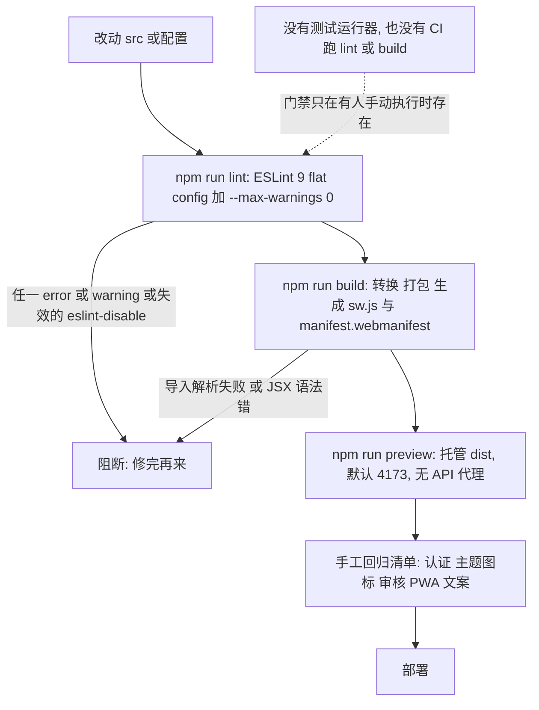

# 验证与质量门禁（无测试框架）

这个仓库的验证能力比它看起来窄得多。`AGENTS.md` 里那句 "No test runner is configured"（`AGENTS.md` 的 Commands 段）不是省略，而是全部事实：`package.json` 只有 `dev`、`build`、`lint`、`preview`、`generate-icons` 五个脚本，没有 `test`；源码树里没有 `*.test.*` / `*.spec.*`，也没有 `playwright.config.*`；唯一的 GitHub Actions 工作流只刷新 OpenWiki 文档，**不跑 lint、不跑 build、不跑任何测试**。

于是"验证"在本项目里只有三件可以自动执行的事（lint、build、preview 冒烟），加上一份必须靠人记住的手工回归清单。本页讲清每层的**能力边界**——尤其是那些"跑通了也不代表没坏"的部分——并按不变量给出可勾选的回归项。构建/部署面本身（`__APP_VERSION__`、CSP、nginx 拓扑、manifest）见[构建、配置与部署](../operations/build-and-release.md)，拦截器语义见[HTTP 层、CSRF 与双 Token 刷新](../architecture/http-and-session.md)；本页不重复它们，只说明"怎么证明它没坏"。

## 阶梯总览



上图是本仓库的全部验证路径：两道可自动化的静态门禁、一次产物冒烟、一份人工清单；虚线标出真正的薄弱点——没有任何机制强制前两道被执行。

| 阶梯 | 命令 | 能证明 | 不能证明 |
|---|---|---|---|
| 静态 | `npm run lint` | 语法/未定义标识符/未使用变量/hook 依赖与 React Compiler 类问题、失效的 disable 注释 | 运行时行为、CSP、缓存、会话 |
| 编译 | `npm run build` | 所有 `import` 可解析、JSX 可转换、产物体积与哈希资源齐全 | 类型正确性（无 TypeScript）、行为正确性、依赖白名单是否漂移 |
| 冒烟 | `npm run preview` | `dist/` 能起、SPA 回退可用、manifest 与 SW 注册、CSP 是否拦截首屏资源 | 任何需要后端的数据流（preview 不代理 `/api`、`/uploads`） |
| 人工 | 本页清单 | 认证/刷新、主题图标覆盖、审核流转、PWA 缓存等行为不变量 | 只能靠执行者诚实与记忆，无留痕 |

## 现状：门禁为什么"看起来存在"

- **没有 git hook、没有 lint-staged、没有 husky**（`.git/hooks` 只有 `.sample` 文件）。`npm run lint` 只在有人敲它时发生。
- **CI 不是质量门禁。** 唯一的 `.github/workflows/openwiki-update.yml` 由 `schedule`（每天 08:00 UTC）与 `workflow_dispatch` 触发，步骤是安装 OpenWiki、`openwiki code --update --print`、删 `openwiki/.run.json`、用 `peter-evans/create-pull-request` 提交 `openwiki`、`AGENTS.md`、工作流自身（及存在时的 `CLAUDE.md`）。它既不 `npm ci`，也不 `npm run lint` / `npm run build`，所以**一个 lint 失败的分支可以合并**，只有本地执行过的人才拦得住。
- **没有类型层。** 没有 TypeScript、没有 `tsconfig.json`/`jsconfig.json`；`devDependencies` 里的 `@types/react`、`@types/react-dom` 只服务编辑器补全，不参与任何命令行检查。`react/prop-types` 在 ESLint 配置里被显式关掉，所以 props 也没有运行时或静态校验。
- **`playwright` 是空转依赖。** 见文末[playwright 的现状与风险](#playwright-的现状与风险)。

结论：**改动的安全性取决于你是否手动跑了两条命令 + 按清单核对**。本页的价值就是把"要核对什么"固定下来。

## 阶梯 1：`npm run lint` 的真实语义

### 命令与文件范围

```bash
eslint . --ext js,jsx --report-unused-disable-directives --max-warnings 0
```

- `eslint.config.js` 是 **ESLint 9 flat config**（`export default [...]`），规则只挂在一个配置对象上：`files: ['**/*.{js,jsx}']`。
- 忽略名单只有三条：`ignores: ['dist', 'dev-dist', 'node_modules']`。`dist/` 与 `dev-dist` 都是构建产物（后者只在把 `devOptions.enabled` 改成 `true` 时出现），`node_modules` 本来默认就忽略。
- **`--ext js,jsx` 在 flat config 下不是"文件范围限制"。** ESLint 9 会把 `--ext` 翻译成一条额外的 `{ files: ['**/*.js', '**/*.jsx'] }` 配置，效果等同于"把这些扩展名也纳入遍历"，而不是"只检查这些扩展名"。真正决定规则是否生效的是配置里的 `files`，决定哪些文件被枚举的还有 ESLint 内置的 `**/*.js`、`**/*.mjs` 默认项。两个直接后果：
  - `generate-icons.mjs` 会被枚举，但 `.mjs` 不匹配配置里的 `files`，所以**它一条规则都没跑**；
  - `public/altcha.js`（约 174 KB 的 vendored Altcha）与 `public/workers/*.js`（hash-wasm 产物）匹配 `**/*.js`，**要按项目规则接受同一套 warn-as-error 检查**，而 `public/` 不在忽略名单里。换掉/升级这些第三方文件时，lint 结果可能突然变红。

### `--report-unused-disable-directives`：过期的 disable 注释直接失败

在 flat config 下这个布尔开关被转成 `linterOptions.reportUnusedDisableDirectives: 'error'`——**不是 warn**。仓库里有 4 处 `// eslint-disable-next-line react-hooks/exhaustive-deps`（`Modal.jsx`、`AdminEpisodeTrash.jsx`、`useCategories.js`、`useEpisodes.js`）用于压制 hook 依赖告警。一旦某次改动让对应告警不再触发（例如把 effect 依赖补全），这些注释本身就会变成 lint 错误，必须同批删除。

### `--max-warnings 0`：三条 warn 规则实际是阻断级

`eslint.config.js` 里显式配了两个 warn，`react-hooks/recommended` 又带进来一个 warn；`--max-warnings 0` 让任意一条命中都失败：

| 规则 | 配置 | 触发场景 |
|---|---|---|
| `react-refresh/only-export-components` | `['warn', { allowConstantExport: true }]` | 在组件文件里额外导出非组件值（常量豁免）。这条规则守的是 Fast Refresh 的状态保持：`I18nContext.jsx` 用 `import.meta.hot?.data` 复用同一个 context 对象、只做具名导出，就是在处理这类 HMR 边界 |
| `no-unused-vars` | `['warn', { argsIgnorePattern: '^_', varsIgnorePattern: '^_' }]` | 未使用变量/参数；**只能靠 `_` 前缀豁免**，注释里写"暂时保留"不行 |
| `react-hooks/exhaustive-deps` | 由 `reactHooks.configs.recommended.rules` 带来，级别 `warn` | effect 依赖数组不完整。补依赖经常引出新的无限循环，所以实际做法往往是加 disable 注释——这又与上一条互相制约 |

也就是说：**改一行代码留下一个"提醒级别"的小问题，lint 就红**。这让 lint 成为真门禁，也让"小改"成本变高。

### 错误级规则远不止"未定义变量"

`eslint.config.js` 展开的是 `js.configs.recommended.rules` + `react.configs.recommended.rules` + `reactHooks.configs.recommended.rules`，其中值得记住的几组：

- **`@eslint/js` recommended**：`no-undef`（错误）、`no-empty`、`no-cond-assign` 等基础正确性规则。
- **`eslint-plugin-react` recommended（全部 error）**：`react/jsx-key`（列表缺 key 直接失败）、`react/jsx-no-target-blank`、`react/display-name`、`react/no-unknown-property`、`react/no-danger-with-children`、`react/no-unescaped-entities`（JSX 文本里裸 `>`、`"`、`'`、`}` 都会报错，写中英文案时要注意）。`react/prop-types`、`react/react-in-jsx-scope`、`react/jsx-uses-react` 被显式关掉。
- **`eslint-plugin-react-hooks` 7.x 的 recommended 已经包含 React Compiler 那一组诊断规则**（仓库装的是 `^7.1.1`）：除 `react-hooks/rules-of-hooks`（error）与 `exhaustive-deps`（warn）外，还有 `set-state-in-effect`、`set-state-in-render`、`refs`、`static-components` 等以 **error** 级别启用的规则。这意味着 lint 实际在问"这段 React 代码是否能让 Compiler 正确推导"——而本仓库大量 `useEffect` 里 `setState` 的写法容易命中 `set-state-in-effect`。**第一次在这个仓库跑 lint 时请先把它当作基线测量**，不要预设它是绿的（没有任何 CI 记录能告诉你当前状态）。

### globals：两个方向都会咬人

```js
globals: { ...globals.browser, ...globals.node, __APP_VERSION__: 'readonly' },
```

- **紧了会误杀**：`__APP_VERSION__` 是 `vite.config.js` 的 `define` 注入的裸全局，不加进这里 `no-undef` 就会失败。**新增任何 `define` 常量都要同步改这一行。**
- **松了会漏检**：把 `globals.node` 一起并进来，等于告诉 ESLint "浏览器代码里 `process`、`Buffer`、`require` 都是合法标识符"。这类错误（在客户端代码里写了 `process.env.XXX`）能通过 lint，只在浏览器里以 `ReferenceError` 崩掉。想收紧就得拆成两段配置（`src/**` 用 browser，根目录脚本用 node）。

### 一个隐藏脆弱点：配置依赖了两个未声明的包

`eslint.config.js` 顶部 `import js from '@eslint/js'` 与 `import globals from 'globals'`，但 `package.json` 的 `devDependencies` 里**既没有 `@eslint/js` 也没有 `globals`**——它们目前只是作为 `eslint` 的传递依赖被提升到 `node_modules/` 顶层才可用（`globals` 当前解析到 14.0.0）。升级 ESLint、换包管理器或改变安装布局（嵌套安装）都可能让配置在加载阶段直接 `ERR_MODULE_NOT_FOUND`。要长期稳定，应把这两个包写进 `dependencies`/`devDependencies`。

## 阶梯 2：`npm run build` 作为编译期门禁

`npm run build` 就是 `vite build`，**不跑 lint**、**不跑 `generate-icons`**。它能挡住的是：

- 无法解析的 `import`（拼错路径、删了文件没改引用、引入未安装的包）——Rollup 直接报错；
- JSX/语法错误、重复导出等转换期错误；
- 极少数配置层面的错误：`defineConfig` 遇到未知顶层键或类型不对的选项会在启动时报 schema 错误。

它挡不住、而且经常被人误以为能挡住的：

- **依赖预打包白名单漂移。** `optimizeDeps.include` + `noDiscovery: true` 只影响 dev 服务器；新依赖没进白名单，`build` 照样成功，问题只在开发期首屏（一次额外整页刷新）暴露。
- **CSP 违规。** `index.html` 的 CSP 是运行时 `meta`，构建不校验。引入新的第三方域名（图片、嵌入播放器、接口）时构建必然成功，只有打开页面才会被拦。
- **`__APP_VERSION__` 静默降级。** 构建环境没有 `.git`（例如只 `COPY src/` 的镜像）时版本号注入成 `'dev'`，页脚会显示 `… · dev`。这是发布后最容易核对的产物事实之一。
- **类型与契约。** 没有 TypeScript，也没有任何 schema 校验；后端返回结构变了，前端只是在渲染时 `undefined` 一片。

### 生产产物里没有 `console`

```js
oxc: { drop: process.env.NODE_ENV === 'production' ? ['console', 'debugger'] : [] }
```

`vite build` 默认把 `NODE_ENV` 设为 `production`，于是 `dist/` 里所有 `console.*` 都被移除。两个验证层面的后果：

1. **不要用"生产包的控制台有没有报错"当验收手段**——`AuthContext`、`AdminReview` 里大量 `console.error(...)` 在生产构建里根本不存在。要看到它们必须用 `npm run dev` 或显式 `NODE_ENV=development vite build`。
2. `App.jsx` 的错误边界用 `import.meta.env.PROD` 决定文案：开发期显示 `error.message`，生产只显示 i18n 的通用一句。所以线上白屏时**页面上拿不到原始错误**，只能靠后端日志或本地复现。

## 阶梯 3：`npm run preview` 冒烟

`vite preview` 只做一件事：把 `dist/` 当静态站点托管（默认 `127.0.0.1:4173`）。`vite.config.js` 只配了 `server.proxy`，**没有 `preview` 段**，所以 preview **不会**把 `/api`、`/uploads` 代理到 `localhost:5000`。这决定了它能干什么：

| 在 preview 里可靠 | 在 preview 里不可靠 |
|---|---|
| 首屏壳渲染、路由与 SPA 回退（可直接刷新 `/episode/1` 这类深链接） | 任何真实数据（列表、详情、站点设置）——API 请求打不到后端 |
| `index.html` 的 CSP 是否拦掉字体/脚本/图标 | 登录、审核、上传等写操作 |
| `link[rel=manifest]` 存在、`manifest.webmanifest` 可访问 | 站点设置驱动的运行时 manifest 覆盖（它依赖 `/api/site-content/…`） |
| Service Worker 注册与离线行为（dev 阶段没有 SW） | 通知 SSE、离线写队列失败重试 |
| 深链接 + 未登录访问 `/admin/*` 的守卫跳转 | — |

**为什么 PWA 必须在 preview 或部署环境验证**：`VitePWA({ devOptions: { enabled: false } })`，dev 服务器既不生成 SW 也不注入 manifest link。任何"改了缓存策略/SW 注册"的改动，在 `npm run dev` 下**不可能**被观察到。

一份五分钟冒烟：

- [ ] `npm run build` 无报错，`dist/` 里有 `index.html`、带 hash 的 `assets/`、`sw.js`、`manifest.webmanifest`。
- [ ] `npm run preview` 打开 `/`，控制台没有 CSP 拒绝记录（字体、图标、脚本都加载成功）。
- [ ] 页脚版本号不是 `dev`（说明构建时有 git 元数据）。
- [ ] 刷新一个深链接（如 `/license`）仍返回应用而不是 404。
- [ ] Application → Service Workers 显示已激活，`navigator.serviceWorker.controller` 非空（第二次访问）。
- [ ] DevTools 切 Offline 后硬刷新，应用壳仍能起来。

## 手工回归清单：改动后最容易被打破的不变量

以下每一项都是"代码里真实存在、且被某个改动轻易破坏、且没有自动检查兜底"的行为。按你改动的区域勾选，不要全跑。

### A. 认证、CSRF 与 419/401 刷新

前置：本地 `localhost:5000` 后端在跑，`npm run dev`；准备一个普通用户与一个管理员。

- [ ] **CSRF 只在非 GET 上附加，且初始化失败也会放行。** 非 GET 请求带 `X-XSRF-TOKEN`；如果启动时 `/api/csrf-token` 失败，写请求会**无头发出**并以 403 结束。验证：在 DevTools 里删掉后端的 CSRF cookie 后立刻保存一次个人资料 → 期望 403；再切走标签页并切回（`visibilitychange` 会重新 `fetchCsrfToken()`）→ 同样的操作应成功。
- [ ] **普通写请求没有"403 重取 CSRF 再重试"的自动补救。** 这条补救只存在于 `refreshAccessToken()` 内部（刷新请求 403 → 重取 token → 再刷新一次）。不要把"刷新端点能自愈"误当成"所有写请求都能自愈"。
- [ ] **419 → 刷新 → 重试只发生一次。** 让 access cookie 过期（等待或用后端工具缩短有效期）后点一次会发多个请求的页面：期望只出现**一个** `POST /api/auth/refresh`，其余请求挂起等待后各自重试一次；`_isRetry` 保证不会无限重试。
- [ ] **并发刷新 409 视为成功。** 两个标签页同时过期时，后到者收到 409 应当被当成"cookie 已被另一标签页换新"而直接重试原请求，**不登出**。
- [ ] **刷新成功后 `localStorage.user` 会被合并。** `auth:token-refreshed` 广播里带 `role`、`email`、`isEmailVerified`、`forceEmailChange`（以及 `_id`/`accountId`/`username`）。测试方法：在另一个标签页用管理员改掉当前用户角色，再触发一次刷新，界面权限应跟着变，无需重新登录。
- [ ] **刷新失败则统一登出且只跳一次。** `localStorage.user` 被清、`auth:session-expired` 派发一次（1 秒窗口内的并发 401 不重复派发、不重复跳转）；`/login`、`/register`、`/reset-password` 上不会自我重定向；带 `skipRedirect` 的请求（`/api/auth/me`、会话心跳、刷新本身）不会跳转。
- [ ] **`forceEmailChange` 的 403 会更新用户快照。** 超管未改邮箱时后端拦截写操作 → 前端写入 `forceEmailChange: true` 并广播 `auth:force-email-change`，全局拦截层出现（见[路由分区与访问守卫](../architecture/routing-and-guards.md)）。
- [ ] **会话心跳只在前台跳。** 登录后每 5 分钟 `POST /api/user-sessions/heartbeat`，但 `document.visibilityState === 'hidden'` 时跳过。把标签页挂后台十几分钟再回来，期望先看到 `/api/auth/me` 与 `/api/csrf-token` 各一次（`visibilitychange` 处理器），会话若已过期则按上面的登出路径走。
- [ ] **绕过 axios 的通道没有拦截器。** 通知的 `EventSource`、任何手写 `fetch` 都不会自动带 CSRF、也不会触发刷新。改动这类代码时必须自己处理（背景见[通知与实时推送](../systems/notifications.md)）。

### B. 主题与图标覆盖

- [ ] **`localStorage.theme` 的取值域是 `light` / `dark` / `system`。** 非法值（含 `null`）回退到"跟随系统"，同时监听 `prefers-color-scheme` 变化：改系统外观，页面应即时切换而无需刷新。
- [ ] **`data-theme` 落在 `document.documentElement` 上**，并且每次主题变更会把整套 CSS 变量重写到根元素；只改 `data-theme` 不会自动改变量。新增 token 必须在暗/亮两套里同时定义（见[主题与图标](../systems/theming-and-icons.md)）。
- [ ] **`localStorage.accent_color` 必须匹配 `^#[0-9a-fA-F]{6}$`。** 非法值被忽略并回到 `#6366f1`；`setAccentColor` 对非法输入直接 return（不写入、不更新）。
- [ ] **所有服务端 SVG 必经 `sanitizeSvg` 才能内联。** 它要求内容以 `<svg` 开头，剥掉 `<?xml?>`/`<!DOCTYPE>`、`script`/`foreignObject`/`iframe`/`object`/`embed`/`link`、`on*` 事件属性与 `javascript:` 链接，并把显式 `fill`/`stroke` 颜色改成 `currentColor`。验证：上传一个内嵌 `<script>` 的 SVG → 图标仍能显示但脚本不执行；再切暗/亮主题 → 图标颜色跟随文字色。**任何绕过 `sanitizeSvg` 直接 `dangerouslySetInnerHTML` 的新路径都是安全回归。**
- [ ] **`misc.logo` 不受主题覆盖影响。** 主题图标合并在遍历时会跳过 `THEME_PROTECTED_ICON_KEYS`（只有 `misc.logo`）；新增"站点身份类"资产要同步加进这个名单，否则主题作者可以替换站点 Logo。
- [ ] **新图标 key 必须登记在 `ICON_COMPONENT_KEYS`。** 后台"图标映射"下拉与主题编辑器都从这个注册表取选项；组件侧用 `<Icon name="…" fallback="…" />` 消费。忘了登记的表现是"图标已上传但哪儿都选不到"。
- [ ] **失败要降级成 fallback，而不是空块。** `Icon` 在无映射、SVG 拉取失败或清洗返回 `null` 时渲染 `fallback`（通常是 emoji）；单个图标拉取失败被静默忽略，不影响其他图标。
- [ ] **应用/取消主题后图标会刷新。** 依赖 `THEME_SELECTION_CHANGED_EVENT`（`theme-selection-changed`）事件；新增的"应用主题"入口若忘记广播，图标会停留在旧覆盖，直到整页刷新。

### C. 审核流转与可见性

前置：一个 `admin`/`superadmin` 与一个 `creator` 账号。

- [ ] **角色闸门在前端只是体验层。** `AdminReview` 只在 `admin.role` 为 `admin` 或 `superadmin` 时拉数据，其他角色 `navigate('/admin/dashboard', { replace: true })`。真正的权限判定在后端——前端通过不代表接口放行；验证时用 creator 账号直接访问 `/admin/review`，期望被弹回仪表盘。
- [ ] **驳回必须填理由。** 前端在 `note` 为空时直接报错、不发请求；后端是否同样强制需在另一个仓库核对。改文案/改校验时两边都要看。
- [ ] **通过/驳回后两个列表都要重取。** 处理函数同时刷新 `pending` 与 `all`；只刷新一个会出现"待审核里消失、全部列表里状态没变"的不一致。
- [ ] **审核对照表的字段表是显式的。** `PENDING_DIFF_FIELDS` 列了 16 个字段（标题、简介、封面、集数、状态、分类、标签、更新日、首播、`hideCreator`、`customAuthors`、QQ 群等）。**新增可编辑字段而不同步这张表，审核人就会"盲审"**——改动被批准但从未被看见。这是审核流程里最容易被破坏、也最难被发现的不变量。
- [ ] **前台可见性只能在真实数据上验。** 审核通过后，用无痕窗口以游客身份刷新首页与 `/episode/:id`，期望内容出现；驳回后期望消失，且创作者侧能看到驳回理由（状态徽章见 `ReviewStatusBadge`）。前端不做可见性过滤，全部依赖后端返回值。
- [ ] **仪表盘徽章不是实时的。** `/api/admin/pending-counts` 只在进入仪表盘时取一次，且失败被 `.catch(() => {})` 吞掉——**"0"既可能是真的没有待办，也可能是请求失败**。验证待办数字时请刷新仪表盘，并确认网络面板里该请求是 200。

### D. PWA 缓存与更新

必须在 `npm run preview` 或真实部署上做（dev 没有 SW）。

- [ ] **预缓存只覆盖 `**/*.{js,css,html,ico,png,svg,woff2}`。** 新增其他扩展名的静态资源（如 `.webp`、`.woff`、`.json`）不会进预缓存，离线不可用。
- [ ] **运行时缓存只有两组分组。** `/api/(episodes|series|categories|banners|friend-links|site-content)` 走 `NetworkFirst`（10 秒超时、100 条、1 小时）；`/uploads/` 走 `CacheFirst`（200 条、30 天）。**新增一个需要离线兜底的接口分组却不改 `urlPattern`，它永远不会被缓存**——这是最容易漏的一处。
- [ ] **`CacheFirst` 的 `/uploads/` 有一个真实陷阱：同名路径换图看不到新图。** 上传覆盖同一个 `/uploads/xxx.png` 后，老用户会继续看到旧图直到缓存过期或 SW 版本更新。验证：替换一张封面 → 已访问过的浏览器刷新 → 若仍是旧图，说明这是缓存行为而非上传失败。
- [ ] **`registerType: 'autoUpdate'`，没有"有新版本"的提示。** 部署后不必等用户点按钮，但也不会主动弹出刷新：验证方式是部署新构建后重新加载页面，检查页脚 `__APP_VERSION__` 变新、DevTools 里 SW 状态为 activated and running。
- [ ] **运行时 manifest 会覆盖构建期 manifest。** 站点设置加载成功后，`link[rel=manifest]` 的 `href` 被改指 `/api/site-content/pwa-manifest`；后端不可用时保持构建期那一套。验证安装性时先确认后端在跑，否则你测的是构建期 manifest。
- [ ] **离线写只有评分走队列。** 队列键 `offline_queue`，24 小时过期、同请求去重、单条最多重试 3 次后丢弃，仅在浏览器 `online` 事件时由 `processOfflineQueue` 重放（没有"回前台就重放"的路径）。其他离线写操作（收藏、评论等）不会排队——别在验收里替它们假设离线可用。

### E. 文案与语言（静默失败）

- [ ] **缺失的 key 不会报错。** `t()` 先查当前语言，查不到回退 `zh`，再查不到就返回 key 字符串本身。所以"英文漏翻"表现为**静默显示中文**。验证：切到 English，在关键页面上找残留中文；新增文案必须同时进 `src/locales/zh.js` 与 `src/locales/en.js`。
- [ ] **切换语言会整页重载。** `switchLang` 写 `localStorage.lang` 后 `window.location.reload()`，为的是让 `index.html` 的早期内联脚本在 React 挂载前设好 `<html lang>`。如果改成"不刷新切换"，浏览器翻译/拼写检查会拿错语言——改这里需要重新评估整条链路（见[启动链与全局 Provider 树](../architecture/boot-and-providers.md)）。
- [ ] **`{param}` 插值缺参不会崩。** 缺失的参数原样保留成 `{name}`。看到界面上出现花括号，就是调用处少了参数。

## playwright 的现状与风险

事实清单：

- `playwright: ^1.61.1` 在 `package.json` 的 **`devDependencies`** 里，`package-lock.json` 也锁了对应版本与 `playwright-core`。
- **源码、脚本、CI 全都没有引用它**：`src/` 下没有 `playwright` 的 import，`package.json` 没有相关脚本，`openwiki-update.yml` 不装浏览器也不跑测试；仓库根没有 `playwright.config.*`，也没有任何 `*.test.*` / `*.spec.*` 文件。
- 因此它现在**纯粹是安装体积与 lockfile 噪音**，并且是一个危险的信号：新人看到依赖里有 playwright 会合理地以为存在端到端测试，从而跳过手工回归。

风险与对策：

- 想真正用它，需要补齐三件事——配置文件、测试目录与脚本（例如 `playwright.config.js` + `e2e/` + `"test:e2e": "playwright test"`），并且要显式 `npx playwright install` 下载浏览器（`playwright` 包本身不再在安装时自动下载）。这些都**尚未存在**，不要凭空执行。
- 更便宜的第一步是把已有的两道静态门禁搬进 CI：新建一个工作流（或在现有工作流里加 job），跑 `npm ci` + `npm run lint` + `npm run build`。注意现有 `openwiki-update.yml` 的 `add-paths` 只提交 `openwiki`、`AGENTS.md`、工作流自身与 `CLAUDE.md`，**它不是、也不该被当成质量门禁**；质量检查要独立触发（`pull_request` / `push`）。
- 如果只想补一点点行为覆盖，优先级建议按本页清单的失败代价排序：**419/401 刷新**（会把人踢下线）> **审核对照表字段**（会导致盲审）> **SVG 清洗**（安全）> **PWA 缓存**（用户看到旧数据）。

## 相关页面

- [快速上手与任务路由](../quickstart.md)——先起后端再谈验证。
- [构建、配置与部署](../operations/build-and-release.md)——`__APP_VERSION__`、`oxc.drop`、CSP、nginx 拓扑与发布检查表。
- [HTTP 层、CSRF 与双 Token 刷新](../architecture/http-and-session.md)——清单 A 的机制来源。
- [主题与图标](../systems/theming-and-icons.md)——清单 B 的优先级与 `sanitizeSvg` 细节。
- [PWA 与离线兼容](../systems/pwa-offline-and-compat.md)——清单 D 的缓存策略全貌。
- [剧集创作、审核与版本流转](../workflows/episode-publishing-and-review.md)——清单 C 的状态机与前后台数据源差异。
- [后端契约地图](../integrations/backend-api-map.md)——接口改动后的冒烟范围。
