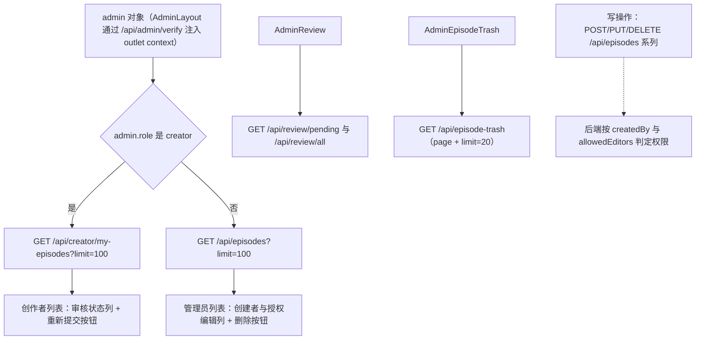
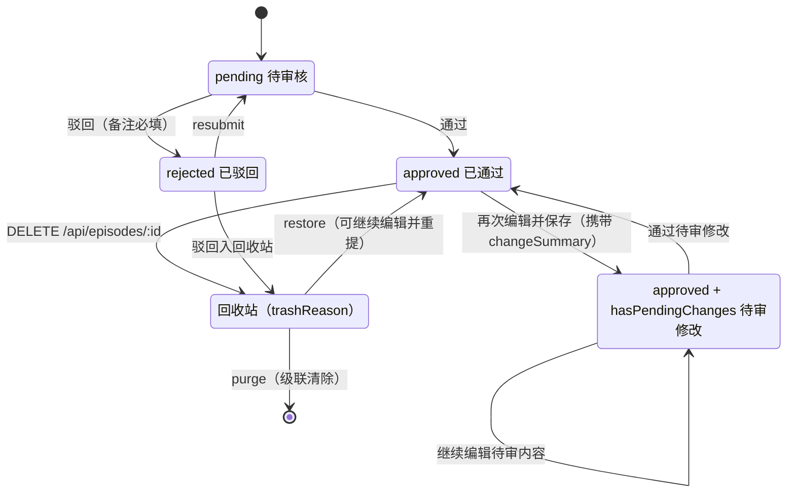
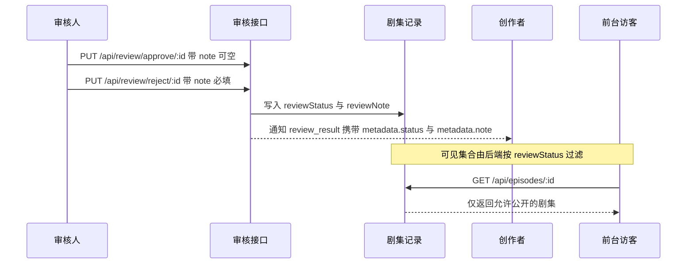

# 剧集创作、审核与版本流转

这条链路横跨后台三个页面（`AdminEpisodes`、`AdminReview`、`AdminEpisodeTrash`）和一个挂载在剧集页上的弹窗组件（`EpisodeVersionHistory`）。前端在这条链路上只做三件事：发请求、展示分档、按钮可见性裁剪。**审核态的真值、谁能改哪条剧集、驳回是否真的把剧集移出列表，全部由后端决定**；前端从不发送 `reviewStatus`，唯一的审核态写入口是 `/api/review/*` 与 `POST /api/episodes/:id/resubmit`。

## 参与页面与角色

| 页面 / 组件 | 路由 | 前端角色门 | 主要接口 |
| --- | --- | --- | --- |
| `AdminEpisodes` | `/admin/episodes` | 仅 `AdminGuard`（四角色都进） | `/api/episodes`、`/api/creator/my-episodes`、`/api/episodes/single/:id`、`/api/episodes/:id/resubmit`、`/api/episodes/upload` |
| `AdminReview` | `/admin/review` | 组件内要求 `admin` / `superadmin`，否则 `navigate('/admin/dashboard', { replace: true })` | `/api/review/pending`、`/api/review/all`、`/api/review/approve/:id`、`/api/review/reject/:id`、`/api/review/assign-editor/:id`、`/api/review/remove-editor/:id` |
| `AdminEpisodeTrash` | `/admin/episode-trash` | **无**（入口卡片只对 admin/superadmin 渲染，页面本身不判角色） | `/api/episode-trash`、`/api/episode-trash/:id/versions`、`/api/episode-trash/:id/restore` |
| `EpisodeVersionHistory` | 无独立路由（`AdminEpisodes` 内的 Modal） | 继承父页 | `/api/versions/:episodeId`、`/api/versions/:episodeId/diff/:v1/:v2`、`/api/versions/:episodeId/rollback/:version` |

页面的角色约定与后台整体结构见[后台管理控制台](../systems/admin-console.md)；字段语义（`reviewStatus`、`pendingChanges`、`hasPendingChanges`、`changeSummary`）见[领域模型](../concepts/domain-model.md)。创作者档案的审核（`/admin/creator-profile(s)`）是与剧集审核同构但**独立**的另一条链路，不在本文范围。

## 数据源分叉：my-episodes 与 /api/episodes

`AdminEpisodes` 是后台唯一按角色切换读数据源的页面，写路径却完全不分裂：

图示：同一页面按角色分叉读源，写入口始终是同一组 `/api/episodes` 端点。

由此得出两条必须同时满足的改动约束：

1. **改读路径要看两处**。creator 走 `/api/creator/my-episodes`（返回自己的剧集，含 `reviewStatus`、`reviewNote`、`hasPendingChanges`、`pendingChanges`），其他角色走 `/api/episodes`（返回公开列表结构 `episodes[]`）。两处响应形状在页面里被同一个兼容表达式吃掉（`Array.isArray(data) ? data : (data.episodes || data.list || [])`），所以后端改动某一侧的包装字段时页面不会报错，只会静默变空。
2. **改写路径只需改一处，但要知道权限在后端**。新建、编辑、删除都不按角色分支，创建者/授权编辑的判定完全依赖后端；前端只用按钮可见性表达"创作者不能删"。

`AdminEpisodes` 用 `limit=100` 一次拉全量且**没有分页**（搜索框只是在本地 `episodes` 数组上过滤）。剧集数超过 100 后，列表与搜索都会静默缺失后排数据。后台唯一分页的剧集相关页面是回收站（每页 20 条，`total` / `totalPages` 来自响应）。

## 审核态的状态机

前端不存在 `draft` 态：新建剧集时表单不提交 `reviewStatus`，初始值由后端赋给；`ReviewStatusBadge` 也只认识三个值。真正的状态轴有三条：`reviewStatus`（审核）、`hasPendingChanges`（待审修改）、`trashReason`（是否在回收站）。

图示：审核态、待审修改与回收站三条轴的合流；`Trash --> [*]` 是唯一不可逆的边。

几处边界值得单独记住：

- **`approved → PendingChanges` 不是状态回退**。已通过剧集被编辑时，后端把改动放进 `pendingChanges` 并置 `hasPendingChanges`，原审核内容继续对外展示，`reviewStatus` 仍是 `approved`。
- **前端把"待审修改"当作可审核对象**：`AdminReview` 的"所有剧集"页签在 `reviewStatus === 'pending' || hasPendingChanges` 时显示通过/拒绝按钮，也就是说审核按钮的可见条件不等于 `reviewStatus === 'pending'`。
- **`rejected → Trash` 这条边是后端行为**。回收站页面的注释与 `trashReason` 的取值（`rejected` / `deleted`）说明驳回的剧集会进回收站；前端没有任何代码参与这次迁移。

## 创作：AdminEpisodes 的写入面

### 新建剧集

提交前在客户端做四项校验：封面（`coverImage`）、标题、描述、总集数（勾选"未知集数"时跳过并提交 `totalEpisodes: null`）。请求体只包含内容字段：`category`（数组，来自 `/api/categories` 的 `name` 列表多选）、`tags`、`updateDay`、`premiereDate`（**仅 `status === 'upcoming'` 且未勾"不设首播"时** 才转 `toISOString()`，否则恒为 `null`）、`hideCreator`、`customAuthors`（创作者 `_id` 数组，候选来自 `/api/admin/creators`）、QQ 群两个字段。

创建成功后页面不复位回列表，而是**连锁进入下一步**：用响应体回填编辑表单、打开编辑 Modal、拉取该剧集的单集列表并展开单集表单，单集号默认 `1`、标题默认取 `adminEpisodes.episodePrefix` 插值。这是"建剧集 → 补单集"的引导路径，改动创建流程时要保留这条接力。

### 编辑已通过剧集：changeSummary 与待审修改回填

`changeSummary` 输入框只在 `isEdit && editingEpisode?.reviewStatus === 'approved'` 时渲染，随 `PUT /api/episodes/:id` 的请求体提交（空则传 `''`）。它是给审核人看的版本说明：`AdminReview` 的待审修改面板把它当作 `pendingChangeSummary` 展示。

编辑一条带待审修改的剧集时，表单**优先加载 `pendingChanges` 而不是正文**（逐字段 `pick(field, fallback)`），`changeSummary` 初值取 `pendingChangeSummary`，并在表单顶部显示黄条提示"正在编辑已提交的待审核修改"。这条约定保证已上线内容不被未审核的草稿覆盖；破坏它会让首页立刻显示尚未审核的文案。

### 单集维护

单集 CRUD 全部内联在 `AdminEpisodes` 里，不走共享 hook：新增 `POST /api/episodes/:id/episodes`、编辑 `PUT /api/episodes/single/:id`、删除 `DELETE /api/episodes/single/:id`（删除前 `window.confirm`）。每次写入后同时刷新单集列表与剧集列表，因为单集操作会改变剧集级计数。

单集提交有一个必须保持的互斥关系：

- 勾选"预告"（`isScheduled: true`）时 `releaseDate` 一律置 `null`，`scheduledDate` 在勾选"不设预告日期"时也置 `null`；
- 未勾选预告时 `scheduledDate` 置 `null`，`releaseDate` 取表单值（空则 `null`）。

`releaseDate` 输入框只在剧集 `status` 为 `ongoing` / `completed` 且未勾预告时出现，所以 `upcoming` 剧集永远只能提交预告时间。后台**没有**"一键把预告集转正"的按钮——那个动作只存在于未被挂载的 `SingleEpisodeManager` 里（见文末薄弱点）；实际转正要手工关掉预告并填发布日期，其余连锁（`currentEpisodes` 加一、追番通知）由后端在 `PUT /single/:id` 中根据 `isUpcoming` 的翻转推断。

### 封面与图片

封面既能填 URL 也能上传：`ImageUploader` 之外还保留一条原生 `<input type="file">` 兜底，客户端校验 5MB 上限与 `image/jpeg|png|gif|webp` 白名单，通过 `POST /api/episodes/upload`（`FormData` + `X-Requested-With`）换回 URL 写入 `coverImage`。上传通道的约定见[媒体上传](../systems/media-upload.md)。

## 审核：AdminReview 的三个页签

页面启动时并行拉三份数据：待审队列 `/api/review/pending`、全量 `/api/review/all`、创作者候选 `/api/admin/creators`。三者都容忍 `{ list }` 与裸数组两种形状。页签对应三种工作模式：

- **待审核**：表格每行带一个备注输入框与通过/拒绝按钮；标题可点开详情 Modal。
- **所有剧集**：展示审核态、备注、授权编辑人，并对 `pending` 或 `hasPendingChanges` 的条目提供通过/拒绝。
- **权限分配**：选择剧集 + 创作者后 `PUT /api/review/assign-editor/:episodeId`（body `{ editorId }`）。移除走 `PUT /api/review/remove-editor/:episodeId`（body 同样是 `{ editorId }`），从"所有剧集"页签里每个授权编辑人徽章的 `×` 触发。

### 通过 / 驳回

图示：一次审核动作同时改变审核态、给创作者下发通知，并间接决定前台可见性。

关键约定：

- **两个端点共用同一个 `note` 字段**，通过时不校验、驳回时前端先拦（`rejectReasonRequired`，只要 `note.trim()` 为空直接报错、不发请求）。因此驳回理由是"前端必填 + 后端落库"的双保险，改字段名要同步三处：`AdminReview` 的入参、`reviewNote` 的展示，以及通知面板对 `metadata.note` 的拼装。
- **`reviewNote` 是页面级单一状态，不是每行独立**。待审核表格里每一行都渲染同一个受控输入框，绑定同一个 `reviewNote`；在任何一行输入的备注，会被之后点击的任意一行按钮使用。成功路径清空 `reviewNote`，失败路径只设置 `error`（成功后不清理 `error`，旧错误会残留到下一次失败）。
- **"所有剧集"页签没有备注输入框**。该页签的拒绝按钮同样要求 `reviewNote.trim()` 非空，所以除非先在"待审核"页签里输入过备注（同一组件状态，切页签不清空），在这个页签点"拒绝"只会得到错误提示。这是当前实现里最容易踩空的一条路径。
- 审核动作后页面会同时刷新待审队列与全量列表；但 `handleAssignEditor` 只刷新全量列表，`handleRemoveEditor` 也是。

### 待审修改对照

详情 Modal 在 `hasPendingChanges && pendingChanges` 时渲染一块黄色对照区：先显示 `pendingChangeSummary`（缺省显示 `noChangeSummary`），再用固定字段表 `PENDING_DIFF_FIELDS` 列出"当前值 → 修改后值"。字段表覆盖 `title`、`titleEn`、`description`、`descriptionEn`、`coverImage`、`totalEpisodes`、`currentEpisodes`、`status`、`category`、`tags`、`updateDay`、`premiereDate`、`hideCreator`、`customAuthors`、`qqGroupLink`、`qqGroupNumber`，且只渲染 `pendingChanges` 里确实存在的键。

由此产生一条维护规则：**后端新增可进入待审修改的字段时，必须同时把它加入 `PENDING_DIFF_FIELDS` 与 `renderPendingValue`**，否则审核人看到的是一个"有改动但对照表为空"的面板。`renderPendingValue` 对每个特殊类型单独处理（封面渲染缩略图、`hideCreator` 转是否、`status` 转三态文案、`category`/`tags` 用顿号连接、`totalEpisodes === null` 显示"未知集数"、`customAuthors` 只显示数量、`premiereDate` 按 locale 格式化）。

## 审核动作的三个外溢后果

改动审核逻辑前，必须先确认这三条都仍然成立：

1. **通知**。审核结果以 `review_result` 类型下发，通知面板用 `metadata.status === 'approved'` 区分通过与驳回，并把 `metadata.note` 拼进驳回文案。也就是说驳回理由最终会被用户看见，措辞与字段名都不能随意改；通知类型的完整清单见[通知系统](../systems/notifications.md)。
2. **前台可见性**。公开页面不渲染 `ReviewStatusBadge`，也不做列表级过滤——用户能看到的剧集就是接口返回的剧集。前端唯一的兜底是详情页在 `episode.reviewStatus && episode.reviewStatus !== 'approved'` 时动态插入 `noindex, nofollow` 的 robots meta 并在卸载时移除（对应后端的 `X-Robots-Tag`）。缺字段即视为可收录，这与审核列表的 `reviewStatus || 'pending'` 默认值不一致；可见性口径的完整说明见[内容目录与展示](../systems/content-catalog.md)。
3. **版本**。`changeSummary` 会随编辑写入剧集版本历史，版本弹窗据此展示"谁在第几版改了什么"。

## 版本历史与回滚

`EpisodeVersionHistory` 是一个自管开关的 Modal，由 `AdminEpisodes` 每行的"版本历史"按钮挂载：

- 列表 `GET /api/versions/:episodeId`，读 `data.versions`；行内展示 `V{version}`、`createdAt`、`changedBy.username || changedBy.accountId`、`changeSummary`。
- 点行展开该版本的 `data` 全字段（键值网格），再点收起。
- 对比模式：依次选中两版，前端**按版本号升序**决定 `v1`/`v2` 后请求 `GET /api/versions/:episodeId/diff/:v1/:v2`，把响应当数组渲染成"字段 / 旧值 / 新值"表格；选中第三版会重置配对。
- 回滚：`POST /api/versions/:episodeId/rollback/:version`，确认文案明确"当前数据将被覆盖"，成功后 `alert` 并**只重拉版本列表**。
- 关闭采用先播退出动画再通知父组件卸载的写法（`setShow(false)` + `setTimeout(onClose, 300)`），父组件直接卸载会让动画失效。

一个容易忽略的后果：**回滚不会刷新 `AdminEpisodes` 的剧集列表**。弹窗关闭后外层仍是回滚前的行数据，需要重新进入页面或触发一次列表拉取才能看到新值。

## 回收站：恢复与彻底删除

`AdminEpisodeTrash` 承接两类进入原因：`deleted`（删除）与 `rejected`（审核拒绝），用 `trashReason` 分色分档展示，并附带 `trashNote`、`trashBy.username`、`trashAt`。列表按 `page` / `limit=20` 分页。

三个动作各自对应一个端点：

| 动作 | 端点 | 前端保护 | 语义 |
| --- | --- | --- | --- |
| 内容日志 | `GET /api/episode-trash/:id/versions` | 无 | 只读版本快照表（版本号 / 变更摘要 / 操作人 / 时间），**没有 diff、没有回滚** |
| 恢复 | `PUT /api/episode-trash/:id/restore` | `ConfirmModal`（primary） | 回到正式集合，创作者可继续编辑并重新提交审核 |
| 彻底删除 | `DELETE /api/episode-trash/:id` | `ConfirmModal`（danger） | 级联清除单集、版本、追番、收藏、历史、评分等全部关联数据，不可恢复 |

"内容日志"是给恢复后回退内容用的依据（页面文案如此约定），但它是只读的：真正能回滚版本的入口只有 `AdminEpisodes` 里的 `EpisodeVersionHistory`。两个入口读的是不同端点，改动版本快照结构时要同时检查 `GET /api/versions/:id` 与 `GET /api/episode-trash/:id/versions` 两条通道。

## 驳回后重提（resubmit）

只有 creator 角色、且 `episode.reviewStatus === 'rejected'` 时，`AdminEpisodes` 行内才出现"重新提交审核"，调用 `POST /api/episodes/:id/resubmit`。失败时把后端 `message` 或 `resubmitFailed` 写进页面级 `error`。

这里存在一条前端无法自证的前提：**重提按钮只有在剧集仍出现在 `/api/creator/my-episodes` 结果中时才可能被看到**。而回收站又把 `rejected` 列为进入原因之一。因此"驳回是否同时把剧集移出创作者列表"完全由后端决定——若移出，创作者在 `AdminEpisodes` 里就看不到这条剧集，只能由管理员在回收站恢复后再让他重提（恢复确认文案也确实是这么描述的）。改动审核或回收站任一侧时，务必用真实数据确认这条衔接。

## 自动状态任务

`AdminDashboard` 上有唯一的写操作面板，仅 `superadmin` 可见，两个按钮分别 `POST /api/auto-status/auto-complete`（自动标记已完结）与 `POST /api/auto-status/check-premieres`（发布到期预告）。响应里的 `message` 直接显示在面板下方，`clearStatusMsg` 会在 3 秒后清空；失败统一显示 `adminDashboard.operationFailed`。

前端只知道这两个端点的按钮文案与返回消息，**判定规则（哪些 `ongoing` 该转 `completed`、哪些 `upcoming` 到点该转 `ongoing`）完全在服务端执行**，前端也没有任何轮询或定时触发——不点按钮就不会跑。待办角标来自另一条接口 `GET /api/admin/pending-counts`（`episodes`、`reports`、`feedbacks`、`friendLinks`、`themes`），只在仪表盘挂载时拉一次。

## 变更检查清单

1. **改读源**：确认 `AdminEpisodes`（`/api/creator/my-episodes` 与 `/api/episodes` 两侧）、`AdminReview`（`/api/review/pending` 与 `/api/review/all`）、`AdminEpisodeTrash`（`/api/episode-trash`）四类响应形状都被覆盖；两边都容忍 `{ list }` / 裸数组，改错一侧不会报错只会空白。
2. **改审核态取值**：同步 `ReviewStatusBadge` 的 `statusStyles` / `statusLabelKeys`、`AdminReview` 的 `reviewStatus || 'pending'` 默认值、`EpisodeDetail` 的 noindex 判定、通知面板的 `review_result` 分支。
3. **改驳回备注**：`AdminReview` 的 `note` 入参与必填校验、`reviewNote` 展示、通知 `metadata.note` 三处对齐。
4. **新增审核写操作**：记得刷新待审队列 + 全量列表（现有 `assign-editor` 只刷后者）；同时考虑是否需要清空页面级 `error`。
5. **新增可待审字段**：加入 `PENDING_DIFF_FIELDS` 与 `renderPendingValue`，并确认 `handleEditEpisode` 的 `pick` 回填覆盖它。
6. **改单集字段**：`AdminEpisodes` 的内联实现与 `useEpisodes` hook 是两份互不引用的代码（见下节），任一侧的字段/端点改动都要人工对齐。
7. **改版本快照结构**：同时检查 `/api/versions/*`（列表 / diff / 回滚）与 `/api/episode-trash/:id/versions`（只读列表）两个消费方。

## 已知薄弱点

| 现象 | 位置 | 影响 |
| --- | --- | --- |
| 列表 `limit=100` 且无分页 | `AdminEpisodes` | 超过 100 条剧集时列表与搜索静默缺失 |
| `reviewNote` 为页面级共享状态 | `AdminReview` 待审核表格 | 一行输入的备注会作用于之后点击的任意一行 |
| "所有剧集"页签没有备注输入框 | `AdminReview` | 在该页签点"拒绝"必被 `rejectReasonRequired` 拦下 |
| 成功后不清理 `error` | `AdminReview` 的 `handleApprove` / `handleReject` | 上一次失败的红字会残留 |
| 回滚后不刷新剧集列表 | `EpisodeVersionHistory` → `AdminEpisodes` | 关闭弹窗后行数据仍是回滚前的值 |
| 无 `draft` 态 | 全链路 | 无法保存"未提交审核"的草稿；新建即进入后端决定的初始审核态 |
| 前端不发送 `isUpcoming` | `AdminEpisodes` 单集表单 | 转正全靠后端根据 `isScheduled` 翻转推断，前端无法显式表达 |
| `SingleEpisodeManager` + `useEpisodes` 未被挂载 | `src/components/SingleEpisodeManager.jsx`、`src/hooks/useEpisodes.js` | 单集 CRUD 的"共享实现"是死代码；它固定请求 `/api/episodes`（不按角色分叉），一旦被 creator 复用会读到错误的数据源；且它自带的"一键转正预告集"并未出现在实际使用的编辑器里 |
| 回收站页面无组件内角色判断 | `AdminEpisodeTrash` | 非授权角色可挂载页面并发请求，能否看到数据取决于后端 |

## 相关页面

- 审核态与服务端字段契约：[领域模型](../concepts/domain-model.md)
- 后台页面职责分工、`adminApi` 传输层与角色门：[后台管理控制台](../systems/admin-console.md)
- 公开侧剧集展示与可见性口径：[内容目录与展示](../systems/content-catalog.md)
- 封面与图片上传通道：[媒体上传](../systems/media-upload.md)
- `review_result` 通知与推送：[通知系统](../systems/notifications.md)
- 接口清单与注册表：[后端接口地图](../integrations/backend-api-map.md)
